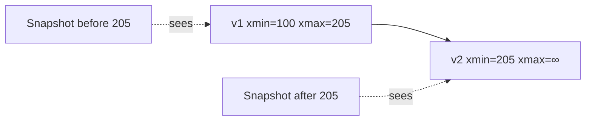
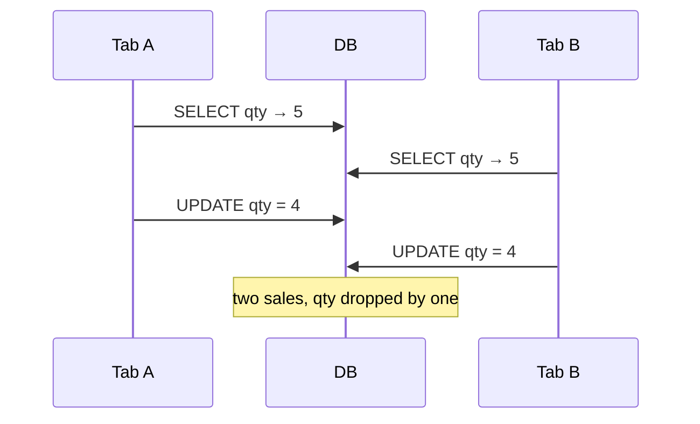
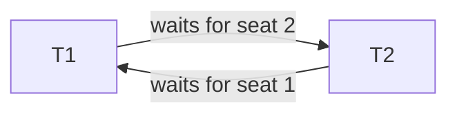

# Concurrency Control

> [!abstract] What this is
> Concurrency control is how thousands of sessions write to the same database without corrupting a row. There are two families: **locks (2PL)** and **versions (MVCC)**. Modern Postgres and InnoDB use MVCC so **readers don't block writers**, but you still lock on **write**, you can still deadlock, and you still lose updates if you read-then-write in the app. The isolation *levels* built on top are in [[04 - Isolation and Anomalies]]; locks you take in the app (`SKIP LOCKED`, Redis, fencing) are in [[14 - Coordination and Concurrency]].

---

## Why It Exists

Two transactions touching the same data at the same time can interleave in ways that neither would produce alone: one overwrites the other, or one reads the other's half-finished work. The engine needs a rule for who waits and who sees what. Knowing the rule tells you which bugs the database prevents for you and which ones you still have to fix yourself.

---

## Lock-Based: Two-Phase Locking (2PL)

2PL splits a transaction's life into two phases. In the **growing phase** it acquires locks and never releases any. In the **shrinking phase** it releases locks and never acquires any. Once it has dropped any lock, it can't take another. That rule is what makes a schedule **conflict-serializable**, which is the textbook guarantee.

A **conflict-serializable** schedule is a timeline of concurrent operations that is guaranteed to produce the same final result as running the transactions one at a time, fully isolated from each other. Concretely, every pair of conflicting operations (two operations on the same item, at least one a write) appears in an order consistent with *some* serial order of the transactions.

What engines actually run is **strict 2PL**: **exclusive** locks are held until **commit or abort**. This stops another transaction from reading your dirty write just before you roll back. The growing/shrinking idea still holds; the shrink simply happens all at once at the end.

### 2PL variations

**1. Basic 2PL.**

- **The rule:** a transaction acquires locks dynamically as needed and may release each one as soon as the operation using it finishes. The only restriction is that once it drops its first lock (entering the shrinking phase), it can never acquire a new one.
- **The flaw (cascading rollbacks):** if transaction A modifies a row and drops the lock early, transaction B can immediately lock and read that modified data. If A then hits an error and rolls back, the data B read never officially existed. The database must abort B (and any other transaction that depended on A's write) to prevent corruption.

**2. Strict 2PL.**

- **The rule:** locks are still acquired dynamically, but every **exclusive** (write) lock is held until the transaction finishes via commit or abort. **Shared** (read) locks can still be dropped early once the shrinking phase begins.
- **The flaw (deadlocks):** because locks are acquired incrementally, statement by statement, transactions frequently block and wait. A locks row 1 and waits for row 2 while B locks row 2 and waits for row 1. Both wait indefinitely until the database's **deadlock detector** steps in and aborts one of them. (Basic 2PL can deadlock the same way; strict 2PL fixes cascading rollbacks, not deadlocks.)

**3. Strong strict 2PL (rigorous 2PL).**

- **The rule:** the transaction holds **all** locks, shared and exclusive, until the very end. Nothing is dropped early.
- **The flaw (throughput):** it rules out these anomalies with the simplest reasoning (transactions serialize in commit order), but it hurts throughput at scale. Holding even a read lock until a long transaction finishes blocks every other transaction from writing that row for the whole duration.

**4. Conservative 2PL.**

- **The rule:** a transaction must declare and acquire every lock it will ever need at the very beginning, before executing a single statement. Because it never waits while holding locks, it **can't deadlock**.
- **The flaw (impractical):** real applications rarely know every row they'll touch upfront, since later queries often depend on what earlier reads returned. Waiting to gather every lock at once also creates a large bottleneck at the start.

### Lock modes

| Mode | Who else can hold it | Use |
|---|---|---|
| **Shared (S)** | Other S | Read |
| **Exclusive (X)** | Nobody | Write |
| **Intention shared (IS)** | | "I will S-lock a row in this table" |
| **Intention exclusive (IX)** | | "I will X-lock a row in this table" |

Intention locks sit on the **table** (or a page) so the engine can decide whether a whole-table lock is safe without inspecting every row. A `LOCK TABLE` in X mode conflicts with a row UPDATE, which holds IX on the table plus X on the row. Without IS/IX, the engine would have to walk every row to check.

**Row-level locks.**

- **Shared (S):** taken when a transaction needs to read a row. Many transactions can hold an S lock on the same row at the same time.
- **Exclusive (X):** taken when a transaction needs to write or modify a row. While it's held, nobody else can hold any other lock on that row until it's released.

**Table-level intention locks.**

- **Intention shared (IS):** a marker placed on the whole table announcing that the transaction will place an S lock on some row inside.
- **Intention exclusive (IX):** a marker placed on the whole table announcing that the transaction will place an X lock on some row inside.
- **The purpose:** intention locks let the engine decide instantly whether a whole-table lock request is safe. Without IS/IX markers, it would have to scan millions of individual rows for conflicts before approving a table-level operation. Intention locks don't conflict with each other (IS and IX coexist fine); they only conflict with table-level S or X locks.

### Granularity

| Granularity | Trade-off | Pick when |
|---|---|---|
| Row | Most concurrency, most lock memory, most deadlock surface | Interview default for OLTP |
| Page | In between | Rarely discussed |
| Table | Simple, lots of blocking | Bulk operations, schema changes |
| Database | Simplest, blocks everything | Almost never |

---

## MVCC

MVCC avoids read locks by keeping versions. A write creates a **new version** of the row (or a new tuple), and a reader sees the version that was **committed before its snapshot**. In Postgres, readers don't take S-locks on the rows they read, so "readers don't block writers, and writers don't block readers." Writers still conflict with other writers on the same row.

### The Postgres picture

Every transaction has an **XID**. Each heap tuple carries `xmin` (the XID that created it) and `xmax` (the XID that deleted it, or the next writer). You see a tuple if its `xmin` committed before your snapshot and its `xmax` is not a delete that committed before you. That visibility rule **is** the isolation level's snapshot; see [[04 - Isolation and Anomalies]].

An `UPDATE` inserts a new tuple and sets `xmax` on the old one. The old versions sit around until **vacuum** removes them, which is where bloat comes from. How that cleanup works, and why long transactions block it, is in [[01 - Storage Engine and Disk IO]].

### The InnoDB picture

InnoDB keeps the current row in the clustered index and older versions in the **undo log**. A reader whose snapshot is older than the current row walks back through the undo records to rebuild the version it's allowed to see. Same idea as Postgres: versions, not S-locks on reads.

| | Postgres | InnoDB |
|---|---|---|
| Where the new version goes | New heap tuple | Updated in place in the clustered row |
| Where old versions live | Old tuples in the heap | Undo log |
| Cleanup | Vacuum | Purge |

> [!tip] The one-liner if they poke internals
> "Postgres uses MVCC so readers don't block writers." You don't draw the clog or the freeze map unless you're talking to a DB team.

---

## Lost Update

This is the concurrency bug you'll actually hit. Two tabs both read `qty = 5`, both compute and write `qty = 4`, and the last commit wins. One sale has vanished. MVCC doesn't save you here, because the read and the write were separate steps in the application.

Pick one fix and say why.

| Fix | How | Pick when |
|---|---|---|
| Atomic SQL | `UPDATE … SET qty = qty - 1 WHERE qty > 0` | Default for counters |
| Optimistic `version` | `UPDATE … WHERE id=? AND version=3`; 0 rows updated → 409 | Profiles, stock, issues |
| `SELECT FOR UPDATE` | Pessimistic row X-lock until commit | Short txn where you must **read, then branch** |

What you must **not** do is `SELECT` in the app, subtract, and `UPDATE` with no predicate. Which tool fits which HLD: [[14 - Coordination and Concurrency]].

**The lost update problem (the last line).** The line above warns against a dangerous pattern: reading a value into application code, doing math on it, and sending an `UPDATE` back without checking whether the data changed in between. If two concurrent requests both read `10`, both subtract 1 in the app, and both write `9`. One operation is completely lost; the true value should be `8`. The table gives three ways to prevent it:

**Fix 1: Atomic SQL.**

- **How it works:** instead of pulling the value into the app, send a single instruction to the database, such as `SET qty = qty - 1`. The database computes the new value from whatever the row holds at that exact moment (the `UPDATE` takes the row lock, so concurrent decrements queue up instead of overwriting each other).
- **When to use it:** the default for simple numeric counters.

**Fix 2: Optimistic versioning.**

- **How it works:** add a `version` column. When you read the row, record its version (e.g. `3`). When you update, require that it's still `3` with `WHERE id = ? AND version = 3`, and bump it to `4` in the same statement. If another process updated the row meanwhile, the version is already `4`, your update matches **0 rows**, and the app can reject the request with **HTTP 409 Conflict** (or re-read and retry).
- **When to use it:** updating richer entities like user profiles, issues, or stock records, where changes must be made carefully and conflicts are rare.

**Fix 3: `SELECT FOR UPDATE`.**

- **How it works:** take an **exclusive (X) row lock** at the moment you read the row. No other transaction can update, delete, or lock that row until you commit. (Under MVCC, plain `SELECT`s from others still read the last committed version; they just can't change it.)
- **When to use it:** short transactions where you must pull the data into the app, make a decision (branch) based on it, and then safely write the result.

---

## Deadlock

A deadlock is two transactions each holding what the other needs. T1 locks seat 1 and waits for seat 2; T2 locks seat 2 and waits for seat 1. That's a cycle in the **wait-for graph**.

The engine periodically builds or walks the wait-for graph. When it finds a cycle it picks a **victim**, usually the cheapest to undo (the youngest, or the one with the least undo), and that transaction fails with `ERROR: deadlock detected` and **rolls back**. The app then **retries** the whole transaction.

Prevention is mostly on you:

| Technique | How | Note |
|---|---|---|
| Sorted lock order | Lock rows in **sorted id order**, so both txns lock seat 1 then seat 2 | No cycle is possible |
| Tiny transactions | Never hold `FOR UPDATE` across a PSP (payment provider) call | Less time holding locks, fewer collisions |
| Timeouts | `lock_timeout` so you fail instead of sitting | Not a substitute for sort order |

> [!danger] Holding a row lock for 10 minutes
> That's not 2PL, that's a **product bug**. Seat booking uses **state + TTL**, not an open transaction. See [[06 - Seat Booking]] and [[14 - Coordination and Concurrency]].

---

## Hot Row

A hot row is when everyone updates the **same** counter or the same seat-map row. The lock, or the MVCC write conflict, **is** the bottleneck, and adding hardware doesn't help because the work is serialised on one row. It's the same family as a Kafka hot partition: one key, one lane. See [[04 - Producer Mechanics and Delivery Guarantees]] and [[09 - Sharding]].

| Fix | How | Pick when |
|---|---|---|
| Shard the counter | Split into, say, 10 buckets and sum on read | Exact count needed, high write rate |
| Redis `INCR` | Count in Redis, reconcile into the DB | You can reconcile later |
| Append events | Insert one row per event and sum | You want an audit trail anyway |

---

## Failure Modes

| Failure | What happens | Mitigation |
|---|---|---|
| **Lost update** | Read-then-write in the app; one write silently disappears | Atomic SQL, `version` column, or `FOR UPDATE` |
| **Deadlock** | Two txns wait on each other; one is killed | Sorted lock order, short txns, retry on deadlock error |
| **Long lock hold** | Everyone else queues behind one txn | Never hold locks across network calls; state + TTL |
| **Hot row** | One row serialises all writers | Sharded counter, Redis, append-and-sum |
| **Version bloat** | Old MVCC versions pile up | Keep transactions short so vacuum / purge can run |

---

## Interview Lines

> [!tip] Say it like this
> - "Postgres uses MVCC, so readers don't block writers, but writers on the same row still conflict."
> - "For a counter I use an atomic `UPDATE … SET qty = qty - 1 WHERE qty > 0`, not read-then-write in the app."
> - "For edits from two tabs I use an optimistic `version` column and return 409 on mismatch."
> - "I lock rows in sorted id order and keep transactions tiny, and the app retries on a deadlock error."
> - "A hot row is a lock bottleneck; I shard the counter or append events."

## Related Notes

- [[README]]
- [[04 - Isolation and Anomalies]]
- [[14 - Coordination and Concurrency]]
- [[01 - Storage Engine and Disk IO]]: steal means uncommitted pages can hit disk, so undo exists; vacuum and purge clean up MVCC versions
- [[06 - Seat Booking]]
- [[11 - Interview Questions]]
