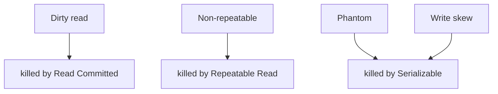
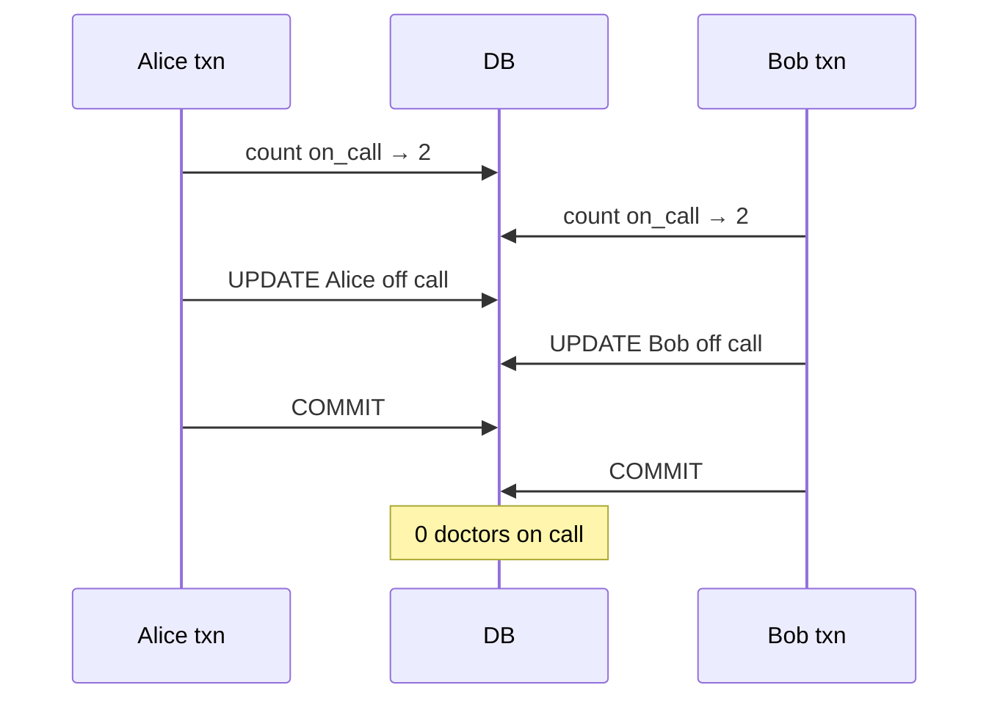
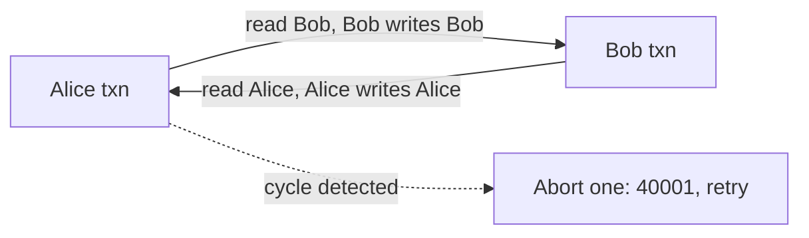

# Isolation and Anomalies

> [!abstract] What this is
> Isolation is the **I** in ACID: what one transaction is allowed to **see** while another is writing. There are four named levels, and each one removes one more anomaly at a higher cost. Postgres defaults to **Read Committed**, and the most important subtlety is that snapshot isolation is **not** Serializable: **write skew** is the gap. How locks and versions implement all of this is in [[03 - Concurrency Control]].

---

## Why It Exists

Running every transaction one at a time would be perfectly safe and hopelessly slow. Isolation levels let you trade some safety for concurrency, and each level is defined by which anomalies it still allows. Choosing well means knowing exactly which anomaly would break your invariant, and raising isolation only for that one transaction.

---

## ACID

ACID gets recited a lot, so it helps to know what each letter does **not** mean.

| Letter | Meaning | Not |
|---|---|---|
| **A**tomic | All statements in the txn happen, or none | "The whole microservice is atomic" |
| **C**onsistent | Constraints hold at commit (PK, FK, CHECK) | Business correctness of the *product* |
| **I**solated | Concurrent txns don't see each other's dirt (to the level you set) | "Nobody else exists" |
| **D**urable | After commit, a crash doesn't eat it. See [[01 - Storage Engine and Disk IO]] | "We also wrote Kafka" |

The C here is **the database's constraints**, not CAP's C. CAP consistency is a different idea, covered in [[02 - Fundamentals]] and [[17 - Consistency Time and Consensus]].

---

## The Four Levels

Each step up the table blocks more or aborts more (SSI retries), so don't put Serializable on the whole app "to be safe." Raise it for the one transaction that needs it.

| Level | You can still see | Pick when |
|---|---|---|
| **Read Uncommitted** | Dirty reads | Almost nobody. An analytics dump if you truly don't care |
| **Read Committed** | No dirty reads. Still **non-repeatable reads** and **phantoms** | Postgres default. Most CRUD |
| **Repeatable Read** | The same row read twice is the same. Still **phantoms** per the SQL spec; InnoDB RR is stronger (next-key locks) | A report that must not see a mid-transaction price change on a row it already read |
| **Serializable** | Looks like txns ran **one at a time**. Phantoms gone. Write skew gone (with true SSI or 2PL serializable) | Money invariants, "at least one doctor on call" |

In Postgres, Repeatable Read is implemented as **snapshot isolation**: the whole transaction reads from one snapshot taken at its first statement. That stops non-repeatable reads and, in practice, phantoms on reads too, but it does not stop write skew.

---

## The Anomalies

Memorise the names. Each is a specific interleaving, and each is killed at a specific level.

### Dirty read

T1 writes `qty = 4` but hasn't committed. T2 reads `4`. Then T1 **rolls back**, so qty is 5 again, and T2 has made a decision based on a value that never existed. **Prevented by:** Read Committed and above.

### Non-repeatable read

T2 reads a row with `qty = 5`. T1 commits `qty = 4`. T2 reads the **same row** again and gets `4`: one transaction, two answers. **Prevented by:** Repeatable Read and above. Read Committed **allows** this, because in Postgres each statement gets a fresh snapshot.

### Phantom

T2 runs `SELECT * FROM seats WHERE status='free'` and gets 3 rows. T1 **inserts** a new free seat and commits. T2 runs the same query and gets 4 rows. Nothing about an existing row changed; a **new row appeared** in the range. **Prevented by:** Serializable, per the SQL spec. InnoDB Repeatable Read uses **gap / next-key locks** and mostly stops this too, which is worth saying if they poke at MySQL.

| Anomaly | What goes wrong | Lowest level that stops it |
|---|---|---|
| Dirty read | You read uncommitted data that gets rolled back | Read Committed |
| Non-repeatable read | The same row changes between two reads | Repeatable Read |
| Phantom | A range query gains or loses rows | Serializable (InnoDB RR mostly) |
| Lost update | Two read-then-writes; one overwrites the other | Atomic SQL / locks (see [[03 - Concurrency Control]]) |
| Write skew | Two txns each change a different row; together they break a rule | Serializable, or lock the invariant |

---

## Write Skew

Write skew is the anomaly interviewers use to check whether you really understand isolation. It survives snapshot isolation because no row is written by both transactions.

### The two doctors

A hospital has a rule: **at least one** doctor must be on call. Right now Alice and Bob are both on call. Both feel unwell and try to go off call at the same moment.

1. Alice's transaction runs `SELECT count(*) FROM doctors WHERE on_call = true` and sees **2**. "Bob's still on, I can leave."
2. Bob's transaction runs the same query on its own snapshot and also sees **2**. "Alice's still on, I can leave."
3. Alice runs `UPDATE doctors SET on_call = false WHERE name = 'Alice'` and commits.
4. Bob runs `UPDATE doctors SET on_call = false WHERE name = 'Bob'` and commits.

Each update was valid given what that transaction saw. Now **zero** doctors are on call, and the invariant is dead.

### Why the lower levels allow it

Neither transaction updated the **same row**, so there's no lost update and no write-write conflict for the engine to catch. There's no dirty read either; each read committed data. Snapshot isolation is perfectly happy. The problem is that the rule was about a **set** of rows, and each transaction's decision depended on rows the other one changed.

### What kills it

| Fix | How | Pick when |
|---|---|---|
| **Serializable** | Postgres SSI detects the pattern and aborts one txn | The invariant is hard to express as one row; you can retry |
| **Lock the invariant** | `SELECT … FOR UPDATE` on the doctors rows, or on a single "roster" row that represents the rule | You want blocking instead of aborts |
| **Constraint** | A `CHECK` or unique constraint that expresses the rule | Rarely possible for set rules, which is why you usually lock |

### Serializable Snapshot Isolation (SSI)

SSI is how Postgres implements Serializable without falling back to heavy 2PL locking. Transactions still read from snapshots, so readers still don't block writers. On top of that, Postgres tracks **what each serializable transaction read** (using lightweight predicate "SIRead" locks that never block anyone) and notices when another transaction writes something that a concurrent transaction read. That's called a read-write dependency.

In the doctors example, Alice read Bob's row and Bob then wrote it; Bob read Alice's row and Alice then wrote it. That's a cycle of read-write dependencies between two concurrent transactions, which means no serial order could have produced the result. SSI spots this dangerous structure and aborts one of them with a **serialization failure** (SQLSTATE `40001`). The app must **retry** the aborted transaction; on retry it sees only one doctor on call and refuses to go off call.

The costs are extra tracking overhead and occasional false-positive aborts, so SSI is for the transactions that need it, and every caller must be ready to retry.

> [!tip] HLD sentence
> "If the invariant spans two rows, snapshot isolation can write-skew. I make that one transaction Serializable, or I lock a single row that *is* the invariant." The same one-liner lives in [[14 - Coordination and Concurrency]].

---

## What You Pick on the Board

Postgres's default Read Committed is **fine** for most HLD. When something needs more, you bump that one transaction, not the whole database.

| Situation | Isolation / tool |
|---|---|
| Read profile, update bio | Read Committed + `version` if two tabs |
| Decrement stock | Atomic `UPDATE … WHERE qty > 0` inside a txn |
| Seat hold | **Not** an open Serializable txn. State + TTL |
| "≥1 on call" / any two-row invariant | Serializable **or** lock the invariant row |
| Long analytics `SELECT` | A replica, not Serializable on the primary |

---

## Failure Modes

| Failure | What happens | Mitigation |
|---|---|---|
| **Write skew under snapshot isolation** | Two txns each change a different row and break a set-level rule | Serializable for that txn, or lock the invariant row |
| **No retry loop on Serializable** | Serialization failures (`40001`) surface as user errors | Retry the whole transaction on `40001` |
| **Serializable everywhere** | More aborts and contention across the app | Raise isolation per transaction, not globally |
| **Assuming RR stops phantoms everywhere** | Behaviour differs between Postgres and InnoDB | Know the engine; use Serializable or explicit locks for range invariants |
| **Long analytics txn on primary** | Holds snapshots open, blocks vacuum, adds load | Run it on a replica |

---

## Interview Lines

> [!tip] Say it like this
> - "Postgres defaults to Read Committed, and that's fine for most CRUD."
> - "Dirty read is killed by Read Committed, non-repeatable read by Repeatable Read, phantoms and write skew by Serializable."
> - "Snapshot isolation isn't Serializable. Two doctors can both go off call because each one changed a different row."
> - "Postgres SSI tracks read-write dependencies and aborts one transaction with a serialization failure, so the app has to retry."
> - "I raise isolation for the one transaction that needs it, not for the whole database."

## Related Notes

- [[README]]
- [[03 - Concurrency Control]]
- [[14 - Coordination and Concurrency]]
- [[02 - Fundamentals]]: CAP-C is a different C
- [[17 - Consistency Time and Consensus]]
- [[11 - Interview Questions]]
