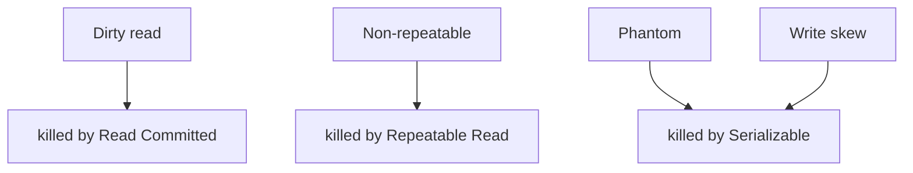
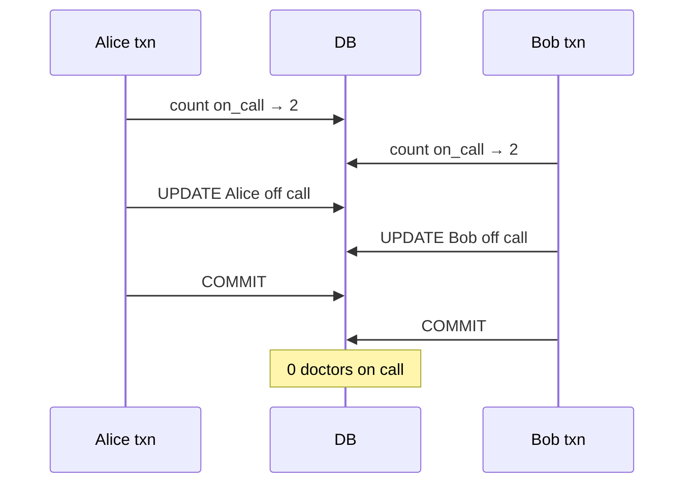
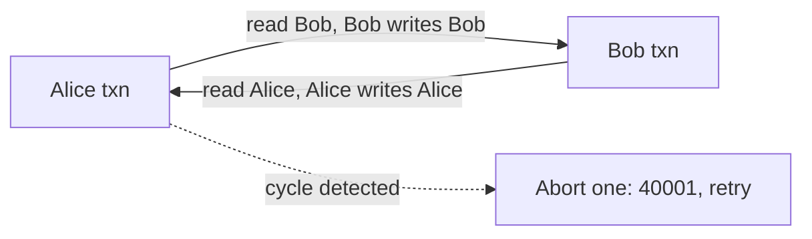

# Isolation and Anomalies

> [!abstract] What this is
> Isolation is the **I** in ACID: what one transaction is allowed to **see** while another is writing. There are four named levels, and each one removes one more anomaly at a higher cost. Postgres defaults to **Read Committed**, and the most important subtlety is that snapshot isolation is **not** Serializable: **write skew** is the gap. How locks and versions implement all of this is in [[03 - Concurrency Control]].

---

## Why It Exists

Running every transaction one at a time would be perfectly safe and hopelessly slow. Isolation levels let you trade some safety for concurrency, and each level is defined by which anomalies it still allows. Choosing well means knowing exactly which anomaly would break your invariant, and raising isolation only for that one transaction.

---

## ACID

ACID gets recited a lot, so it helps to know what each letter does **not** mean.

| Letter         | Meaning                                                                       | Not                                   |
| -------------- | ----------------------------------------------------------------------------- | ------------------------------------- |
| **A**tomic     | All statements in the txn happen, or none                                     | "The whole microservice is atomic"    |
| **C**onsistent | Constraints hold at commit (PK, FK, CHECK)                                    | Business correctness of the *product* |
| **I**solated   | Concurrent txns don't see each other's dirt (to the level you set)            | "Nobody else exists"                  |
| **D**urable    | After commit, a crash doesn't eat it. See [[01 - Storage Engine and Disk IO]] | "We also wrote Kafka"                 |

The C here is **the database's constraints**, not CAP's C. CAP consistency is a different idea, covered in [[02 - Fundamentals]] and [[17 - Consistency Time and Consensus]].

---

## The Four Levels

Each step up the table blocks more or aborts more (SSI retries), so don't put Serializable on the whole app "to be safe." Raise it for the one transaction that needs it.

Three terms the table leans on (each gets a full section further down):

- **SSI (Serializable Snapshot Isolation):** how Postgres delivers Serializable without heavy 2PL locks. Transactions run freely on their snapshots and nobody waits, but Postgres watches what each one reads and writes. If two concurrent transactions form a pattern that no one-at-a-time order could produce, it **aborts** one of them (usually at commit) with a serialization failure. So the cost of Serializable here is **retries instead of waiting**: the app must catch the error and rerun the whole transaction, and putting Serializable everywhere turns into a constant stream of aborts and retries.
- **Non-repeatable read (the row changed):** you read the same row twice in one transaction and get different values. You read a wallet balance of ₹100, another transaction deducts ₹50 and commits, and your second read says ₹50. Stopped by **Repeatable Read**.
- **Phantom read (the result set changed):** you run the same range or search query twice and a row appears or disappears, even though no existing row was modified. You count a customer's active orders and get 5, another transaction inserts a new active order and commits, and the same query now returns 6. Stopped by **Serializable**. Postgres RR and InnoDB RR also stop it for repeated plain reads, but not in every case (see below).

| Level                | You can still see                                                                                                | Pick when                                                                          |
| -------------------- | ---------------------------------------------------------------------------------------------------------------- | ---------------------------------------------------------------------------------- |
| **Read Uncommitted** | Dirty reads                                                                                                      | Almost nobody. An analytics dump if you truly don't care                           |
| **Read Committed**   | No dirty reads. Still **non-repeatable reads** and **phantoms**                                                  | Postgres default. Most CRUD                                                        |
| **Repeatable Read**  | The same row read twice is the same. Still **phantoms** per the SQL spec; Postgres and InnoDB stop them for plain re-reads, not for range invariants | A report that must not see a mid-transaction price change on a row it already read |
| **Serializable**     | Looks like txns ran **one at a time**. Phantoms gone. Write skew gone (with true SSI or 2PL serializable)        | Money invariants, "at least one doctor on call"                                    |

In Postgres, Repeatable Read is implemented as **snapshot isolation**: the whole transaction reads from one snapshot taken at its first statement. That stops non-repeatable reads and, in practice, phantoms on reads too, but it does not stop write skew.

### Repeatable Read and phantom reads

The SQL specification only requires Repeatable Read to prevent **non-repeatable reads**; it explicitly allows phantom reads at this level. In practice, both Postgres and InnoDB stop phantoms for **repeated plain reads** at Repeatable Read anyway, but they get there differently, and neither closes every phantom-related hole (cases below).

**Postgres: snapshot isolation.** Snapshot isolation freezes the state of the database **for reading**, but it doesn't stop other concurrent transactions from writing to the live database. That's why Postgres Repeatable Read remains vulnerable to **write skew**: two transactions can each read the same snapshot, then each write a different row, and together break a rule.

**InnoDB: snapshots plus next-key locks.** Plain `SELECT`s in InnoDB RR also read from a snapshot (a read view rebuilt from the undo log). On top of that, **locking reads and writes** (`SELECT … FOR UPDATE`, `FOR SHARE`, `UPDATE`, `DELETE`) take **next-key locks**: a lock on each matching index record plus the **gap** before it in the B+ tree. That blocks other transactions from inserting new rows into the range you queried, so phantoms can't appear for locking reads.

> [!warning] InnoDB RR is not "stronger" across the board
> Next-key locks only protect what you read **with a locking read**. Write skew built on plain `SELECT`s (the two-doctors case) still happens in InnoDB RR, and InnoDB RR also allows **lost updates** on plain read-then-write, which Postgres RR rejects with a serialization error. To stop write skew in InnoDB, use `FOR UPDATE` on the rows that define the rule, or Serializable (which turns plain `SELECT`s into `FOR SHARE`).

**Where RR still lets phantoms through.**

- **InnoDB: mixing snapshot and current reads.** Plain `SELECT`s read the snapshot, but `UPDATE`, `DELETE`, and `FOR UPDATE` read the **latest committed** rows. You `SELECT` a range and get 3 rows; another transaction inserts a 4th and commits; your `UPDATE … WHERE` on the same range touches that new row (and makes it your own change); your next plain `SELECT` now returns 4 rows. A phantom inside one RR transaction.
- **Postgres (and InnoDB plain reads): range invariants.** For "no overlapping bookings", two transactions each check the range, see nothing, and both insert. Each one's reads were phantom-free, yet the rule broke, because the row that should have stopped each of them was a phantom **the other** inserted. This is write skew driven by a phantom, and RR allows it in both engines unless the check uses locking reads (InnoDB next-key locks) or the transaction runs Serializable.

So "RR stops phantoms" is true for "the same query returns the same rows", not for "nobody can insert into the range I based my decision on".

### How Postgres implements snapshot isolation

Snapshot isolation reuses the **MVCC** architecture that's already there: older versions of updated rows are left intact on disk anyway, so nothing has to be copied.

**The snapshot itself.** A snapshot is a small list of transaction IDs (XIDs) held in memory. When it's taken, Postgres records which transactions are active across the system at that moment. It stores three pieces of metadata:

1. **`xmin`:** the oldest transaction ID still active.
2. **`xmax`:** the next transaction ID not yet assigned (anything at or above it started after the snapshot).
3. **`xip` list:** every transaction ID between those two bounds that's still in progress.

**The visibility rules.** Every row version on disk is already stamped with an `xmin` (the transaction that created it) and an `xmax` (the transaction that deleted or updated it). Instead of reading a copy of the data, your transaction scans the single shared, live table and checks each row version against its snapshot:

- **Visible:** the row's `xmin` belongs to a transaction that **committed before your snapshot** was taken.
- **Invisible (too new):** the row's `xmin` is in your snapshot's in-progress list, or belongs to a transaction that started after your snapshot (or it aborted). The row is hidden from you.
- **Invisible deletion:** the row's `xmax` belongs to a transaction that was still in progress in your snapshot, or started after it. You ignore the deletion and keep reading the old version.

So 1,000 concurrent transactions don't copy the database. Each one holds a small list of numbers in memory and uses it to filter the one shared physical dataset, which reconstructs exactly the view that existed when its snapshot was taken.

---

## The Anomalies

Memorise the names. Each is a specific interleaving, and each is killed at a specific level.

### Dirty read

T1 writes `qty = 4` but hasn't committed. T2 reads `4`. Then T1 **rolls back**, so qty is 5 again, and T2 has made a decision based on a value that never existed. **Prevented by:** Read Committed and above.

### Non-repeatable read

T2 reads a row with `qty = 5`. T1 commits `qty = 4`. T2 reads the **same row** again and gets `4`: one transaction, two answers. **Prevented by:** Repeatable Read and above. Read Committed **allows** this, because in Postgres each statement gets a fresh snapshot.

### Phantom

T2 runs `SELECT * FROM seats WHERE status='free'` and gets 3 rows. T1 **inserts** a new free seat and commits. T2 runs the same query and gets 4 rows. Nothing about an existing row changed; a **new row appeared** in the range. **Prevented by:** Serializable, per the SQL spec. In practice Postgres RR (one snapshot) and InnoDB RR (snapshot plus **gap / next-key locks** on locking reads) stop this exact re-read case too, but not the mixed-read and range-invariant cases in [[#Repeatable Read and phantom reads]].

| Anomaly | What goes wrong | Lowest level that stops it |
|---|---|---|
| Dirty read | You read uncommitted data that gets rolled back | Read Committed |
| Non-repeatable read | The same row changes between two reads | Repeatable Read |
| Phantom | A range query gains or loses rows | Serializable (RR in Postgres / InnoDB for plain re-reads only) |
| Lost update | Two read-then-writes; one overwrites the other | Atomic SQL / locks (see [[03 - Concurrency Control]]) |
| Write skew | Two txns each change a different row; together they break a rule | Serializable, or lock the invariant |

---

## Write Skew

Write skew is the anomaly interviewers use to check whether you really understand isolation. It survives snapshot isolation because no row is written by both transactions.

### The two doctors

A hospital has a rule: **at least one** doctor must be on call. Right now Alice and Bob are both on call. Both feel unwell and try to go off call at the same moment.

1. Alice's transaction runs `SELECT count(*) FROM doctors WHERE on_call = true` and sees **2**. "Bob's still on, I can leave."
2. Bob's transaction runs the same query on its own snapshot and also sees **2**. "Alice's still on, I can leave."
3. Alice runs `UPDATE doctors SET on_call = false WHERE name = 'Alice'` and commits.
4. Bob runs `UPDATE doctors SET on_call = false WHERE name = 'Bob'` and commits.

Each update was valid given what that transaction saw. Now **zero** doctors are on call, and the invariant is dead.

### Why the lower levels allow it

Neither transaction updated the **same row**, so there's no lost update and no write-write conflict for the engine to catch. There's no dirty read either; each read committed data. Snapshot isolation is perfectly happy. The problem is that the rule was about a **set** of rows, and each transaction's decision depended on rows the other one changed.

### What kills it

| Fix | How | Pick when |
|---|---|---|
| **Serializable** | Postgres SSI detects the pattern and aborts one txn | The invariant is hard to express as one row; you can retry |
| **Lock the invariant** | `SELECT … FOR UPDATE` on the doctors rows, or on a single "roster" row that represents the rule | You want blocking instead of aborts |
| **Constraint** | A `CHECK` or unique constraint that expresses the rule | Rarely possible for set rules, which is why you usually lock |

**Command mechanics.**

- **`SELECT`:** a pure read. It uses MVCC to read a frozen snapshot of the data and takes **no row locks**, so concurrent transactions can modify the row freely while you read it.
- **`UPDATE`:** a write. It immediately takes an **exclusive row lock** on the rows it changes, blocking any other writer of those rows until the transaction commits or aborts.
- **`SELECT … FOR UPDATE`:** a hybrid. It returns data for your application to read, but locks the rows **exactly as an `UPDATE` would**. It secures the rows for your transaction before you compute your next step.

**Solving write skew in Postgres.** Write skew occurs when two concurrent transactions read the same initial state and then make conflicting updates that break a business rule, because neither sees the other's uncommitted changes. Under Repeatable Read or lower, two explicit pessimistic locking approaches prevent it:

1. **Lock the target rows (`SELECT … FOR UPDATE`).** Lock the specific rows you need to check at the exact moment you read them. Any other transaction that tries to **lock or update** those same rows (another `FOR UPDATE`, an `UPDATE`, a `DELETE`) waits in line until you commit. Plain `SELECT`s still read the old snapshot without waiting, which is why **every** transaction that enforces the rule must use `FOR UPDATE`.
2. **Lock a single "roster" row.** If the rule spans many rows that are hard to lock together, or involves **inserting** new data (you can't lock a row that doesn't exist yet), create one dedicated parent row that represents the whole rule. Every transaction that modifies the data must lock this roster row first. That forces a bottleneck that acts like a **mutex**: only one transaction can evaluate the rule at a time.

**How `SELECT … FOR UPDATE` solves the two-doctor problem.** With the invariant "at least one doctor must always be on call", this is the execution path that stops two transactions from taking both doctors off call:

1. **A scans and locks:** transaction A runs `SELECT … FROM doctors WHERE on_call FOR UPDATE`. The engine finds Doctor 1 and Doctor 2 and, as it reads them, writes A's XID into the **`xmax`** field of both row versions (with a lock-only flag), which is how Postgres records a row lock.
2. **B attempts to read:** a moment later, transaction B runs the same query. It reaches Doctor 1 and sees A's XID in `xmax`.
3. **Lock check:** B checks A's status (the in-progress transaction list, and the commit log `clog` for finished ones) and finds A is still **in progress**.
4. **B is blocked:** because B used `FOR UPDATE`, it must respect the lock. Postgres puts B to sleep waiting on A's transaction ID lock.
5. **A completes:** A sees two doctors, sets Doctor 1 off call, and commits.
6. **B wakes up:** under **Read Committed**, B re-checks the latest version of the rows it was waiting on. Doctor 1 no longer matches `on_call`, so B sees only Doctor 2, and the app correctly refuses to take the last doctor off call. Under **Repeatable Read**, B instead fails with a serialization error ("could not serialize access due to concurrent update") and must retry, after which it sees one doctor and refuses.

### Serializable Snapshot Isolation (SSI)

SSI is how Postgres implements Serializable without falling back to heavy 2PL locking. Transactions still read from snapshots, so readers still don't block writers. On top of that, Postgres tracks **what each serializable transaction read** (using lightweight predicate "SIRead" locks that never block anyone) and notices when another transaction writes something that a concurrent transaction read. That's called a read-write dependency.

In the doctors example, Alice read Bob's row and Bob then wrote it; Bob read Alice's row and Alice then wrote it. That's a cycle of read-write dependencies between two concurrent transactions, which means no serial order could have produced the result. SSI spots this dangerous structure and aborts one of them with a **serialization failure** (SQLSTATE `40001`). The app must **retry** the aborted transaction; on retry it sees only one doctor on call and refuses to go off call.

	
The costs are extra tracking overhead and occasional false-positive aborts, so SSI is for the transactions that need it, and every caller must be ready to retry.

> [!tip] HLD sentence
> "If the invariant spans two rows, snapshot isolation can write-skew. I make that one transaction Serializable, or I lock a single row that *is* the invariant." The same one-liner lives in [[14 - Coordination and Concurrency]].

---

## What You Pick on the Board

Postgres's default Read Committed is **fine** for most HLD. When something needs more, you bump that one transaction, not the whole database.

| Situation | Isolation / tool |
|---|---|
| Read profile, update bio | Read Committed + `version` if two tabs |
| Decrement stock | Atomic `UPDATE … WHERE qty > 0` inside a txn |
| Seat hold | **Not** an open Serializable txn. State + TTL |
| "≥1 on call" / any two-row invariant | Serializable **or** lock the invariant row |
| Long analytics `SELECT` | A replica, not Serializable on the primary |

---

## Failure Modes

| Failure | What happens | Mitigation |
|---|---|---|
| **Write skew under snapshot isolation** | Two txns each change a different row and break a set-level rule | Serializable for that txn, or lock the invariant row |
| **No retry loop on Serializable** | Serialization failures (`40001`) surface as user errors | Retry the whole transaction on `40001` |
| **Serializable everywhere** | More aborts and contention across the app | Raise isolation per transaction, not globally |
| **Assuming RR stops phantoms everywhere** | RR stops phantoms on plain re-reads, but range invariants still break (and InnoDB mixed snapshot/current reads can show new rows) | Know the engine; use Serializable or explicit locks for range invariants |
| **Long analytics txn on primary** | Holds snapshots open, blocks vacuum, adds load | Run it on a replica |

---

## Interview Lines

> [!tip] Say it like this
> - "Postgres defaults to Read Committed, and that's fine for most CRUD."
> - "Dirty read is killed by Read Committed, non-repeatable read by Repeatable Read, phantoms and write skew by Serializable."
> - "Snapshot isolation isn't Serializable. Two doctors can both go off call because each one changed a different row."
> - "Postgres SSI tracks read-write dependencies and aborts one transaction with a serialization failure, so the app has to retry."
> - "I raise isolation for the one transaction that needs it, not for the whole database."

## Related Notes

- [[README]]
- [[03 - Concurrency Control]]
- [[14 - Coordination and Concurrency]]
- [[02 - Fundamentals]]: CAP-C is a different C
- [[17 - Consistency Time and Consensus]]
- [[11 - Interview Questions]]
