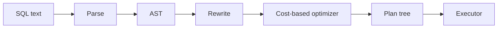
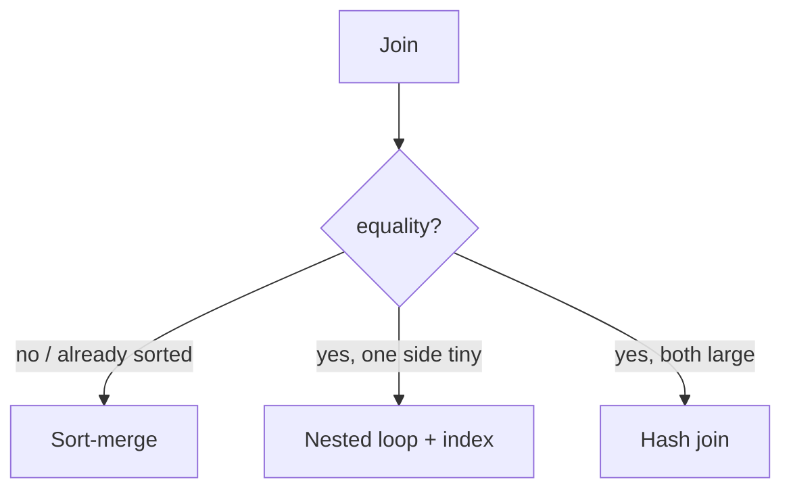

# Query Execution and Optimization

> [!abstract] What this is
> SQL is just text. The engine turns it into a **tree of operators** and runs the **cheapest** tree it can estimate. Cost means estimated pages read plus CPU, and the estimates come from **statistics** such as row counts and histograms.
>
> This note covers how that plan is chosen, the three join algorithms, the access paths (seq scan, index scan, **index-only**), the app-side killer **N+1**, and why the interview move is to read `EXPLAIN` rather than guess.

---

## Why It Exists

When someone says "the database is slow," the cause is usually one of three things: the optimizer picked a bad plan, the right index doesn't exist, or the application is sending far more queries than it should. You can't tell which without knowing how a query becomes a plan.

You never hand-write the AST in an HLD. What you **do** say is something like "the optimizer picked a seq scan because the stats said 80% of the table matches." That sentence shows you understand the engine is making a cost decision, not ignoring you.

---

## From Text to a Plan

A query passes through four stages before any row comes back. Parsing checks the text and builds a tree; rewriting simplifies it; the optimizer chooses how to run it; the executor runs it.

| Stage | What it does |
|---|---|
| **Parse** | Tokens become an **AST** (select list, from, where, join) |
| **Rewrite** | View expansion, constant folding, subquery pull-up |
| **CBO** | Enumerates some of the legal plans, **costs** each one, picks the minimum |
| **Executor** | Pulls tuples through the operators (or vectorised batches) |

---

## The Cost-Based Optimizer

The optimizer can't run every plan to see which is fastest, so it estimates. Its estimates are only as good as the statistics it has about your data.

### What it uses

The most important input is **cardinality**: how many rows a filter will return. To estimate that, the engine keeps **histograms**, which describe how a column's values are distributed rather than just its min and max. If `status` is 99% `done`, then `WHERE status='open'` is highly selective, and the histogram is what tells the optimizer so. Without a histogram the engine assumes values are spread uniformly, and it **lies**.

It also considers table size, index height and guesses about cache hits. The cost units are made up, but they are **ordered**: a random page read costs far more than a sequential page read, which costs far more than CPU work.

### When the plan is stupid

Bad plans nearly always trace back to bad estimates.

| Cause | Example | Fix |
|---|---|---|
| **Stale stats** | Table grew 10× since the last analyse | `ANALYZE` / let autovacuum run |
| **Correlated columns** | `city` and `zip` move together; the histogram treats them as independent | Extended statistics, or rewrite the query |
| **Parameter the prepare didn't see** | `WHERE id = $1` looks like 1 row, but you bound a popular id | Re-plan for skewed values, or split the hot case |

> [!warning] "I'll add an index" is not a plan
> If the predicate matches 40% of the table, a **seq scan is cheaper** than thousands of random index lookups. The CBO is allowed to ignore your index, and when it does that's correct, not a bug.

---

## Join Algorithms

Every join is one of three algorithms. Which one the optimizer picks depends on whether the join is on equality, how big each side is, and whether the inputs are already sorted.

| Algorithm | How | Cost feel | Pick when |
|---|---|---|---|
| **Nested loop** | For each row of the outer side, probe the inner side (often via an **index**) | `O(N × cost of inner lookup)` | Small outer, or the inner side has an index on the join key |
| **Hash join** | Build a hash table of the **smaller** input, probe it with the larger | `O(N+M)`, memory for the build side | Equality join and both sides are big enough that a nested loop is dumb |
| **Sort-merge** | Sort both sides on the join key, then zip them | `O(N log N + M log M)`, or cheap if already sorted (index) | Large joins, inputs already ordered, or merge-friendly disk |

A nested loop with a **seq scan on the inner side** is the `O(N*M)` disaster interviewers name. A nested loop with an index on the inner side (an **index nested loop**) is how `orders ⋈ users ON user_id` often runs, and it's fast.

A hash join **spills** to disk if the build side doesn't fit in RAM. That still works, just slower. Sort-merge shines when both inputs come out of an index **already ordered**, so the sort step is free.

---

## Access Paths

For each table in the plan, the optimizer also picks how to read it. An index scan is **not** always faster; it trades a sequential read of everything for random reads of a few things.

| Path | What it does | Pick when |
|---|---|---|
| **Sequential scan** | Reads the heap front to back | Most of the table qualifies, or there's no useful index |
| **Index scan** | Walks the B+ tree, then fetches heap TIDs | Selective predicate. Random heap I/O if the table isn't clustered |
| **Bitmap index scan** | Collects TIDs, sorts them by page, then reads the heap | Many matches. Turns random I/O into "each page once" |
| **Index-only scan** | The index has every column the query needs | Covering index, plus (in Postgres) the visibility map says the pages are all-visible |

Index-only scan is the covering-index idea from [[02 - Indexing]]. One more useful trick: `ORDER BY` plus `LIMIT` on an indexed column can stop early, because the index already returns rows in order and no sort is needed.

---

## N+1 Queries

N+1 is an **application** bug that shows up as "the DB is slow." The app runs `SELECT * FROM users`, then for each user runs `SELECT * FROM orders WHERE user_id=?`. That's 1 + N round trips, each one paying network latency, when one query would do.

The fixes are all ways of asking once:

- one `JOIN`;
- or `WHERE user_id IN (…)`;
- or a dataloader that batches lookups, if you're in a GraphQL or ORM hole.

ORMs cause this by default through lazy loading. You still own it.

---

## Reading EXPLAIN

In an interview, the credible move when a query is slow is "I'd look at the plan," not a guess. `EXPLAIN` shows the estimated plan. `EXPLAIN ANALYZE` actually runs the query and shows real row counts next to the estimates.

| What you see | What it means |
|---|---|
| Seq scan on a huge table with a selective `WHERE` | Missing or unused index |
| Nested loop with a huge inner side | Wrong join algorithm, often from bad estimates |
| Estimate 10 rows, actual 10 million | **Stats** are wrong |

Don't memorise Postgres node names beyond seq scan, index scan, hash and nested loop.

---

## Failure Modes

| Failure | What happens | Mitigation |
|---|---|---|
| Stale statistics | Optimizer picks a plan for a table that no longer exists in that shape | `ANALYZE`, healthy autovacuum |
| Nested loop with seq-scan inner | `O(N*M)` work; query time explodes with table size | Index on the join key, or fix estimates so a hash join is chosen |
| Hash join spill | Build side exceeds memory and goes to disk | More work memory, or filter the build side first |
| Generic plan for a skewed parameter | Prepared plan fits the typical id, not the popular one | Re-plan for hot values |
| N+1 from the ORM | Hundreds of round trips per request | `JOIN`, `IN (…)`, or batching |

---

## Interview Lines

> [!tip] Say it like this
> - "The optimizer is cost-based. It picks a plan from statistics, so a bad plan usually means bad stats."
> - "An index doesn't guarantee an index scan. If 40% of rows match, a seq scan is cheaper and the planner is right to use it."
> - "Nested loop with an index on the inner side is fine. Nested loop with a seq-scan inner is the `O(N*M)` disaster."
> - "N+1 is an app bug. One join or one `IN` query fixes it."
> - "Before guessing, I'd run `EXPLAIN ANALYZE` and compare estimated rows to actual rows."

## Related Notes

- [[README]]
- [[02 - Indexing]]
- [[07 - Data Modelling]]
- [[11 - Interview Questions]]
