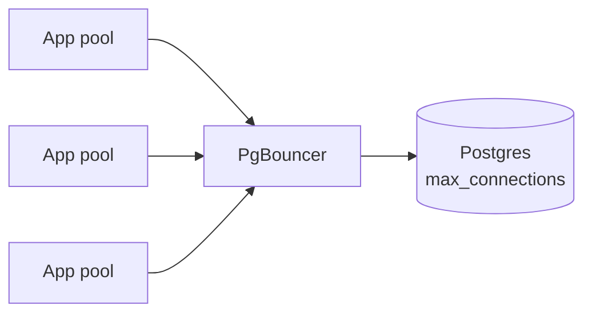

# Connections and Network I/O

> [!abstract] What this is
> A Postgres connection is, roughly, a **process**. It's scarce and expensive, so opening TCP + TLS + auth **per query** will melt you. Apps share a **pool** instead, but many app boxes times a fat pool still means too many server backends.
>
> This note covers why connections cost so much, how app pools and PgBouncer fix it, and the two server I/O models: thread-per-connection vs **event-driven** (`epoll` / `kqueue`). The short overview is in [[05 - Databases]].

---

## Why It Exists

Every request that talks to the database needs a connection. If each connection is cheap, you never think about it. They aren't cheap, and the database can only hold a fixed number, so the question "how many connections will this design open?" decides whether the database survives a traffic spike or a scale-out of the app tier.

---

## Why a Connection Is Expensive

Setting up a connection involves several steps, and each has a cost:

| Step | Cost |
|---|---|
| TCP handshake | A network round trip |
| TLS handshake | The expensive part: more round trips plus crypto |
| Auth and session setup | Checking credentials, setting session GUCs, and in Postgres possibly forking a backend **process** |
| Memory per connection | Postgres can use tens of MB per backend |

On top of that, `max_connections` is a hard ceiling, often 100–400 on a box you haven't tuned.

So the rule is simple. One HTTP request that opens a new DB connection is a **bug**. One HTTP request that **borrows** a connection from a pool for 5 ms is the design.

---

## Connection Pooling

Pooling means opening connections once and reusing them. There are two places to do it, and at scale you use both.

### App pool (Hikari, SQLAlchemy, pgxpool)

The pool lives **inside the app process**. At startup it opens `N` connections and keeps them warm. Each request checks one out, runs its query, and checks it back in.

`N` should be small. Five to 20 per instance is common; 50 "to be safe" is not.

### The melt formula

The problem with per-app pools is multiplication. 200 app pods × 50 pool size = **10,000** backends. Postgres will either refuse them (`too many connections`) or swap itself to death trying to hold them.

The fixes, in order:

1. Shrink the per-instance pool.
2. Put a **pooler** in front of Postgres (next section).
3. Don't run 200 pods if 20 would do.

### External pooler (PgBouncer)

PgBouncer sits between the apps and Postgres and maps many client connections onto a few server connections. How tightly it shares depends on its mode:

| Mode | When the server connection is released | Pick when |
|---|---|---|
| **Session** | When the client disconnects (weak multiplexing) | The app relies on session state |
| **Transaction** | At `COMMIT` | The usual choice |
| **Statement** | After each statement (even tighter) | Rarely; it breaks session state and multi-statement transactions |

Transaction pooling **breaks** session features: `SET`, temp tables, and prepared statements unless you're careful, because the next transaction may run on a different server connection.

Name PgBouncer when the **app count** is the problem, not when you have two boxes.

> [!tip] Interview default
> "Each app has a small pool. If we have many services, PgBouncer in transaction mode in front of Postgres." Don't design PgBouncer internals.

---

## I/O Models on the Server Side

How a server handles many clients decides how many it can hold. There are two models, and knowing which one a component uses explains its limits.

### Thread- or process-per-connection

Each client gets its own OS thread or process, which blocks in `read()` waiting for data. It's simple to program. But 10k clients means 10k stacks plus the context switches between them.

Postgres **backends are processes**, which is exactly why `max_connections` is small. Classic Java app servers used to work this way toward the DB too.

### Event-driven with kernel notification

One thread (or a few) manages many **non-blocking** sockets. Instead of blocking on each one, it asks the kernel which file descriptors are ready and only does work for those.

| Mechanism | Platform | Note |
|---|---|---|
| **`epoll`** | Linux | Scales to large fd counts |
| **`kqueue`** | BSD / macOS | Same idea |
| `select` / `poll` | Old, portable | Linear scan; dies at high fd count |

This is how Nginx, Redis, PgBouncer, Node and modern gateways hold **tens of thousands** of idle clients.

| Model | Concurrent idle clients | Cost | Pick when |
|---|---|---|---|
| Process/thread per connection | Hundreds to low thousands | Memory + scheduler | Few clients, each doing heavy work (DB backends) |
| `epoll` / `kqueue` | Tens to hundreds of thousands idle | One loop, work only when data arrives | Many mostly-idle clients (gateways, websockets, poolers) |

### Idle is the key word

Holding 50k open TLS connections that rarely send is an `epoll` problem. Running 50k **active queries** is still a question of how many backends and cores you have.

Multiplexing clients is not the same as multiplexing **queries on one Postgres backend**. One backend still runs one query at a time. The pooler's job is to avoid holding a backend while the client is thinking.

> [!info] Where this shows up in HLD
> API gateway and websocket fan-in are event-driven. The DB is still a small number of fat backends. Don't say "Postgres uses epoll so we can have 100k queries."

---

## Failure Modes

| Failure | What happens | Mitigation |
|---|---|---|
| Connection per request | TLS + auth on every query; latency and CPU spike | App-side pool |
| Pool multiplication | 200 pods × 50 = 10,000 backends; `too many connections` or swapping | Smaller pools, PgBouncer, fewer pods |
| Pool exhaustion | Requests queue waiting for a checkout | Timeout on checkout ([[08 - Reliability]]), shorter transactions |
| Session state under transaction pooling | `SET`, temp tables or prepared statements leak or vanish | Avoid session state, or use session mode for those clients |
| Long transactions holding a connection | Pool drains while a request waits on something slow | Never hold a transaction across a network call |

---

## Interview Lines

> [!tip] Say it like this
> - "A Postgres connection is a process, so connections are scarce. Every app uses a small pool."
> - "200 pods with a pool of 50 is 10,000 backends. Shrink the pools and put PgBouncer in transaction mode in front."
> - "Transaction pooling breaks session features like `SET` and temp tables."
> - "Event-driven I/O lets a gateway hold many idle clients. It doesn't let one Postgres backend run more than one query."

## Related Notes

- [[README]]
- [[03 - Networking and APIs]]
- [[04 - Load Balancing CDN and Gateway]]
- [[11 - Interview Questions]]
- [[08 - Reliability]] — timeouts on the checkout from the pool
