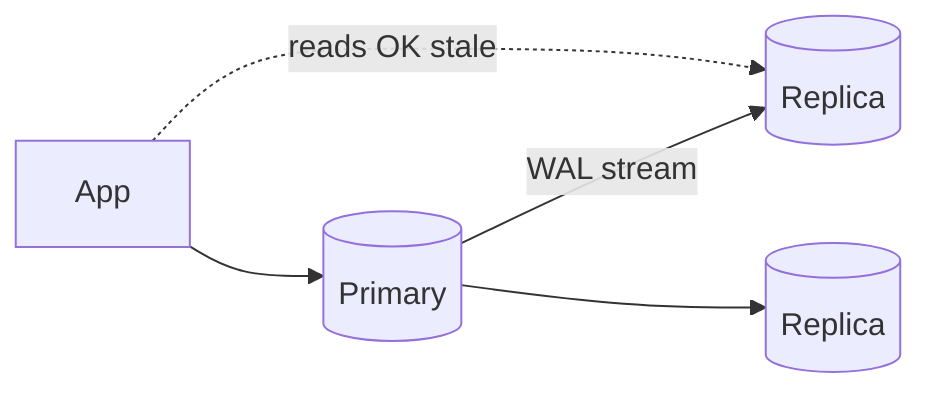
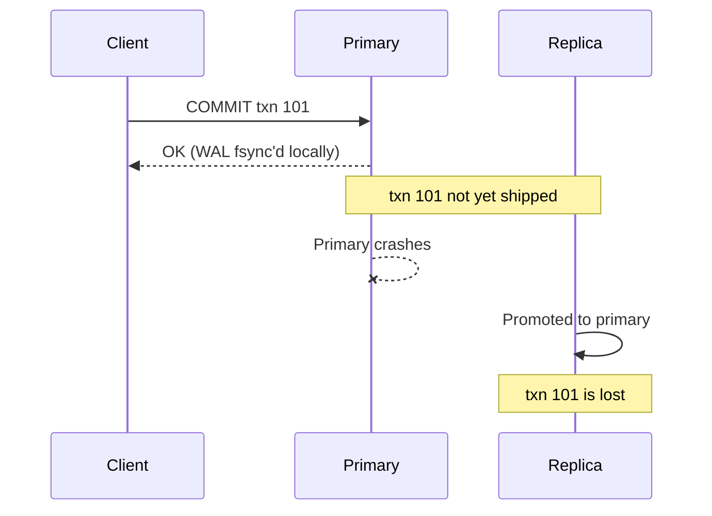

# Replication

> [!abstract] What this is
> Replication keeps extra copies of the same data on other machines, for **reads**, **failover** and **backup**. The default design is **one primary, async replicas, a cache in front**. Async means **lag**: after a write, either read the primary or accept stale data.
>
> Mechanically, a replica is applying the primary's **WAL** ([[01 - Storage Engine and Disk IO]]). Quorum math for leaderless stores is in [[10 - Distributed Building Blocks]], and the consistency models behind all of this are in [[17 - Consistency Time and Consensus]].

---

## Why It Exists

One database box is one point of failure and one ceiling on read throughput. Replication addresses both.

- It scales **reads**. Writes still hit one primary in the usual setup.
- It enables **failover** when the primary dies.
- It lets backups and analytics run without sitting on the OLTP box.

It is not a substitute for **sharding**. Sharding is for when **writes or disk** don't fit on one primary; see [[09 - Sharding]].

---

## Topologies

The topology decides who accepts writes and how copies agree. Almost every OLTP design uses leader–follower; the others exist for specific problems.

| Mode | Write | Read | Failure | Pick when |
|---|---|---|---|---|
| **Leader–follower** (primary–replica) | All writes to the leader | Replicas serve reads | Promote a replica | Default |
| **Sync replica** | Write waits until the replica has it | Up to date | Slower commits, stronger durability | Losing the last write is unacceptable |
| **Async replica** | Write returns after the leader's WAL | Replica **lags** | Can lose last writes on failover | Default replica type |
| **Multi-leader** | Writes on both leaders | Conflicts possible | Needs conflict resolution | Only if you must write in two regions |
| **Leaderless (quorum)** | `W` of `N` | `R` of `N`, want `R+W>N` | Tolerates node loss | Dynamo / Cassandra |

---

## Sync vs Async

The core trade-off is whether a commit waits for a replica. Waiting costs latency; not waiting risks losing the newest writes.

### Async (the default you draw)

The primary `fsync`s its WAL and returns to the client. The replica receives the WAL and applies it **later**. Lag is 0 ms when things are quiet and can reach **seconds** under load or with a slow replica.

### Sync

The commit waits until at least one replica has the WAL. You don't lose those writes if the primary dies. You **do** wait on the replica's disk for every commit, and a dead sync replica **blocks writes** unless you degrade to async. Say which you'd do.

| | Async | Sync |
|---|---|---|
| Commit latency | Primary's disk only | Primary + replica round trip |
| Data loss on failover | Whatever hadn't replicated | None for acknowledged writes |
| Replica dies | Nothing happens to writes | Writes block, or you degrade |
| Pick when | Default | "Cannot lose the last payment" |

> [!tip] Interview default
> One primary, **async** replicas. Mention lag out loud: "after a write, read the primary or accept ~100 ms stale." Use a sync replica if they say "cannot lose the last payment."

---

## Failover and Data Loss

Failover means promoting a replica to primary when the old primary dies. With async replication, any transaction that committed on the old primary but had **not yet** reached this replica is **gone**. The client was told "committed," and the data no longer exists.

That window is your **RPO** (how much recent data you can lose) for this setup. It's roughly the replication lag at the moment of failure. Sync replication shrinks it to zero for acknowledged writes, at the cost of commit latency. RPO and RTO as targets are covered in [[08 - Reliability]].

A second failover risk is **split brain**: the old primary comes back still believing it's primary and accepts writes. Failover tooling must fence it off before the new primary takes writes.

---

## Read-Your-Writes

Async lag produces one very visible bug. A user updates their name, then `GET /me` hits a **lagging** replica and shows the old name. To the user, their write was lost.

Eventual consistency is fine for **other people's** feed. It isn't fine for **your own** submit-then-refresh. The fixes all route that user's reads to a copy that has their write:

| Fix | How | Pick when |
|---|---|---|
| **Sticky to primary** | After a write, set a session flag so this user reads from the primary for a short window | Simple default |
| **Read-after-write from primary** | Specific reads that follow a write always go to the primary | A few known flows (profile, settings) |
| **Causal token** | Client carries the write's WAL position or timestamp; only read from a replica that has caught up to it | Heavy read offload where primary reads are too costly; rarer in interviews |

The formal guarantees (read-your-writes, monotonic reads, causal consistency) are in [[17 - Consistency Time and Consensus]].

---

## Multi-Leader

With multi-leader, two regions both accept writes. If the same row gets two updates with no common order, you get a **conflict**, and something must resolve it.

| Resolution | Cost |
|---|---|
| Last-write-wins | Clocks lie, so a real write can silently vanish |
| Store both, app merges | Complexity pushed into the application |
| CRDTs | Only for data types that merge cleanly. See [[15 - Out of Scope]] |

The default is **don't**. Use one writer region. If the interviewer forces two, name the conflict.

---

## Leaderless / Quorum

In a leaderless store there's no primary. The client (or a coordinator) sends each write to `N` replicas and waits for `W` acknowledgements; a read asks `R` replicas.

If **`R + W > N`**, a read overlaps at least one replica holding the latest write, under the usual assumptions. The classic setting is `N=3, W=2, R=2`. For fast writes you can set `W=1`, but then reads are stale unless `R=N`.

This is **Cassandra / Dynamo**, not how you talk about Postgres. Depth is in [[10 - Distributed Building Blocks]], and the CAP choice when a node is down is in [[02 - Fundamentals]].

---

## What Replication Is Not

Replication is often credited with things it doesn't do.

- It's not a cross-region active-active story, unless you took on multi-leader.
- It's not "now we can shard."
- It's not CDC by itself. CDC **is** "someone tails the WAL and feeds ES or Kafka." See [[10 - Distributed Building Blocks]] and [[06 - Ecosystem Resilience and Design Patterns]].
- It's not a backup. A bad `DELETE` replicates to every copy within milliseconds. See [[12 - Schema Changes and Backups]].

---

## Failure Modes

| Failure | What happens | Mitigation |
|---|---|---|
| Replica lag | Reads return stale data | Monitor lag; route read-your-writes to the primary |
| Async failover | Last committed writes are lost | Sync replica for critical data; accept RPO ≈ lag otherwise |
| Sync replica down | Writes block | Degrade to async, or keep two sync candidates |
| Split brain | Two primaries accept writes | Fencing during failover |
| Multi-leader conflict | Same row updated in two regions | Single writer region, or explicit merge rules |
| Bad write replicated | Corruption copied everywhere | Backups with point-in-time recovery |

---

## Interview Lines

> [!tip] Say it like this
> - "One primary, async replicas for reads, cache in front."
> - "Async means lag. For a user's own writes, I read from the primary for a short window."
> - "Async failover can lose the last few committed writes. If that's unacceptable, one replica is synchronous."
> - "Replicas scale reads, not writes. If writes don't fit, that's sharding."
> - "Replication isn't backup. A bad delete replicates too."

## Related Notes

- [[README]]
- [[01 - Storage Engine and Disk IO]]
- [[09 - Sharding]]
- [[02 - Fundamentals]]
- [[10 - Distributed Building Blocks]]
- [[17 - Consistency Time and Consensus]]
- [[08 - Reliability]]
- [[12 - Schema Changes and Backups]]
- [[11 - Interview Questions]]
