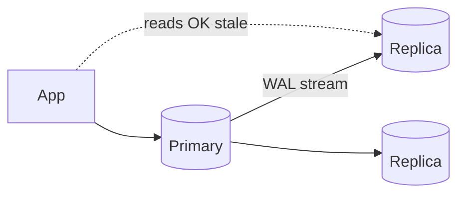
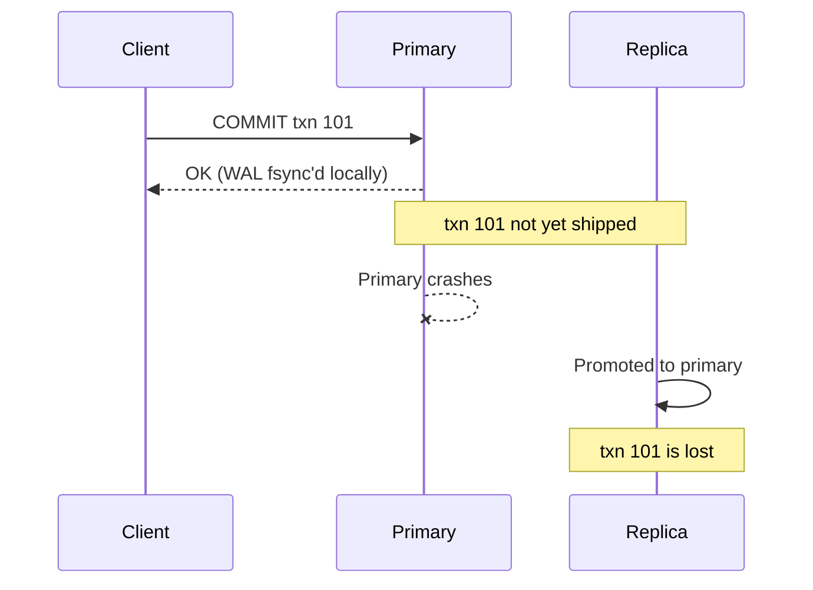

# Replication

> [!abstract] What this is
> Replication keeps extra copies of the same data on other machines, for **reads**, **failover** and **backup**. The default design is **one primary, async replicas, a cache in front**. Async means **lag**: after a write, either read the primary or accept stale data.
>
> Mechanically, a replica is applying the primary's **WAL** ([[01 - Storage Engine and Disk IO]]). Quorum math for leaderless stores is in [[10 - Distributed Building Blocks]], and the consistency models behind all of this are in [[17 - Consistency Time and Consensus]].

---

## Why It Exists

One database box is one point of failure and one ceiling on read throughput. Replication addresses both.

- It scales **reads**. Writes still hit one primary in the usual setup.
- It enables **failover** when the primary dies.
- It lets backups and analytics run without sitting on the OLTP box (meaning : The Primary Database).

It is not a substitute for **sharding**. Sharding is for when **writes or disk** don't fit on one primary; see [[09 - Sharding]].

---

## Topologies

The topology decides who accepts writes and how copies agree. Almost every OLTP design uses leader–follower; the others exist for specific problems.

| Mode | Write | Read | Failure | Pick when |
|---|---|---|---|---|
| **Leader–follower** (primary–replica) | All writes to the leader | Replicas serve reads | Promote a replica | Default |
| **Sync replica** | Write waits until the replica has it | Up to date | Slower commits, stronger durability | Losing the last write is unacceptable |
| **Async replica** | Write returns after the leader's WAL | Replica **lags** | Can lose last writes on failover | Default replica type |
| **Multi-leader** | Writes on both leaders | Conflicts possible | Needs conflict resolution | Only if you must write in two regions |
| **Leaderless (quorum)** | `W` of `N` | `R` of `N`, want `R+W>N` | Tolerates node loss | Dynamo / Cassandra |

**Leaderless quorums.** In databases like Cassandra or the original Dynamo design there is no single leader; any node can accept a write. To keep data accurate without a leader they use a voting scheme called a **quorum**, based on three variables:

- **`N`:** the number of nodes (replicas) storing a copy of that specific data.
- **`W`:** the number of nodes that must successfully save the write before the database tells the application it succeeded.
- **`R`:** the number of nodes you must check when reading, to find the latest version.

**`R + W > N`** guarantees the read set and the write set overlap. With `N = 3` and `W = 2`, you read from at least `R = 2`. Because `2 + 2 > 3`, it's impossible for your read not to include at least one node that holds the freshest acknowledged write.

This design **tolerates node loss**. If one server catches fire, the database doesn't pause to elect a new leader; it keeps reading and writing to the remaining nodes that still make up the quorum.

**Picking the freshest copy.** When a node saves a write, it attaches a **timestamp** to the data. When you read from `R` nodes (say 2 of 3), each returns its data with its timestamp. The engine compares them, and the copy with the **newest timestamp** is treated as the freshest and returned to the application (Cassandra also writes it back to the stale replica, which is read repair).

> [!note] Two caveats
> DynamoDB the AWS service is **not** leaderless: each partition has a leader ([[24 - Cassandra and DynamoDB]]). And "always the latest" assumes strict quorums and sane clocks: sloppy quorums, concurrent writes resolved by last-write-wins, and clock skew can all return or keep an older value. See [[17 - Consistency Time and Consensus]] and [[10 - Distributed Building Blocks]].

---

## Sync vs Async

The core trade-off is whether a commit waits for a replica. Waiting costs latency; not waiting risks losing the newest writes.

### Async (the default you draw)

The primary `fsync`s its WAL and returns to the client. The replica receives the WAL and applies it **later**. Lag is 0 ms when things are quiet and can reach **seconds** under load or with a slow replica.

That gap is **replication lag**. On a quiet system the WAL reaches the replica almost instantly. Under a write spike, the primary keeps acknowledging writes without waiting, but shipping all that WAL over the network, and the replica replaying it, falls behind. A replica "seconds behind" is literally serving data from a few seconds ago: a user posts a comment, refreshes a page that reads from the replica, and doesn't see it until the replica catches up (the read-your-writes problem).

### Sync

The commit waits until at least one replica has the WAL. You don't lose those writes if the primary dies. You **do** wait on the replica's disk for every commit, and a dead sync replica (meaning the replica which was in sync has died) **blocks writes** unless you degrade to async. Say which you'd do.

| | Async | Sync |
|---|---|---|
| Commit latency | Primary's disk only | Primary + replica round trip |
| Data loss on failover | Whatever hadn't replicated | None for acknowledged writes |
| Replica dies | Nothing happens to writes | Writes block, or you degrade |
| Pick when | Default | "Cannot lose the last payment" |

A sync replica exists for **write safety**, not as the read node. Its job is to guarantee that every acknowledged write is on at least two machines, so if the primary dies it can be promoted with **zero committed transactions lost**. It doesn't even guarantee fresh reads: with Postgres's default `synchronous_commit = on`, the primary waits only until the replica has **flushed** the WAL, not **applied** it, so a read there can still miss a just-acknowledged write (only `remote_apply` closes that gap, at extra commit latency). So reads that must be fresh go to the **primary**, and general read traffic (comment sections, product catalogs) still spreads across **async replicas** that may be milliseconds to seconds stale. The common shape is one primary, one sync replica for durability, and async replicas for read scale-out.
In a standard setup the primary doesn't get to just switch to another replica in case the one it was in sync with, dies. That is why in sync cases when a replica dies it keeps blocking writes forever unless manual intervention is done. 

> [!tip] Interview default
> One primary, **async** replicas. Mention lag out loud: "after a write, read the primary or accept ~100 ms stale." Use a sync replica if they say "cannot lose the last payment."

### Replication slots

A **replication slot** is the primary's promise to keep WAL until a specific replica (or CDC consumer like Debezium) has confirmed receiving it. Without one, the primary may recycle WAL a lagging replica still needs, and that replica has to be rebuilt from a fresh copy. With one, the replica can always catch up. The catch is the reverse failure: if the replica or consumer **dies and its slot stays**, the primary keeps every WAL segment from that point on, and its disk slowly fills until the primary itself goes down. A stale slot also holds back vacuum's cleanup horizon ([[01 - Storage Engine and Disk IO]]). Monitor slot lag, drop slots for consumers that are gone, and cap retained WAL with `max_slot_wal_keep_size`.

---

## Failover and Data Loss

Failover means promoting a replica to primary when the old primary dies. With async replication, any transaction that committed on the old primary but had **not yet** reached this replica is **gone**. The client was told "committed," and the data no longer exists.

That window is your **RPO** (how much recent data you can lose) for this setup. It's roughly the replication lag at the moment of failure. Sync replication shrinks it to zero for acknowledged writes, at the cost of commit latency. RPO and RTO as targets are covered in [[08 - Reliability]].

A second failover risk is **split brain**: the old primary comes back still believing it's primary and accepts writes. Failover tooling must fence it off before the new primary takes writes.

**Who decides, and how clients find it.** Postgres itself has no leader election or automatic failover; something outside it promotes a replica. Self-hosted, that's usually **Patroni** with **etcd** (or Consul / ZooKeeper): the primary holds a leader key with a short TTL and keeps renewing it; if it stops, the key expires, the healthiest least-lagged replica takes it, and Patroni promotes it. The consensus lives in etcd ([[17 - Consistency Time and Consensus]]), not in Postgres. Managed services (RDS, Cloud SQL) do the same from their control plane. Clients then use two endpoints:

- **Write endpoint:** a name that always resolves to the current primary (a DNS record updated on failover, HAProxy checking Patroni's "am I primary?" health check, or a driver option like `target_session_attrs=read-write`).
- **Read endpoint:** spreads load across replicas with simple round-robin or least-connections (DNS round-robin like the Aurora reader endpoint, HAProxy / a load balancer, or the driver's host list). Health checks drop dead replicas, and optionally ones lagging past a threshold.

Routing is **per connection, not per query**: a pooled connection sticks to one replica, so every query on it goes there, and the endpoint has no idea which reads need fresh data. That's why read-your-writes (below) is the application's job.

---

## Read-Your-Writes

Async lag produces one very visible bug. A user updates their name, then `GET /me` hits a **lagging** replica and shows the old name. To the user, their write was lost.

Eventual consistency is fine for **other people's** feed. It isn't fine for **your own** submit-then-refresh. The fixes all route that user's reads to a copy that has their write:

| Fix | How | Pick when |
|---|---|---|
| **Sticky to primary** | After a write, set a session flag so this user reads from the primary for a short window | Simple default |
| **Read-after-write from primary** | Specific reads that follow a write always go to the primary | A few known flows (profile, settings) |
| **Causal token** | Client carries the write's WAL position or timestamp; only read from a replica that has caught up to it | Heavy read offload where primary reads are too costly; rarer in interviews |

The formal guarantees (read-your-writes, monotonic reads, causal consistency) are in [[17 - Consistency Time and Consensus]].

---

## Multi-Leader

With multi-leader, two regions both accept writes. If the same row gets two updates with no common order, you get a **conflict**, and something must resolve it.

| Resolution             | Cost                                                                                                                                                                                                                                                       |
| ---------------------- | ---------------------------------------------------------------------------------------------------------------------------------------------------------------------------------------------------------------------------------------------------------- |
| Last-write-wins        | Clocks lie (never show exact time, a little ahead or lagging in miliseconds), so a real write (real write in this context is the write that is the true last write but since clocks lie they might be overwritten by a non-true write) can silently vanish |
| Store both, app merges | Complexity pushed into the application                                                                                                                                                                                                                     |
| CRDTs                  | Only for data types that merge cleanly. See [[15 - Out of Scope]]                                                                                                                                                                                          |

The default is **don't**. Use one writer region. If the interviewer forces two, name the conflict.

**How "store both, app merges" works.** The database uses **version vectors** to tell "B overwrote A" apart from "A and B happened concurrently." Only in the concurrent case does it keep both versions as **siblings**, because it doesn't understand the business logic well enough to combine them. On the next read it returns all siblings, and the application must merge them (for a shopping cart: union the items without duplicates) and **write the result back** with the version context it read, which tells the database the merge replaces both. The classic trap is **deleted items coming back**: if one sibling removed an item and the other still has it, a naive union resurrects it, which is exactly what the Dynamo paper reported for carts. Deletes have to be recorded explicitly (removal markers, or a CRDT like an OR-set). Few stores offer siblings (Riak, CouchDB); Cassandra and DynamoDB use last-write-wins.

---

## Leaderless / Quorum

In a leaderless store there's no primary. The client (or a coordinator) sends each write to `N` replicas and waits for `W` acknowledgements; a read asks `R` replicas.

If **`R + W > N`**, a read overlaps at least one replica holding the latest write, under the usual assumptions. The classic setting is `N=3, W=2, R=2`. For fast writes you can set `W=1`, but then reads are stale unless `R=N`.

This is **Cassandra / Dynamo**, not how you talk about Postgres. Depth is in [[10 - Distributed Building Blocks]], and the CAP choice when a node is down is in [[02 - Fundamentals]].

---

## What Replication Is Not

Replication is often credited with things it doesn't do.

- It's not a cross-region active-active story, unless you took on multi-leader.
- It's not "now we can shard."
- It's not CDC by itself. CDC **is** "someone tails the WAL and feeds ES or Kafka." See [[10 - Distributed Building Blocks]] and [[06 - Ecosystem Resilience and Design Patterns]].
- It's not a backup. A bad `DELETE` replicates to every copy within milliseconds. See [[12 - Schema Changes and Backups]].

A "cross-region active-active" architecture means having database servers in completely different geographic locations (like Mumbai and London) that are both simultaneously "active" and able to accept new write traffic.

The line clarifies that simply turning on standard database replication does not give you this capability. Standard replication relies on a Leader-Follower model where only one primary server globally can accept writes. Even if you place a read-only replica in London, users in London must still send their writes across the internet to the primary server in Mumbai.

---

## Failure Modes

| Failure | What happens | Mitigation |
|---|---|---|
| Replica lag | Reads return stale data | Monitor lag; route read-your-writes to the primary |
| Async failover | Last committed writes are lost | Sync replica for critical data; accept RPO ≈ lag otherwise |
| Sync replica down | Writes block | Degrade to async, or keep two sync candidates |
| Split brain | Two primaries accept writes | Fencing during failover |
| Multi-leader conflict | Same row updated in two regions | Single writer region, or explicit merge rules |
| Bad write replicated | Corruption copied everywhere | Backups with point-in-time recovery |

---

## Interview Lines

> [!tip] Say it like this
> - "One primary, async replicas for reads, cache in front."
> - "Async means lag. For a user's own writes, I read from the primary for a short window."
> - "Async failover can lose the last few committed writes. If that's unacceptable, one replica is synchronous."
> - "Replicas scale reads, not writes. If writes don't fit (single write instace's CPU keeps maxxing out or harddrive cannot simply write data fast enough), that's sharding."
> - "Replication isn't backup. A bad delete replicates too."

## Related Notes

- [[README]]
- [[01 - Storage Engine and Disk IO]]
- [[09 - Sharding]]
- [[02 - Fundamentals]]
- [[10 - Distributed Building Blocks]]
- [[17 - Consistency Time and Consensus]]
- [[08 - Reliability]]
- [[12 - Schema Changes and Backups]]
- [[11 - Interview Questions]]
