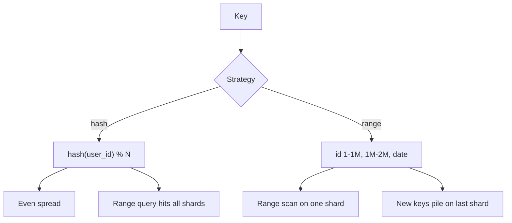

# Sharding

> [!abstract] What this is
> Sharding splits data across **multiple primaries** because one box can't take the **writes** or hold the **disk**. Try replicas and a cache first; don't shard because it sounds senior. Once you do shard, the **shard key is the whole design**, and more shards don't always mean more throughput, for the same reason more Kafka partitions don't.
>
> Hash rings and consistent hashing are in [[10 - Distributed Building Blocks]].

---

## Why It Exists

Replication copies the whole dataset, so every copy still takes every write and stores every byte. When the write rate or the data size outgrows one machine, the only option is to split the data so each machine owns a part.

### When you shard

- Write QPS is higher than the primary can take.
- The data is multi-TB and won't fit, restore, or vacuum on one box.

Not because "we have 50k users."

### What you try first

1. Indexes and query fixes ([[05 - Query Execution and Optimization]]).
2. A cache ([[06 - Caching]]).
3. Read replicas ([[08 - Replication]]).
4. A bigger box (vertical scaling), until it's embarrassing.

---

## The Key Is the Design

The shard key decides which queries touch one shard and which touch all of them. Pick it from the #1 query.

The **shard key** is the specific piece of data used to divide the database across servers. The core rule, "pick it from the #1 query," means choosing it based on the **most frequent, most critical query** the application runs, because that query dictates how the data has to be organized to be fast. The table below is that choice for the four common keys.

| Key | Good for | Pain | Pick when |
|---|---|---|---|
| `user_id` | "My orders"; all of a user's rows together | "Global trending" hits **every** shard | Most queries are scoped to one user |
| `hash(key) % N` | Even spread | **Adding a shard reshuffles everything**, unless you use consistent hashing | Point lookups, uniform load |
| Range (`date`, `id`) | Scans of a range | **Hot shard**: today's partition eats all writes | Range scans dominate and writes aren't sequential |
| Geo / tenant | Regional or B2B products | One huge tenant is a hot shard | Data naturally belongs to a region or customer |

What each row means in plain terms:

**1. `user_id`**

- **Good for:** apps where users mostly look at their own data. If the #1 query is "show me all my past orders," sharding by `user_id` puts all of one user's orders on the same server.
- **Pain:** queries across all users, like "show me global trending items." Because data is split by user, that query has to hit **every** shard to gather the answer, which is slow.
- **Pick when:** most queries are scoped to a single user.

**2. `hash(key) % N`**

- **Good for:** an even spread of data across servers. Instead of grouping by user, a key (like a product ID) goes through a hash function that deterministically assigns it to a server; the assignment looks random, so no one server does all the work.
- **Pain:** the formula depends on the number of servers, `N`. Add a server and `N` changes, so almost every key maps to a different server and the database has to physically **reshuffle** most of the data. **Consistent hashing** is the fix: adding a server only moves the slice of keys it takes over ([[10 - Distributed Building Blocks]]).
- **Pick when:** you mostly do **point lookups** (fetch one item by its key) and want load evenly balanced.

**3. Range (`date`, `id`)**

- **Good for:** queries over a span. Grouping data in key order lets "all sales from Monday to Wednesday" be answered by scanning one contiguous chunk.
- **Pain:** the **hot shard**. If data is grouped by date, every new write today lands on the same server, which maxes out while the rest of the cluster sits idle.
- **Pick when:** range scans (like date-based reports) dominate, and incoming writes are spread across the key range rather than always arriving at the newest end.

**4. Geo / tenant**

- **Good for:** B2B software and regional apps. On a platform serving many companies (**tenants**), company A's data lives on one shard and company B's on another; for geo, each region's data stays in that region.
- **Pain:** one massive tenant (a Walmart among small customers) turns its shard into a **hot shard** that gets overloaded while the others do little. The usual fix is to give whales their own dedicated shard.
- **Pick when:** the data naturally belongs entirely to one region or customer.

Sharding takes some things away, and you should say so:

- **Cross-shard JOIN**: you don't have one. Join in the app, denormalise, or don't ask the question.
- **Cross-shard transaction**: not ACID across boxes. 2PC is painful ([[10 - Distributed Building Blocks]]); use a saga, or design so you don't need it.
- **Secondary index without the shard key**: becomes **scatter-gather** across every shard. "Search" belongs in ES ([[02 - Indexing]], [[09 - Storage Search and Geo]]).

What each of these means in practice:

**1. Cross-shard JOIN.** On one database, a `JOIN` between `orders` and `products` happens inside one engine that can see both tables. Once `orders` is sharded by `user_id`, an order and the product it references can live on different machines, and no single database can see both rows, so it can't join them. You're left with three options:

- **Join in the app:** fetch the orders from the user's shard, collect the product IDs, fetch those products (from their shard or a cache), and stitch the results together in code. It works, but it's extra round trips you now own.
- **Denormalise:** copy the fields you need (product name, price at purchase) into the order row itself, so the hot query never needs the other table. The cost is keeping copies in sync when the source changes.
- **Don't ask the question on the OLTP path:** cross-cutting questions ("revenue per product across all users") go to an analytics store fed by CDC, not to the sharded database ([[20 - Data Processing and Analytics]]).

**2. Cross-shard transaction.** A transaction is only ACID inside one database, because one engine owns the locks and the WAL for all the rows it touches. Transferring money from a user on shard 1 to a user on shard 7 touches two independent databases, and neither can commit or roll back the other. **2PC** (two-phase commit) makes them agree, but a coordinator crash between "prepare" and "commit" leaves both shards holding locks and waiting, so it's slow and fragile. The usual answers:

- **Saga:** split the work into local transactions (debit on shard 1, then credit on shard 7), each committed on its own, with a **compensating** step (refund the debit) if a later step fails. You get eventual consistency, not atomicity.
- **Design it away:** choose the shard key so the rows one transaction touches live together, e.g. shard by `account_id` and keep an account's ledger entries on the same shard.

**3. Secondary index without the shard key.** Each shard only indexes its own rows, so a query on any other column (say `email` when the shard key is `user_id`) can't be routed to one shard. The router has to send it to **every** shard and merge the results (**scatter-gather**), which costs every shard work on every request and is only as fast as the slowest one. For exact lookups, keep a small lookup table (`email → user_id`) sharded by email; for search and fuzzy matching, feed the data into Elasticsearch as a global index. The full walkthrough is in [[02 - Indexing]].

**Distributed SQL engines** (like Citus for Postgres, or Vitess for MySQL) act as a smart **coordinator**. They make a cluster of independent servers look like one big relational database to the application, breaking each SQL query down and pushing the physical work to the underlying shards. How the engine executes the common operations:

- **Distributed aggregations (`COUNT`s):** to count millions of rows, the coordinator doesn't download the data. It asks each shard to count its own local rows, the shards return small sub-totals, and the coordinator adds them up.
- **Distributed sorting (`ORDER BY … LIMIT 10`):** for the 10 most recent transactions, the coordinator asks every shard for its own local top 10. With 5 shards it receives just 50 rows, sorts those in memory, and returns the final top 10. That avoids pulling millions of unsorted rows across the network.
- **Co-located joins (joining on the shard key):** if `users` and `orders` are both sharded by `user_id`, user 5's profile and user 5's orders are guaranteed to live on the same server. A join for user 5 runs entirely on that server's CPU and disk, with no data crossing the network, so it's fast.
- **Reference tables:** small, rarely updated tables that are joined often (Indian states, pincodes, app config statuses) aren't sharded. The engine copies the whole table onto every shard, so each server has a full local copy and joins against it never need network cross-talk.
- **The network shuffle penalty:** a join on a column that isn't the shard key (say `orders` joined to `products` on `product_id` when the data is sharded by `user_id`) needs rows that live on different servers. The engine has to package rows, stream them over the network, and match them on another machine. That data movement is what kills performance.

Which reinforces the golden rule of distributed databases: **design the shard key around your most frequent joins and queries**, so the data they need naturally lives together.

---

## Hash vs Range

This pair comes up constantly. Hash spreads load and kills range scans; range keeps range scans local and invites hot spots.

### Hash

`hash(user_id) % N` spreads evenly even if ids are sequential. A point lookup goes to one shard. A range query ("users 1000–2000") goes to **all** shards.

When `N` changes, almost every key moves. **Consistent hashing** fixes that by moving only a neighbouring arc of keys; see [[10 - Distributed Building Blocks]].

### Range

Shard A holds `id 1–1M`, shard B holds `1M–2M`, or each shard holds a date like `date=2026-09-23`. A range scan stays on one or a few shards.

The catch is sequential keys. With ids that increase or a "today" key, all inserts land on the right edge, so **one shard is hot** while the other 49 sit idle.

---

## Hot Shard and Hot Key

Splitting data evenly is not the same as splitting **traffic** evenly. You can have 10 shards holding the same number of rows each, and still have one of them doing most of the work, because a few key values get far more requests than the rest. The shard that owns those values is a **hot shard**: its primary sits at 100% CPU while the other nine look healthy.

The usual culprits:

- **A celebrity `user_id`:** sharded by user, one account with 50 million followers gets more reads and writes than thousands of normal users combined, and all of it lands on that user's shard.
- **`country = IN`:** sharded by country, the biggest market's shard carries most of the load.
- **`date = today`:** sharded by date, every new write goes to today's shard.

The trap is thinking more shards will help. Adding shards spreads **different** keys across more machines, but every row for **one** key still has to live on one shard, so a single hot key stays on a single machine no matter how many shards you add. It's the same problem as a Kafka hot partition ([[04 - Producer Mechanics and Delivery Guarantees]]).

The fixes depend on where the heat comes from:

| Fix                    | How                                                                                                                                                         | Pick when                                            |
| ---------------------- | ----------------------------------------------------------------------------------------------------------------------------------------------------------- | ---------------------------------------------------- |
| Higher-cardinality key | Choose a shard key with many distinct values that are used about equally (e.g. `user_id` instead of `country`), so no single value carries much of the load | You're designing the key up front                    |
| Isolate the whale      | Give the huge tenant or user a shard (or table) of its own, so its load doesn't crowd out everyone else                                                     | A few known giants dominate the traffic              |
| Shard a counter        | Split one hot row (a like count, a stock level) into N bucket rows, write to a random bucket, and sum the buckets on read ([[03 - Concurrency Control]])    | The hot thing is a single row, not a whole key range |

**How a sharded counter works.** Say a viral post's like count is one row, `post_likes(post_id = 42, count)`. Every like is an `UPDATE … SET count = count + 1` on that same row, and each one takes the row lock, so thousands of likes per second **queue up one at a time** behind it. Faster hardware doesn't help much, because the bottleneck is the serialisation on one row, not CPU.

The fix is to replace the one row with N rows (say 16 buckets): `(post_id = 42, bucket = 0..15, count)`. Each like picks a random bucket and increments only that row, so up to 16 writes can proceed in parallel instead of one. If the bucket number is part of the shard key, the buckets can even land on different shards. To read the total, `SELECT SUM(count) … WHERE post_id = 42` adds up the 16 rows.

The trade-off is that writes get cheaper and reads get a bit more expensive (16 rows instead of 1), so it fits counters that are written far more often than they're read exactly: likes, views, votes. For a stock level that must never go below zero it's harder, because no single bucket knows the real total; you'd decrement a bucket that still has stock, or use a different approach ([[03 - Concurrency Control]]).

---

## More Shards ≠ More Throughput

It's tempting to think that doubling the shards doubles what the system can handle. It only does if the work actually spreads across them.

A request passes through several stages: the app servers, the network, the shards, and (for queries that span shards) the coordinator that merges results. The system can only go as fast as its **slowest stage**, so throughput is roughly `min(app, network, hottest shard, coordinator)`. Adding shards raises only the "shards" part, and only if load is even across them. If one shard is hot, or the app or coordinator is already maxed out, more shards change nothing.

What matters for a single query isn't how many shards exist, but **how many shards that query has to touch**:

- A query that includes the shard key goes to **one** shard. Adding shards means each shard holds less data and serves fewer such queries, so this scales well.
- A query without the shard key goes to **every** shard (scatter-gather) and has to wait for all of them. It can only answer when the **slowest** shard replies, so its p99 latency is the worst latency among all the shards it hit. The more shards, the more likely one of them is having a slow moment (GC pause, disk hiccup, noisy neighbour), so a scatter-gather over 64 shards can be **slower** than one over 8.

The common ways "we added shards" fails to help:

| They add shards and… | What actually happened |
|---|---|
| Writes still concentrate on one key | That key still lives on one shard, so it's still a **hot shard**. Raising `N` does nothing for it. |
| Every read is scatter-gather | Each read now fans out to **more** shards and waits for the slowest one, so p99 got **worse**, not better. |
| They reshard using `hash(key) % N` | Changing `N` remaps almost every key, so most of the data has to move between machines, and any cache keyed by shard location is effectively wiped. |
| Transactions often span shards | Every such request now pays for 2PC or a saga, which adds latency and failure cases. |
| They went to 64 small primaries | 64 machines to monitor, fail over, patch, and hold connections to, each mostly idle. More operational load, little gain. |

> [!tip] Same grill as Kafka partitions
> Shard **after** you have numbers. Pick a key that matches the #1 query. Choose an `N` you can operate (start with 2–8, not 256). Plan the reshard (consistent hash or range split) **before** you're on fire.

---

## Directory / Lookup Table

With hash or range sharding, a key's shard is **computed**: run the key through the formula and you know where it lives. A **directory** (or lookup table) replaces the formula with an explicit record. It's a small table, kept in its own store, that maps each entity to its shard:

| `tenant_id` | `shard_id` |
|---|---|
| `acme` | 3 |
| `walmart` | 7 |
| `tiny_co` | 3 |

To serve a request, the router first looks up the entity in the directory, then sends the query to that shard.

**What it buys you: flexible placement.** Because each entity's location is just a row, you can put any entity anywhere and move it individually. If `walmart` grows huge, copy its data to a new dedicated shard and update its one row; no other tenant is touched. With `hash(key) % N`, by contrast, you can't move one tenant without changing the formula, which moves everyone.

**What it costs:**

- **An extra hop:** every request needs a directory lookup before it can reach the data.
- **An extra single point of failure:** if the directory is down, no request can find its shard, so the whole system is down. It has to be replicated and highly available.
- **An extra cache to keep consistent:** to avoid that lookup on every request, routers cache the directory. When an entity moves, every cached copy must be updated, or requests go to the old shard. (The usual safety net: the old shard rejects requests for data it no longer owns, and the router refreshes and retries.)

It's rarely the **first** answer in an interview. Reach for it when tenants have to be **movable one at a time** (whales, regional moves, rebalancing) and a hash formula is too blunt to place them individually.

---

## Failure Modes

| Failure | What happens | Mitigation |
|---|---|---|
| Hot shard | One primary at 100%, others idle | Higher-cardinality key, isolate whales, bucketed counters |
| Scatter-gather on every read | Fan-out raises p99 | Key matches the #1 query; search in ES |
| `hash % N` reshard | Nearly all data moves; caches wiped | Consistent hashing or range splits |
| Cross-shard transaction | 2PC blocking or saga complexity | Keep a transaction's rows on one shard |
| Directory unavailable | No request can find its shard | Cache the directory; replicate it |

---

## Interview Lines

> [!tip] Say it like this
> - "I'd shard only when writes or disk don't fit one primary. Replicas and a cache come first."
> - "The shard key is the design. I pick it from the #1 query, so that query hits one shard."
> - "Hash spreads load but makes range queries scatter-gather. Range keeps scans local but makes today's shard hot."
> - "More shards don't split a hot key, and scatter-gather over more shards can make p99 worse."
> - "I'd use consistent hashing so adding a shard moves a slice of keys, not all of them."

## Related Notes

- [[README]]
- [[07 - Data Modelling]]
- [[08 - Replication]]
- [[10 - Distributed Building Blocks]]
- [[04 - Producer Mechanics and Delivery Guarantees]] — hot key, more-n ≠ more throughput
- [[11 - Interview Questions]]
