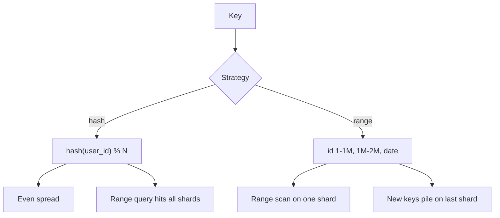

	# Sharding

> [!abstract] What this is
> Sharding splits data across **multiple primaries** because one box can't take the **writes** or hold the **disk**. Try replicas and a cache first; don't shard because it sounds senior. Once you do shard, the **shard key is the whole design**, and more shards don't always mean more throughput, for the same reason more Kafka partitions don't.
>
> Hash rings and consistent hashing are in [[10 - Distributed Building Blocks]].

---

## Why It Exists

Replication copies the whole dataset, so every copy still takes every write and stores every byte. When the write rate or the data size outgrows one machine, the only option is to split the data so each machine owns a part.

### When you shard

- Write QPS is higher than the primary can take.
- The data is multi-TB and won't fit, restore, or vacuum on one box.

Not because "we have 50k users."

### What you try first

1. Indexes and query fixes ([[05 - Query Execution and Optimization]]).
2. A cache ([[06 - Caching]]).
3. Read replicas ([[08 - Replication]]).
4. A bigger box (vertical scaling), until it's embarrassing.

---

## The Key Is the Design

The shard key decides which queries touch one shard and which touch all of them. Pick it from the #1 query.

| Key | Good for | Pain | Pick when |
|---|---|---|---|
| `user_id` | "My orders"; all of a user's rows together | "Global trending" hits **every** shard | Most queries are scoped to one user |
| `hash(key) % N` | Even spread | **Adding a shard reshuffles everything**, unless you use consistent hashing | Point lookups, uniform load |
| Range (`date`, `id`) | Scans of a range | **Hot shard**: today's partition eats all writes | Range scans dominate and writes aren't sequential |
| Geo / tenant | Regional or B2B products | One huge tenant is a hot shard | Data naturally belongs to a region or customer |

Sharding takes some things away, and you should say so:

- **Cross-shard JOIN**: you don't have one. Join in the app, denormalise, or don't ask the question.
- **Cross-shard transaction**: not ACID across boxes. 2PC is painful ([[10 - Distributed Building Blocks]]); use a saga, or design so you don't need it.
- **Secondary index without the shard key**: becomes **scatter-gather** across every shard. "Search" belongs in ES ([[02 - Indexing]], [[09 - Storage Search and Geo]]).

---

## Hash vs Range

This pair comes up constantly. Hash spreads load and kills range scans; range keeps range scans local and invites hot spots.

### Hash

`hash(user_id) % N` spreads evenly even if ids are sequential. A point lookup goes to one shard. A range query ("users 1000–2000") goes to **all** shards.

When `N` changes, almost every key moves. **Consistent hashing** fixes that by moving only a neighbouring arc of keys; see [[10 - Distributed Building Blocks]].

### Range

Shard A holds `id 1–1M`, shard B holds `1M–2M`, or each shard holds a date like `date=2026-09-23`. A range scan stays on one or a few shards.

The catch is sequential keys. With ids that increase or a "today" key, all inserts land on the right edge, so **one shard is hot** while the other 49 sit idle.

---

## Hot Shard and Hot Key

An even shard **count** is not even **traffic**. A celebrity `user_id`, `country=IN` or `date=today` can push one shard's primary to 100% while the others look fine.

More shards **do not split a single key**. It's the same as a Kafka hot partition ([[04 - Producer Mechanics and Delivery Guarantees]]).

| Fix | How | Pick when |
|---|---|---|
| Higher-cardinality key | Choose a key with many distinct, evenly used values | Designing the key up front |
| Isolate the whale | Give the huge tenant or user its own shard or table | A few known giants |
| Shard a counter | Split one hot row into buckets and sum on read ([[03 - Concurrency Control]]) | The hot thing is a single row |

---

## More Shards ≠ More Throughput

Throughput is `min(app, network, hottest shard, coordinator)`. Parallelism is how many shards the **query** actually hits. A scatter-gather over 64 shards can be **slower** than one over 8, because p99 is set by the slowest shard.

| They add shards and… | What happened |
|---|---|
| Writes are still one key | Hot shard. `N` does nothing. |
| Every read is scatter-gather | You added **fan-out**. p99 got worse. |
| Reshard with `hash % N` | Massive data move. Cache wipe. |
| Cross-shard transaction | 2PC / saga tax on every request |
| 64 tiny primaries | More failover, more connections, more ops. Each box idle. |

> [!tip] Same grill as Kafka partitions
> Shard **after** you have numbers. Pick a key that matches the #1 query. Choose an `N` you can operate (start with 2–8, not 256). Plan the reshard (consistent hash or range split) **before** you're on fire.

---

## Directory / Lookup Table

A directory maps `entity_id → shard_id` in a small store. That gives flexible placement: you can move one tenant without touching anyone else.

It costs an extra hop, an extra SPOF and an extra cache to keep consistent. It's rarely the **first** answer. Use it when tenants must be **movable** and hashing is too blunt.

---

## Failure Modes

| Failure | What happens | Mitigation |
|---|---|---|
| Hot shard | One primary at 100%, others idle | Higher-cardinality key, isolate whales, bucketed counters |
| Scatter-gather on every read | Fan-out raises p99 | Key matches the #1 query; search in ES |
| `hash % N` reshard | Nearly all data moves; caches wiped | Consistent hashing or range splits |
| Cross-shard transaction | 2PC blocking or saga complexity | Keep a transaction's rows on one shard |
| Directory unavailable | No request can find its shard | Cache the directory; replicate it |

---

## Interview Lines

> [!tip] Say it like this
> - "I'd shard only when writes or disk don't fit one primary. Replicas and a cache come first."
> - "The shard key is the design. I pick it from the #1 query, so that query hits one shard."
> - "Hash spreads load but makes range queries scatter-gather. Range keeps scans local but makes today's shard hot."
> - "More shards don't split a hot key, and scatter-gather over more shards can make p99 worse."
> - "I'd use consistent hashing so adding a shard moves a slice of keys, not all of them."

## Related Notes

- [[README]]
- [[07 - Data Modelling]]
- [[08 - Replication]]
- [[10 - Distributed Building Blocks]]
- [[04 - Producer Mechanics and Delivery Guarantees]] — hot key, more-n ≠ more throughput
- [[11 - Interview Questions]]
