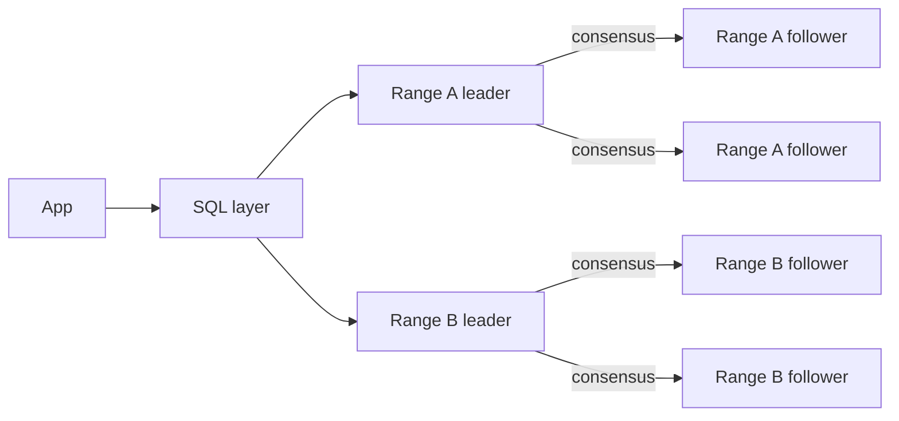

# Engine Choice

> [!abstract] What this is
> Default to **Postgres**. Switch when the **access pattern** says so, not because "NoSQL scales." Consistency is chosen **per table**, not per company, and B+ tree vs LSM is a **write vs read** pick, not a brand pick.
>
> Each engine's depth lives in the other notes in this folder. This one is the drill: which store for which data, in one sentence.

---

## Why It Exists

Every design has a "which database?" moment, and it's where interviewers hear the most hand-waving. Both SQL and NoSQL can "scale." What matters is matching the store to **this query** and **this consistency** requirement, and being able to say what you gave up.

---

## The Pick

This is the sentence to say, and then stop talking:

> "Postgres for users/orders because I want transactions and arbitrary queries. If this table is a firehose of events or a 100 TB write-heavy log, I'd put *that* in Cassandra/Kafka and keep the source of truth for money in Postgres."

Notice it picks per table. One system can use Postgres, Redis, Cassandra and S3 at once.

---

## Drill Table

| Data | Pick | Why |
|---|---|---|
| Users, orders, payments | **Postgres**, strong | Transactions, joins, constraints |
| Session, hot profile | **Redis** (cache or rebuildable store) | Tiny, TTL, `O(1)` |
| Chat messages, huge append | **Cassandra / Dynamo**, partition by `chat_id` | Write-heavy, key-shaped. Mechanics: [[24 - Cassandra and DynamoDB]] |
| Analytics events | **Kafka → warehouse** | OLTP Postgres is not the sink. See [[20 - Data Processing and Analytics]] |
| Search | **Elasticsearch**, lag OK | Inverted index. [[09 - Storage Search and Geo]] |
| Files | **S3**, URL in Postgres | [[09 - Storage Search and Geo]] |
| Graph-as-product | Neo4j / specialised | Rarely the first box on the board |
| Relational data whose writes outgrow one primary | **Distributed SQL** (Spanner, CockroachDB, YugabyteDB, TiDB) | SQL + transactions across nodes. See below |

---

## B+ Tree vs LSM

The storage structure underneath matters more than the brand. B+ trees update pages in place; LSM trees append and merge later.

| | B+ (Postgres, InnoDB) | LSM (Cassandra, RocksDB, Lucene-ish) |
|---|---|---|
| Write | Update page in place. Random I/O, page splits | Append to memtable, flush, compact |
| Read | One (or a few) tree walks. Predictable | May hit several files. Bloom filters help |
| Best at | Point reads, transactions, ad-hoc queries | Firehose writes, time-series-ish keys |
| Pick when | Point-read transactional workload | Write-heavy firehose |

Internals are in [[02 - Indexing]].

---

## Distributed SQL (NewSQL)

Sharded Postgres gives you scale but loses cross-shard joins and transactions. Cassandra gives you scale but loses SQL and multi-row transactions. Distributed SQL databases (Spanner, CockroachDB, YugabyteDB, TiDB) try to keep both: SQL and transactions, with writes spread across many nodes.

### What they give

Data is split into **ranges** (contiguous key spans), and each range is replicated to several nodes that agree on every write through **consensus** (Raft or Paxos) per range. The database moves and splits ranges automatically. On top of that, it runs distributed transactions across ranges and offers **serializable** isolation. To the app it looks like one SQL database that accepts writes on every node.

### What they cost

- **Write latency.** Every write waits for a majority of the range's replicas to acknowledge it. A transaction touching several ranges adds a commit protocol on top.
- **Cross-region latency.** If replicas are spread across regions for survivability, each write pays at least one inter-region round trip. Placement rules (keep a range's replicas near its users) help, but physics doesn't go away.
- **Operational cost.** More nodes, a newer system, fewer people who know how to debug it, and often licensing or managed-service cost. Hot keys still land on one range.

How consensus and commit-wait timing work is in [[17 - Consistency Time and Consensus]].

### Pick when

| Option | Gives | Costs | Pick when |
|---|---|---|---|
| **Single Postgres + replicas** | Full SQL, transactions, simple ops | One write primary | Default; writes fit one box |
| **Sharded Postgres** | Write scale, familiar engine | No cross-shard joins/transactions; resharding is yours | Clean shard key (tenant, user) and almost every transaction stays in one shard |
| **Distributed SQL** | Write scale, SQL, serializable cross-node transactions | Consensus latency on every write, ops cost | Relational data with cross-entity transactions that outgrow one primary, or multi-region writes with strong consistency |
| **Cassandra / Dynamo** | Massive write throughput, tunable consistency | No joins, no multi-row transactions, key-shaped queries only | Firehose, one key-shaped query, eventual or quorum consistency is fine |

---

## Store Flavours

Key-value, document, wide-column and graph are compared in [[07 - Data Modelling]]. One distinction is worth repeating: Redis as a cache is not Redis as a source of record. Use it as SoR only for data you can lose or rebuild; see [[06 - Caching]].

---

## Failure Modes

These are the choices that sound confident and go badly.

| Failure | What happens | Mitigation |
|---|---|---|
| One Cassandra for payments "because it scales" | No multi-row transactions for a ledger | Money stays in Postgres |
| Sharding Postgres on day one | All the costs of [[09 - Sharding]], none of the need | Replicas and cache first |
| Dual-write Postgres **and** ES in the request | The two drift when one write fails | Outbox / CDC. See [[06 - Ecosystem Resilience and Design Patterns]] |
| Multi-leader across two regions for a ledger | Conflicting balance updates | One writer region. See [[08 - Replication]] |
| Distributed SQL for a small workload | Consensus latency and ops cost for scale you don't need | Single Postgres until writes don't fit |

---

## Interview Lines

> [!tip] Say it like this
> - "Postgres by default, because I want transactions and arbitrary queries. I'd move a specific table only when its access pattern demands it."
> - "Consistency is per table. Money is strong in Postgres; the feed can be eventual."
> - "Write-heavy firehose is LSM. Point-read transactional is B+ tree."
> - "Distributed SQL gives horizontal writes with serializable transactions, but every write pays for consensus, and cross-region writes pay a round trip."
> - "Money never goes in Cassandra because it scales."

## Related Notes

- [[README]]
- [[05 - Databases]]
- [[07 - Data Modelling]]
- [[02 - Indexing]]
- [[09 - Sharding]]
- [[17 - Consistency Time and Consensus]]
- [[20 - Data Processing and Analytics]]
- [[11 - Interview Questions]]
