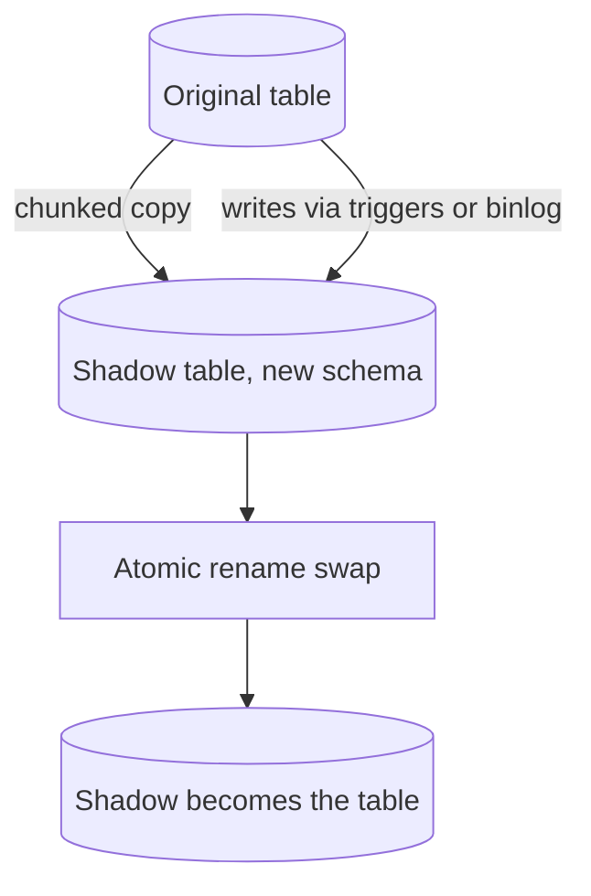
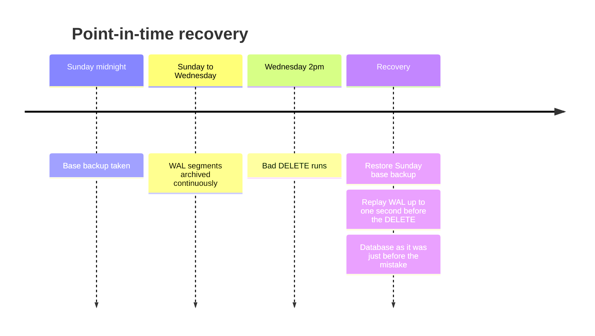

# Schema Changes and Backups

> [!abstract] What this is
> Two operational skills that decide whether a database survives real life: changing the schema of a live table without an outage, and getting data back after something goes wrong. Schema changes are made safe with **expand–migrate–contract** and online DDL tools. Recovery rests on **base backup + WAL replay** for point-in-time recovery, plus restore drills, because an untested backup isn't a backup.

---

## Why It Exists

Designs on a whiteboard have a fixed schema. Real systems change theirs every week while traffic keeps flowing, and during a deploy the old and new versions of the app run side by side against the same tables. A schema change that takes a heavy lock or rewrites a large table can stop every query for minutes.

Backups exist because replication doesn't protect you from yourself. A bad migration, a buggy `DELETE`, or a compromised account writes to the primary, and replication faithfully copies the damage to every replica within milliseconds ([[08 - Replication]]). The only way back is a copy from before the mistake.

---

## Why Schema Changes Are Dangerous

Most DDL needs a strong lock on the table, and some DDL has to rewrite every row. Three problems follow.

**Locks.** In Postgres, many `ALTER TABLE` forms take an `ACCESS EXCLUSIVE` lock, which blocks reads and writes. Even when the change itself is instant, the lock has to be *acquired*. If a long-running query holds a weaker lock on the table, the `ALTER` waits behind it, and every new query queues behind the `ALTER`. A metadata-only change can cause an outage just by waiting.

**Table rewrites.** Some changes (like changing a column's type) copy the whole table into a new file. On a large table that takes a long time, doubles the disk usage while it runs, and holds the lock throughout.

**Long migrations.** Even with no lock problems, a migration that touches every row generates a huge amount of WAL, can make replicas lag, and competes with production traffic for I/O.

> [!warning] Always set a lock timeout
> Run DDL with `SET lock_timeout = '2s'` (or similar). If the lock isn't granted quickly, the statement fails instead of stalling the whole table, and you retry later.

---

## Cheap vs Expensive Operations

The same logical change can be instant or dangerous depending on how you write it. This table covers the common cases in Postgres, with MySQL notes where they differ.

| Operation | Cost in Postgres | MySQL (InnoDB) | Pick when / how |
|---|---|---|---|
| Add nullable column, no default | Metadata only; brief lock | `ALGORITHM=INSTANT` in 8.0 | Always safe. The default first step of any expand. |
| Add column with a constant default | Metadata only since Postgres 11 (the default is stored in the catalog). A volatile default like `clock_timestamp()` still rewrites the table | `INSTANT` in recent 8.0 | Safe on modern versions with a constant default. On older versions, add nullable, backfill, then set the default. |
| `CREATE INDEX` | Blocks writes for the whole build | Online (`INPLACE`) with concurrent DML | Only on small tables or during maintenance. |
| `CREATE INDEX CONCURRENTLY` | Doesn't block writes. Slower, can't run inside a transaction, and a failure leaves an `INVALID` index to drop and retry | n/a (normal index build is already online) | Default for adding an index to a live Postgres table. |
| Change column type | Usually a full table rewrite under `ACCESS EXCLUSIVE`. Some binary-compatible changes (e.g. widening `varchar(n)` or `varchar` → `text`) are metadata only | Usually a table copy | Avoid on large tables. Use expand–migrate–contract with a new column instead. |
| Add `NOT NULL` | Full table scan under `ACCESS EXCLUSIVE` to check for nulls | Often a rebuild | Add `CHECK (col IS NOT NULL) NOT VALID`, then `VALIDATE CONSTRAINT` (weaker lock, no blocking), then `SET NOT NULL`, which on Postgres 12+ uses the validated constraint and skips the scan. |
| Drop column | Metadata only in Postgres (space reclaimed later) | Rebuild or `INSTANT` in newer 8.0 | Safe once no code reads or writes the column. The last step of contract. |

---

## Expand–Migrate–Contract

The core pattern for any change that isn't instant: never make a change that the currently running app version can't handle. Split it into steps that are each backward-compatible, and ship each step on its own.

1. **Expand.** Add the new structure alongside the old. Nothing breaks, because nothing uses it yet.
2. **Migrate.** Make the app write both, backfill old rows, then switch reads to the new structure.
3. **Contract.** Once no running code touches the old structure, remove it.

### Worked example: rename `users.name` to `users.full_name`

A plain `ALTER TABLE users RENAME COLUMN name TO full_name` is instant for the database, but it breaks every running instance of the old app the moment it commits. During a rolling deploy, old and new versions both run, so the rename has to happen in stages.

| Step | Database change | App change | Old app still OK? | New app OK? |
|---|---|---|---|---|
| 1. Expand | `ALTER TABLE users ADD COLUMN full_name text;` (nullable, instant) | None | Yes, ignores the new column | n/a |
| 2. Dual-write | None | Deploy v2: writes both `name` and `full_name`, still reads `name` | Yes | Yes |
| 3. Backfill | `UPDATE users SET full_name = name WHERE full_name IS NULL` in batches (next section) | None | Yes | Yes |
| 4. Switch reads | None | Deploy v3: reads `full_name`, still writes both | Yes (v2 still writes both) | Yes |
| 5. Stop old writes | None | Deploy v4: writes only `full_name` | v2/v3 are gone by now | Yes |
| 6. Contract | Add `NOT NULL` safely if needed, then `ALTER TABLE users DROP COLUMN name;` | None | n/a | Yes |

Each row is a separate deploy, and you can stop or roll back at any point before step 6 without losing data. The same shape works for splitting a table, changing a type (new column of the new type), or moving data to another store.


---

## Backfills

A backfill copies or computes data for existing rows. One giant `UPDATE` over a large table holds row locks for a long time, generates a burst of WAL that makes replicas lag, and if it fails halfway you start again from zero. A safe backfill has four properties.

| Property | What it means | How |
|---|---|---|
| **Batched** | Touch a bounded number of rows per transaction | `UPDATE … WHERE id BETWEEN $lo AND $hi`, a few thousand rows at a time |
| **Throttled** | Leave headroom for production traffic | Sleep between batches; pause if replica lag or DB CPU goes above a threshold |
| **Resumable** | A crash doesn't restart from the beginning | Walk the primary key in order and store the last processed id |
| **Idempotent** | Re-running a batch is harmless | Guard with a condition like `WHERE full_name IS NULL`, so done rows are skipped |

```sql
-- One batch; the job loops, advancing :last_id, and sleeps between batches
UPDATE users
SET    full_name = name
WHERE  id > :last_id AND id <= :last_id + 5000
  AND  full_name IS NULL;
```

Dual-writes must be live **before** the backfill starts. Otherwise rows written during the backfill are missed.

---

## Online DDL Tools

For changes the database can't do online (common on MySQL for type changes and big rebuilds), tools rebuild the table in the background and swap it in. They share one approach: build a **shadow table** with the new schema, copy rows into it in chunks, keep it in sync with ongoing writes, then **atomically swap** the names.

| Tool | How it stays in sync | Trade-off | Pick when |
|---|---|---|---|
| **pt-online-schema-change** (Percona) | Triggers on the original table copy each insert/update/delete into the shadow table | Triggers add load to every write on the hot table | MySQL, simpler setups, triggers acceptable |
| **gh-ost** (GitHub) | No triggers. Reads the **binlog** (MySQL's replication log) and applies changes to the shadow table asynchronously | Needs row-based binlog; more moving parts | MySQL on busy tables where trigger overhead is a problem; you want throttling and pause control |



The cut-over is a quick rename (`RENAME TABLE` in MySQL), so the lock is held only for a moment. Postgres users often don't need these tools because more DDL is online, but `pg_repack` plays a similar role for rebuilding bloated tables.

---

## Backups

A backup is a copy you can restore from after data is lost or corrupted. There are three kinds, and a serious setup uses at least two.

| Kind | What it is | Strengths | Weaknesses | Pick when |
|---|---|---|---|---|
| **Logical** (`pg_dump`, `mysqldump`) | SQL or archive of the data and schema | Portable across versions and machines; can restore one table | Slow to dump and very slow to restore on large databases; no point-in-time | Small databases, migrations between versions, grabbing one table |
| **Physical** (base backup, e.g. `pg_basebackup`) | Copy of the data files themselves | Fast restore; combines with WAL for point-in-time recovery | Same major version and architecture; whole cluster only | The main backup for any production database |
| **Snapshots** (EBS/disk/volume snapshots) | Block-level copy of the disk at an instant | Very fast to take and restore; managed by the cloud | Crash-consistent only; tied to one provider and region unless copied | Fast recovery path alongside physical backups + WAL |

### Point-in-time recovery

Point-in-time recovery (PITR) lets you restore to any moment, such as one second before a bad `DELETE`. It works because the WAL records every change ([[01 - Storage Engine and Disk IO]]). You take a periodic **base backup** and continuously **archive WAL** segments to durable storage. To recover, you restore the latest base backup from before the incident and replay archived WAL up to the target time (in Postgres, `recovery_target_time`).



How much you can lose (RPO) is set by how often WAL is shipped. How long recovery takes (RTO) is set by how much WAL has to be replayed since the last base backup, so more frequent base backups mean faster restores. Setting RPO and RTO targets is covered in [[08 - Reliability]]; backup storage, retention, and cross-region copies are infrastructure concerns in [[19 - Deployment and Infrastructure]].

### Restore drills

An untested backup isn't a backup. Backups fail silently: archiving breaks, credentials expire, a file is corrupted, or the restore takes ten hours when you assumed one. The only proof is restoring regularly into a separate environment, checking the data, and timing it. That measured time is your real RTO.

> [!danger] Replicas are not backups
> A replica is only seconds behind the primary, so a bad write reaches it almost immediately. A delayed replica helps a little; PITR from archived WAL is the real protection.

---

## Failure Modes

| Failure | What happens | Mitigation |
|---|---|---|
| DDL waits behind a long query | Lock queue forms; every query on the table stalls | `lock_timeout`, retry; kill or avoid long transactions |
| Table rewrite on a big table | Minutes of blocked reads/writes, double disk | Expand–migrate–contract with a new column; online DDL tools |
| Plain `CREATE INDEX` on a live table | Writes blocked for the build | `CREATE INDEX CONCURRENTLY`; drop and retry if it ends `INVALID` |
| Rename or drop in one deploy | Old app instances crash on the missing column | Expand–migrate–contract; drop only after all old code is gone |
| Unbatched backfill | Long locks, replica lag, restarts from zero on failure | Batched, throttled, resumable, idempotent |
| Backfill before dual-write | Rows written during the backfill are missed | Turn on dual-writes first |
| Bad write replicated | Every replica has the corruption | PITR from base backup + WAL |
| WAL archiving silently broken | PITR can only reach the last good segment | Alert on archive failures; restore drills |
| Backup never restored | Restore fails or takes far longer than planned during an incident | Scheduled restore drills with timing |

---

## Interview Lines

> [!tip] Say it like this
> - "Schema changes go through expand–migrate–contract, so old and new app versions both work at every step."
> - "I add indexes with `CREATE INDEX CONCURRENTLY` and run DDL with a lock timeout."
> - "Backfills are batched, throttled, resumable and idempotent, and dual-writes are on before they start."
> - "gh-ost and pt-online-schema-change build a shadow table, keep it in sync through the binlog or triggers, then swap it in with an atomic rename."
> - "Replication isn't backup. Point-in-time recovery is a base backup plus WAL replay to just before the mistake."
> - "An untested backup isn't a backup. We restore it on a schedule and time it."

## Related Notes

- [[README]]
- [[01 - Storage Engine and Disk IO]]
- [[08 - Replication]]
- [[08 - Reliability]]
- [[19 - Deployment and Infrastructure]]
- [[11 - Interview Questions]]
