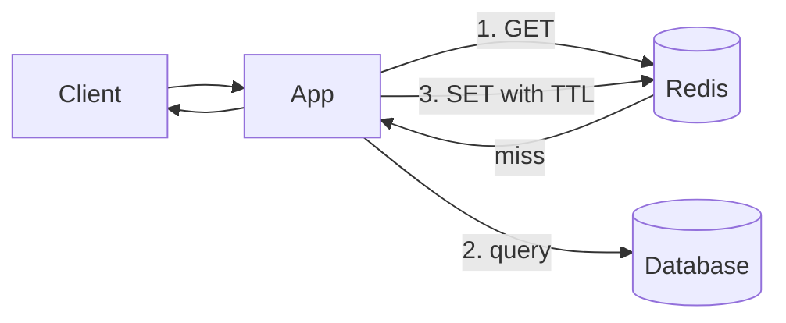

# Caching

> [!abstract] What this is
> A cache is a fast copy of data that already lives somewhere slower. Adding one is never just "put Redis in front." It's four decisions: **what key**, **what TTL**, **who invalidates it**, and **what happens when the cache is down**.
>
> Defaults when nothing forces otherwise: cache-aside pattern, Redis as the store, LRU eviction plus a TTL.

---

## Why It Exists

A database read costs 20–50 ms. A Redis read costs about 1 ms. When the same rows are read over and over, that gap is the difference between a DB that coasts and a DB whose CPU is pinned.

So a cache earns its place when three things are true: the workload is **read-heavy**, the **same data is read repeatedly**, and that data **doesn't change on every request**. If the value changes every time someone looks at it, caching only adds a second place for it to be wrong.

---

## Where a Cache Can Live

There are several layers between the user and the database, and each can cache. They are different boxes and shouldn't be mixed up on a diagram.

| Layer | What it holds | Pick when |
|---|---|---|
| Browser / client | Responses governed by `Cache-Control` headers | Static or slow-changing public content. You don't fully control it. |
| CDN | Static files and some public `GET` responses | Content is the same for every user. See [[04 - Load Balancing CDN and Gateway]]. |
| API gateway | Occasional response caching | Rarely worth it. |
| **Redis** | Application data | The default "cache" in an interview. |
| In-process (e.g. Caffeine) | Tiny hot data: config, feature flags | Data is small and can be lost when the process restarts. |

> [!warning] Private data doesn't belong on the CDN or in the browser cache. You can delete a Redis key instantly; you can't reliably recall something already sitting in a CDN edge or a user's browser.

---

## Read and Write Patterns

The pattern decides who fills the cache and what happens on a write.

### Cache-aside (the default)

The application talks to the cache and the database separately. The cache only ever holds data someone actually asked for.

1. Read the cache. On a **hit**, return it.
2. On a **miss**, read the database, store the result in the cache with a TTL, then return it.
3. On a **write**, update the database and then **delete** the cache key.

Deleting is safer than writing the new value into the cache. If two writes race, a computed value can land in the cache in the wrong order; a delete just forces the next reader to fetch the truth.

### The other patterns

| Pattern | How it works | Cost | Pick when |
|---|---|---|---|
| **Cache-aside** | App fills on miss, deletes on write | First read after a write is slow | Default for almost everything |
| **Write-through** | Every write goes to cache and DB together | Slower writes | You own the write path and want the cache always warm |
| **Write-behind** | Write to cache, flush to DB later | **Data loss** if the cache dies before flushing | Almost never, when the DB is the source of truth |
| **Refresh-ahead** | Refresh a key before its TTL expires | Extra background work | A few very hot keys that must never miss |

---

## Keeping the Cache Correct

Cache invalidation is genuinely the hard part, and it's fine to say so. There are two tools, and most designs use both.

- **TTL only.** Every key expires after a fixed time. Simple, and briefly stale by design. Fine for profiles and product pages.
- **Invalidate on write.** Delete the key whenever the underlying data changes. Required when stale data is actually *wrong*, such as permissions or prices.

The standard answer combines them: **delete on write, and keep a TTL as a safety net** in case an invalidation is ever missed.

---

## Eviction

TTL removes keys when they get old. Eviction removes keys when memory is **full**. They're separate mechanisms and both run at once.

| Policy | Keeps | Pick when |
|---|---|---|
| **LRU** (least recently used) | Whatever was touched recently | Default. Say this. |
| **LFU** (least frequently used) | Whatever is popular over time | Some keys are "always hot" |
| **FIFO** | Newest entries | Rarely better than LRU |

In Redis this is one line of config: `maxmemory-policy allkeys-lru`.

---

## How Redis Itself Works

Treating Redis as a magic box is fine until someone asks "what happens if Redis restarts?" These three mechanisms answer that.

### Persistence

Redis lives in memory, but it can write to disk so a restart doesn't start empty.

| Mode | How it works | Loses on crash | Pick when |
|---|---|---|---|
| **None** | Memory only | Everything | Pure cache that can be rebuilt from the DB |
| **RDB** (snapshot) | Periodically dumps the whole dataset to a file | Everything since the last snapshot (minutes) | Fast restarts, some loss is acceptable |
| **AOF** (append-only file) | Logs every write; replays the log on restart | About one second, with `fsync` every second | Redis holds data you'd rather not lose, e.g. counters |
| **RDB + AOF** | Both | About one second | Faster restart than AOF alone, with AOF's durability |

> [!warning] Even with AOF, Redis is not a replacement for a database of record. If losing the data costs money, the source of truth belongs in the DB and Redis holds a copy.

### Replication

A Redis primary streams its writes to one or more replicas. Replicas serve reads and can take over if the primary dies. **Redis Sentinel** watches the primary and promotes a replica automatically.

Replication is **asynchronous**. A write acknowledged by the primary can be lost if the primary dies before the replica receives it.

### Redis Cluster (sharding)

One Redis box eventually runs out of memory. Redis Cluster splits data across several primaries using **16,384 hash slots**. Each key maps to a slot with `CRC16(key) mod 16384`, and each primary owns a range of slots. Adding a node moves slots, not every key.

Two consequences come up often:

- **Multi-key commands** (`MGET`, transactions, Lua scripts) only work if all the keys are in the same slot. **Hash tags** force that: `{user:42}:cart` and `{user:42}:profile` hash only the part in braces, so they land together.
- **A hot key stays on one shard.** Sharding spreads *many* keys; it does nothing for one key that gets half the traffic. See Failure Modes below.

---

## Redis vs Memcached

| | Redis | Memcached |
|---|---|---|
| Data types | Strings, hashes, lists, sets, **sorted sets**, bitmaps, streams | Opaque blobs |
| Persistence | Optional (RDB / AOF) | None |
| Replication | Built in | None |
| Pick when | Cache **plus** counters, leaderboards, locks, pub/sub | You need only a simple, multi-threaded blob cache |

Redis is rarely just `GET`/`SET`. Its data types map directly onto common features:

| Feature | Redis structure |
|---|---|
| Leaderboard | Sorted set |
| Feed of post IDs | List or sorted set |
| Rate limit | `INCR` plus a TTL |
| Lock | `SET key token NX EX 30` (details in [[14 - Coordination and Concurrency]]) |

> [!tip] Name the structure, not just the tool. "I'll cache the events" is vague. "A sorted set of `event_id` by popularity, each payload in a hash, TTL five minutes" shows you've actually designed it.

---

## Failure Modes

| Failure | What happens | Mitigation |
|---|---|---|
| **Stampede** (thundering herd) | A hot key expires; thousands of requests miss at once and all hit the DB | Let only one request refresh (a lock via `SETNX`), add random jitter to TTLs, serve the stale value while one request refills |
| **Hot key** | One key takes a huge share of traffic (a celebrity's profile) and saturates one node | Add an in-process cache in front, replicate the key, or split it into several keys |
| **Hot shard** | One Redis Cluster node takes disproportionate load | Same as a DB hotspot: rebalance slots or change the key design |
| **Redis down** | Every request falls through to the DB, which then falls over too | Short timeouts, a **circuit breaker**, optionally serve stale in-process data. See [[08 - Reliability]] |
| **Flush on deploy** | Clearing the whole cache sends every request to the DB at once | Never flush-all in production. Warm the cache, or let keys expire naturally |
| **Primary failover** | Recent writes that hadn't replicated are lost | Accept it for a cache; for anything important, the DB is the source of truth |

---

## Interview Lines

> [!tip] Say it like this
> - "Cache-aside with Redis. On a write I delete the key after commit, and every key has a TTL as a safety net."
> - "Deleting beats updating the cache on write, because two concurrent writes can't leave a wrong value behind."
> - "TTL handles staleness; LRU handles memory pressure. They're different mechanisms."
> - "If Redis goes down I fail fast with a short timeout and a circuit breaker, so the database doesn't get flattened."
> - "Redis isn't my source of truth for money. It's a copy I can rebuild."

## Related Notes

- [[04 - Load Balancing CDN and Gateway]]
- [[05 - Databases]]
- [[08 - Reliability]]
- [[14 - Coordination and Concurrency]]
