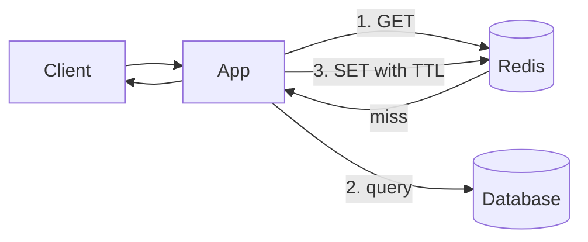

# Caching

> [!abstract] What this is
> A cache is a fast copy of data that already lives somewhere slower. Adding one is never just "put Redis in front." It's four decisions: **what key**, **what TTL**, **who invalidates it**, and **what happens when the cache is down**.
>
> Defaults when nothing forces otherwise: cache-aside pattern, Redis as the store, LRU eviction plus a TTL.

---

## Why It Exists

A database read costs 20–50 ms. A Redis read costs about 1 ms. When the same rows are read over and over, that gap is the difference between a DB that coasts and a DB whose CPU is pinned.

So a cache earns its place when three things are true: the workload is **read-heavy**, the **same data is read repeatedly**, and that data **doesn't change on every request**. If the value changes every time someone looks at it, caching only adds a second place for it to be wrong.

---

## Where a Cache Can Live

There are several layers between the user and the database, and each can cache. They are different boxes and shouldn't be mixed up on a diagram.

| Layer | What it holds | Pick when |
|---|---|---|
| Browser / client | Responses governed by `Cache-Control` headers | Static or slow-changing public content. You don't fully control it. |
| CDN | Static files and some public `GET` responses | Content is the same for every user. See [[04 - Load Balancing CDN and Gateway]]. |
| API gateway | Occasional response caching | Rarely worth it. |
| **Redis** | Application data | The default "cache" in an interview. |
| In-process (e.g. Caffeine) | Tiny hot data: config, feature flags | Data is small and can be lost when the process restarts. |

> [!warning] Private data doesn't belong on the CDN or in the browser cache. You can delete a Redis key instantly; you can't reliably recall something already sitting in a CDN edge or a user's browser.

In this context, "recall" means to forcefully revoke, invalidate, or pull back data after it has been distributed out into the world.

Here is why the distinction between a centralized cache and an edge cache is so critical for private data:

- **Centralized Control (Redis):** Because Redis is a database you own and control, you can execute a delete command instantly. The moment you do, that data is wiped, and no subsequent request will ever see it.
- **Distributed Chaos (CDNs and Browsers):** Once a file (like a private profile picture or a financial summary) is cached on a CDN edge server or downloaded into a user's local browser cache, you lose absolute control over it. While you can ask a CDN to invalidate a cache, you cannot reliably guarantee that every single global server purges it instantly. Worse, you have zero ability to reach into a user's physical phone or laptop to delete a file that is already sitting in their local Chrome cache. 

Because you cannot reliably pull back ("recall") that distributed data once it is out there, putting private information on a CDN or allowing the browser to cache it is a massive security risk.

---

## Read and Write Patterns

The pattern decides who fills the cache and what happens on a write.

### Cache-aside (the default)

The application talks to the cache and the database separately. The cache only ever holds data someone actually asked for.

1. Read the cache. On a **hit**, return it.
2. On a **miss**, read the database, store the result in the cache with a TTL, then return it.
3. On a **write**, update the database and then **delete** the cache key.

Deleting is safer than writing the new value into the cache. If two writes race, a computed value can land in the cache in the wrong order; a delete just forces the next reader to fetch the truth.

Here is exactly how the race condition happens if you try to **update** the cache:

1. **Write A** updates the database to `Value = 1`.
2. **Write B** immediately updates the database to `Value = 2` (this is now the true, final state of the database).
3. **Write B** executes quickly and updates the cache to `Value = 2`.
4. **Write A** experiences a slight network delay, arrives late, and overwrites the cache with `Value = 1`.

**The result:** Your database correctly holds `Value = 2`, but your cache is permanently stuck serving the outdated `Value = 1` to users until the cache expires. The computed values landed in the cache in the wrong order.

### The other patterns

| Pattern | How it works | Cost | Pick when |
|---|---|---|---|
| **Cache-aside** | App fills on miss, deletes on write | First read after a write is slow | Default for almost everything |
| **Write-through** | Every write goes to cache and DB together | Slower writes | You own the write path and want the cache always warm |
| **Write-behind** | Write to cache, flush to DB later | **Data loss** if the cache dies before flushing | Almost never, when the DB is the source of truth |
| **Refresh-ahead** | Refresh a key before its TTL expires | Extra background work | A few very hot keys that must never miss |

---

## Keeping the Cache Correct

Cache invalidation is genuinely the hard part, and it's fine to say so. There are two tools, and most designs use both.

- **TTL only.** Every key expires after a fixed time. Simple, and briefly stale by design. Fine for profiles and product pages.
- **Invalidate on write.** Delete the key whenever the underlying data changes. Required when stale data is actually *wrong*, such as permissions or prices.

The standard answer combines them: **delete on write, and keep a TTL as a safety net** in case an invalidation is ever missed.

---

## Eviction

TTL removes keys when they get old. Eviction removes keys when memory is **full**. They're separate mechanisms and both run at once.

| Policy | Keeps | Pick when |
|---|---|---|
| **LRU** (least recently used) | Whatever was touched recently | Default. Say this. |
| **LFU** (least frequently used) | Whatever is popular over time | Some keys are "always hot" |
| **FIFO** | Newest entries | Rarely better than LRU |

In Redis this is one line of config: `maxmemory-policy allkeys-lru`.

---

## Redis as the Cache Store

Redis is the default answer to "which store?" in this note, but it's a full data-structure server with its own persistence, replication, sharding, and jobs beyond caching (locks, rate limits, leaderboards, pub/sub). That depth lives in its own note so it doesn't get lost inside the caching *pattern*: **[[21 - Redis]]**.

What matters for caching specifically: Redis answers in about a millisecond, supports `EXPIRE` natively (so TTL is one flag, not a column you check yourself), and `DEL` is how cache-aside invalidates on write.

---

## Failure Modes

| Failure                        | What happens                                                                         | Mitigation                                                                                                                    |
| ------------------------------ | ------------------------------------------------------------------------------------ | ----------------------------------------------------------------------------------------------------------------------------- |
| **Stampede** (thundering herd) | A hot key expires; thousands of requests miss at once and all hit the DB             | Let only one request refresh (a lock via `SETNX`), add random jitter to TTLs, serve the stale value while one request refills |
| **Hot key**                    | One key takes a huge share of traffic (a celebrity's profile) and saturates one node | Add an in-process cache in front, replicate the key, or split it into several keys                                            |
| **Hot shard**                  | One Redis Cluster node takes disproportionate load                                   | Same as a DB hotspot: rebalance slots or change the key design                                                                |
| **Redis down**                 | Every request falls through to the DB, which then falls over too                     | Short timeouts, a **circuit breaker**, optionally serve stale in-process data. See [[08 - Reliability]]                       |
| **Flush on deploy**            | Clearing the whole cache sends every request to the DB at once                       | Never flush-all in production. Warm the cache, or let keys expire naturally                                                   |
| **Primary failover**           | Recent writes that hadn't replicated are lost                                        | Accept it for a cache; for anything important, the DB is the source of truth                                                  |

When a popular cache key expires, thousands of application threads might simultaneously realize the data is missing. To prevent them from all querying the underlying database at once, every thread immediately sends a `SETNX` command to Redis to try and create a temporary "lock" key. Because Redis processes commands one at a time, only the very first thread succeeds and is granted the lock; this "winner" takes on the responsibility of executing the heavy database query and saving the fresh data back into the cache. The thousands of other threads that failed to get the lock instantly know someone else is handling it, so they fall into a short waiting loop within their own application code (such as sleeping for 50 milliseconds and then checking the cache again) until they see the new data arrive, completely shielding the database from the massive traffic spike.

And random jitters make sure that not all the hot keys expire together and attack the database.

**Short Timeouts** When an application requests data from a cache, it waits for a response. If Redis silently crashes or a network partition occurs, the application might default to a standard network timeout, waiting 10 to 30 seconds before giving up. During this wait, the application thread is completely blocked. If a spike in traffic hits, all your application threads will quickly get stuck waiting in line for the dead cache, completely exhausting your server's resources and crashing the application itself. Configuring a short timeout (e.g., 50 milliseconds) forces the application to give up almost instantly, freeing the thread to either check the database or return an error.

**Circuit Breaker**

Even with short timeouts, repeatedly attempting to connect to a definitively dead service wastes CPU cycles and network resources. A circuit breaker is a software pattern that sits inside your application code and monitors the failure rate of these network calls.

- **Closed (Normal):** Requests flow through to Redis normally.
- **Open (Tripped):** If the circuit breaker detects too many consecutive failures or timeouts, it "trips" and opens the circuit. The application immediately stops attempting to reach Redis. Instead of waiting for a network timeout, the application instantly "fails fast," executing a predefined fallback logic (like serving slightly stale local data or returning an error).
- **Half-Open (Testing):** After a configured cooldown period, the circuit breaker lets a single test request through. If it succeeds, the circuit closes and normal traffic resumes.

**How They Help Together When Redis Fails** If Redis goes down, every single request experiences a cache miss. This causes 100% of your read traffic to "fall through" and slam directly into your underlying database, which is rarely provisioned to handle that massive load and will instantly crash as well.

The circuit breaker intentionally avoids routing queries to the database because of a massive capacity mismatch. Redis is designed to handle enormous read volume (e.g., 100,000 queries per second), whereas the underlying relational database is typically scaled to handle only the small fraction of traffic that naturally misses the cache (e.g., 5,000 queries per second).

---

## Interview Lines

> [!tip] Say it like this
> - "Cache-aside with Redis. On a write I delete the key after commit, and every key has a TTL as a safety net."
> - "Deleting beats updating the cache on write, because two concurrent writes can't leave a wrong value behind."
> - "TTL handles staleness; LRU handles memory pressure. They're different mechanisms."
> - "If Redis goes down I fail fast with a short timeout and a circuit breaker, so the database doesn't get flattened."
> - "Redis isn't my source of truth for money. It's a copy I can rebuild."

## Related Notes

- [[04 - Load Balancing CDN and Gateway]]
- [[05 - Databases]]
- [[08 - Reliability]]
- [[14 - Coordination and Concurrency]]
- [[21 - Redis]]
