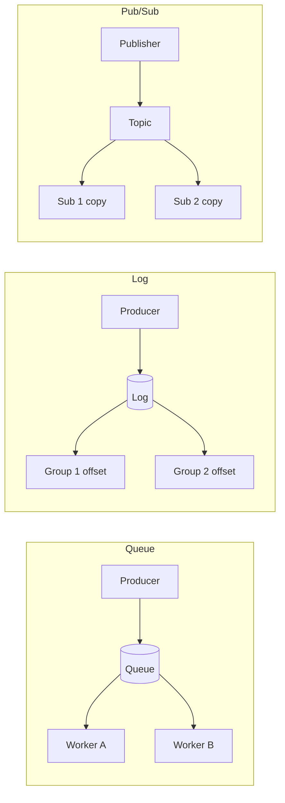
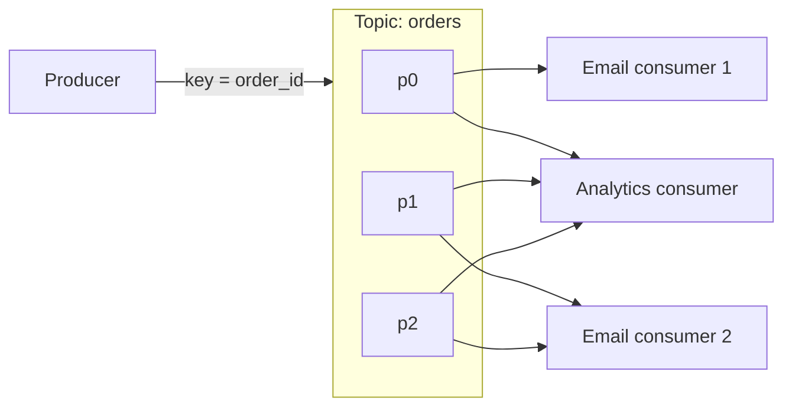
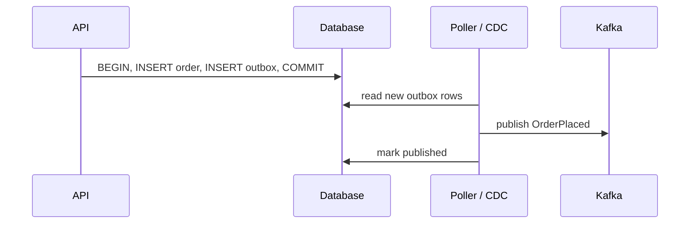

# Async Messaging

> [!abstract] What this is
> A queue is for **work you should not do on the user's request**: sending email, fanout, image resizing (meaning, things that are meant for being background tasks that would have took a lot of time to get done together were the tasks that need to be offloaded to a queue), "tell the other service." Kafka is a **durable log** that many consumers can replay. Delivery is **at-least-once** until *you* make the consumer idempotent; there is no magic exactly-once button.
>
> Defaults when nothing forces otherwise: Kafka (or SQS if you don't want to operate anything) keyed by entity ID, at-least-once delivery, an idempotent consumer, and a transactional outbox for "write the DB and publish."

---

## Why It Exists

A queue earns its place when one of these is true:

- The HTTP request should return **before** the slow work finishes.
- Traffic **spikes**: a 5k QPS burst hits while workers handle 500/s. Buffer it, don't drop it.
- You want to **decouple**: the order service shouldn't know about email, analytics, or the search indexer.
- **Multiple independent consumers** need the same event.

> [!warning] If the user is staring at a spinner waiting for this result, **do not queue it**
> Queues add latency. Checkout confirmation can enqueue the *email*; charging the card stays on the request (or a sync call with a timeout).

---

## Queue vs Log vs Pub/Sub

These three words get used interchangeably, but they describe different delivery models. Picking the right one is usually the first real decision.

A **queue** hands each message to **one** worker and deletes it once that worker acks. It's for jobs: "do this once." A **log** (stream) appends messages and **keeps** them for a retention period; each reader tracks its own position, so many readers can read everything and rewind. **Pub/sub** copies each message to **every** current subscriber; it's about fanout, and it can be built on either of the other two.

| Model | Each message goes to | After delivery | Replay | Examples | Pick when |
|---|---|---|---|---|---|
| **Queue** | One of many competing workers | Deleted on ack | Awkward | RabbitMQ queue, SQS | Jobs, emails, "do this once" |
| **Log / stream** | Every consumer group; one consumer per partition inside a group | Kept until retention | First-class (move the offset) | Kafka, Kinesis | Events, audit, many subscribers, reprocessing |
| **Pub/sub** | Every subscriber | Depends on the backing store | Only if log-backed | RabbitMQ fanout exchange, SNS → SQS, Kafka with many groups | One event, many independent reactions |

**Queue** : This job needs to be done just once, by just one of the pods that end up consuming this message (job)

The queue vs stream split is the distinction interviewers usually want:

|           | Queue (RabbitMQ, SQS)            | Stream / log (Kafka)                                     |
| --------- | -------------------------------- | -------------------------------------------------------- |
| Model     | Message disappears when consumed | Stays for a retention period                             |
| Consumers | Competing consumers (one wins)   | **Consumer groups**; several groups each read everything |
| Replay    | Awkward                          | First-class (offset)                                     |
| Use       | Jobs, emails, "do this once"     | Events, audit, many subscribers, replay                  |

SQS is "I don't want to operate Kafka." Kafka is "several systems need this event and we might reprocess." The broker details and a three-way comparison are in [[RabbitMQ and SQS]].

---

## Kafka in One Section

This is the part of Kafka every design needs. The internals are in [[Kafka/README]].

A **topic** is split into **partitions**, and a partition is an ordered log. The **partition key** (for example `order_id`) decides placement: same key → same partition → **order within that key**. There is no global order across partitions.

The **producer** appends. Inside a **consumer group**, each partition is assigned to one consumer, so useful consumers ≤ partitions. **Another group** can read the same topic independently, so notifications *and* analytics each get every event.

The **offset** is how far a group has read. Commit it **after** processing (at-least-once); commit before and you skip records on a crash. **Lag** is what builds up when produce rate > consume rate. Alert on it, and fix it with more consumers and partitions, faster workers, or backpressure on produce.

Replication uses brokers with a leader per partition ([[03 - Replication Durability and Consistency]]). If they ask "why is Kafka fast," the one-sentence answer is sequential disk, batching, and zero-copy ([[02 - Low-Level Storage and Performance IO]]). Don't lecture.

---

## Delivery Semantics

Every broker gives you one of three guarantees, and the honest reading matters more than the name.

| Name | Meaning | Reality |
|---|---|---|
| At most once | Send and forget | Can lose |
| At least once | Retry until ack | **Duplicates**. This is the default. |
| Exactly once | Once | **End to end it isn't real unless** you have an idempotent producer, a transactional outbox, and an idempotent consumer. Say "effectively once via idempotency keys." |

The Transactional Outbox pattern solves the dangerous "dual-write" problem. When your application creates a user, it needs to do two things: save the user in a relational database (like PostgreSQL) and publish a "UserCreated" event to Kafka. If the database commit succeeds but the network fails before hitting Kafka, your system is permanently out of sync. If you write to Kafka first, but the database transaction rolls back, Kafka has broadcasted a ghost event.

To fix this, you create a specific `outbox` table in your database. When you save the user, you also save the Kafka message into the `outbox` table within the exact same ACID database transaction. This guarantees the message is staged if and only if the business data is saved. A separate background process (a relay) continuously reads this `outbox` table and pushes those messages to Kafka.

This completes the "end-to-end" exactly-once illusion:

1. **Transactional Outbox:** Guarantees the message safely escapes the source database without being lost or originating from a rolled-back transaction.
    
2. **Idempotent Producer:** Guarantees the relay does not accidentally duplicate the message inside Kafka if a network retry happens.
    
3. **Idempotent Consumer:** Guarantees that if the destination server crashes and re-reads the message, it will not process the exact same event twice.

Kafka's own exactly-once (idempotent producer plus transactions) covers Kafka-to-Kafka pipelines. It stops at Kafka's edge; the full explanation is in [[04 - Producer Mechanics and Delivery Guarantees]].

**Stopping at the Edge:** The "edge" is the boundary where Kafka meets an external system (like a MySQL database, an email server, or a third-party API). Kafka's internal transactions have zero control over your external Postgres database. If your consumer reads a message from Kafka, successfully updates a Postgres table, but then crashes a millisecond before sending the "offset commit" back to Kafka, Kafka does not know the Postgres update happened. When the consumer restarts, Kafka will send the message again. Because Kafka cannot roll back your external Postgres database, its native exactly-once guarantee strictly stops at its own borders.

**Kafka Transactions (The Internal Feature):** The "transactions" mentioned below the table specifically refers to Kafka's native Transaction API. This is a built-in feature used purely for "Kafka-to-Kafka pipelines" (like Kafka Streams). It allows a stream processor to read a message from Topic A, process it, and write the result to Topic B atomically, ensuring that both the read offset and the new write are either committed together or rolled back together.

> [!tip] The interview answer
> "At-least-once plus an idempotent consumer (dedupe on `event_id` / upsert)." That *is* how production systems get exactly-once.

---

## Idempotency

The duplicate always comes from the same place: a worker crashes after doing the work but before acking, so the broker redelivers. The consumer has to make "run it twice" produce the same result as "run it once."

| Technique                  | How                                                            | Pick when                                     |
| -------------------------- | -------------------------------------------------------------- | --------------------------------------------- |
| Unique `event_id`          | Store it in the DB: `INSERT … ON CONFLICT DO NOTHING`          | Any event with a stable ID                    |
| Upsert by natural key      | Write by `order_id` so a repeat overwrites with the same value | The effect is "set state," not "add"          |
| Client **Idempotency-Key** | Client sends a key; store it on the payment intent row         | Payments and other user-initiated money moves |

The distinction of `event_id` and Client `Idempotency-Key` comes down to where the ID is generated and whose "intent" it is protecting.

- **`event_id` (System Identity):** This is typically a unique identifier generated internally by a backend service the moment an event is created. It represents a specific technical occurrence. As the table notes, this is used for "Any event with a stable ID". If an internal worker crashes before acknowledging a message and the broker redelivers it, the `event_id` remains perfectly stable. The downstream consumer sees the identical ID and safely ignores the duplicate using a standard database constraint like `INSERT ... ON CONFLICT DO NOTHING`.
- **`Client Idempotency-Key` (User Intent):** This key is generated externally by the client (e.g., a mobile app or web browser) _before_ the request ever reaches your infrastructure. It represents a specific business intention from the user.

---

## Transactional Outbox

This is the answer to "write the DB and publish." Don't `INSERT order` and then `kafka.send`, because one can succeed and the other fail.

1. In the **same DB transaction**, write the order **and** an `outbox` row.
2. A poller or Debezium CDC publishes the outbox rows to Kafka.
3. Mark them published.

This is the standard fix for the "dual write" problem, so name it. The relay can publish twice if it crashes after sending but before marking, which is one more reason consumers must be idempotent. Depth: [[06 - Ecosystem Resilience and Design Patterns]].

This highlights a critical architectural distinction between the two outbox implementations mentioned in the diagram: a standard Poller versus Change Data Capture (CDC). The "mark published" step applies exclusively to the Poller method.

- **The Poller Method:** A custom application thread periodically runs `SELECT * FROM outbox WHERE status = 'PENDING'`. It must actively execute an `UPDATE` or `DELETE` on the database row after pushing to Kafka so the next query does not pick it up again.
- **The CDC Method (Debezium):** Step 3 is skipped entirely. Because a CDC tool tails the database's Write-Ahead Log (WAL), writing a "published" status back to the outbox table would immediately generate a new WAL entry and trigger a redundant update event in Kafka.

Instead of modifying the database row, a CDC connector tracks its own progress externally. It continuously records its current position (such as a Log Sequence Number in PostgreSQL) and saves this pointer in a dedicated, hidden Kafka topic. If the connector crashes, it simply reads its last saved pointer and resumes tailing the WAL from that exact moment.

To prevent the outbox table from growing infinitely in a CDC architecture, developers typically run a separate, decoupled background job that blindly deletes rows older than a specific threshold (e.g., 7 days). The CDC connector is simply configured to filter out and completely ignore `DELETE` operations when it reads them from the WAL.

---

## Retry, Delay, DLQ

Retries need a shape, or they turn a small outage into a big one.

- Retry with **exponential backoff plus jitter**, otherwise you get a retry storm.
- After N failures, move the message to a **dead letter queue**. It goes to humans and metrics, never a silent drop.
- Don't retry 400s (bad payload). Do retry 503s and timeouts.

| Error | Retry? | Why |
|---|---|---|
| 400 / validation | No, straight to DLQ | It will fail the same way every time |
| 503 / timeout | Yes, with backoff + jitter | Likely transient |
| Still failing after N tries | DLQ + alert | Stop blocking the queue; a human looks |

---

## Backpressure

A queue that grows forever is a delayed outage. When the queue is full, **reject produce** (429 / 503) or slow the producer down. Scaling workers is the real fix; the queue only buys time.

The things mentioned below are about the line "Scaling workers is the real fix; the queue only buys time." but Backpressure in general only means pressuring the opposite direction of the data flow i.e. putting some pressure on the services upstream to the producer service, by throttling / rate limiting.

In standard message queues like AWS SQS or RabbitMQ, horizontal scaling works infinitely because any free worker can grab the next message off the top of the queue. However, in Kafka, the partition count acts as a hard mathematical ceiling for concurrency within a single consumer group. If a topic has 10 partitions, an 11th consumer pod will simply sit idle.

When a system design document says "scaling workers is the real fix" in the context of Kafka backpressure, it implies a few specific strategies to bypass or elevate that partition limit:

- **Scale the Partitions First (The Standard Fix):** To horizontally scale your consumer pods, you must first increase the number of partitions on the Kafka topic itself. Altering a topic from 12 to 24 partitions allows you to spin up 12 more consumer pods to share the load. (Note: Adding partitions requires careful planning if message ordering relies on hashing a specific key).
- **Consumer-Side Fan-Out (Async Threading):** If you cannot increase partitions, you detach the heavy processing from the Kafka consumption loop. A single Kafka consumer pod pulls a batch of messages from its partition and immediately drops them into a local async thread pool, or forwards them to a secondary, non-partitioned queue (like Redis or RabbitMQ). The Kafka consumer just acts as a fast router, allowing the actual "workers" (the threads or secondary consumers) to scale horizontally without partition limits.
- **Vertical Scaling (Throughput Optimization):** While horizontal scaling is the HLD default, vertical scaling is often the immediate operational fix for Kafka backpressure. If you are locked at 10 partitions and 10 consumers, you must make those 10 consumers process data faster. This means allocating more CPU/RAM to the pods, optimizing the database queries the consumers are running, or implementing batch database inserts.

> [!warning] The catch with consumer-side fan-out
> Handing messages to a thread pool gives up two things the partition gave you for free. **Ordering**: two messages for the same key can now finish in either order, so if order matters, route each key to the same thread (hash the key to a thread). **Safe offset commits**: if the consumer commits the offset as soon as it hands the batch off, and the pod crashes before the threads finish, those messages are lost. Commit only offsets whose processing has actually completed.

A few more mechanics complete the picture:

- **Pull vs push decides where the pressure lands.** Kafka consumers **pull**: they ask for the next batch only when ready, so a slow consumer never gets flooded; the backlog just becomes **consumer lag** sitting safely on the broker. Push-style brokers need an explicit limit instead: RabbitMQ's **prefetch** count (`basic.qos`) caps how many unacked messages a consumer is handed at once, and without it a slow consumer gets buried in memory ([[RabbitMQ and SQS]]).
- **The consumer must protect its own downstream.** Scaling consumers up moves the pressure onto whatever they write to. Fifty consumer pods each running full speed against one Postgres will take it down. Cap the worker pool, rate-limit calls to the downstream, and when it slows down (rising latency, 429s, 503s), **pause** the partitions (`consumer.pause()` / `resume()`) instead of retrying in a tight loop, so lag grows on the broker rather than errors piling up downstream.
- **The producer side has backpressure too.** A Kafka producer buffers records in memory (`buffer.memory`). If the broker can't keep up and the buffer fills, `send()` **blocks** for up to `max.block.ms` and then throws, which pushes the pressure back into the service that's producing. Brokers can also enforce **quotas** that delay an over-quota producer's responses, slowing it without rejecting it.
- **Lag is the signal to act on.** Alert on consumer lag (and on how fast it's growing), and scale consumers from it, e.g. with KEDA on Kubernetes. A lag that keeps growing while consumers are maxed out means you've hit the partition ceiling or the downstream's ceiling, and adding pods won't help.
- **Partitions are a one-way door.** You can increase a topic's partition count but not decrease it, and adding partitions changes which partition a key hashes to for new messages, so per-key ordering breaks across the switch. Size partitions for future consumer counts up front.

The general theory of throttling (who enforces it, reject vs delay, rate vs concurrency limits, adaptive limits, retry budgets) is in [[08 - Reliability]].

---

## Fanout

One event, many channels: `OrderPlaced` → search index, email, analytics, push.

| Approach | How | Pick when |
|---|---|---|
| **Topic + many consumer groups** | Each downstream reads the log independently | Default. Prefer this |
| One worker that fans out | A single consumer calls every downstream | Rarely. Worse coupling: one slow channel blocks the rest |

On SQS the equivalent is SNS → one SQS queue per subscriber; on RabbitMQ it's a fanout exchange ([[RabbitMQ and SQS]]).

---

## Failure Modes

| Failure                               | What happens                                               | Mitigation                                               |
| ------------------------------------- | ---------------------------------------------------------- | -------------------------------------------------------- |
| Crash after work, before ack / commit | Message redelivered; handler runs twice                    | Idempotent consumer on `event_id`                        |
| Dual write (DB then publish)          | Order saved, event lost, or the reverse                    | Transactional outbox                                     |
| Retry storm                           | Every client retries at once and keeps the downstream down | Exponential backoff + jitter, cap retries                |
| Poison message                        | One bad payload fails forever and blocks progress          | Don't retry 4xx; DLQ after N tries                       |
| Unbounded lag                         | Queue grows until it's a delayed outage                    | Alert on lag, scale consumers, backpressure on produce   |
| User-facing work queued               | Spinner waits on async work                                | Keep it on the request path; queue only the side effects |

---

## Interview Lines

> [!tip] Say it like this
> - "Queue for jobs that should happen once, log for events many systems read and might replay."
> - "Key by `order_id` so each order is ordered; there's no global order and I don't need one."
> - "At-least-once plus an idempotent consumer on `event_id`. That's effectively once."
> - "For write-DB-and-publish I use a transactional outbox, with a poller or CDC relaying to Kafka."
> - "Retry with backoff and jitter, don't retry 4xx, DLQ after N failures, and alert on lag."
> - "A queue only buys time. Backpressure or more workers is the real fix."

## Related Notes

- [[Kafka/README]]
- [[RabbitMQ and SQS]]
- [[08 - Reliability]]
- [[11 - Services and Observability]]
- [[12 - Mini Designs]] (notifications, news feed)
- [[20 - Data Processing and Analytics]]
- [[HLD/Topics/07 - Async Messaging/README]]
