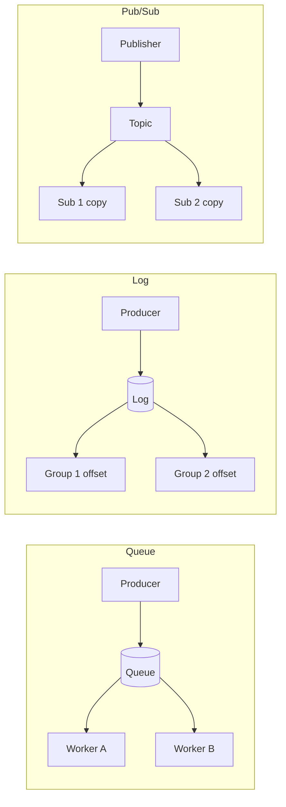
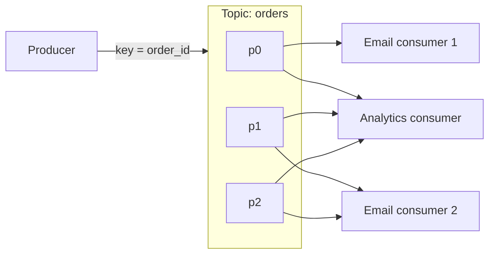

# Async Messaging

> [!abstract] What this is
> A queue is for **work you should not do on the user's request**: sending email, fanout, image resizing, "tell the other service." Kafka is a **durable log** that many consumers can replay. Delivery is **at-least-once** until *you* make the consumer idempotent; there is no magic exactly-once button.
>
> Defaults when nothing forces otherwise: Kafka (or SQS if you don't want to operate anything) keyed by entity ID, at-least-once delivery, an idempotent consumer, and a transactional outbox for "write the DB and publish."

---

## Why It Exists

A queue earns its place when one of these is true:

- The HTTP request should return **before** the slow work finishes.
- Traffic **spikes**: a 5k QPS burst hits while workers handle 500/s. Buffer it, don't drop it.
- You want to **decouple**: the order service shouldn't know about email, analytics, or the search indexer.
- **Multiple independent consumers** need the same event.

> [!warning] If the user is staring at a spinner waiting for this result, **do not queue it**
> Queues add latency. Checkout confirmation can enqueue the *email*; charging the card stays on the request (or a sync call with a timeout).

---

## Queue vs Log vs Pub/Sub

These three words get used interchangeably, but they describe different delivery models. Picking the right one is usually the first real decision.

A **queue** hands each message to **one** worker and deletes it once that worker acks. It's for jobs: "do this once." A **log** (stream) appends messages and **keeps** them for a retention period; each reader tracks its own position, so many readers can read everything and rewind. **Pub/sub** copies each message to **every** current subscriber; it's about fanout, and it can be built on either of the other two.



| Model | Each message goes to | After delivery | Replay | Examples | Pick when |
|---|---|---|---|---|---|
| **Queue** | One of many competing workers | Deleted on ack | Awkward | RabbitMQ queue, SQS | Jobs, emails, "do this once" |
| **Log / stream** | Every consumer group; one consumer per partition inside a group | Kept until retention | First-class (move the offset) | Kafka, Kinesis | Events, audit, many subscribers, reprocessing |
| **Pub/sub** | Every subscriber | Depends on the backing store | Only if log-backed | RabbitMQ fanout exchange, SNS → SQS, Kafka with many groups | One event, many independent reactions |

The queue vs stream split is the distinction interviewers usually want:

| | Queue (RabbitMQ, SQS) | Stream / log (Kafka) |
|---|---|---|
| Model | Message disappears when consumed | Stays for a retention period |
| Consumers | Competing consumers (one wins) | **Consumer groups**; several groups each read everything |
| Replay | Awkward | First-class (offset) |
| Use | Jobs, emails, "do this once" | Events, audit, many subscribers, replay |

SQS is "I don't want to operate Kafka." Kafka is "several systems need this event and we might reprocess." The broker details and a three-way comparison are in [[RabbitMQ and SQS]].

---

## Kafka in One Section

This is the part of Kafka every design needs. The internals are in [[Kafka/README]].

A **topic** is split into **partitions**, and a partition is an ordered log. The **partition key** (for example `order_id`) decides placement: same key → same partition → **order within that key**. There is no global order across partitions.

The **producer** appends. Inside a **consumer group**, each partition is assigned to one consumer, so useful consumers ≤ partitions. **Another group** can read the same topic independently, so notifications *and* analytics each get every event.

The **offset** is how far a group has read. Commit it **after** processing (at-least-once); commit before and you skip records on a crash. **Lag** is what builds up when produce rate > consume rate. Alert on it, and fix it with more consumers and partitions, faster workers, or backpressure on produce.

Replication uses brokers with a leader per partition ([[03 - Replication Durability and Consistency]]). If they ask "why is Kafka fast," the one-sentence answer is sequential disk, batching, and zero-copy ([[02 - Low-Level Storage and Performance IO]]). Don't lecture.



---

## Delivery Semantics

Every broker gives you one of three guarantees, and the honest reading matters more than the name.

| Name | Meaning | Reality |
|---|---|---|
| At most once | Send and forget | Can lose |
| At least once | Retry until ack | **Duplicates**. This is the default. |
| Exactly once | Once | **End to end it isn't real unless** you have an idempotent producer, a transactional outbox, and an idempotent consumer. Say "effectively once via idempotency keys." |

Kafka's own exactly-once (idempotent producer plus transactions) covers Kafka-to-Kafka pipelines. It stops at Kafka's edge; the full explanation is in [[04 - Producer Mechanics and Delivery Guarantees]].

> [!tip] The interview answer
> "At-least-once plus an idempotent consumer (dedupe on `event_id` / upsert)." That *is* how production systems get exactly-once.

---

## Idempotency

The duplicate always comes from the same place: a worker crashes after doing the work but before acking, so the broker redelivers. The consumer has to make "run it twice" produce the same result as "run it once."

| Technique | How | Pick when |
|---|---|---|
| Unique `event_id` | Store it in the DB: `INSERT … ON CONFLICT DO NOTHING` | Any event with a stable ID |
| Upsert by natural key | Write by `order_id` so a repeat overwrites with the same value | The effect is "set state," not "add" |
| Client **Idempotency-Key** | Client sends a key; store it on the payment intent row | Payments and other user-initiated money moves |

---

## Transactional Outbox

This is the answer to "write the DB and publish." Don't `INSERT order` and then `kafka.send`, because one can succeed and the other fail.

1. In the **same DB transaction**, write the order **and** an `outbox` row.
2. A poller or Debezium CDC publishes the outbox rows to Kafka.
3. Mark them published.

```mermaid
sequenceDiagram
    participant API
    participant DB as Database
    participant Relay as Poller / CDC
    participant K as Kafka
    API->>DB: BEGIN; INSERT order; INSERT outbox; COMMIT
    Relay->>DB: read new outbox rows
    Relay->>K: publish OrderPlaced
    Relay->>DB: mark published
```

This is the standard fix for the "dual write" problem, so name it. The relay can publish twice if it crashes after sending but before marking, which is one more reason consumers must be idempotent. Depth: [[06 - Ecosystem Resilience and Design Patterns]].

---

## Retry, Delay, DLQ

Retries need a shape, or they turn a small outage into a big one.

- Retry with **exponential backoff plus jitter**, otherwise you get a retry storm.
- After N failures, move the message to a **dead letter queue**. It goes to humans and metrics, never a silent drop.
- Don't retry 400s (bad payload). Do retry 503s and timeouts.

| Error | Retry? | Why |
|---|---|---|
| 400 / validation | No, straight to DLQ | It will fail the same way every time |
| 503 / timeout | Yes, with backoff + jitter | Likely transient |
| Still failing after N tries | DLQ + alert | Stop blocking the queue; a human looks |

---

## Backpressure

A queue that grows forever is a delayed outage. When the queue is full, **reject produce** (429 / 503) or slow the producer down. Scaling workers is the real fix; the queue only buys time.

---

## Fanout

One event, many channels: `OrderPlaced` → search index, email, analytics, push.

| Approach | How | Pick when |
|---|---|---|
| **Topic + many consumer groups** | Each downstream reads the log independently | Default. Prefer this |
| One worker that fans out | A single consumer calls every downstream | Rarely. Worse coupling: one slow channel blocks the rest |

On SQS the equivalent is SNS → one SQS queue per subscriber; on RabbitMQ it's a fanout exchange ([[RabbitMQ and SQS]]).

---

## Failure Modes

| Failure | What happens | Mitigation |
|---|---|---|
| Crash after work, before ack / commit | Message redelivered; handler runs twice | Idempotent consumer on `event_id` |
| Dual write (DB then publish) | Order saved, event lost, or the reverse | Transactional outbox |
| Retry storm | Every client retries at once and keeps the downstream down | Exponential backoff + jitter, cap retries |
| Poison message | One bad payload fails forever and blocks progress | Don't retry 4xx; DLQ after N tries |
| Unbounded lag | Queue grows until it's a delayed outage | Alert on lag, scale consumers, backpressure on produce |
| User-facing work queued | Spinner waits on async work | Keep it on the request path; queue only the side effects |

---

## Interview Lines

> [!tip] Say it like this
> - "Queue for jobs that should happen once, log for events many systems read and might replay."
> - "Key by `order_id` so each order is ordered; there's no global order and I don't need one."
> - "At-least-once plus an idempotent consumer on `event_id`. That's effectively once."
> - "For write-DB-and-publish I use a transactional outbox, with a poller or CDC relaying to Kafka."
> - "Retry with backoff and jitter, don't retry 4xx, DLQ after N failures, and alert on lag."
> - "A queue only buys time. Backpressure or more workers is the real fix."

## Related Notes

- [[Kafka/README]]
- [[RabbitMQ and SQS]]
- [[08 - Reliability]]
- [[11 - Services and Observability]]
- [[12 - Mini Designs]] (notifications, news feed)
- [[20 - Data Processing and Analytics]]
- [[HLD/Topics/07 - Async Messaging/README]]
