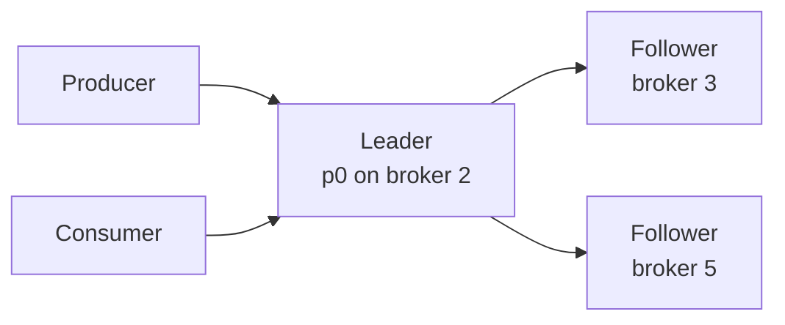
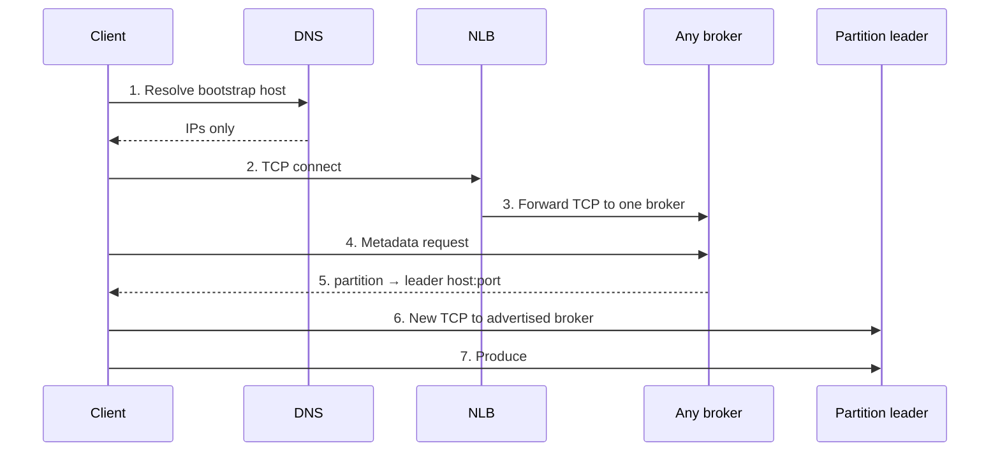
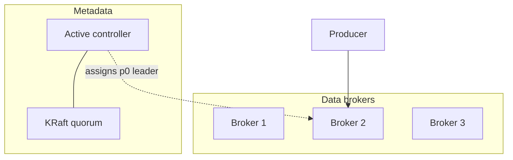

# Core Architecture and Cluster Consensus

> [!abstract] What this is
> A Kafka cluster is a set of **brokers** that store logs and serve produce and fetch requests. Cluster **metadata** (who leads which partition, topic config, membership) is decided by a **controller**, whose consensus used to live in **ZooKeeper** and now lives in **KRaft** (Raft inside Kafka). User records are **not** run through Raft per message: each partition has one **leader** and some **followers**. The short version lives in [[07 - Async Messaging]].

---

## Why It Exists

Kafka has to do two very different jobs. It has to move huge volumes of records quickly, and it has to keep a small, authoritative answer to "who is in charge of what." Splitting those jobs is the whole architecture: brokers and partition leaders handle the data path, and the controller plus its quorum handle the metadata path. Most confusion in interviews comes from mixing the two.

---

## The Pieces

Say these first. Each piece has a clear job and an equally clear thing it does **not** do.

| Piece | Job | Not its job |
|---|---|---|
| **Broker** | One Kafka process. Stores partition files. Serves produce / fetch. | Track "did consumer C finish message 5?" |
| **Topic** | Named stream (`orders`) | Hold one giant ordered list of the world |
| **Partition** | One **ordered** log. Unit of parallelism. | Global order across the topic |
| **Controller** | Cluster brain: create topic, pick **partition** leaders, react to broker death | Sit on every produce |
| **KRaft quorum** | Raft for **metadata** only | Replacing ISR for your user records |

### Dumb broker, smart consumer

The broker is a disk log. It stores records and hands them out when a consumer **polls**. After that it keeps no per-message "waiting for this consumer to finish" list. RabbitMQ does keep that list; Kafka does not (see [[RabbitMQ and SQS]]).

An **offset** is just a number: "this group's next record on this partition is #10461." While the consumer runs, that number sits in its memory, which is not enough, because memory is gone if the process dies.

A **commit** is the consumer **writing that number to Kafka** so it survives a crash. Kafka stores it in a compacted topic called `__consumer_offsets`, keyed by `(group, topic, partition)`. So Kafka holds the durable bookmark, and the consumer decides **when** to write it. The official bookmark does not live only on the consumer's own disk.

> [!tip] Process first, then commit
> Commit **after the handler has finished** (success or a deliberate skip), so a restart continues from the next record. If you commit the moment you **poll**, or an auto-commit timer fires before the handler runs, and then crash, that record is never processed. You skipped it. Depth: [[05 - Consumer Mechanics and Scalability]].

---

## Brokers and Broker Configuration

A broker is one Kafka **process / node**. It stores partition logs on disk and serves **produce** (writes) and **fetch** (reads). You run **several** brokers so one box dying does not take the cluster down. A topic's partitions are **spread** across brokers, so more brokers let you place more partitions and run more produce and fetch in parallel. One broker holds **many topics**, and can also hold **several partitions of the same topic**, for example leader of `orders-p0` and follower of `orders-p2`.

You don't need to recite 200 config keys. These are the ones worth naming.

| Knob | Why it exists | Prod default you say |
|---|---|---|
| `broker.id` | Who this node is | Unique per broker |
| `log.dirs` | Where the append-only segment files live | Dedicated disks |
| `num.partitions` | Default partition count for new topics | You still set this **per-topic** |
| `default.replication.factor` | How many copies of each partition | ==3== |
| `min.insync.replicas` | Durability floor for `acks=all` | ==2== ([[03 - Replication Durability and Consistency]]) |
| `unclean.leader.election.enable` | Promote a lagging replica if all ISR are dead? | **false** unless you chose uptime over the last writes |

What the broker does **not** do is track "has consumer C processed message 5?" That is the **group's offset**, stored in `__consumer_offsets` ([[05 - Consumer Mechanics and Scalability]]).

---

## Controllers and Leader Election

### Cluster metadata

Cluster metadata is the cluster's **address book**, not your `orders` records. It answers which topics exist, how many partitions each has, **which broker is leader of partition 7**, which brokers are alive, and what each replica list is. Someone has to **change** that book when you create a topic or a broker dies, and someone has to **hand the book** to clients ("send `orders` partition 0 to broker 2").

### What the controller does

The **controller** is the Kafka role that **updates the address book**. It creates and deletes topics, assigns partitions to brokers, and when broker 4 dies it picks a new leader for each partition broker 4 used to lead.

It does **not** append your `OrderPlaced` bytes; that is the **partition leader**. It also does not sit on every produce. Clients cache `partition → leader broker` and refresh the book only when a produce comes back "not leader for this partition."

### Active controller

Only **one** controller may change the address book at a time. That one is the **active** controller. If two controllers both changed the book, you would get two different answers to "who leads partition 7."

If the active controller dies, someone else must take the role, or the address book **cannot change**. Produces already going to a **partition leader** keep flowing; they don't wait on the controller unless that partition's leadership itself is moving. Who takes over, and how they already have the same book, is the consensus section below.

> [!info] Two different "leaders"
> The **controller** decides who is *allowed* to be a partition leader and updates the address book. The **partition leader** actually appends *this* partition's log. Mixing these two up is a common interview fail.

---

## Consensus: KRaft vs ZooKeeper

### Metadata log and Raft

The address book is not a sticky note in one process's RAM. It is stored as an **append-only log of changes**: "created topic X," "broker 4 is dead," "p7 leader is now broker 2." That is the **metadata log**. Replay it from the start and you rebuild the current address book.

**Raft** is how several machines keep **the same log**. A change is real only once a **majority** has it (2 of 3, or 3 of 5). After that, if one machine dies, the others still have the book. Raft here covers only the **metadata log**. Your user produce still goes to the **partition leader**, then to ISR followers ([[03 - Replication Durability and Consistency]]). The general theory is in [[17 - Consistency Time and Consensus]].

### Controller quorum

The **controller quorum** is the set of machines (usually 3 or 5) that keep the metadata log with Raft. One of them is the **active** controller, which is the Raft leader for this log. The others hold copies so the book doesn't die with one box. They vote on **metadata**, not on who stores `orders`.

KRaft runs in two shapes:

| Mode | Config | What it means | Pick when |
|---|---|---|---|
| **Combined** | `process.roles=broker,controller` | Same process is a data broker and a controller-eligible node; the quorum is some or all of your brokers | Small clusters, fewer boxes |
| **Isolated** | `process.roles=controller` on some boxes, `broker` on others | Controller nodes don't serve produce / fetch; the quorum is a separate 3 or 5 machines | Larger clusters where metadata work shouldn't compete with data traffic |

### ZooKeeper (the old world)

ZooKeeper did the same jobs: keep the address book and have exactly one active controller. The book lived in **ZooKeeper**, a **separate** cluster with its own majority vote, and Kafka brokers did not store that log. ZooKeeper stored the book and helped **elect** which Kafka **broker** was the active controller. The controller was still a normal Kafka broker, not a ZooKeeper node. When that broker died, ZooKeeper was used to pick another **broker** as controller.

| | ZooKeeper era | KRaft |
|---|---|---|
| Where the address book lives | ZooKeeper's own store | Metadata log **inside Kafka** |
| Who agrees on each change | ZooKeeper's majority | Controller quorum (Raft) |
| Who is the active controller | One **Kafka broker**, chosen via ZK | One member of the **controller quorum** |
| Extra system to run | Yes (ZK) | No |

If an older shop still runs ZooKeeper, the *ideas* (controller, partition leaders) are the same; only the place the book lives differs.

> [!warning] Don't oversell Raft
> KRaft is for the **metadata log**. It is not "every user message is a Raft round."

### Where the chain stops

Old Kafka asked ZooKeeper to run the vote, but ZooKeeper does **not** ask another product. You start ZooKeeper with a **list you typed** (server 1, 2, 3, or 5 servers), and those machines vote **among themselves**. That is the bottom.

KRaft is the same idea without the extra product. You start the controller quorum with a voter list you typed (`controller.quorum.voters`), and they vote among themselves. Lose a **majority** of that list and the address book **stops updating**. The chain doesn't continue; it **halts**. The only leftover "dependency" is bootstrap, where a human types the first voter list. That is not another coordinator.

---

## Leader-Follower Mechanism

Each partition has one leader and some followers. The leader takes every write; followers copy it.

| Role | Writes | Reads (classic) |
|---|---|---|
| **Leader** | All produces | Consumers (so they never see uncommitted) |
| **Follower** | Fetch from leader, append locally | Standby |

### Client connection

Producers and consumers use the **same kind of connection**: a **long-lived TCP** socket speaking the **Kafka protocol**, a binary request / response protocol, not HTTP. The client opens **one socket per broker it needs** and **reuses** it; there is no new TCP handshake per record. TLS, if the port is encrypted, is that same TCP plus encryption. It is still Kafka, not HTTPS.

| | Producer | Consumer |
|---|---|---|
| Request | `Produce` | `Fetch` |
| Who waits | Client waits for an ack (or not, if `acks=0`) | Client sends Fetch; the **broker may wait** until there is enough data, then replies |
| Then | Next Produce on the **same** socket | Next Fetch on the **same** socket |

The consumer is not a special connection type. Fetch is a **long-poll**: the request stays open until new data arrives or the wait expires. The two wait knobs (`fetch.min.bytes`, `fetch.max.wait.ms`) are in [[05 - Consumer Mechanics and Scalability]].

### Write path

The URL or bootstrap list you give the producer is **not** "the leader." It is any set of brokers that can answer "who leads this partition?" Connecting to bootstrap actually goes like this:

1. The client looks up the bootstrap hostname. DNS returns **IPs**, and that is all DNS does.
2. If those IPs belong to an **NLB**, the NLB only forwards **TCP** to **one** backend broker. It doesn't read Kafka and doesn't return the address book.
3. The TCP session is now with **that broker**.
4. The client sends a **Metadata** request on that socket.
5. **The broker** replies with `partition → leader host:port`.
6. The client opens **new** TCP connections to those advertised brokers, usually their real hostnames, not back through the bootstrap name.
7. Produce goes on those sockets, to the **leader**.

Writes always go to the leader, never to a random broker in the bootstrap list. If a producer sends to a broker that is **not** the leader (stale metadata, or it hit a follower), that broker does **not** append the record. It replies "not leader for this partition," and the producer refreshes metadata and retries on the real leader. Followers **pull** from the leader with fetch and append locally; the leader does not push to them. AWS MSK has exactly this shape: a bootstrap hostname or list, then advertised brokers. An ALB does **not** pick the partition leader.

### Read path

Reads use the same socket type; the request is **Fetch** instead of Produce. The default to say is: **produce → leader, consume → leader, followers only pull and stand by.**

Consumers may read only up to the **high watermark**, the point that is on every ISR member. That's why classic fetch hits the leader: you never see a record that exists only on the leader and would vanish if it crashed. HW depth is in [[03 - Replication Durability and Consistency]].

Newer Kafka adds **fetch from follower** for locality. The consumer fetches from a follower in the same rack or AZ using `client.rack` and `broker.rack`; writes still go to the leader. A **rack** is a label for physical place. In a datacenter it was a real rack; on AWS you set it to the **AZ** (`ap-south-1a`). Brokers advertise `broker.rack`, the consumer sets `client.rack` to *its* AZ, and Kafka prefers a follower with the **same** label.

| Aspect | Effect of follower fetch |
|---|---|
| Safety | The follower still serves only data at or below the HW, never dirty bytes from a lagging replica |
| Freshness | Slightly worse: the follower can be behind the leader's tip, so committed data may show up a moment later |
| Cost / load | Less cross-AZ traffic, less load on the leader |
| Pick when | They ask about leader load or cross-AZ cost. Otherwise lead with leader reads, or they hear "any replica, any data" |

### Leader dies, and how many of each

When a partition leader dies, the controller promotes someone from the **ISR**, not a replica that is 10 minutes behind. ISR, HW and unclean election are covered in [[03 - Replication Durability and Consistency]].

**Replication factor** is usually ==3==. **Partition count** is your parallelism. How many to pick is in [[04 - Producer Mechanics and Delivery Guarantees]]; how consumers split them is in [[05 - Consumer Mechanics and Scalability]].

---

## Picture of a Cluster

Putting the metadata path and data path on one diagram:

KRaft elects the **active controller**. The active controller picks who leads `p0` (usually someone in the ISR) and writes that into the metadata log. The producer talks to **broker 2**, the partition leader. Brokers 1 and 3 may hold **followers** of `p0`, or be leaders of other partitions.

---

## Failure Modes

| Failure | What happens | Mitigation |
|---|---|---|
| Active controller dies | Address book can't change until a new active controller is elected; existing produce to partition leaders keeps flowing | 3 or 5 voter quorum so a majority survives |
| Majority of the quorum lost | Metadata **halts**: no new topics, no leader changes | Spread voters across AZs; don't run a 2-node quorum |
| Partition leader dies | Controller promotes an ISR member; clients get "not leader," refresh metadata, retry | RF=3, `unclean.leader.election.enable=false` |
| Client sends to the wrong broker | Broker refuses with "not leader for this partition" | Built in: client refreshes metadata and retries |
| Load balancer mistaken for routing | An NLB forwards TCP to one broker; it can't pick leaders | Use it only for bootstrap; rely on advertised listeners |

---

## Interview Lines

> [!tip] Say it like this
> - "Brokers store partition logs. The controller owns metadata, like who leads each partition. Those are two different kinds of leader."
> - "KRaft is Raft for the metadata log only. User records go to the partition leader and replicate through the ISR."
> - "The broker doesn't track per-message acks. The consumer commits its offset to `__consumer_offsets` after processing."
> - "Bootstrap is only for discovery. The client asks any broker for metadata, then connects straight to the partition leaders."
> - "Lose a majority of the controller quorum and metadata stops changing. The chain halts; there's no coordinator above it."

## Related Notes

- [[Kafka/README]]
- [[03 - Replication Durability and Consistency]]
- [[05 - Consumer Mechanics and Scalability]]
- [[07 - Async Messaging]]
- [[17 - Consistency Time and Consensus]]
