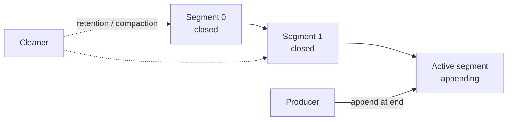
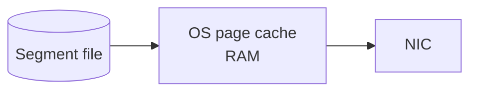
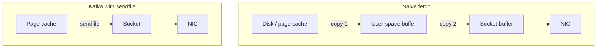
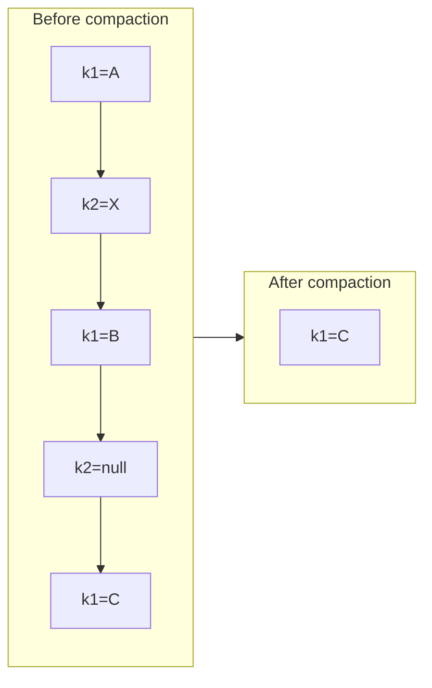

# Low-Level Storage and Performance I/O

> [!abstract] What this is
> How a Kafka partition actually sits on disk, and why a Java system can push so much data. A partition is an **append-only log**: you write only at the end, never `UPDATE` in the middle. Two tiny **sparse indexes** make lookups fast, hot bytes live in the **OS page cache** rather than a big JVM heap, and consumer fetches use **`sendfile`** so the payload barely touches user space. Old data is cleaned up by **retention** (time or size) or **compaction** (keep the latest value per key).

---

## Why It Exists

"Why is Kafka fast if it's Java?" is a standard question. The answer isn't a clever JVM trick. It's that Kafka avoids the expensive things entirely: random disk writes, big heaps that GC has to scan, and copying bytes through user space. Everything in this note is one of those avoidances.

---

## Append-Only Logs

A partition on disk is a **log** made of **segment files**. You only ever write at the **end**. There is no `UPDATE` in the middle and no rewriting page 12. That gives two cheap things for free: produce is cheap because it's **sequential I/O**, and replay is cheap because an offset is just a **bookmark** into the log.

### Segments

The **active segment** is the one currently being appended to. When it hits a size or time limit it gets **closed**, and a new active segment starts. Retention and compaction run only on **closed** segments, never on the live tail, so the writer never fights the cleaner over the same file.

> [!tip] Think of a notebook
> Producers add pages. Consumers are paperclips (offsets). Nobody rewrites a page that already exists.

| Consequence | Why we like it |
|---|---|
| Sequential disk | Cheap produces |
| Offset = bookmark | Replay is "move the bookmark" |
| Old segments close | Retention / compaction run on closed files, not the live tail |

---

## Index Structures (Offset Index and Time Index)

A segment can be **hundreds of MB**. You can't scan from byte 0 to find "offset `1_000_412`," and you can't scan from byte 0 to find "messages after 10:00." So each segment carries two small indexes.

| Index | Maps | Used for |
|---|---|---|
| **Offset index** | logical offset → file position | "start at offset X" |
| **Time index** | timestamp → offset | "messages after 10:00" |

Both are **sparse**, not a B-tree of every record. They hold a checkpoint every few KB or every N messages, not one entry per record. Kafka jumps to the **nearest checkpoint** and then scans a little. That keeps the indexes **tiny** while the logs stay **huge**, and it's why "find offset X" is not a full-file scan.

---

## OS Page Cache

Kafka does **not** keep the hot log in the **JVM heap**, and it doesn't run a 32 GB `-Xmx` so that GC can wreck you at 100k msg/s. Instead it simply reads and writes **files** and lets the **Linux page cache** hold recent bytes in RAM.

> [!note] Learnings: how data flows on write and read
> - **No objects for messages:** the broker doesn't deserialize records into Java objects. It treats a produced batch as opaque bytes: it checks the batch header and CRC, assigns offsets, and appends the batch.
> - **Write = page cache, not disk:** the append is a write to the segment file, which lands in the **OS page cache**. Those pages are now **dirty** (in RAM, not yet on disk).
> - **Ack before disk:** the leader acks once the bytes are in its page cache (with `acks=all`, once the ISR followers have them in *their* page caches too). Kafka doesn't `fsync` per message by default.
> - **Flush is the OS's job:** the kernel writes dirty pages to the segment file on disk **asynchronously**, in the background.
> - **Durability comes from replication,** not from fsync: a crash before the flush loses that broker's copy, but the other replicas still hold it.
> - **Reads come from the same page cache:** consumers mostly read the recent tail, which is still **hot** in the page cache, so fetches are RAM reads with no disk access. Only lagging consumers reading old segments hit the disk.

This keeps the heap **small**, so GC doesn't eat the throughput. It has a nice side effect too: if you restart the broker, the page cache can still be **warm**, because the OS hadn't needed that RAM yet. The first fetches after a restart can still be cache hits.

> [!warning] RAM is for the page cache
> A tiny box that **pages out** kills this. A huge heap that **starves** the OS cache also kills this. Give the broker **RAM for cache**, not a fat `-Xmx`.

When RAM runs short, Linux has two very different ways to free it. **Page eviction** works on **file-backed** memory, i.e. the page cache. A **clean** page (read from disk, unchanged) is simply dropped. A **dirty** page (like a fresh Kafka append) is first flushed to its file on disk, then dropped. Either way, the only cost is a later **cache miss**: the next read of that file goes to disk and pays milliseconds.

**Swapping** works on **anonymous** memory, which no file backs: the Java heap, thread stacks, the process's own state. The OS writes those pages out to a pre-configured **swap file or partition** on disk, and when the process touches one again, the thread stalls until it's read back. That's far worse than eviction for a JVM. A GC walks objects all over the heap, so a swapped-out heap turns a ~50 ms pause into **seconds of random disk reads**. Meanwhile the broker answers nothing and misses its heartbeats to the controller, so the cluster **fences it** and moves its partition leaders elsewhere, even though the process is still alive, just thrashing.

That's why Kafka (and Elasticsearch and other heavy JVM data nodes) run with **`vm.swappiness=1`**: the kernel evicts page cache first and practically never swaps the heap.

> [!note] Learnings: `-Xmx`, the 32 GB trap, and heap vs page cache
> - **`-Xmx`** is the JVM flag for the **maximum heap size**. RAM outside the heap stays with the OS, and Linux uses spare RAM as page cache.
> - **The 32 GB trap (compressed oops):** below ~32 GB the JVM stores object references as **32-bit compressed pointers**. At `-Xmx32g` or above it switches to full **64-bit** pointers for that run, so every reference doubles. A 32 GB heap can then hold **less** data than a 30–31 GB one. Stay at `-Xmx31g` or less if you need a big heap; `-XX:+PrintFlagsFinal` shows `UseCompressedOops`.
> - **Why GC hurts at 100k msg/s:** Eden (where new objects go) fills faster, so minor GCs run constantly. A big heap also means longer **stop-the-world** pauses. A 1 s pause at 100k/s is 100k requests queued, then timeouts upstream.
> - **"But Kafka doesn't create objects per message":** the payload bytes don't need to be objects, but the code around them still allocates. Each request parse, response, `ByteBuffer` and metadata object is short-lived garbage. Even a few objects per request is ~1M objects a second at 100k/s.
> - **Produce vs fetch:** produced bytes do pass through broker memory on their way into the segment file (and land in page cache). The **fetch** path with `sendfile` skips the heap for the payload. With TLS, zero-copy is lost, since bytes must be encrypted in user space.
> - **Tiny box pages out:** too little total RAM makes the OS swap active memory to disk, and throughput collapses.
> - **Huge heap starves the cache:** say `-Xmx56g` on a 64 GB box leaves ~8 GB for page cache. Recent segments no longer fit, and reads go to disk.
> - **The right split:** the JVM is only a traffic cop telling the kernel what to send, so it needs a small heap. On a 64 GB broker give the heap ~**6 GB** and leave the ~58 GB rest unassigned; Linux fills it with page cache automatically.
> - **If an app really needs a huge heap:** use a low-pause GC (ZGC), or **scale out** to several small JVMs so each GC is short and a pause hits only part of the traffic.
> - **Cache survives the restart:** a lot of times the cache survives the restart of the broker because the caching is done on the OS page cache and not the JVM

---

## Zero-Copy (`sendfile`)

A naive fetch copies the data twice. The kernel reads the file into a **user-space buffer**, then user space copies it into the **kernel socket buffer**. Two copies cost CPU, and in Java they add GC pressure because those user buffers live on the heap.

Kafka's fetch uses `sendfile`. The data is already in **page cache** (or comes from disk into cache), and `sendfile` moves those page-cache pages toward the **socket** directly. User space barely touches the payload.

The result is that the fetch path is **network / sequential-disk bound**, not "Java memcpy" bound.

| Path | Copies through user space | Bottleneck | Pick when |
|---|---|---|---|
| Naive read + write | Two | CPU and GC | Only when you must transform bytes in the app |
| `sendfile` | Barely any | Network / disk | Serving stored bytes unchanged, which is what a Kafka fetch does |

---

## Log Compaction Strategies

Kafka has two different cleanup jobs, and they answer different questions. **Retention** keeps recent history; **compaction** keeps current state.

| | Retention (default) | Compaction |
|---|---|---|
| Drops | Older than N days (`retention.ms`) / bigger than N GB (`retention.bytes`) | Older **values for the same key** |
| What's left | Recent **history** | **Latest state** per key |
| Use | Clicks, orders audit, "every event" | Changelog, `__consumer_offsets`, "current address for `user_id`" |
| Delete a key | Wait for time / size | **Tombstone** (`key=X, value=null`) |
| Pick when | You need every event within a window | You only care about the latest value per key |

> [!example] Same data, two jobs
> "7 days of every `user_id` event" → **retention**. "Current address for `user_id`" → **compaction**.

### What compaction is

For each **key**, compaction keeps the **latest value** and drops older updates for that key. The log becomes a **changelog**: current state, not full history. It's used for compacted "table" topics and for `__consumer_offsets`, where you care about the **last** commit per group-partition, not every commit ever made.

Here `k1` keeps only its latest value `C`, and `k2` is gone because its last record was a tombstone.

### What compaction is not

Compaction is not "exactly one record per key, forever, instantly." It runs in the **background** on **old** segments, so the tail can still hold two updates for the same key until it runs. It's also not a substitute for audit. If you need **every event**, use retention, because compaction throws history away on purpose.

As mentioned before, retention and compaction run only on closed segments.

### Tombstones

To delete a key on a compacted topic, produce `key=X, value=null`. After compaction runs, X **disappears**.

---

## Failure Modes

| Failure                       | What happens                                                                                                               | Mitigation                                              |
| ----------------------------- | -------------------------------------------------------------------------------------------------------------------------- | ------------------------------------------------------- |
| Broker heap sized huge        | OS page cache is starved; reads go to disk; Alongside it, since JVM size to be scanned by GC is too large : GC pauses grow | Small heap, leave RAM to the OS                         |
| Box too small, paging         | Hot data gets evicted; throughput collapses                                                                                | Size RAM for the working set of recent segments         |
| Compacted topic used as audit | History for a key silently disappears                                                                                      | Use retention for "every event" topics                  |
| Expecting instant compaction  | Readers still see duplicate keys on the tail                                                                               | Treat the tail as "latest wins"; compaction is eventual |
| Forgot tombstone semantics    | Deleted key never goes away on a compacted topic                                                                           | Produce `value=null` for the key                        |

**Page cache eviction (file-backed memory).** The page cache holds 4 KB chunks ("pages") of file data in RAM. It has no fixed size: it grows into free RAM and shrinks when something else needs memory. To shrink it, the OS **drops clean pages** (unchanged since read, so no disk write) and **flushes dirty pages** to their file first, then drops them. The cost shows up later: the next read of that data is a cache miss and goes to disk. Constant evict-and-refetch is what people mean by the cache **thrashing**. (Linux also calls swapping "paging out", so "evicting the page cache" is the clearer name for this one.)

**Swapping (anonymous memory).** Anonymous memory has no file behind it: the Java heap, metaspace, direct buffers, thread stacks. The only place the OS can push it is a pre-configured **swap file or partition**. It doesn't wait until RAM is completely gone. With the default `vm.swappiness=60`, Linux balances under memory pressure between dropping page cache and swapping out **cold** anonymous pages, and the rarely touched parts of a big heap are ideal victims. If the node has no swap at all (common on Kubernetes), the same pressure ends with the **OOM killer** stopping the broker instead.

**How this applies to the two failure modes:**

In both cases, the box too small (Case 2) or the heap too large (Case 1), **page cache eviction** is what first hurts throughput. The page cache can't hold the working set of recent segments, so "reads go to disk".

**Swapping** is a risk in both cases, wherever anonymous memory competes with RAM:
- **Case 2 (box too small)** is the classic case: heap plus OS plus other processes don't fit in RAM, so anonymous pages have nowhere to go but swap.
- **Case 1 (huge heap)** swaps in two ways. Either the heap plus the JVM's memory outside the heap overshoots RAM (e.g. `-Xmx62g` on a 64 GB box), or default swappiness pushes cold heap pages out to keep the page cache. A huge heap that still fits mostly just starves the page cache.

Swapping is lethal for a JVM because GC touches objects all over the heap. A **full GC** is stop-the-world and walks the whole heap. If parts of it are in swap, every touch is a **random disk read**, and a ~50 ms pause becomes seconds or even 30 s. The broker answers nothing, misses its heartbeats to the controller, and gets **fenced**, so its partition leaders move to other brokers until it recovers. Hence `vm.swappiness=1` on Kafka nodes.

A huge heap also makes full-GC pauses longer **without any swap**, simply because there's more heap to scan. That's a separate cost, and the table lists it separately.

---

## Interview Lines

> [!tip] Say it like this
> - "It's Java, but throughput is **network / sequential-disk** bound, not GC-bound."
> - "Page cache plus `sendfile` plus sequential append. That's the whole trick."
> - "A partition is an append-only log of segments. Cleanup runs on closed segments, never the live tail."
> - "The indexes are sparse, so finding offset X is a jump plus a short scan."
> - "Retention keeps history, compaction keeps the latest value per key. `__consumer_offsets` is compacted."

## Related Notes

- [[Kafka/README]]
- [[08 - Interview Questions]]
- [[03 - Replication Durability and Consistency]]
- [[05 - Consumer Mechanics and Scalability]] (`__consumer_offsets` is compacted)
