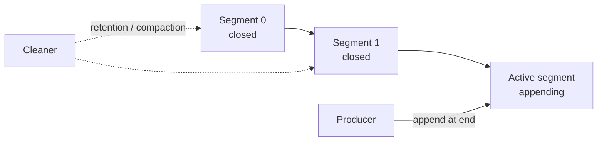
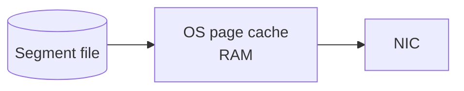
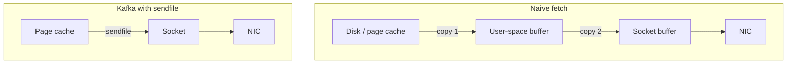
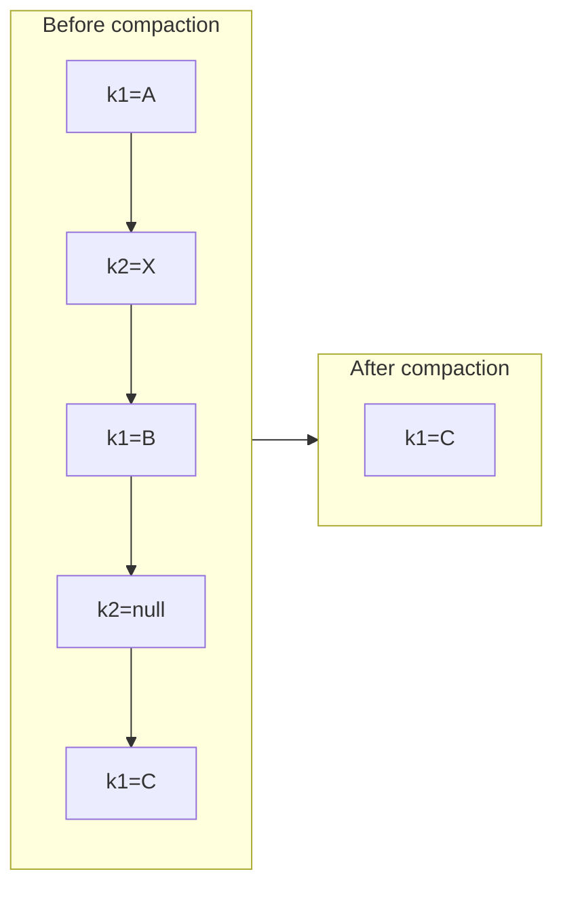

# Low-Level Storage and Performance I/O

> [!abstract] What this is
> How a Kafka partition actually sits on disk, and why a Java system can push so much data. A partition is an **append-only log**: you write only at the end, never `UPDATE` in the middle. Two tiny **sparse indexes** make lookups fast, hot bytes live in the **OS page cache** rather than a big JVM heap, and consumer fetches use **`sendfile`** so the payload barely touches user space. Old data is cleaned up by **retention** (time or size) or **compaction** (keep the latest value per key).

---

## Why It Exists

"Why is Kafka fast if it's Java?" is a standard question. The answer isn't a clever JVM trick. It's that Kafka avoids the expensive things entirely: random disk writes, big heaps that GC has to scan, and copying bytes through user space. Everything in this note is one of those avoidances.

---

## Append-Only Logs

A partition on disk is a **log** made of **segment files**. You only ever write at the **end**. There is no `UPDATE` in the middle and no rewriting page 12. That gives two cheap things for free: produce is cheap because it's **sequential I/O**, and replay is cheap because an offset is just a **bookmark** into the log.

### Segments

The **active segment** is the one currently being appended to. When it hits a size or time limit it gets **closed**, and a new active segment starts. Retention and compaction run only on **closed** segments, never on the live tail, so the writer never fights the cleaner over the same file.

> [!tip] Think of a notebook
> Producers add pages. Consumers are paperclips (offsets). Nobody rewrites a page that already exists.

| Consequence | Why we like it |
|---|---|
| Sequential disk | Cheap produces |
| Offset = bookmark | Replay is "move the bookmark" |
| Old segments close | Retention / compaction run on closed files, not the live tail |

---

## Index Structures (Offset Index and Time Index)

A segment can be **hundreds of MB**. You can't scan from byte 0 to find "offset `1_000_412`," and you can't scan from byte 0 to find "messages after 10:00." So each segment carries two small indexes.

| Index | Maps | Used for |
|---|---|---|
| **Offset index** | logical offset → file position | "start at offset X" |
| **Time index** | timestamp → offset | "messages after 10:00" |

Both are **sparse**, not a B-tree of every record. They hold a checkpoint every few KB or every N messages, not one entry per record. Kafka jumps to the **nearest checkpoint** and then scans a little. That keeps the indexes **tiny** while the logs stay **huge**, and it's why "find offset X" is not a full-file scan.

---

## OS Page Cache

Kafka does **not** keep the hot log in the **JVM heap**, and it doesn't run a 32 GB `-Xmx` so that GC can wreck you at 100k msg/s. Instead it simply reads and writes **files** and lets the **Linux page cache** hold recent bytes in RAM.

This keeps the heap **small**, so GC doesn't eat the throughput. It has a nice side effect too: if you restart the broker, the page cache can still be **warm**, because the OS hadn't needed that RAM yet. The first fetches after a restart can still be cache hits.

> [!warning] RAM is for the page cache
> A tiny box that **pages out** kills this. A huge heap that **starves** the OS cache also kills this. Give the broker **RAM for cache**, not a fat `-Xmx`.

---

## Zero-Copy (`sendfile`)

A naive fetch copies the data twice. The kernel reads the file into a **user-space buffer**, then user space copies it into the **kernel socket buffer**. Two copies cost CPU, and in Java they add GC pressure because those user buffers live on the heap.

Kafka's fetch uses `sendfile`. The data is already in **page cache** (or comes from disk into cache), and `sendfile` moves those page-cache pages toward the **socket** directly. User space barely touches the payload.

The result is that the fetch path is **network / sequential-disk bound**, not "Java memcpy" bound.

| Path | Copies through user space | Bottleneck | Pick when |
|---|---|---|---|
| Naive read + write | Two | CPU and GC | Only when you must transform bytes in the app |
| `sendfile` | Barely any | Network / disk | Serving stored bytes unchanged, which is what a Kafka fetch does |

---

## Log Compaction Strategies

Kafka has two different cleanup jobs, and they answer different questions. **Retention** keeps recent history; **compaction** keeps current state.

| | Retention (default) | Compaction |
|---|---|---|
| Drops | Older than N days (`retention.ms`) / bigger than N GB (`retention.bytes`) | Older **values for the same key** |
| What's left | Recent **history** | **Latest state** per key |
| Use | Clicks, orders audit, "every event" | Changelog, `__consumer_offsets`, "current address for `user_id`" |
| Delete a key | Wait for time / size | **Tombstone** (`key=X, value=null`) |
| Pick when | You need every event within a window | You only care about the latest value per key |

> [!example] Same data, two jobs
> "7 days of every `user_id` event" → **retention**. "Current address for `user_id`" → **compaction**.

### What compaction is

For each **key**, compaction keeps the **latest value** and drops older updates for that key. The log becomes a **changelog**: current state, not full history. It's used for compacted "table" topics and for `__consumer_offsets`, where you care about the **last** commit per group-partition, not every commit ever made.

Here `k1` keeps only its latest value `C`, and `k2` is gone because its last record was a tombstone.

### What compaction is not

Compaction is not "exactly one record per key, forever, instantly." It runs in the **background** on **old** segments, so the tail can still hold two updates for the same key until it runs. It's also not a substitute for audit. If you need **every event**, use retention, because compaction throws history away on purpose.

### Tombstones

To delete a key on a compacted topic, produce `key=X, value=null`. After compaction runs, X **disappears**.

---

## Failure Modes

| Failure | What happens | Mitigation |
|---|---|---|
| Broker heap sized huge | OS page cache is starved; reads go to disk; GC pauses grow | Small heap, leave RAM to the OS |
| Box too small, paging | Hot data gets evicted; throughput collapses | Size RAM for the working set of recent segments |
| Compacted topic used as audit | History for a key silently disappears | Use retention for "every event" topics |
| Expecting instant compaction | Readers still see duplicate keys on the tail | Treat the tail as "latest wins"; compaction is eventual |
| Forgot tombstone semantics | Deleted key never goes away on a compacted topic | Produce `value=null` for the key |

---

## Interview Lines

> [!tip] Say it like this
> - "It's Java, but throughput is **network / sequential-disk** bound, not GC-bound."
> - "Page cache plus `sendfile` plus sequential append. That's the whole trick."
> - "A partition is an append-only log of segments. Cleanup runs on closed segments, never the live tail."
> - "The indexes are sparse, so finding offset X is a jump plus a short scan."
> - "Retention keeps history, compaction keeps the latest value per key. `__consumer_offsets` is compacted."

## Related Notes

- [[Kafka/README]]
- [[08 - Interview Questions]]
- [[03 - Replication Durability and Consistency]]
- [[05 - Consumer Mechanics and Scalability]] (`__consumer_offsets` is compacted)
