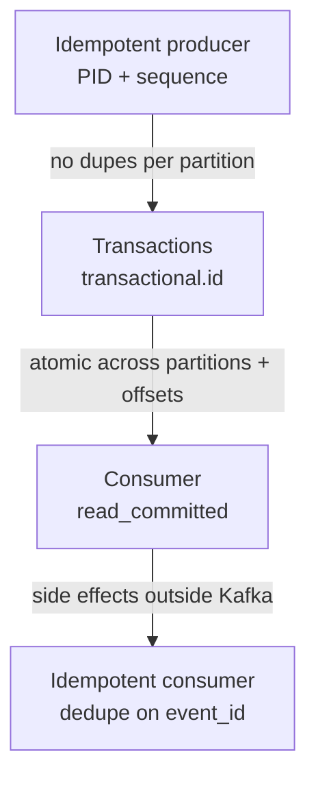

# Producer Mechanics and Delivery Guarantees

> [!abstract] What this is
> Everything on the producer side: where a record lands (**partition**), when the producer believes it landed (`acks`), and how retries avoid creating ghosts (**idempotence and transactions**). One record goes to **exactly one partition**, and order holds **per partition only**, so global order means one partition and no scale. The default you design for is **at-least-once plus dedupe on `event_id`**. Batching is how you avoid saturating the NIC, and more partitions do **not** always mean more throughput ([[08 - Interview Questions]]).

---

## Why It Exists

The producer is where most correctness decisions get made without anyone noticing. The key you pick decides ordering and hot spots. The `acks` setting decides what "sent" means. The retry settings decide whether a network blip creates a duplicate or a reorder. Getting these right is cheaper than cleaning up after them downstream.

---

## Message Routing and Partitioning

Every record goes to **exactly one partition**. The producer decides which one, using one of three strategies.

| Strategy | Rule | Order? | Pick when |
|---|---|---|---|
| **Key** | `murmur2(key) % n` | Same key → same partition → **ordered for that key** | Entity has an ordering invariant: `order_id` / `user_id` / `device_id` |
| **Sticky / default (no key)** | Fill a batch on one partition, then rotate | Throughput. **No** per-entity order | Firehose with no entity invariant |
| **Custom** | You write the partitioner | Whatever you coded | Rare. Say why |

### Order vs scale

Order exists **per partition only**. Global order means one partition, which means **no horizontal scale**. The correct move is to partition by a **business key**: that entity stays ordered, and the topic is still parallel across dozens of partitions.

> [!warning] Adding partitions later
> `hash % n` **changes** when `n` changes, so the same `user_id` can land on a **new** partition while its old history stays on the **old** one. "We'll add partitions next year" is not free if you keyed by user.

### How many partitions?

The first cut is `peak rate / rate-per-partition`. Then check it against consumers: **useful consumers in a group ≤ partition count**, so instance 11 with 10 partitions sits idle.

Pick a count that **divides** the consumer counts you will actually run. 12 partitions works for 2, 3, 4 or 6 instances. 10 partitions with 3 consumers splits 4 / 3 / 3, so one box does more work.

Don't open with 1000. More partitions mean more files, more replication, and more rebalance surface, and the producer gets slower before the cluster does. The next section explains why.

---

## More Partitions ≠ Always More Throughput

People assume "more partitions, more throughput" because a partition is one **ordered** log with one **leader**. More partitions mean more leaders you can write to in parallel and more consumers that can poll in parallel. That's true **until** something else becomes the bottleneck.

> [!tip] The one-liner they want
> Throughput is `min(producer, broker, consumer)`. Parallelism in a group is `min(partitions, consumers)`. Adding partitions only helps while partitions are the limiter **and** keys are even. After that it plateaus, then it **hurts**.

### What actually caps you

| Cap | What happens when you add partitions anyway |
|---|---|
| Consumers in the group `< n` | Each instance owns **more** partitions: more files, more fetch loops, more memory. Parallelism did **not** go up. |
| Consumers in the group `> n` | Extra instances sit **idle**. You needed partitions, not another pod. [[05 - Consumer Mechanics and Scalability]] |
| One **hot key** | That key still lands on **one** partition. `n = 1000` does not split `user_id=celebrity`. |
| Producer batching | Same QPS spread thinner → **smaller batches**, more requests, more RAM (`batch.size × n`) |
| Broker / controller | More open segment files, more replication, heavier metadata, **longer rebalances** |

### Producer-side cost of a huge `n`

The producer keeps a **buffer per partition**, so RAM is roughly `batch.size × partition count` plus compression buffers. 1000 partitions × 16 KB is already tens of MB **before** you count payload.

At the same produce rate, more partitions means each partition fills more slowly. `linger.ms` expires before `batch.size` is reached, compression gets worse (it's **per batch**), and more `ProduceRequest`s go on the wire. There are also more leaders to discover and talk to: metadata refreshes get fatter, and `acks=all` waits on **more** ISR sets. That's why "just set it to 1000" makes **produce p99 worse** before it makes consumption faster.

### Hot partitions (key skew)

`murmur2(key) % n` is even over **keys**, not over **traffic**. A celebrity or bursty key can make one partition 80% of QPS. One consumer in the group drowns while the other 99 partitions and consumers look fine.

More partitions **do not fix this**, because that key still hashes to exactly one partition. Splitting the key (for example `user_id + shard`) spreads load but **breaks per-key order**. The sticky / no-key partitioner spreads load too, but gives **no** per-entity order and can still hot-spot if one producer process is the firehose.

| Fix | What it does | Cost |
|---|---|---|
| Key with real cardinality (`order_id`, not `country=IN`) | Spreads traffic across many keys | None, if the invariant allows it |
| Isolate a known whale on its **own topic** | Stops one entity starving the rest | Another topic to run |
| Accept one key is one lane | Keeps the order contract | That key's throughput is capped |
| Split the key (`user_id + shard`) | Spreads the hot key | **Loses per-key order** |

> [!warning] Adding partitions later still doesn't fix a hot key
> `hash % n` **changes** for *everyone*. The celebrity still maps to **one** (possibly new) partition, and old history stays behind. You paid the rebalance and hash-break tax, and the whale is still a whale.

### What you pick in the interview

Start from **expected peak / per-partition rate** and the **planned consumer count**. Prefer a number that divides cleanly (12, 24, 48, not 10 if you'll run 3 instances). Leave **headroom**, but don't leave 900 empty partitions "for later." If they push "we'll add partitions at 10×," name three things: the hash break, the producer buffer cost, and that a hot key still won't split.

---

## Acknowledgments (`acks`)

`acks` decides what "success" means to the producer: how many brokers must have the record before the send returns.

| `acks` | Wait for | You can lose the write if… | Pick when |
|---|---|---|---|
| `0` | Nobody | Leader never even saw it | Metrics you can drop |
| `1` | Leader append | Leader dies before followers catch up | Low latency, some loss acceptable |
| `all` / `-1` | Leader + **current ISR** | ISR shrank to 1 and `min.insync.replicas` allowed it | Anything that matters (with `min.insync.replicas=2`) |

`acks=all` is **not** "RF=3 acknowledged," and it's not "three disks have it." It is "whoever is **currently in the ISR** acknowledged." If the ISR is `{leader}` and `min.insync.replicas=1`, you have one disk. Depth: [[03 - Replication Durability and Consistency]].

---

## Delivery Guarantees

There are three names, and the honest meaning of each matters more than the name.

| Name | How you get it | Honest meaning |
|---|---|---|
| At-most-once | Fire and forget / commit offset **before** work / `acks=0` | Can **lose** |
| At-least-once | Retry until ack; commit offset **after** work | **Duplicates**. This is the default. |
| Exactly-once | Idempotent produce + transactions **inside Kafka** + idempotent **consumer** outside | **Effectively once**, not magic |

> [!tip] What you actually ship
> At-least-once plus an **idempotent consumer** (`event_id` upsert / `INSERT … ON CONFLICT DO NOTHING`). That *is* how production systems get exactly-once. Kafka EOS (below) stops *producer-retry* duplicates and *multi-partition* half-writes. It does **not** stop a sloppy handler that ran twice outside Kafka.

---

## Exactly-Once, End to End

Kafka's exactly-once semantics (EOS) is built from two pieces that stack: the **idempotent producer** makes a single producer's retries safe on one partition, and **transactions** make a group of writes across partitions (plus the consumer's offset commit) atomic. The third piece, an **idempotent consumer**, lives outside Kafka and is your job.



### Idempotent producers

The problem: a network timeout means the producer doesn't know whether the broker got the batch, so it **sends again**. Without help, the log now has **two copies**.

With `enable.idempotence=true`, the broker gives the producer a **producer ID (PID)**, and the producer stamps every batch with a **sequence number** per partition. The broker remembers the last sequence it accepted for each PID and partition. A retried batch with a sequence it has already seen is **dropped** instead of appended.

| Stops | Does not stop |
|---|---|
| **Network-retry** duplicates at the broker | "My consumer ran the handler twice" |
| Reorder on retry, because Kafka keeps `max.in.flight` in a safe range when idempotence is on | Duplicates from a **new** producer instance after a restart (it gets a new PID; that needs transactions) |

**The reorder trap.** If you force `max.in.flight > 5`, or turn idempotence **off** with in-flight > 1, a retry can **land before** an earlier batch. Records in that partition are now **out of order**. With idempotence on, Kafka keeps `max.in.flight` in a safe range so this doesn't happen.

### Transactions and the transactional coordinator

A transaction is an atomic write to **several partitions and topics**: all visible, or none. On the broker side, a **transactional coordinator** runs on one broker and records transaction state in the internal topic `__transaction_state`. This is **2PC among Kafka partitions**, **not** 2PC with your Postgres.

The producer sets a stable **`transactional.id`**. On startup, `initTransactions()` registers it with the coordinator and bumps an epoch, so any older "zombie" instance with the same id is **fenced** and its writes are rejected. That's what extends idempotence across producer restarts.

The flow for a read-process-write loop:

```mermaid
sequenceDiagram
    participant App as App (consumer + producer)
    participant TC as Txn coordinator
    participant Out as Output partitions
    participant Off as __consumer_offsets
    App->>TC: initTransactions (transactional.id)
    App->>App: poll input records
    App->>TC: beginTransaction
    App->>Out: send results (p0, p3, ...)
    App->>Off: sendOffsetsToTransaction
    App->>TC: commitTransaction
    TC->>Out: write commit markers
    TC->>Off: write commit markers
```

The important step is `sendOffsetsToTransaction`: the consumer's input offsets are committed **in the same transaction** as the output records. Either the outputs and the "I've consumed up to here" bookmark both become visible, or neither does. A crash mid-way aborts the transaction, and the next run reprocesses from the old offset without leaving half-written output behind.

### Consumers must read committed

Aborted records still physically sit in the log. Consumers only skip them if they set `isolation.level=read_committed`. The default (`read_uncommitted`) can let you see records from a transaction that later **aborted**. Say this if they poke.

### Where transactions live, and where they don't

Their home is **Kafka Streams** style read-process-write: consume, process, produce, and commit offsets in the **same** transaction.

They are not the tool for an API request that writes Postgres **and** Kafka. Kafka's transaction can't include your database. That's the **transactional outbox** ([[06 - Ecosystem Resilience and Design Patterns]]).

### What EOS covers and what it doesn't

| EOS covers | EOS does not cover |
|---|---|
| Producer retries creating duplicates (idempotence) | A handler that sends an email, charges a card, or writes a DB, then crashes before commit |
| Zombie producers after restart (`transactional.id` fencing) | Writes to Postgres in the same "transaction" (use outbox) |
| Half-written output across several partitions | Consumers left on `read_uncommitted` |
| Output and input offsets committed atomically (Kafka → Kafka) | Anything outside Kafka. Side effects still need an **idempotent consumer** |

> [!warning] EOS stops at Kafka's edge
> If the consumer's work touches anything outside Kafka, a crash after the side effect and before the commit means it runs again. Dedupe on `event_id` in the target system, or use an upsert by natural key.

---

## Batching and Compression

Sending one record per syscall wastes the network. The producer collects records into per-partition batches and sends those.

| Knob | Effect |
|---|---|
| `batch.size` | Max bytes sitting in a batch **per partition** |
| `linger.ms` | Wait a few ms to fill the batch (latency ↑, throughput ↑) |
| Compression | Snappy / LZ4 / Zstd on the **batch**. Spend CPU for less network / disk |

| `linger.ms` | Feel | Pick when |
|---|---|---|
| `0` | Fastest per record, more tiny requests | Latency-sensitive, low volume |
| `5–20 ms` | Normal | Pipelines |
| `500 ms` | Big batches, slow | Never for a user-facing "I clicked pay" event |

That user-facing produce usually **shouldn't** be on the HTTP path anyway. The HTTP path writes the DB, and a poller or CDC publishes the event ([[06 - Ecosystem Resilience and Design Patterns]]).

---

## Failure Modes

| Failure | What happens | Mitigation |
|---|---|---|
| Hot key | One partition takes most traffic; one consumer drowns | Better key, isolate the whale, or accept one lane |
| Partitions added later | `hash % n` changes; per-key order breaks across old and new partitions | Size with headroom up front |
| Too many partitions | Small batches, more RAM, worse produce p99, longer rebalances | Size from peak rate and consumer count |
| Retry without idempotence | Duplicates, and reorder if in-flight > 1 | `enable.idempotence=true` |
| `acks=all` with `min.insync.replicas=1` | Acknowledged write on one disk only | `min.insync.replicas=2` |
| Zombie producer after restart | Two instances write the same output | `transactional.id` fencing |
| Consumer on `read_uncommitted` | Sees aborted transaction records | `isolation.level=read_committed` |
| Side effect then crash | Email / charge happens twice even with EOS | Idempotent consumer, dedupe on `event_id` |

---

## Interview Lines

> [!tip] Say it like this
> - "I key by `order_id`, so each order is ordered and the topic stays parallel. There's no global order."
> - "`acks=all` with `min.insync.replicas=2` and RF=3. `acks=all` means the current ISR, not all replicas."
> - "Idempotent producer: the broker dedupes retries by PID and sequence number per partition."
> - "Transactions make output records and consumer offsets commit atomically across partitions, and consumers read with `read_committed`."
> - "EOS stops at Kafka's edge. Anything outside Kafka still needs an idempotent consumer, so I ship at-least-once plus dedupe on `event_id`."
> - "More partitions isn't free: smaller batches, more producer RAM, longer rebalances, and a hot key still lands on one partition."

## Related Notes

- [[Kafka/README]]
- [[03 - Replication Durability and Consistency]]
- [[05 - Consumer Mechanics and Scalability]] (`n` vs `c`, idle consumers)
- [[06 - Ecosystem Resilience and Design Patterns]]
- [[08 - Interview Questions]]
- [[RabbitMQ and SQS]]
