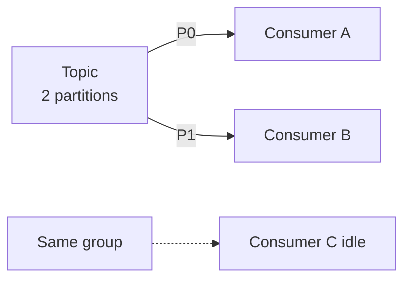
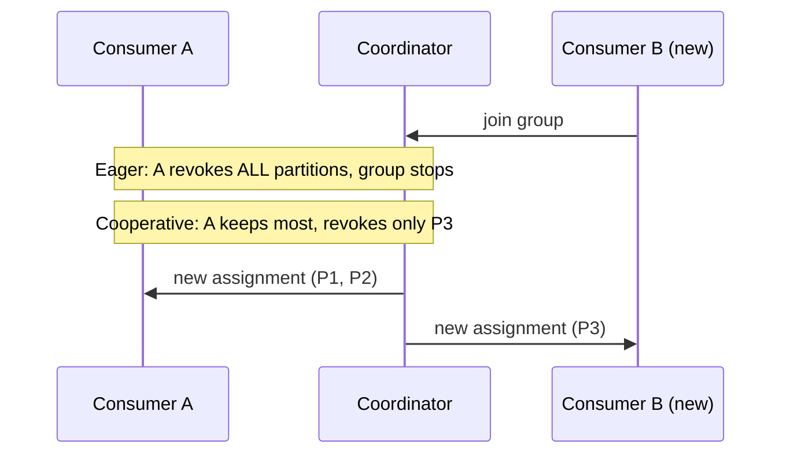
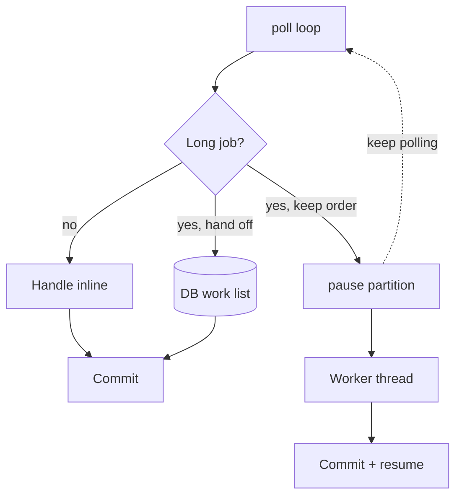

# Consumer Mechanics and Scalability

> [!abstract] What this is
> A Kafka consumer **pulls** records, and that pull is its backpressure. Consumers join a **group** that splits partitions between them, and each group records its progress as an **offset** in `__consumer_offsets`. Two groups on the same topic each see every record.
>
> The decisions this note helps you make: how many consumers are actually useful (never more than the partition count), how to commit offsets, which rebalance protocol to run, and how to keep slow work from getting a healthy consumer kicked out of the group.

---

## Why It Exists

Producers write into a log that never forgets on its own schedule. Something has to read that log, at its own pace, spread across many machines, without two machines doing the same work and without losing track of where it got to after a crash. That is the consumer's job.

The hard parts are all about scale and liveness. Adding instances past the partition count does **nothing**. A hot partition still pins one instance no matter how many you add. Rebalances used to stop the whole group (**eager**); **cooperative sticky** assignment and **static membership** mean they don't have to. And there are two separate "are you alive?" clocks. Mix them up and you get a fake-death storm.

---

## Pull vs Push Consumption

Kafka consumers **poll**. If a consumer is slow, it simply polls less often or fetches smaller batches, and the log waits for it (up to the retention limit). That is **consumer-managed backpressure**: the reader sets the pace, not the broker.

A push broker has to put the pile of undelivered messages somewhere, either in the consumer's memory or in the broker's. Kafka refuses to babysit your in-flight list on the broker. RabbitMQ takes the opposite approach: it **pushes**, tracks unacked messages, and can **prefetch** a number of them to each consumer. With Kafka you ask, you get a batch, and you commit an offset when *you* decide you're done. See [[RabbitMQ and SQS]] for the queue side.

| | Kafka (pull) | RabbitMQ (push) |
|---|---|---|
| Who sets the pace | Consumer polls when ready | Broker pushes, limited by prefetch |
| Who tracks in-flight state | Consumer, as one offset per partition | Broker, per unacked message |
| Slow consumer | Polls less; the log waits until retention | Unacked messages pile up on the broker |
| Pick when | Many readers, replay, high throughput | Per-message ack, NACK, priority |

### Fetch wait knobs

A Fetch is a request on the **same long-lived TCP connection** as Produce, and the broker is allowed to **hold that request** before it replies. Two settings control how long.

| Setting | Meaning |
|---|---|
| `fetch.min.bytes` | Don't reply until the response is at least this many bytes. Stops a flood of tiny Fetch replies. |
| `fetch.max.wait.ms` | Don't wait longer than this, even if `min.bytes` isn't met. Reply with whatever you have, which may be empty. |

The broker replies at **whichever happens first**: enough bytes have arrived, or the wait expires.

| Tuning | Effect | Pick when |
|---|---|---|
| Larger min + longer wait | Fewer requests, better throughput, **higher** latency | Batch or analytics consumers, network-bound consumers |
| Small min + short wait | Faster "I got something", more chatter | Latency-sensitive consumers on low-volume topics |

The socket, protocol and bootstrap steps are covered in [[01 - Core Architecture and Cluster Consensus]].

---

## Consumer Groups and Offsets

A consumer group is a set of instances that share the work of one logical subscriber. Groups are independent of each other: if `email-workers` and `analytics` both read `orders`, each group sees **every** order, and they never steal records from each other.

Inside one group, each partition goes to **at most one** consumer (classic assignment). You scale out by adding instances, but only **up to the partition count**. Instance 11 in a group reading 10 partitions sits **idle**.

With 2 partitions and 3 consumers in the **same** group, two consumers get work and one sits idle. You needed a third partition, not a third consumer. (With 4 partitions and 3 consumers, all three work and one owns two partitions; a fourth consumer makes it clean, and a fifth would sit idle.)

### Partition vs consumer balancing

Let `n` be the number of partitions and `c` the number of instances in **this** group. The parallelism you actually get is `min(n, c)`. Assignment is "as even as integers allow", not magically equal QPS, so leftover work always lands on **someone**.

| Situation | What you get | What you do |
|---|---|---|
| `c < n` | Each consumer owns up to `ceil(n/c)` partitions. 10 partitions / 3 consumers → **4 / 3 / 3**. | Fine. The box with 4 partitions is slightly hotter. |
| `c = n` | One partition per consumer. Clean. | This is the usual target. |
| `c > n` | `c - n` instances sit **idle**. | Adding pods does **nothing**. Add partitions first, or stop scaling this group. |
| `n >> c` | Each consumer owns a pile of partitions. | Parallelism did **not** increase. You paid for files, memory and longer rebalances with no extra workers. |

Both kinds of scaling have a cost. Adding a consumer triggers a **rebalance** and only helps if `c` was below `n`. Adding a partition also rebalances, and only helps if some consumer was the limiter **and** the new partition actually receives traffic. It also changes the producer's hash mapping; see [[04 - Producer Mechanics and Delivery Guarantees]].

Prefer an `n` that **divides** the `c` values you expect to run. 12 partitions split evenly across 2, 3, 4 or 6 instances. 10 partitions across 3 instances cannot.

### Hot partitions (the consumer view)

Even assignment of **partitions** is not even assignment of **load**. If one key or one tenant is 80% of the topic, that partition has exactly one owner in the group. That owner runs at 100% CPU while the other consumers are bored.

Neither kind of scaling fixes this. More consumers **cannot** share that partition, because one partition has at most one consumer in the group. More partitions **cannot** split that key, because the same key always hashes to the same partition.

In an interview, say it plainly: this is the ordering contract working as designed, not a bug. The fix is to change the **key** (give it higher cardinality) or to isolate the whale onto its own topic or lane. Don't "scale the group to 50" and expect the celebrity's lane to fork. The producer and hash side of this, and why a bigger `n` doesn't save you, is in [[04 - Producer Mechanics and Delivery Guarantees]].

### Offsets and commits

An offset means "the next record **this group** wants on **this partition**". Offsets live in the internal topic `__consumer_offsets`, which is **compacted**, because you only care about the last commit per group and partition, not every commit ever made. Compaction itself is covered in [[02 - Low-Level Storage and Performance IO]].

When you commit decides what a crash costs you.

| Commit style | What happens on crash | Failure mode | Pick when |
|---|---|---|---|
| **Auto** (on an interval) | It's easy to commit **before** the work finished | **Lost** work (at-most-once) | Losing a record is acceptable, e.g. sampled metrics |
| **Manual after success** | A crash before the commit means the batch is **replayed** | Duplicates (at-least-once) | Default. Pair it with an idempotent handler. |

Commit frequency is its own trade-off. Committing too often hammers `__consumer_offsets`. Committing too rarely means a long replay after a crash. Manual commit after success is the default you design for.

### Lag

**Lag** is the high watermark minus the committed offset: how far behind the group is. Alert on it. The fixes are more partitions plus more instances (capped at the partition count), a faster handler, or producing more slowly. The "always lagging" interview question is worked through in [[08 - Interview Questions]].

---

## Rebalance Protocols

A rebalance reassigns partitions among the members of a group. It happens when a member **joins**, a member **leaves**, the topic's **partition count** changes, or someone is **kicked** for missing either the session timeout (heartbeat) or the poll interval (processing).

The **eager** protocol is the old, stop-the-world version. Every member revokes **all** its partitions, the whole group **stops**, and a new assignment is computed from scratch. That pause is the latency spike people complain about.

**Cooperative sticky** is what you want. Members keep the partitions they still own and only **revoke the ones that must move**, while the rest of the group keeps polling. "Sticky" means the assignor prefers not to shuffle partitions for no reason.

| | Eager | Cooperative sticky |
|---|---|---|
| Partitions | All revoked | Only the ones that **must move** |
| Group | Stops the world | Rest keep reading |
| Feel | Latency spike | Incremental handoff |
| Pick when | Legacy clients only | Default for any new consumer |

---

## Static Group Membership

By default, every consumer process joins with a random identity. So every deploy looks like a leave followed by a join, and a rolling restart causes a storm of revokes. That dynamic membership is the default you don't want for stateful nodes.

Setting `group.instance.id` makes the process a **named** member instead of a random UUID each start. If an instance dies and comes back **before** the session timeout, the group doesn't treat it as a new stranger, so there is **no rebalance** (or a much smaller one).

| Membership | Rolling restart | Pick when |
|---|---|---|
| Dynamic (default) | Leave + join on every restart, revoke storm | Stateless consumers where a rebalance is cheap |
| Static (`group.instance.id`) | Back before session timeout means no rebalance | Stateful consumers, Kafka Streams nodes that should own the **same** partitions across restarts |

---

## Consumer Liveness and Long Work

The group coordinator uses two different clocks to decide whether a consumer is alive, and they watch different things.

| Knob | Watches | Thread | If you miss it |
|---|---|---|---|
| `heartbeat.interval.ms` / `session.timeout.ms` | **Network** heartbeat | Background heartbeat thread | Coordinator decides you're dead and rebalances |
| `max.poll.interval.ms` | Time **between** calls to `poll()` | Your processing / poll loop | You're kicked even though heartbeats were **fine** |

`max.poll.interval.ms` is the one that bites. Heartbeats come from a background thread, so a process that is stuck inside a slow handler still looks healthy on the network. But if your code doesn't call `poll()` again within `max.poll.interval.ms`, the consumer leaves the group, its partitions are reassigned, and its eventual commit fails because it no longer owns them.

> [!danger] The classic outage
> A fat handler meets a small `max.poll.interval.ms`. The coordinator thinks the consumer is dead (**fake death**) and rebalances. The next owner picks up the **same** slow record, takes just as long, and is kicked too. The result is a rebalance storm where no progress is made.

### Keeping the poll loop fast

The simple fixes work when the work is only a little too slow.

| Fix | How it helps | Pick when |
|---|---|---|
| Raise `max.poll.interval.ms` | Gives each batch more time before you're kicked | Work is slow but bounded and predictable |
| **Process faster** | Shrink the handler | Always worth trying first |
| Smaller `max.poll.records` | Smaller batches, so you poll again before the interval | Per-record time is fine; batches are just too big |
| Thread pool | Poll thread hands records to workers | Only if you can still commit offsets correctly, and per-key order isn't the invariant |

The thread pool option has a real cost. The moment work leaves the poll thread, ordering and exactly-once get harder, because you must only commit an offset once every record before it has finished. Don't do this if per-key order is the invariant.

### Long work outside the poll loop

When a single record triggers genuinely long work (video transcoding, a report that takes minutes, a call to a slow partner API), don't do it inside the poll loop at all. Two patterns keep the consumer responsive.

**Hand off to a work list.** The consumer's only job is to write a row into a durable work table in the database (idempotently, keyed by `event_id`) and then commit the offset. Separate workers pick rows from that table (for example with `SELECT … FOR UPDATE SKIP LOCKED`), do the long job, and mark the row done. Kafka's part finishes in milliseconds, so `max.poll.interval.ms` is never at risk, and the work list gives you retries and visibility of its own.

**Pause and resume partitions.** The consumer hands the record to a worker thread, calls `pause()` on that partition, and keeps calling `poll()`. While paused, `poll()` returns no records from that partition but still counts as a poll, so the consumer stays in the group. When the worker finishes, the consumer commits that offset and calls `resume()`. This keeps per-partition order, because nothing new from that partition is processed until the slow record is done.

| Pattern | Order kept | State lives in | Pick when |
|---|---|---|---|
| Hand off to DB work list | No (workers run in parallel) | Database table | Jobs are independent; you want retries and a dashboard |
| Pause / resume partition | Yes, per partition | Consumer memory + committed offset | Order matters and jobs are occasional |
| Raise `max.poll.interval.ms` | Yes | Consumer | Work is only slightly too slow |

Don't fake a delay by sleeping in the consumer either. Scheduled work belongs in a scheduler; see [[02 - Task Scheduler]].

---

## Failure Modes

| Failure | What happens | Mitigation |
|---|---|---|
| **Idle consumers** | `c > n`; extra pods get no partitions | Add partitions, or stop scaling the group |
| **Hot partition** | One key dominates; one consumer at 100% CPU | Higher-cardinality key, or isolate the whale |
| **Auto-commit loss** | Offset committed before work finished; crash loses it | Manual commit after success |
| **Replay duplicates** | Crash before commit reprocesses a batch | Idempotent handler keyed on `event_id` |
| **Eager rebalance spike** | Whole group stops on every join or leave | Cooperative sticky assignor |
| **Deploy revoke storm** | Every restart is leave + join | Static membership (`group.instance.id`) |
| **Fake death** | Slow handler exceeds `max.poll.interval.ms`; rebalance storm | Smaller `max.poll.records`, faster handler, hand off to a work list, or pause/resume |
| **Growing lag** | Consumers can't keep up | More partitions + instances, faster handler, alert on lag |

---

## Interview Lines

> [!tip] Say it like this
> - "Kafka consumers pull, so a slow consumer just falls behind. Lag is the signal, and I alert on it."
> - "Parallelism in one group is `min(partitions, consumers)`. Past the partition count, extra pods sit idle."
> - "A hot key is one partition and one consumer. I fix the key, not the consumer count."
> - "I commit manually after success, so a crash means replay, and my handler is idempotent."
> - "Cooperative sticky plus static membership means a rolling deploy doesn't stop the group."
> - "Long work never runs inside the poll loop. I hand it to a DB work list or pause the partition, so `max.poll.interval.ms` can't kick me out."

## Related Notes

- [[Kafka/README]]
- [[01 - Core Architecture and Cluster Consensus]]
- [[02 - Low-Level Storage and Performance IO]]
- [[04 - Producer Mechanics and Delivery Guarantees]]
- [[08 - Interview Questions]]
- [[02 - Task Scheduler]] — don't fake a delay by sleeping in the consumer
- [[RabbitMQ and SQS]]
