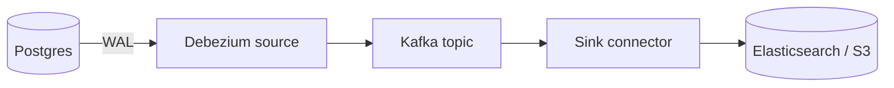
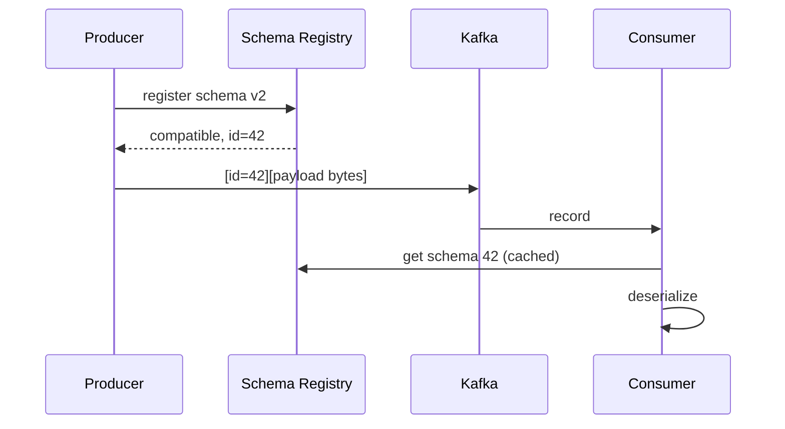
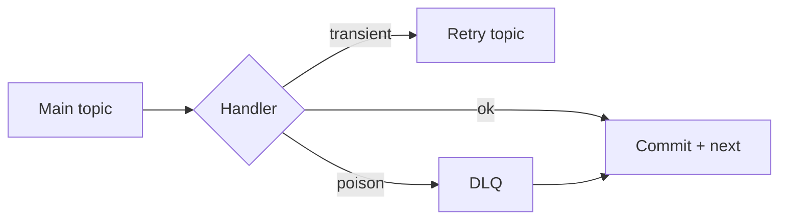
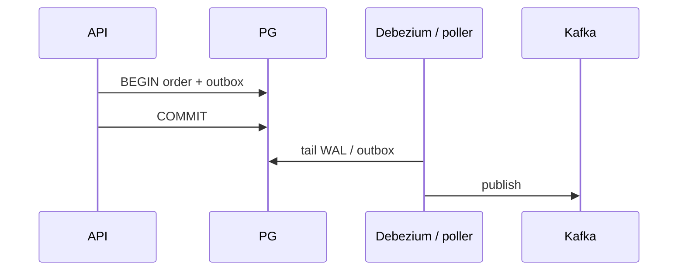

# Ecosystem, Resilience and Design Patterns

> [!abstract] What this is
> Kafka on its own is a log. The tools around it decide how you process data (**Kafka Streams**, which runs inside your own JVM), how data gets in and out (**Kafka Connect**, with Debezium tailing the Postgres WAL), and how producers and consumers agree on what the bytes mean (**Schema Registry**). Two patterns keep the system honest: a **DLQ** so a poison pill doesn't loop the group, and the **outbox** so a DB write plus an event doesn't pretend to be a distributed transaction.

---

## Why It Exists

A bare producer and consumer get you surprisingly far, but real systems hit the same four walls. Data has to move between Kafka and databases or search indexes. One team changes a message format and another team's consumer crashes. One bad record blocks a partition forever. And a service needs to update its database *and* publish an event, with no way to make both atomic. Each section below is the standard answer to one of those walls.

---

## Kafka Streams

Kafka Streams is a **library inside your application**, not a separate cluster you install. Your service consumes from topics, transforms the records, and produces to other topics. For stateful work it keeps local state in **RocksDB**, backed by a compacted **changelog topic** so the state can be rebuilt if the instance dies.

| Kind | Examples | State | Pick when |
|---|---|---|---|
| Stateless | `map`, `filter` | None | Reshape or route records |
| Stateful | aggregate, join, window | Local RocksDB + **changelog topic** (replayed if the instance dies) | Counts, joins between streams, time windows |

### Static membership and partitions matter here

State is **replayable** from the changelog if an instance dies, but replaying is slow. You still want the **same** instance to own the same partitions after a rolling restart, so it can reuse its local RocksDB. That's what `group.instance.id` gives you; see [[05 - Consumer Mechanics and Scalability]].

### Exactly-once in Streams

Streams can wrap its loop in a Kafka **transaction**: the read, the process step, the write, and the offset commit all commit together. That is still **not** your Postgres. If the side effect is a database write, you're back to the outbox (below). The producer side of transactions is in [[04 - Producer Mechanics and Delivery Guarantees]].

> [!tip] HLD default
> "Send an email when an order is placed" needs only a **consumer group**. Don't start an HLD with "I'll write a Streams cluster" unless the **product is the pipeline**. Bigger pipelines and batch vs stream processing are in [[20 - Data Processing and Analytics]].

---

## Kafka Connect and Debezium

**Kafka Connect** is a framework for moving data between Kafka and other systems. **Source** connectors bring data in (DB → Kafka); **sink** connectors push data out (Kafka → Elasticsearch or S3). You run and configure **connectors** instead of hand-writing a poller for every table, unless the available connector is worse than 50 lines of your own code.

**Debezium** is the common source connector for **change data capture (CDC)**. It tails the Postgres **WAL** and emits an event for every row change. That's how an **outbox table** (or the business table itself) becomes a topic **without** the API ever calling `producer.send`.

Connect is not magic consistency. A mis-set connector will **duplicate** records, and delivery is still **at-least-once** unless the sink is idempotent.

---

## Schema Registry and Schema Evolution

On the wire, a Kafka record is just **bytes**. Producers and consumers usually live in different repos, are owned by different teams, and deploy on different days. Nothing in Kafka stops service A from adding, renaming or retyping a field and breaking every consumer downstream. The schema is the **contract** between them, and it needs to be written down and enforced somewhere both sides can see.

A **Schema Registry** is that place. Producers serialize with a schema format (**Avro**, **Protobuf** or **JSON Schema**), register the schema, and embed a small **schema id** in each record. Consumers read the id and fetch the matching schema to deserialize. When a producer tries to register a new version, the registry checks it against the configured compatibility mode and **rejects** it if it would break readers. The break is caught at deploy time instead of at 3 a.m.

| Format | Strengths | Pick when |
|---|---|---|
| **Avro** | Compact binary, schema evolution designed in, strong registry support | Default for Kafka-heavy JVM shops and CDC |
| **Protobuf** | Compact binary, generated code in many languages, numbered fields | Polyglot services, teams already using gRPC |
| **JSON Schema** | Human-readable payloads | Readability matters more than size or speed |

### Compatibility modes

The compatibility mode says which direction of change must keep working. "Backward" means new readers can read old data, so you upgrade **consumers first**. "Forward" means old readers can read new data, so you upgrade **producers first**.

| Mode | Guarantee | Changes allowed | Upgrade order | Pick when |
|---|---|---|---|---|
| **Backward** | New reader can read **old** data | Delete fields; add **optional** fields (with defaults) | Consumers first | Default. Consumers need to replay old history. |
| **Forward** | Old reader can read **new** data | Add fields; delete **optional** fields | Producers first | Producers change often and consumers lag behind on upgrades |
| **Full** | Both directions | Add or delete **optional** fields only | Any order | Many independent teams; the tight contract |
| **None** | No checks | Anything | Coordinated big-bang | Only during early development, or with a new topic per version |

Registries usually also offer *transitive* variants (for example `BACKWARD_TRANSITIVE`), which check the new schema against every previous version rather than just the latest one. That matters on a topic with long retention, where a consumer may read records written many versions ago.

> [!warning] The rule
> **Add optional fields with defaults. Never reuse a field name or number, and never change a field's type.** Without a registry, service A adds a field, service B throws an NPE, the record becomes a **poison pill**, and the group stalls. The registry is the contract, not a nice-to-have.

---

## Error Handling: DLQ and Retry Topics

A consumer will eventually meet a record it can't process. What matters is whether the failure is **transient** (it might work next time) or **permanent** (it will never work). The two need opposite treatment.

| Failure type | Examples | Treatment |
|---|---|---|
| **Transient** | 503, timeout | Retry with **backoff** via a **retry topic** (or delayed retry), so the **main** partition keeps moving |
| **Poison pill** | Bad JSON, a record that fails forever, a deserialization crash | Send to a **DLQ** and commit past it |

For transient errors, never `sleep(60)` on the hot partition. That blocks every record behind this one.

A poison pill is worse. If you **don't** commit its offset, the same record blocks the partition forever. After the rebalance it **kills the next instance** that picks up the partition, and then the next, a cascading crash of the whole group.

The **DLQ** recipe is:

1. Catch the exception locally.
2. Log it.
3. Produce the payload to `topic.dlq`.
4. **Commit the bad offset anyway.**
5. Continue with the next record.

Humans or a replay job own the DLQ from there. Don't retry **400s** on the hot path; a bad request stays bad.

> [!danger] Never commit = group death loop
> The offset never advances, so every new owner dies on the same record. This is the poison-pill interview question; see [[08 - Interview Questions]].

---

## The Outbox Pattern

The anti-pattern is the **dual write**: `INSERT order` and then `kafka.send` in the **same API request**. One can succeed while the other fails. The process can crash between them, the network can partition, or the broker can be down right after the DB commit. That is **not** a transaction, however carefully it's coded.

The outbox pattern makes the database the only thing the API writes to:

1. In the same **Postgres transaction**, insert the business row and an `outbox` row describing the event.
2. Something else publishes the outbox to Kafka. Either a **poller** runs `SELECT … FOR UPDATE SKIP LOCKED`, publishes, and marks rows sent, **or** **Debezium** tails the WAL for the `outbox` table.

| Publisher | How | Pick when |
|---|---|---|
| Poller | `SELECT … FOR UPDATE SKIP LOCKED`, publish, mark sent | No Debezium or Connect in the stack |
| Debezium CDC | Tails the WAL for the `outbox` table | The tight version; Connect is already running |

CDC from the outbox is the tight version. If the API also calls `kafka.send` **after** commit, it can still crash in between. Tailing the WAL means that if the row committed, the event **will** be published, eventually. Either way the publisher can send an event more than once, so consumers must dedupe.

### What you say about consistency

This is **eventual** consistency. The row is committed and the topic lags by milliseconds. Users do **not** need the confirmation email within the same 50 ms as the `201 Created`. There is no 2PC with the broker: Kafka transactions work **inside** Kafka, not across Kafka and Postgres ([[04 - Producer Mechanics and Delivery Guarantees]]).

### The other side: inbox

The consumer side mirrors the outbox. The consumer writes the `event_id` into an inbox table in the **same transaction** as its side effect. If the same event is replayed, the insert conflicts and the handler becomes a no-op. Idempotency keys and dedupe are covered in [[14 - Coordination and Concurrency]].

---

## Failure Modes

| Failure | What happens | Mitigation |
|---|---|---|
| **Schema break** | Producer changes a field; consumers fail to deserialize | Schema Registry with a compatibility mode; add optional fields only |
| **Poison pill** | One record crashes every owner in turn | DLQ, then commit the bad offset |
| **Retry sleep** | `sleep()` on the hot partition blocks everything behind it | Retry topic with backoff |
| **Dual write** | DB commits but the event is never sent, or the reverse | Outbox + CDC or poller |
| **Duplicate publish** | Outbox publisher or connector sends an event twice | Inbox table / idempotent sink keyed on `event_id` |
| **Mis-set connector** | Connect duplicates or skips records | Idempotent sinks; monitor connector offsets |
| **Streams state loss** | Instance dies; local RocksDB gone | Rebuild from changelog; static membership to limit reshuffles |

---

## Interview Lines

> [!tip] Say it like this
> - "For 'send an email on order' a consumer group is enough. I'd only reach for Streams if the pipeline is the product."
> - "Every topic has a registered schema with backward compatibility. Producers add optional fields; they never reuse or retype one."
> - "Transient errors go to a retry topic with backoff. Poison pills go to a DLQ and I commit past them, so one bad record can't kill the group."
> - "I never dual-write. The order and the outbox row commit in one transaction, and Debezium publishes from the WAL."
> - "That's eventual consistency with at-least-once delivery, so the consumer dedupes on `event_id` in an inbox table."

## Related Notes

- [[Kafka/README]]
- [[07 - Async Messaging]]
- [[04 - Producer Mechanics and Delivery Guarantees]]
- [[05 - Consumer Mechanics and Scalability]]
- [[07 - Event-Driven Architecture and System Trade-offs]]
- [[08 - Interview Questions]]
- [[14 - Coordination and Concurrency]]
- [[20 - Data Processing and Analytics]]
