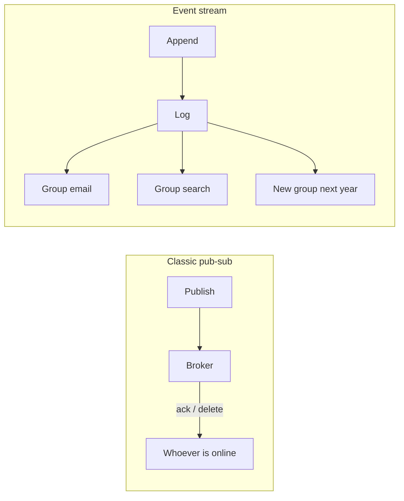
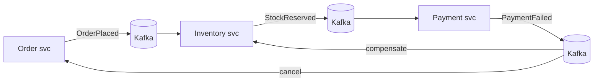
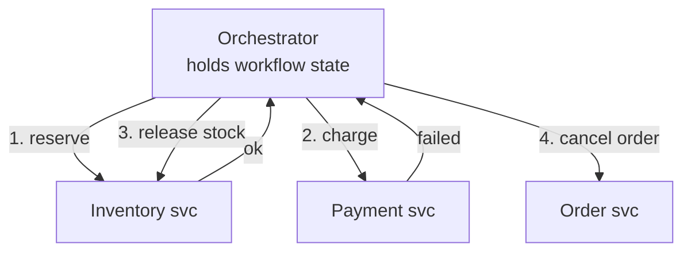

# Event-Driven Architecture and System Trade-offs

> [!abstract] What this is
> Picking a broker starts with the **shape** of the problem: is it a job that should be done once, or a history of events that many readers need? Kafka is a **log**; RabbitMQ and SQS are **queues**, and they are not "faster Kafka". The useful frame is **smart broker** (Rabbit) vs **smart consumer** (Kafka).
>
> This note also covers how multi-step workflows are coordinated across services (choreography vs orchestration), and one hard rule: don't put the card charge only on a fire-and-forget topic.

---

## Why It Exists

"Use Kafka" is not a design. Kafka, RabbitMQ and SQS solve different problems, and choosing the wrong one shows up later as awkward retries, missing replay, or a cluster nobody wanted to run. Once events are flowing, a second question follows: when one business action spans several services, who decides what happens next? Both choices shape how the system fails.

---

## Smart Broker vs Smart Consumer

In Kafka the broker is a dumb log and **you** track offsets. In RabbitMQ the broker tracks every unacked message and handles NACK, routing and priority. In SQS, AWS tracks a visibility timeout per message. Everything else in the table follows from that split. The queue side is covered in depth in [[RabbitMQ and SQS]].

| | Kafka | RabbitMQ | SQS |
|---|---|---|---|
| Brain | Dumb log. **You** track offsets. | Broker tracks unacked, NACK, routing, priority | AWS tracks visibility timeout |
| After consume | Stays until **retention** | Usually **gone** on ack | Gone on delete / ack |
| Replay | Reset offset; first-class | Awkward (you're late) | No (unless you copied it yourself) |
| Order | Per **partition** | Per queue + priority | Standard: none. FIFO: yes, **capped TPS** |
| Routing | Topic + key → partition | Exchanges (direct / topic / fanout) + bindings | One queue, simple |
| Throughput | Sequential disk, batch, zero-copy | Lower; not the point | Fine for workers; FIFO is the bottleneck |
| Latency | Batching / linger | Often **lower** for a single small job | Fine; not a stream |
| Message size | Prefer small; huge blobs → **S3 + id** | Also unhappy at tens of MB | Same; don't put the video in the message |
| Ops | You (or MSK) | You | Almost none |
| Best at | Fan-out, audit, CDC, Streams, many groups on one history | Work queues, retry *this* message, priority, fancy routing | Decouple a worker / Lambda, zero cluster |

> [!tip] Pick in one line
> Jobs, NACK, priority, "do this once" → **Rabbit**. Many subscribers, replay, per-key order at scale → **Kafka**. Zero ops and no history → **SQS** (FIFO if you need order, and mention the **TPS cap**).

---

## Kafka vs RabbitMQ

This is the comparison interviewers push on most. The honest answer is that each wins a different shape of problem.

| Pick | When | Examples |
|---|---|---|
| **RabbitMQ** | The broker must be smart about individual messages | This message failed → **requeue / NACK**. This one is **priority**. Route by five headers through exchanges and bindings. Work queues, "eat once", competing consumers. A payment **job** with retry / NACK is a queue-shaped problem. |
| **Kafka** | Decoupling in **time** matters | Analytics onboarded in June still reads **May**. Search and email are **two groups** on the same topic. Audit, CDC, Streams. Strict **per-key** order at high fan-out. |

On performance, Rabbit often wins latency for a **single small job**. Kafka wins **throughput** because of batching, sequential disk writes and zero-copy reads ([[02 - Low-Level Storage and Performance IO]]). For huge payloads the answer is the same in both: store the blob in **S3 and send the id**. Neither broker wants a 50 MB message.

> [!warning] Don't say "Kafka is always better"
> A payment job with retry / NACK is a **queue**. A log of every `OrderPlaced` for five independent subscribers is a **stream**.

---

## Kafka vs SQS

SQS means **no brokers on your on-call**, almost. It comes in two flavours. **Standard** queues are at-least-once with **no** ordering. **FIFO** queues give order and dedupe, but with a **throughput cap**. Say that out loud rather than hiding it.

What SQS cannot do is just as important. It can't replay "the last two days for a new analytics group" unless you kept a copy yourself. It has no concept of several **consumer groups** reading one log. And it has nothing like CDC, Streams or a compacted changelog.

| Pick | When |
|---|---|
| **SQS** | The product is "decouple this Lambda / worker" and you will **not** sell replay |
| **Kafka** | The **log is the product** |

---

## Pub-Sub vs Event Streaming

Classic pub-sub delivers a message to whoever is online and then deletes it. An event stream appends to a log that each group reads at its own pace, including a group that doesn't exist yet.

| | Ephemeral pub-sub (queue) | Event stream (Kafka) |
|---|---|---|
| Missed it while down | Usually **gone** | Still on disk if retention allows |
| New consumer | Starts **now** | Can start at **offset 0** or a timestamp |
| After consume | Deleted on ack | Stays until retention / compaction |
| You pay | Simpler broker | Disk + lag alerts + retention policy |
| You gain | "Do this job once" | Decoupling in **time**, not just in process |
| Pick when | Work items that should be done once | Facts that many teams need, now and later |

The trade-off in one breath: you pay for **disk, retention and consumer-lag operations**, and you gain a new team in June that can still read May. That is the whole event-driven pitch for Kafka.

---

## Choreography vs Orchestration

When one business action spans several services (place order → reserve stock → charge card → ship), you need a way to coordinate the steps, and a way to undo earlier steps if a later one fails. That sequence of local transactions with compensating actions is a **saga**; the pattern itself is covered in [[10 - Distributed Building Blocks]]. There are two ways to drive one.

In **choreography**, there is no central coordinator. Each service listens for events and reacts by doing its step and emitting a new event. The workflow is implied by who subscribes to what.

In **orchestration**, one orchestrator owns the workflow. It sends a command to each service in turn, waits for the reply, and decides the next step, including which compensations to run on failure. Orchestrators such as **Temporal** or **AWS Step Functions** **hold the workflow state** durably, so a crash mid-workflow resumes from the last completed step instead of being lost.

| | Choreography | Orchestration |
|---|---|---|
| Control flow | Emerges from event subscriptions | Explicit, in one place |
| Coupling | Loose; services only know event types | Orchestrator knows every step and service |
| Visibility | Hard; "where is order 42?" means stitching logs | Easy; the orchestrator's state shows the current step |
| Failure handling | Each service emits failure events; compensation is spread out | Orchestrator runs retries, timeouts and compensations |
| Adding a step | Add a subscriber; may silently change the flow | Change the workflow definition |
| Pick when | Two or three steps, simple fan-out, teams want independence | Many steps, branching, timeouts, or money involved |

The trap with choreography is that nobody can see the whole workflow, and cycles of events are easy to create by accident. The cost of orchestration is a central component that must be highly available, and services that are more tightly coupled to it. Many real systems mix the two: orchestration inside a business process, events to notify everyone else.

---

## What Does Not Go on a Fire-and-Forget Topic

Some writes are too important to exist only as an event. Card **capture** as the only write, anything that needs "exactly this once" **without** an idempotent sink, and anything where "the event vanished and we charged twice / never charged" would end in a lawsuit.

The HLD default is that the user's request writes to the **DB first** (or to an outbox in the same transaction). Topics carry the follow-on work: email, search indexing, analytics, push notifications. Don't put the **money** only on a topic. The outbox pattern that makes this safe is in [[06 - Ecosystem Resilience and Design Patterns]], and the consistency trade-offs are in [[17 - Consistency Time and Consensus]].

---

## Failure Modes

| Failure | What happens | Mitigation |
|---|---|---|
| **Queue used as a log** | New team needs last month's events; they're gone | Kafka (or keep a copy) when replay matters |
| **Log used as a job queue** | No NACK, no priority, no delay; sleeping blocks a partition | Rabbit / SQS for jobs, or a scheduler |
| **SQS FIFO ceiling** | Ordered queue hits its throughput cap | Shard by message group, or move to Kafka |
| **Huge messages** | Broker memory and latency suffer | Store in S3, send the id |
| **Lost choreography** | Nobody can say where a workflow is stuck; accidental event loops | Correlation ids and tracing, or switch to orchestration |
| **Orchestrator down** | Workflows stall | Durable orchestrator (Temporal / Step Functions) that resumes from saved state |
| **Money on a topic only** | Event lost or duplicated → wrong charge | DB write first, outbox, idempotent consumers |

---

## Interview Lines

> [!tip] Say it like this
> - "Kafka is a smart-consumer log; Rabbit is a smart-broker queue. I pick by the shape of the problem, not by speed."
> - "If a new team next quarter needs today's events, that's a log, so Kafka. If it's a job to do once with retries, that's a queue."
> - "SQS is zero ops, but Standard has no order and FIFO has a throughput cap."
> - "For a three-step saga I'd choreograph with events. For anything with many steps, timeouts or money, I'd use an orchestrator like Temporal that holds the workflow state."
> - "The payment is written to the database first. Kafka carries the email, search and analytics."

## Related Notes

- [[Kafka/README]]
- [[07 - Async Messaging]]
- [[RabbitMQ and SQS]]
- [[02 - Low-Level Storage and Performance IO]]
- [[06 - Ecosystem Resilience and Design Patterns]]
- [[08 - Interview Questions]]
- [[10 - Distributed Building Blocks]]
- [[17 - Consistency Time and Consensus]]
