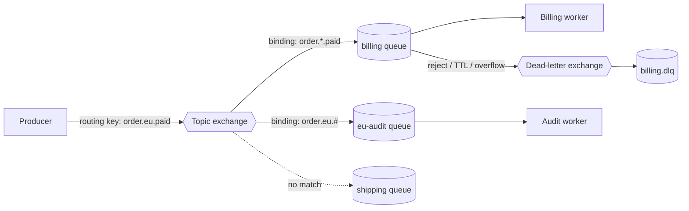
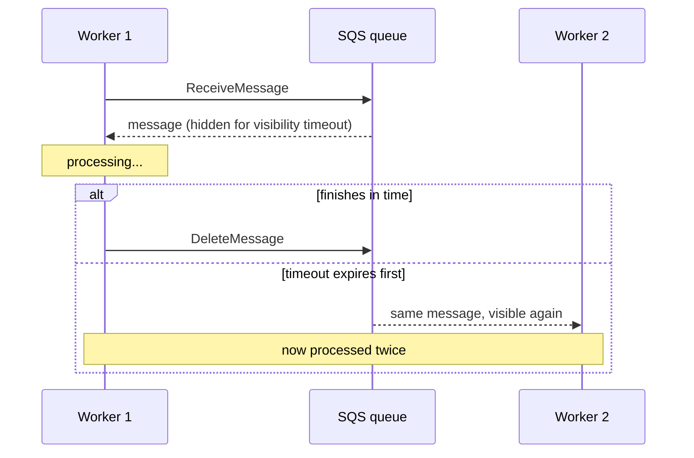

# RabbitMQ and SQS

> [!abstract] What this is
> The two classic **queues** you'll reach for when Kafka's log model isn't what you need. RabbitMQ is a broker that **routes** messages through exchanges into queues and tracks an ack for every message. SQS is AWS's fully managed queue: no brokers to run, with a **visibility timeout** instead of explicit leases. The decision this note helps with is Kafka vs RabbitMQ vs SQS for a given workload.

---

## Why It Exists

Kafka is a log: messages stay, consumers track offsets, and parallelism is capped by partitions. Plenty of workloads don't want that. A job queue wants each task handed to one free worker, acked individually, retried on failure, and then forgotten. Sometimes you also need flexible routing ("billing events to these queues, EU events to those") or you simply don't want to operate a cluster. That's where RabbitMQ and SQS fit. The queue vs log vs pub/sub framing is in [[07 - Async Messaging]].

---

## RabbitMQ Model

RabbitMQ never lets a producer write straight into a queue. The producer publishes to an **exchange** with a **routing key**. The exchange looks at its **bindings** (rules connecting it to queues) and copies the message into every queue that matches. Consumers read from **queues**.

### Exchange types

The exchange type decides how the routing key is matched against bindings.

| Exchange | Routes by | Example | Pick when |
|---|---|---|---|
| **Direct** | Exact routing-key match | Key `email` → `email` queue | One key per job type |
| **Topic** | Pattern on dot-separated keys; `*` matches one word, `#` matches zero or more | `order.*.paid`, `order.eu.#` | Routing by several attributes (type, region, status) |
| **Fanout** | Ignores the key; copies to every bound queue | `OrderPlaced` → email, search, analytics queues | Pub/sub broadcast |
| **Headers** | Message header values instead of the key | `format=pdf AND region=eu` | Routing on attributes that don't fit a key string. Rare |

### Acks and prefetch

RabbitMQ tracks every delivered message until the consumer **acks** it. This is the per-message bookkeeping Kafka deliberately doesn't do ([[01 - Core Architecture and Cluster Consensus]]). The consumer can **ack** (done, delete it), **nack / reject with requeue** (put it back), or **reject without requeue** (send it to the dead-letter exchange if one is set). If the consumer's connection drops with messages unacked, RabbitMQ redelivers them to another consumer. That's at-least-once, so consumers still need to be idempotent.

**Prefetch** (`basic.qos`) caps how many unacked messages a consumer may hold at once. Without it, RabbitMQ pushes as fast as it can, and one consumer can hoard a huge backlog while others sit idle. A small prefetch spreads work fairly across workers; a larger one improves throughput for fast handlers.

| Prefetch | Effect | Pick when |
|---|---|---|
| 1 | Fair dispatch; each worker holds one message | Slow, uneven jobs (image processing) |
| Tens to low hundreds | Fewer round trips, higher throughput | Fast, uniform handlers |
| Unlimited | One consumer can hoard the queue; memory risk | Avoid |

### Dead-letter exchanges

A queue can be configured with a **dead-letter exchange** (`x-dead-letter-exchange`). A message is dead-lettered when it's rejected without requeue, when its **TTL expires**, or when the queue exceeds its **length limit**. The DLX routes it like any exchange, usually into a `*.dlq` queue for inspection and alerts. Combined with a per-message TTL, a DLX is also the usual way to build **delayed retries**: publish to a wait queue with a TTL whose dead-letter target is the original work queue.

### Quorum queues

Classic queues live on one node. **Quorum queues** replicate each queue across several nodes using Raft, so a queue survives a node failure without losing acked-by-broker messages. They are the default choice for anything durable, replacing the older mirrored classic queues. Quorum queues can also cap redeliveries with a **delivery limit**, after which a poison message is dead-lettered instead of looping forever. Raft background: [[17 - Consistency Time and Consensus]].

---

## SQS Model

SQS is a queue as an API. There are no brokers, partitions or exchanges to run. Producers call `SendMessage`, consumers call `ReceiveMessage`, and a consumer calls `DeleteMessage` when it's done. There are two queue types.

| | Standard | FIFO |
|---|---|---|
| Delivery | At-least-once; occasional duplicates | Exactly-once **processing** via deduplication ID within a 5-minute window |
| Ordering | Best-effort; can arrive out of order | Strict order **within a message group** |
| Throughput | Very high, scales without setup | Lower; limited per message group |
| Pick when | Jobs where order doesn't matter and consumers are idempotent | Per-entity order matters (all events for one `order_id` in order) |

### Visibility timeout

SQS doesn't hand out leases or track consumers. When a consumer receives a message, SQS hides it from everyone else for the **visibility timeout**. If the consumer deletes it before the timeout, it's gone. If the timeout expires first, the message becomes visible again and another consumer picks it up.

That's why the visibility timeout **must exceed your worst-case processing time**. If it's shorter, a slow but healthy worker loses the message to another worker mid-job, and the work runs twice. For jobs with unpredictable duration, the worker calls `ChangeMessageVisibility` to extend the timeout as it goes (a heartbeat).

### Long polling

By default `ReceiveMessage` returns immediately, even with nothing to return, so an idle consumer burns requests (and money) on empty responses. **Long polling** (`WaitTimeSeconds` up to 20) holds the request open until a message arrives or the wait ends. Use it; it's the SQS equivalent of Kafka's long-poll fetch.

### Dead-letter queue via redrive policy

A **redrive policy** on the source queue names a DLQ and a `maxReceiveCount`. Each time a message is received without being deleted, its receive count goes up. Once it passes `maxReceiveCount`, SQS moves it to the DLQ instead of redelivering. That turns a poison message into something a human looks at, instead of a loop. A FIFO queue's DLQ must also be FIFO.

### Message groups in FIFO

In a FIFO queue every message carries a **message group ID**. Order is guaranteed only **within** a group, and while one message in a group is in flight, the next message in that group isn't handed out. Different groups are processed in parallel. It plays the same role as a Kafka partition key: group by `order_id` to keep each order ordered while many orders run at once. One hot group is one lane, just like a hot Kafka key.

### Limits worth naming

| Limit | Value | Consequence |
|---|---|---|
| Max retention | 14 days (default 4) | Not an archive. Consumers must keep up; no long replay |
| Max message size | 256 KB | Store large payloads in S3 and send a pointer (claim-check pattern) |
| FIFO dedup window | 5 minutes | A duplicate sent after the window is accepted as new |
| Long-poll wait | Up to 20 s | Set it; saves empty receives |

> [!warning] AWS limits change over time
> Check current AWS docs before quoting exact numbers in a design review. The shape (bounded retention, small messages, visibility timeout) is what matters in an interview.

Fanout on AWS is **SNS → one SQS queue per subscriber**: SNS copies each message, and each downstream gets its own queue, retry and DLQ.

---

## Kafka vs RabbitMQ vs SQS

All three move messages asynchronously. They differ in what happens to a message after it's read, and in how much you operate.

| | Kafka | RabbitMQ | SQS |
|---|---|---|---|
| **Model** | Partitioned, durable log; consumers track offsets | Broker with exchanges routing into queues; per-message ack | Managed queue; visibility timeout, delete on done |
| **Ordering** | Per partition (by key) | Per queue with one consumer; lost with competing consumers and requeues | Standard: best-effort. FIFO: per message group |
| **Replay** | First-class, within retention | No; acked messages are gone | No; deleted messages are gone, max 14 days anyway |
| **Throughput shape** | Very high sequential throughput; parallelism capped by partitions | Moderate; good for many small jobs and complex routing | Standard scales horizontally with no setup; FIFO is lower |
| **Ops burden** | High self-hosted (brokers, KRaft, partitions); lower with MSK / Confluent | Medium: cluster, quorum queues, upgrades | None; fully managed, pay per request |
| **Fanout** | Many consumer groups on one topic | Fanout / topic exchange | SNS → SQS per subscriber |
| **Pick when** | Several systems need the same event, you might reprocess, or it's a high-volume stream feeding analytics ([[20 - Data Processing and Analytics]]) | You need flexible routing, per-message acks, priorities or delayed retries for work queues | You're on AWS and want a job queue with zero operations |

More on the trade-offs: [[07 - Event-Driven Architecture and System Trade-offs]].

---

## Failure Modes

| Failure | What happens | Mitigation |
|---|---|---|
| SQS visibility timeout shorter than processing | Message reappears mid-job; a second worker runs it too | Timeout > worst-case processing time; extend with `ChangeMessageVisibility`; idempotent consumer |
| Poison message | Fails every time and redelivers forever | SQS redrive policy with `maxReceiveCount`; RabbitMQ reject without requeue, quorum-queue delivery limit, DLX |
| No prefetch limit (RabbitMQ) | One consumer hoards messages; others idle; memory grows | Set `basic.qos` prefetch |
| Classic RabbitMQ queue node dies | Queue unavailable, messages possibly lost | Quorum queues |
| Consumer crash after side effect, before ack / delete | Message redelivered; work runs twice | Idempotent consumer (dedupe on `event_id`) |
| Hot FIFO message group | One group serialises; its backlog grows | Better group key; one group is one lane by design |
| Payload over 256 KB | `SendMessage` rejected | Put the body in S3, send the pointer |
| Consumers fall behind > retention | SQS deletes unprocessed messages after retention | Alert on queue age; scale consumers |
| Short polling on idle queue | Many empty receives, higher cost | Long polling (`WaitTimeSeconds`) |

---

## Interview Lines

> [!tip] Say it like this
> - "RabbitMQ routes: producers publish to an exchange, bindings decide which queues get a copy, and every message is acked individually."
> - "Set a prefetch so one RabbitMQ consumer can't hoard the queue, and use quorum queues for durability."
> - "In SQS the visibility timeout has to exceed processing time, or a slow worker's message gets handed to someone else."
> - "Poison messages go to a DLQ: redrive policy with `maxReceiveCount` on SQS, a dead-letter exchange on RabbitMQ."
> - "SQS FIFO orders per message group, the same idea as a Kafka partition key."
> - "Kafka when many systems need the event and might replay it; RabbitMQ for routed work queues; SQS when I want a queue with no operations."

## Related Notes

- [[07 - Async Messaging]]
- [[Kafka/README]]
- [[07 - Event-Driven Architecture and System Trade-offs]]
- [[01 - Core Architecture and Cluster Consensus]]
- [[04 - Producer Mechanics and Delivery Guarantees]]
- [[17 - Consistency Time and Consensus]]
- [[20 - Data Processing and Analytics]]
- [[08 - Reliability]]
