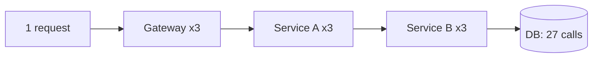
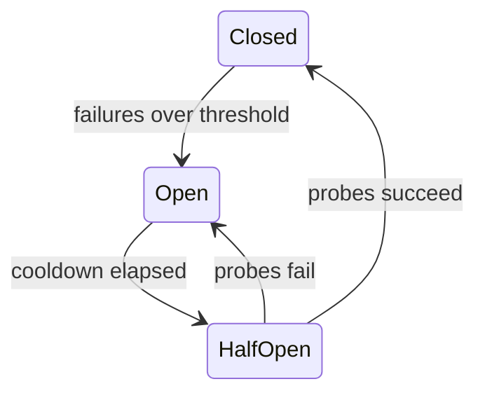
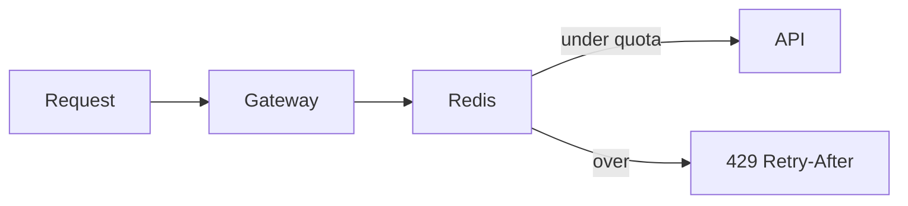

# Reliability

> [!abstract] What this is
> Distributed systems fail **partially**: one dependency gets slow, one region goes dark, one client floods you. Timeouts, retries with jitter, idempotency, circuit breakers, rate limits, and a disaster recovery plan are how you **fail small instead of hanging the whole site**.
>
> Rate limiter is also a **standalone HLD question**, so treat it as both a building block and a [[12 - Mini Designs|mini design]].

---

## Why It Exists

On one machine, a function call either works or throws. Across a network, a call can also **hang**, **succeed without you hearing back**, or **fail only sometimes**. Every service you call is a place where that can happen, and a system with ten dependencies has ten ways to get stuck.

The dangerous failures are not the clean crashes. They are the slow ones: a dependency that takes 30 seconds instead of 30 ms ties up your threads, your threads run out, and now *you* are the slow dependency for everyone upstream. The patterns in this note exist to stop one sick part from spreading. The targets they protect (SLOs, error budgets) are defined in [[11 - Services and Observability]].

---

## Timeouts

A timeout is the most basic reliability tool: every outbound call (DB, Redis, HTTP, Kafka produce) gets a maximum wait. Infinite wait is how one sick dependency takes you down, because each hung call holds a thread or connection forever.

Two rules for picking the number:

- Set it **shorter than the user SLA**. If the user gives up at 2 s, a 10 s DB timeout is pointless.
- Set it **shorter than the caller's timeout**. If the caller gives up first, your work is wasted and the caller may retry on top of it, which causes **retry amplification** (see below).

A useful pattern is a **deadline** passed down the call chain ("you have 800 ms left") so each layer knows how much time remains instead of each one starting its own fresh clock.

---

## Retries

Many failures are transient: a packet drop, a pod restarting, a brief 503. Retrying hides them from the user. But a retry is also extra load on something that may already be struggling, so retries have to be selective and bounded.

| Error | Retry? | Why |
|---|---|---|
| Timeout, 503, connection reset | Yes | Likely transient |
| 429 Too Many Requests | Yes, after `Retry-After` | Server told you when |
| 400 / 401 / 404 | No | Will fail the same way again |
| `POST` that might have succeeded | Only if idempotent | Otherwise you charge twice. See Idempotency below. |

**Exponential backoff plus jitter.** Wait 100 ms, then 200, then 400, and add randomness to each wait. Without jitter, all clients that failed at the same moment retry at the same moment, in lockstep, which is a **thundering herd**.

**Cap retries. Then fail.** Two or three attempts is normal. After that, return an error or a degraded response.

---

## Retry Budgets and Amplification

Per-request retry caps are not enough, because retries multiply across layers. Suppose a request goes gateway → service A → service B → database, and each layer retries 3 times. If the database is down, one user request becomes up to 3 × 3 × 3 = 27 database calls. The system hammers the dependency hardest at exactly the moment it is weakest. This is a **retry storm**.

Two fixes, usually used together:

- **Retry at one layer only.** Usually the layer closest to the failing call, or the edge. Inner layers fail fast and let one place decide.
- **Retry budget.** Cap retries as a share of normal traffic, for example "retries may be at most 10% of requests over the last minute." When things are healthy, the few failures get retried. When a dependency is down and everything fails, the budget runs out fast and retries stop, so load stays close to 1.1× instead of 3×. gRPC and Envoy support this directly.

| Approach | Worst-case load on a dead dependency | Pick when |
|---|---|---|
| Fixed retries at every layer | Multiplies per layer (27× in the example) | Never on purpose |
| Retry at one layer | About 3× | Simple default |
| Retry budget (~10%) | About 1.1× | Many services, high traffic, or a mesh that supports it |

---

## Hedged Requests

Sometimes the problem isn't failure but **tail latency**: most calls return in 20 ms, but 1 in 100 takes 1 s because it hit a slow replica or a GC pause. Retrying after a timeout doesn't help much here, because the user already waited the full timeout.

A **hedged request** sends the call to one replica, waits about as long as the p95 latency, and if there is still no answer, sends a duplicate to a second replica. Whichever answers first wins and the other is cancelled or ignored. The slow tail mostly disappears, because it is unlikely that both replicas are slow at the same time.

The rules:

- **Only for idempotent reads.** Sending a payment twice to "whoever is faster" is a bug.
- **Cost is extra load.** Hedging after p95 means roughly 5% more requests (a rough figure, it depends on the distribution). Hedging immediately doubles load.
- Combine with a **retry budget** so hedges stop when the whole backend is slow, not just one replica.

> [!tip] Hedging fixes "one replica is slow." It makes "all replicas are slow" worse. That's why it's capped.

---

## Circuit Breaker

If `payment-svc` is erroring, **stop calling it for a bit**. A circuit breaker counts failures to a dependency. When they cross a threshold, it **opens** and every call fails fast without touching the network, so you can show "pay later" instead of hanging. After a cooldown it goes **half-open** and lets a few probe calls through. If they succeed it **closes**; if they fail it opens again.

Without this, your thread pool dies waiting on a dead friend, and the dead friend never gets breathing room to recover.

### Bulkhead

A bulkhead is the ship idea: separate compartments so one leak doesn't sink the boat. Give each dependency its **own thread pool or connection pool**, so a slow recommendations service can use up its 20 threads but cannot eat the threads that checkout needs.

| Pattern | Protects against | Pick when |
|---|---|---|
| **Timeout** | One call hanging forever | Always, on every outbound call |
| **Circuit breaker** | Repeatedly calling a dependency that is down | Any remote dependency that can fail |
| **Bulkhead** | One slow dependency starving all workers | Several dependencies of different importance share a process |

---

## Rate Limiting

You will be asked to design this. A rate limiter caps how many requests a caller can make in a period. It protects against **abuse**, against a **noisy neighbour** starving other tenants, and against you overwhelming **your own downstream**.

**Where:** at the API gateway or edge, so rejected traffic costs almost nothing. Optionally also per service for internal protection.

**Dimension:** per user, per IP, per API key, per endpoint. Often **all of them** with different quotas, such as 1,000/min per API key but 10/min on `/login` per IP.

### Algorithms

| Algorithm | Idea | Watch out | Pick when |
|---|---|---|---|
| **Fixed window** | 100/min, counter resets on the clock | Burst at the window edge (up to 2×) | Simple quotas where edge bursts are fine |
| **Sliding window log** | Store every request timestamp | Memory grows with traffic | Low volume, needs exact limits |
| **Sliding window counter** | Weighted mix of previous and current window counts | Approximate | Good compromise at scale |
| **Token bucket** | Tokens refill at rate R, burst up to B | Two parameters to tune | **The default answer** |
| **Leaky bucket** | Requests drain at a constant rate | Smooths, but may delay requests | Protecting a downstream that needs a steady rate |

### Distributed limiting

There are many gateway nodes. Keeping counters in local memory is wrong, because the real limit becomes N × nodes. The shared counter goes in **Redis**: `INCR` plus a TTL, ideally inside a **Lua script** so increment and expire happen atomically. For token bucket, store the token count and last refill time in Redis and compute the refill in the script.

When over the limit, respond **429** with a `Retry-After` header. Limits can be **soft** (warn or degrade) or **hard** (drop).

The full design walkthrough lives in [[12 - Mini Designs]].

---

## Load Shedding and Backpressure

Rate limiting caps each caller. Load shedding caps **you**. When a service is already overloaded, accepting more work only makes every request slower, until they all time out and none succeed. That is a latency death spiral.

So when you are already dying, **refuse work early** with a 503 rather than queueing it. Shed the least important traffic first (analytics pings before checkout). Pair this with [[07 - Async Messaging|queue backpressure]], where a full queue pushes back on producers instead of growing forever.

---

## Health Checks, Deploys, and Graceful Shutdown

A deploy is a planned failure of every instance, one at a time, and it should be invisible to users. The mechanics are **liveness vs readiness** probes so the load balancer stops sending traffic before you send `SIGTERM`, and **connection draining** so in-flight requests finish. The full explanation and diagram live in [[04 - Load Balancing CDN and Gateway]]; rollout strategies such as canary and blue-green are in [[19 - Deployment and Infrastructure]].

You don't need Kubernetes internals. "Rolling deploy, readiness, drain" is the sentence.

---

## Idempotency

Duplicates are guaranteed in a system with retries. The user double-clicks Pay. The gateway retries a timeout. A queue worker gets the same message redelivered. If the operation isn't idempotent, each of these charges the user again.

The fix is an **`Idempotency-Key`** on every mutating API. The client generates a unique key per logical operation. The server stores key → response. A repeat with the same key returns the stored result and does not charge twice.

This is what makes the "retry `POST` only if idempotent" rule above safe to follow.

---

## Distributed Lock (pointer)

Locks come up next to reliability because they fail in subtle ways. The recipe (`SET NX EX` with a token, fencing tokens, lease vs lock, `SKIP LOCKED`) lives in [[14 - Coordination and Concurrency]].

The one rule to keep here: **don't hold a Redis lock while a human pays**. Use a DB row with `hold_until` instead.

---

## Graceful Degradation

When a non-critical part breaks, the site should get worse, not go down. Decide ahead of time what each feature falls back to, and name what you **drop** when on fire.

| Broken part | Fallback |
|---|---|
| Search | Keyword-less browse |
| Recommendations | Popular list |
| Redis | Serve from DB **behind a circuit breaker**, so the DB doesn't die too |

---

## Disaster Recovery

Everything above handles one server or one dependency failing. Disaster recovery (DR) handles losing **a whole database, a whole region, or your data itself** (a bad migration, an accidental `DELETE`, ransomware). Replication doesn't save you from the last one: a bad write replicates to every replica in milliseconds.

### RPO and RTO

Two numbers define any DR plan:

- **RPO (recovery point objective):** how much data you can afford to lose, measured in time. RPO of 5 minutes means after recovery you may be missing up to the last 5 minutes of writes.
- **RTO (recovery time objective):** how long you can be down. RTO of 1 hour means service must be back within an hour.

> [!example] A payments DB with nightly backups only has an RPO of up to 24 hours: a crash at 11 pm loses the whole day. Adding continuous WAL archiving brings RPO down to seconds or minutes. RTO is separate: even with perfect data, restoring a large DB from backup can take hours.

### Backup types

| Type | What it is | Pick when |
|---|---|---|
| **Full backup** | Complete copy of the data | Baseline, periodically (e.g. weekly) |
| **Incremental** | Only what changed since the last backup | Between fulls, to save time and space. Restore needs the full plus every increment. |
| **Snapshot** | Storage-level point-in-time image (EBS, RDS snapshots) | Fast to take and restore for whole volumes |
| **Point-in-time recovery (PITR)** | Base backup plus the continuous **WAL** (write-ahead log) replayed up to any chosen moment | Recovering to "one second before the bad `DELETE`". The default for important OLTP data. |

Backups should live in a **different account or region** from the data, so one mistake or one outage can't take both.

> [!warning] An untested backup is a hope, not a backup. Regularly **restore** into a scratch environment and time it. That measured time is your real RTO.

### Regional failover

At the region level there are two shapes. In **active-passive**, one region serves all traffic and a second region has a replica ready to be promoted; failover means promoting the replica and moving traffic (via DNS or GSLB, see [[04 - Load Balancing CDN and Gateway]]). In **active-active**, several regions serve traffic at once, so losing one just moves its users to the others. Active-active is much harder because both regions accept writes, which raises conflict and consistency questions covered in [[17 - Consistency Time and Consensus]].

### DR strategies

These four tiers trade cost against recovery speed. The RPO/RTO values are rough orders of magnitude, not guarantees.

| Strategy | Setup | Rough RPO | Rough RTO | Cost | Pick when |
|---|---|---|---|---|---|
| **Backup and restore** | Backups in another region; rebuild everything on disaster | Hours | Hours to a day | Lowest | Internal tools, non-critical systems |
| **Pilot light** | Data continuously replicated to the second region; minimal compute kept off or tiny | Minutes | Tens of minutes to hours | Low | Important but can tolerate some downtime |
| **Warm standby** | Scaled-down full copy running in the second region, scaled up on failover | Seconds to minutes | Minutes | Medium | Customer-facing systems with tight RTO |
| **Active-active** | Full capacity in several regions, all serving | Near zero | Near zero | Highest (2× infra plus consistency complexity) | Payments, core flows where downtime is very expensive |

---

## Chaos Engineering

All these mechanisms only work if they actually trigger when needed, and the only way to know is to break things on purpose. Chaos engineering means **deliberately injecting failure** (kill a pod, add 500 ms latency to a dependency, drop a region) and watching what happens.

It's run like an experiment:

1. **Steady-state hypothesis.** Define "healthy" with a metric, for example "checkout success rate stays above 99%."
2. **Inject a failure.** Kill instances, add latency, block a dependency.
3. **Limit the blast radius.** Start in staging or with a small slice of production traffic, with an abort switch.
4. **Compare.** If the steady state held, confidence goes up. If it broke, you found a weakness before a real outage did.

A **game day** is a scheduled team exercise where you run a failure scenario (such as a regional failover) end to end, including the humans: alerts, runbooks, and who does what. Netflix's Chaos Monkey is the well-known example.

> [!tip] In an interview, one line is enough: "We'd validate failover with game days and chaos tests, not just trust the diagram."

---

## Failure Modes

| Failure | What happens | Mitigation |
|---|---|---|
| **No timeout** | One slow dependency holds every thread; the whole service hangs | Timeouts on every outbound call, shorter than the caller's |
| **Retry storm** | Retries at every layer multiply load on a struggling dependency | Retry at one layer, retry budget (~10%), backoff with jitter |
| **Synchronized retries** | Clients retry in lockstep and hit the server in waves | Jitter |
| **Non-idempotent retry** | User charged twice | `Idempotency-Key` on mutating APIs |
| **Cascading failure** | A dead dependency drains thread pools upstream | Circuit breaker plus bulkheads |
| **Local-memory rate limit** | Real limit becomes N × nodes | Shared counter in Redis with an atomic Lua script |
| **Overload death spiral** | Queueing more work makes every request time out | Load shedding with early 503s |
| **Replicated bad write** | A bad `DELETE` hits every replica | Point-in-time recovery from WAL |
| **Untested backups** | Restore fails or takes far longer than planned | Regular restore drills; measure real RTO |

---

## Interview Lines

> [!tip] Say it like this
> - "Every outbound call has a timeout shorter than its caller's, and retries use exponential backoff with jitter."
> - "I retry at one layer and cap retries with a budget of about 10% of traffic, so a dead dependency doesn't get a retry storm."
> - "Circuit breaker on payments: when it's failing we fail fast and show 'pay later' instead of hanging."
> - "Token bucket at the gateway, state in Redis via a Lua script, 429 with `Retry-After`."
> - "Every mutating API takes an `Idempotency-Key`, so retries and double-clicks are safe."
> - "RPO is how much data we can lose, RTO is how long we can be down. For this system: PITR from WAL and a warm standby region."

## Related Notes

- [[04 - Load Balancing CDN and Gateway]]
- [[06 - Caching]]
- [[07 - Async Messaging]]
- [[11 - Services and Observability]]
- [[12 - Mini Designs]]
- [[14 - Coordination and Concurrency]]
- [[17 - Consistency Time and Consensus]]
- [[19 - Deployment and Infrastructure]]
