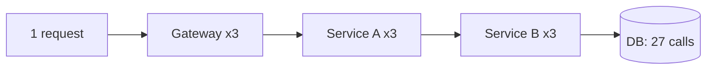
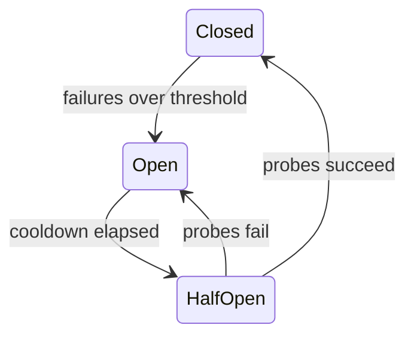
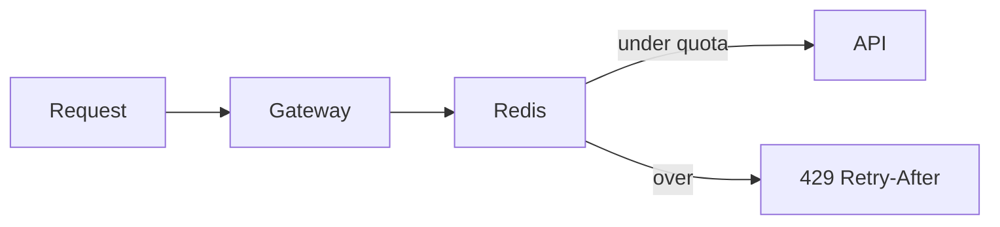

# Reliability

> [!abstract] What this is
> Distributed systems fail **partially**: one dependency gets slow, one region goes dark, one client floods you. Timeouts, retries with jitter, idempotency, circuit breakers, rate limits, and a disaster recovery plan are how you **fail small instead of hanging the whole site**.
>
> Rate limiter is also a **standalone HLD question**, so treat it as both a building block and a [[12 - Mini Designs|mini design]].

---

## Why It Exists

On one machine, a function call either works or throws. Across a network, a call can also **hang**, **succeed without you hearing back**, or **fail only sometimes**. Every service you call is a place where that can happen, and a system with ten dependencies has ten ways to get stuck.

The dangerous failures are not the clean crashes. They are the slow ones: a dependency that takes 30 seconds instead of 30 ms ties up your threads, your threads run out, and now *you* are the slow dependency for everyone upstream. The patterns in this note exist to stop one sick part from spreading. The targets they protect (SLOs, error budgets) are defined in [[11 - Services and Observability]].

---

## Timeouts

A timeout is the most basic reliability tool: every outbound call (DB, Redis, HTTP, Kafka produce) gets a maximum wait. Infinite wait is how one sick dependency takes you down, because each hung call holds a thread or connection forever.

Two rules for picking the number:

- Set it **shorter than the user SLA**. If the user gives up at 2 s, a 10 s DB timeout is pointless.
- Set it **shorter than the caller's timeout**. If the caller gives up first, your work is wasted and the caller may retry on top of it, which causes **retry amplification** (see below).

A useful pattern is a **deadline** passed down the call chain ("you have 800 ms left") so each layer knows how much time remains instead of each one starting its own fresh clock.

---

## Retries

Many failures are transient: a packet drop, a pod restarting, a brief 503. Retrying hides them from the user. But a retry is also extra load on something that may already be struggling, so retries have to be selective and bounded.

| Error | Retry? | Why |
|---|---|---|
| Timeout, 503, connection reset | Yes | Likely transient |
| 429 Too Many Requests | Yes, after `Retry-After` | Server told you when |
| 400 / 401 / 404 | No | Will fail the same way again |
| `POST` that might have succeeded | Only if idempotent | Otherwise you charge twice. See Idempotency below. |

**Exponential backoff plus jitter.** Wait 100 ms, then 200, then 400, and add randomness to each wait. Without jitter, all clients that failed at the same moment retry at the same moment, in lockstep, which is a **thundering herd**.

**Cap retries. Then fail.** Two or three attempts is normal. After that, return an error or a degraded response.

---

## Retry Budgets and Amplification

Per-request retry caps are not enough, because retries multiply across layers. Suppose a request goes gateway → service A → service B → database, and each layer retries 3 times. If the database is down, one user request becomes up to 3 × 3 × 3 = 27 database calls. The system hammers the dependency hardest at exactly the moment it is weakest. This is a **retry storm**.



Two fixes, usually used together:

- **Retry at one layer only.** Usually the layer closest to the failing call, or the edge. Inner layers fail fast and let one place decide.
- **Retry budget.** Cap retries as a share of normal traffic, for example "retries may be at most 10% of requests over the last minute." When things are healthy, the few failures get retried. When a dependency is down and everything fails, the budget runs out fast and retries stop, so load stays close to 1.1× instead of 3×. gRPC and Envoy support this directly.

The compounding effect might also be seen in the case of 1.1x making about 1.33x in 3 layers (not a lot) but still, like already mentioned above, this 1.1x fix is paired / used usually together with the decision of retrying at only one layer.

| Approach | Worst-case load on a dead dependency | Pick when |
|---|---|---|
| Fixed retries at every layer | Multiplies per layer (27× in the example) | Never on purpose |
| Retry at one layer | About 3× | Simple default |
| Retry budget (~10%) | About 1.1× | Many services, high traffic, or a mesh that supports it |

---

## Hedged Requests

**Tail latency** refers to the small percentage of requests that take significantly longer to process than the average. While the vast majority of calls might finish quickly (e.g., 20 milliseconds), a tiny fraction (the "tail" of the statistical curve, like 1 in 100) might take a full second because that specific request hit a server experiencing a temporary issue like a Garbage Collection (GC) pause.

Sometimes the problem isn't failure but **tail latency**: most calls return in 20 ms, but 1 in 100 takes 1 s because it hit a slow replica or a GC pause. Retrying after a timeout doesn't help much here, because the user already waited the full timeout.

A **hedged request** sends the call to one replica, waits about as long as the p95 latency, and if there is still no answer, sends a duplicate to a second replica. Whichever answers first wins and the other is cancelled or ignored. The slow tail mostly disappears, because it is unlikely that both replicas are slow at the same time.

The rules:

- **Only for idempotent reads.** Sending a payment twice to "whoever is faster" is a bug.
- **Cost is extra load.** Hedging after p95 means roughly 5% more requests (a rough figure, it depends on the distribution). Hedging immediately doubles load. Hedging immediately means firing two requests immediately to two replicas for finding and keeping the faster response.
- Combine with a **retry budget** so hedges stop when the whole backend is slow, not just one replica.

> [!tip] Hedging fixes "one replica is slow." It makes "all replicas are slow" worse. That's why it's capped.

About the tip above : Hedging is a tool to bypass a localized glitch. If a single server is temporarily frozen, sending a duplicate request to a second server works perfectly because the second server is healthy and will answer quickly. However, if your entire backend database is overwhelmed and every single server is struggling, the problem is systemic. In this scenario, hedging just throws even more duplicate requests at servers that are already suffocating, making the outage much worse. Combining hedging with a retry budget (capping it) ensures that if the whole system goes down, the application recognizes the widespread failure and stops sending those extra, damaging duplicate requests.

---

## Circuit Breaker

If `payment-svc` is erroring, **stop calling it for a bit**. A circuit breaker counts failures to a dependency. When they cross a threshold, it **opens** and every call fails fast without touching the network, so you can show "pay later" instead of hanging. After a cooldown it goes **half-open** and lets a few probe calls through. If they succeed it **closes**; if they fail it opens again.



Without this, your thread pool dies waiting on a dead friend, and the dead friend never gets breathing room to recover.

### Bulkhead

A bulkhead is the ship idea: separate compartments so one leak doesn't sink the boat. Give each dependency its **own thread pool or connection pool**, so a slow recommendations service can use up its 20 threads but cannot eat the threads that checkout needs.

| Pattern | Protects against | Pick when |
|---|---|---|
| **Timeout** | One call hanging forever | Always, on every outbound call |
| **Circuit breaker** | Repeatedly calling a dependency that is down | Any remote dependency that can fail |
| **Bulkhead** | One slow dependency starving all workers | Several dependencies of different importance share a process |

---

## Rate Limiting

You will be asked to design this. A rate limiter caps how many requests a caller can make in a period. It protects against **abuse**, against a **noisy neighbour** starving other tenants, and against you overwhelming **your own downstream**.

**Where:** at the API gateway or edge, so rejected traffic costs almost nothing. Optionally also per service for internal protection.

**Dimension:** per user, per IP, per API key, per endpoint. Often **all of them** with different quotas, such as 1,000/min per API key but 10/min on `/login` per IP.

### Algorithms

| Algorithm | Idea | Watch out | Pick when |
|---|---|---|---|
| **Fixed window** | 100/min, counter resets on the clock | Burst at the window edge (up to 2×) | Simple quotas where edge bursts are fine |
| **Sliding window log** | Store every request timestamp | Memory grows with traffic | Low volume, needs exact limits |
| **Sliding window counter** | Weighted mix of previous and current window counts | Approximate | Good compromise at scale |
| **Token bucket** | Tokens refill at rate R, burst up to B | Two parameters to tune | **The default answer** |
| **Leaky bucket** | Requests drain at a constant rate | Smooths, but may delay requests | Protecting a downstream that needs a steady rate |
### Sliding Window Log

The Sliding Window Log algorithm enforces rate limits by keeping an exact chronological record of every single request made by a user.

**How It Works:**

- **The Log:** The system maintains a sorted set or list of timestamps for every incoming request tied to a specific user or IP address.
- **The Evaluation:** When a new request arrives, the algorithm performs three steps:
    1. **Prune:** It removes all timestamps from the log that fall outside the current rolling time window (e.g., if the window is 1 minute, it deletes any timestamp older than exactly 60 seconds ago).
    2. **Count:** It counts the number of timestamps remaining in the log.
    3. **Decide:** If the count is below the permitted threshold, the request is accepted, and its timestamp is added to the log. If the count exceeds the threshold, the request is rejected (though its timestamp is sometimes still logged to track malicious spamming).
   
**Pros:**
- **Absolute Accuracy:** It is mathematically perfect. Because it does not rely on fixed boundaries, there are no edge cases where a user can double their limit by sending requests right at the turn of a minute.

**Cons:**
- **Massive Memory Footprint:** Storing a unique timestamp for every single request consumes a vast amount of RAM, especially for high-traffic APIs or large user bases.
- **Processing Overhead:** Continuously pruning and evaluating lists of timestamps on every single API call is computationally expensive.

### Sliding Window Counter

The Sliding Window Counter algorithm is a highly optimized hybrid. It combines the low memory cost of the "Fixed Window" approach with the smooth boundary logic of the "Sliding Window Log." Instead of storing individual timestamps, it tracks rolling request counts across two fixed windows.

**How It Works:**
- **The Tracking:** The system stores only two numbers for a user: the total request count from the _previous_ fixed time window, and the current request count for the _current_ fixed time window.
- **The Evaluation:** When a new request arrives, the algorithm calculates an estimated rolling count using a weighted average based on the exact current time.

**The Formula:** `Estimated Count = (Previous Window Count * % of time remaining in previous window) + Current Window Count`

**Example Scenario:** Assume a limit of 100 requests per minute.
- In the previous minute (1:00 to 1:01), the user made **80 requests**.
- In the current minute (1:01 to 1:02), the user has made **20 requests**.
- A new request arrives at exactly **1:01:15**.
- Because 15 seconds have passed in the current minute, that means 25% of the current window has elapsed. Therefore, the algorithm weights the _previous_ window at 75%.
- `Estimated Count = (80 * 0.75) + 20 = 80 total requests`.
- Since 80 is less than the 100 limit, the request is accepted and the current window count becomes 21.

**Pros:**
- **Highly Memory Efficient:** It only needs to store a few integers per user, regardless of whether they make 10 requests or 10,000 requests.
- **Smooths Traffic Spikes:** It successfully prevents the "boundary spike" problem where users hammer an API at the exact moment a fixed minute rolls over.

**Cons:**
- **Slight Heuristic Inaccuracy:** The algorithm assumes that the requests in the previous window were distributed perfectly evenly. If a user fired all 80 requests at the very end of the previous minute, the weighted calculation would be slightly mathematically inaccurate. However, in large-scale production systems, this tiny margin of error is considered perfectly acceptable in exchange for the massive performance gains.
### Distributed limiting

There are many gateway nodes. Keeping counters in local memory is wrong, because the real limit becomes N × nodes. The shared counter goes in **Redis**: `INCR` plus a TTL, ideally inside a **Lua script** so increment and expire happen atomically. For token bucket, store the token count and last refill time in Redis and compute the refill in the script.

When over the limit, respond **429** with a `Retry-After` header. Limits can be **soft** (warn or degrade) or **hard** (drop).



The full design walkthrough lives in [[12 - Mini Designs]].

---

## Throttling

**Throttling** is the umbrella term for deliberately limiting how much work flows into a system. The terms around it get mixed up, so pin them down first:

| Term | Who it limits | Trigger |
|---|---|---|
| **Rate limiting** | One caller (user, API key, tenant) | That caller went over its quota |
| **Load shedding** | Everyone, starting with the least important | *You* are overloaded, whoever is calling |
| **Backpressure** | The producer upstream | A slow consumer's limit propagates back against the data flow ([[07 - Async Messaging]]) |
| **Throttling** | Any of the above | Any of the above |

Throttling design comes down to a few independent questions: who enforces it, what happens to the excess, what exactly is being counted, whether the limit is fixed or adaptive, and how the "slow down" is signalled.

### Who throttles: the victim, the caller, or the middle

- **The receiver (server-side).** The service being hit protects itself: rate limits, quotas, concurrency caps, load shedding. This is **mandatory**, because you can't trust callers to behave; a buggy client or an attacker won't throttle itself.
- **The caller (client-side).** The caller slows itself down: its own rate limiter, exponential backoff with jitter, a **retry budget**, a circuit breaker. This is cooperative, and it matters because a rejection isn't free: the server still accepts the connection, parses the request, and writes a 429. Under heavy overload, just saying "no" can saturate the server. Google's SRE approach is **adaptive client-side throttling**: each client tracks how many of its recent requests the backend actually accepted, and once requests far exceed accepts, it starts rejecting a share of new requests **locally**, before they ever leave the client.
- **Something in the middle.** An API gateway, load balancer, or service mesh enforces limits for every service behind it, and a queue between two services absorbs bursts so the downstream sees a steady rate.

The robust setup uses all three: the server protects itself no matter what, well-behaved clients back off so the server spends less on rejections, and the gateway rejects at the edge where it's cheapest.

### What happens to the excess

| Strategy | What it does | Cost | Pick when |
|---|---|---|---|
| **Reject** | Fail fast: **429** (this caller is over its limit) or **503** (the server is overloaded) | The caller must handle it | Default. Cheap, and the caller decides whether to retry |
| **Delay** | Queue or pace requests out at a fixed rate (leaky bucket) | Latency and memory grow; an unbounded wait queue is an outage in slow motion | Smoothing short bursts into a downstream that needs a steady rate |
| **Degrade** | Serve a cheaper answer: cached or stale data, fewer results, optional features off | Users get a worse but working experience | Read paths where "something" beats "nothing" |
| **Shed by priority** | Drop the least important traffic first | Must classify traffic up front | Overload; analytics pings go before checkout |

If you delay, two rules keep it safe. The queue must be **bounded**, so excess is rejected rather than piling up. And requests should carry a **deadline** (propagated from the caller's timeout), so a worker drops a request whose client has already given up instead of doing useless work. Under heavy overload, some systems even switch the wait queue to **LIFO**: the newest requests still have a live client, and the oldest are probably already timed out.

### What gets counted

- **Rate** (requests per second): good for fairness and quotas ("1,000/min per API key").
- **Concurrency** (requests in flight at once): better for protecting the service itself. By Little's law, in-flight requests = throughput × latency. If a dependency slows down and latency triples, a fixed rate limit still lets the same rate in, so in-flight work triples and threads and memory run out. A concurrency cap holds the in-flight count fixed no matter how latency moves.
- **Cost-weighted**: an expensive request (a search, a report, a big upload) spends more tokens than a cheap one, so the limit tracks actual load rather than request count.

### Static vs adaptive limits

A **static** limit is a fixed number from load tests or a business quota. It's simple, but it's wrong whenever capacity changes: a deploy, a slow dependency, a bigger instance. An **adaptive** limit moves with live signals such as latency and error rate, the same way TCP congestion control works: raise the limit slowly while things are healthy, cut it sharply when latency rises or errors appear (**AIMD**: additive increase, multiplicative decrease). Netflix's concurrency-limits library and Envoy's adaptive concurrency filter do this. In practice, use static limits for fairness between customers and adaptive limits for self-protection.

**Adaptive Limits for Self-Protection** An adaptive limit dynamically adjusts the maximum amount of traffic a system accepts based on real-time health signals, specifically tracking metrics like error rates and latency. "Self-protection" refers to the system's ability to prevent its own collapse during unpredictable infrastructural events, such as a slow downstream dependency or reduced server capacity following a deployment.

Instead of blindly accepting a fixed number of requests until it runs out of memory and crashes, the system acts as a self-regulating valve. It slowly raises the traffic limit while operations are healthy, but sharply cuts the limit the exact moment it detects rising latency or errors. This AIMD (additive increase, multiplicative decrease) approach ensures the server sheds excess load and survives the stress, keeping the core system alive.

**Static Limits for Fairness Between Customers** A static limit is a rigid, fixed number that does not change with server health, often derived from load tests or specific business quotas (e.g., a pricing tier allowing 100 API calls per minute).

Using static limits for "fairness" ensures that system resources are distributed equitably among all users. It prevents the "noisy neighbor" problem, where one highly active customer hogs all the available server capacity. Even if the backend server is perfectly healthy and technically capable of handling a massive spike in traffic, the static limit acts as a strict boundary to ensure that one customer's heavy workload cannot monopolize the bandwidth and degrade the experience for the rest of the customer base.

### Why Adaptive Limits are Not Good For Customer Fairness

A plain global adaptive limiter (like Envoy's adaptive concurrency filter) is blind to caller identity. It watches system-wide health signals, mainly latency and errors, and decides **how much** total work to admit, not **whose** work. It tracks no per-customer quotas.

If a system relies exclusively on adaptive limits, a noisy neighbor hogs resources during both phases of the system's reaction:

- **The Scaling Phase:** As long as the server remains healthy, the adaptive algorithm continuously raises the global traffic ceiling. A noisy neighbor sending an unrestricted flood of requests will immediately consume this newly opened capacity, while standard users continue sending their normal, low volume.
- **The Throttling Phase:** Once the physical server reaches its limits and latency inevitably spikes, the adaptive algorithm triggers its multiplicative decrease, sharply cutting the total number of requests the system will accept. If the noisy neighbor is firing 10,000 requests per second and a normal user is firing 10 requests per second, the noisy neighbor mathematically crowds out the normal user. The limited processing slots are quickly consumed by the sheer volume of the noisy neighbor's traffic, resulting in the normal user's requests being dropped or delayed.

This is why static, per-customer rate limits sit in front of the adaptive system: each caller is cut off at its own quota, so no single tenant can take more than that share of whatever capacity the adaptive limit allows. A quota caps a caller's share but doesn't divide what's left evenly, though. A big customer running at its quota still outweighs a 10 req/s user when capacity shrinks, and if many callers are each under quota but together exceed capacity, first-come-first-served admission still favours whoever sends more. Even sharing inside the limit comes from **fair queueing** (a queue per tenant, served in turn) or from adaptive limits **partitioned** per tenant or priority, which Netflix's concurrency-limits supports. Quotas also only help if they're small relative to total capacity: a tenant whose quota is 80% of the cluster can crowd everyone out without ever breaking its limit.

### How "slow down" is signalled

| Layer              | Signal                                                                                                                              |
| ------------------ | ----------------------------------------------------------------------------------------------------------------------------------- |
| HTTP               | **429 Too Many Requests** or **503 Service Unavailable**, with **`Retry-After`**                                                    |
| gRPC               | `RESOURCE_EXHAUSTED` (or `UNAVAILABLE` for overload)                                                                                |
| Transport          | TCP receive window and HTTP/2 flow-control windows: the receiver stops granting window, so the sender physically can't send more    |
| Kafka              | Broker **quotas**: an over-quota client isn't rejected, its response is **delayed** (`throttle_time_ms`) so it naturally slows down |
| Pull-based systems | The consumer asks for the next batch only when ready (Kafka polling, reactive streams' `request(n)`), so throttling is built in     |

**Transport Layer** At the foundational network level, data transfer is governed by buffer availability, known as a "window". If a receiving server is overwhelmed and cannot process incoming data fast enough, its internal TCP or HTTP/2 buffers fill up. The receiver communicates a window size of zero back to the sender, which physically blocks the sender's operating system from transmitting any more packets until the receiver clears some buffer space and grants a larger window. This provides absolute, network-level backpressure without the application code ever needing to intervene.

**Kafka (Broker Quotas)** Unlike standard HTTP APIs that instantly reject excess traffic with a 429 error, Kafka handles over-quota clients by intentionally stalling. If a producer or consumer exceeds its assigned data rate, the Kafka broker calculates a penalty duration (`throttle_time_ms`). Instead of rejecting the request, the broker holds it, delays the processing for that exact duration, and then completes the request. This artificially inflates network latency, forcing the client's internal loops to naturally slow down without requiring the client to write custom backoff or retry logic.

**Pull-Based Systems** In push-based architectures (like HTTP webhooks), the upstream service blasts data downstream, requiring explicit throttling signals if the downstream gets overwhelmed. In pull-based architectures (like Kafka consumer polling or reactive streams using `request(n)`), the downstream worker strictly dictates the pace. A Kafka consumer only asks the broker for the next batch of messages when it has completely finished processing the current batch. If the consumer slows down, data transmission naturally halts because the consumer simply stops asking for more, making backpressure an inherent, unlosable feature of the design.

### Fairness

Limits usually exist at several granularities at once: per user, per tenant, per IP, per endpoint, plus a global cap on the whole service. Without per-tenant limits, one noisy tenant can consume the global budget and starve everyone else. **Fair queueing** (a separate queue per tenant, served round-robin) stops one big caller from crowding out many small ones even when they share capacity.

### Throttling and retries

Retries are where throttling usually goes wrong. Every retry is extra load arriving exactly when the server said it was overloaded, and retries at several layers multiply (3 retries at each of 3 layers is up to 64 attempts for one user action). Clients should honour `Retry-After`, add **jitter** (if everyone waits exactly `Retry-After` seconds, they all come back in the same instant), and cap retries with a **retry budget** of around 10% extra traffic.

> [!tip] Interview line
> "The service protects itself with a concurrency limit and sheds by priority; per-tenant rate limits at the gateway return 429 with `Retry-After`; clients back off with jitter inside a retry budget."

---

## Load Shedding and Backpressure

Rate limiting caps each caller. Load shedding caps **you**. When a service is already overloaded, accepting more work only makes every request slower, until they all time out and none succeed. That is a latency death spiral.

So when you are already dying, **refuse work early** with a 503 rather than queueing it. Shed the least important traffic first (analytics pings before checkout). Pair this with [[07 - Async Messaging|queue backpressure]], where a full queue pushes back on producers instead of growing forever.

---

## Health Checks, Deploys, and Graceful Shutdown

A deploy is a planned failure of every instance, one at a time, and it should be invisible to users. The mechanics are **liveness vs readiness** probes so the load balancer stops sending traffic before you send `SIGTERM`, and **connection draining** so in-flight requests finish. The full explanation and diagram live in [[04 - Load Balancing CDN and Gateway]]; rollout strategies such as canary and blue-green are in [[19 - Deployment and Infrastructure]].

You don't need Kubernetes internals. "Rolling deploy, readiness, drain" is the sentence.

**1. The "vs" in Liveness vs Readiness**

Liveness and readiness probes serve two distinct, non-interchangeable purposes in container orchestration.

- **Liveness:** Checks if the application has crashed or deadlocked. If a liveness probe fails, the orchestrator violently kills and restarts the container.
- **Readiness:** Checks if the application is prepared to accept network traffic. If a readiness probe fails, the orchestrator leaves the container running but temporarily removes it from the active routing pool.

**2. Removing the Instance from the Load Balancer** When a deployment or shutdown is initiated, the application is programmed to intentionally fail its readiness probe (e.g., its `/health/ready` endpoint starts returning an HTTP 503 instead of 200). It keeps its liveness probe returning HTTP 200 so it does not get killed immediately. The load balancer continuously polls the readiness endpoint. The moment it detects the failure, it removes that instance's IP address from its routing table, which stops the load balancer from sending any new traffic to that instance before the actual shutdown signal (`SIGTERM`) is ever sent.

**3. The Mechanics of Connection Draining** After the instance is removed from the load balancer, it receives no new requests, but it is still actively processing the requests that arrived milliseconds before the routing change. Connection draining is a configurable waiting period (e.g., 30 seconds) where the load balancer keeps those specific, existing network sockets open. The application uses this grace period to finish processing the in-flight requests and return the final data to the users without abruptly severing their connections. Once active connections drop to zero, or the timeout expires, the container is safely terminated.

---

## Idempotency

Duplicates are guaranteed in a system with retries. The user double-clicks Pay. The gateway retries a timeout. A queue worker gets the same message redelivered. If the operation isn't idempotent, each of these charges the user again.

The fix is an **`Idempotency-Key`** on every mutating API. The client generates a unique key per logical operation. The server stores key → response. A repeat with the same key returns the stored result and does not charge twice.

This is what makes the "retry `POST` only if idempotent" rule above safe to follow.

---

## Distributed Lock (pointer)

Locks come up next to reliability because they fail in subtle ways. The recipe (`SET NX EX` with a token, fencing tokens, lease vs lock, `SKIP LOCKED`) lives in [[14 - Coordination and Concurrency]].

The one rule to keep here: **don't hold a Redis lock while a human pays**. Use a DB row with `hold_until` instead.

This is about booking-style flows (movie seats, concert tickets) where something has to be reserved for a person while they go off and pay.

**The tempting approach.** The user picks seat A7, the server takes a Redis lock (`SET lock:seat:A7 token NX EX 600`), the user goes to the payment page, and on success the server books the seat and releases the lock.

**Why that's a bad idea:**

- **Humans are slow and unpredictable.** Paying can take 30 seconds or 10 minutes: OTPs, bank redirects, abandoned tabs. A distributed lock is meant to be held for milliseconds around a critical step in code, not across a human's whole checkout.
- **The TTL is a guess.** Too short and the lock expires mid-payment: someone else grabs A7 and both users pay for the same seat. Too long and abandoned checkouts keep seats locked from everyone.
- **Redis isn't the source of truth.** A Redis lock can vanish on failover (async replication can promote a replica that never got the key), and then two people hold "the" lock. The booking itself lives in your database anyway, so the lock and the booking can disagree.
- **It's invisible.** You can't query "which seats are on hold and until when" to grey them out in the UI or audit what happened.

**The DB-row approach.** The hold becomes data in the same database as the booking:

```sql
UPDATE seats
SET status = 'held', held_by = :user, hold_until = now() + interval '10 minutes'
WHERE seat_id = 'A7'
  AND (status = 'available' OR (status = 'held' AND hold_until < now()));
```

- If it updates **1 row**, you got the hold. If it updates **0 rows**, someone else has the seat.
- An expired hold is just a row whose `hold_until` is in the past, so the next person's `UPDATE` can take it. Nothing needs to "release" it, and a crashed server can't leave a seat stuck.
- When payment succeeds, the final `status = 'booked'` update checks that this user still holds it and it hasn't expired. If the hold lapsed, you refund instead of double-booking.

**Two different "holds": milliseconds vs 10 minutes.** It's easy to mix these up:

- **The database row lock** is a real lock inside Postgres. The `UPDATE` takes an exclusive lock on the A7 row while it runs and releases it at commit, a few **milliseconds** later.
- **The 10-minute hold** isn't a lock at all. It's just **data**: three column values written into the row (`status = 'held'`, `held_by`, `hold_until`). After the `UPDATE` commits, nothing in the database is locked. Anyone can read the row, other seats are unaffected, and no connection or transaction is kept open.

The seat is "reserved" for 10 minutes only because every later attempt checks those columns and backs off. The Redis-lock version's hold is a lock that must stay alive and be released; the DB version turns the hold into a **fact stored on the row**, protected by a lock that lasts only as long as the write.

**Why it's atomic.** Atomic here means the **check** ("is A7 free?") and the **claim** ("mark it held by me") happen as one indivisible step, so two users can't both see "free" and both claim it. A single `UPDATE … WHERE …` gives you that. If users X and Y click A7 at the same instant:

1. X's `UPDATE` finds A7, sees `status = 'available'`, takes the row lock, and writes `held_by = X`.
2. Y's `UPDATE` reaches the same row, finds it locked, and **waits**.
3. X commits and the lock is released.
4. Y wakes up, and under Read Committed Postgres **re-checks the `WHERE` clause against the new version of the row**. It's now `status = 'held'` with `hold_until` in the future, so the condition is false.
5. Y's `UPDATE` changes **0 rows**, and the app shows "seat taken".

That's the same re-check as step 6 of the two-doctor walkthrough in [[04 - Isolation and Anomalies]]. The broken version is `SELECT status` in the app, see `'available'`, then `UPDATE`: both users can read `'available'` before either writes, and both write. That's the lost-update pattern ([[03 - Concurrency Control]]). Putting the condition **inside** the `UPDATE` is what makes check-and-claim one step.

So the rule really means: don't model "reserved while a human pays" as a lock. Model it as a **state on the row with an expiry time** (the "state + TTL" pattern). The full designs are in [[06 - Seat Booking]] and [[14 - Coordination and Concurrency]].

---

## Graceful Degradation

When a non-critical part breaks, the site should get worse, not go down. Decide ahead of time what each feature falls back to, and name what you **drop** when on fire.

| Broken part | Fallback |
|---|---|
| Search | Keyword-less browse |
| Recommendations | Popular list |
| Redis | Serve from DB **behind a circuit breaker**, so the DB doesn't die too |

---

## Disaster Recovery

Everything above handles one server or one dependency failing. Disaster recovery (DR) handles losing **a whole database, a whole region, or your data itself** (a bad migration, an accidental `DELETE`, ransomware). Replication doesn't save you from the last one: a bad write replicates to every replica in milliseconds.

### RPO and RTO

Two numbers define any DR plan:

- **RPO (recovery point objective):** how much data you can afford to lose, measured in time. RPO of 5 minutes means after recovery you may be missing up to the last 5 minutes of writes.
- **RTO (recovery time objective):** how long you can be down. RTO of 1 hour means service must be back within an hour.

> [!example] A payments DB with nightly backups only has an RPO of up to 24 hours: a crash at 11 pm loses the whole day. Adding continuous WAL archiving brings RPO down to seconds or minutes. RTO is separate: even with perfect data, restoring a large DB from backup can take hours.

### Backup types

| Type | What it is | Pick when |
|---|---|---|
| **Full backup** | Complete copy of the data | Baseline, periodically (e.g. weekly) |
| **Incremental** | Only what changed since the last backup | Between fulls, to save time and space. Restore needs the full plus every increment. |
| **Snapshot** | Storage-level point-in-time image (EBS, RDS snapshots) | Fast to take and restore for whole volumes |
| **Point-in-time recovery (PITR)** | Base backup plus the continuous **WAL** (write-ahead log) replayed up to any chosen moment | Recovering to "one second before the bad `DELETE`". The default for important OLTP data. |

Backups should live in a **different account or region** from the data, so one mistake or one outage can't take both.

> [!warning] An untested backup is a hope, not a backup. Regularly **restore** into a scratch environment and time it. That measured time is your real RTO.

### Regional failover

At the region level there are two shapes. In **active-passive**, one region serves all traffic and a second region has a replica ready to be promoted; failover means promoting the replica and moving traffic (via DNS or GSLB, see [[04 - Load Balancing CDN and Gateway]]). In **active-active**, several regions serve traffic at once, so losing one just moves its users to the others. Active-active is much harder because both regions accept writes, which raises conflict and consistency questions covered in [[17 - Consistency Time and Consensus]].

### DR strategies

These four tiers trade cost against recovery speed. The RPO/RTO values are rough orders of magnitude, not guarantees.

| Strategy               | Setup                                                                               | Rough RPO          | Rough RTO                | Cost                                           | Pick when                                             |
| ---------------------- | ----------------------------------------------------------------------------------- | ------------------ | ------------------------ | ---------------------------------------------- | ----------------------------------------------------- |
| **Backup and restore** | Backups in another region; rebuild everything on disaster                           | Hours              | Hours to a day           | Lowest                                         | Internal tools, non-critical systems                  |
| **Pilot light**        | Data continuously replicated to the second region; minimal compute kept off or tiny | Minutes            | Tens of minutes to hours | Low                                            | Important but can tolerate some downtime              |
| **Warm standby**       | Scaled-down full copy running in the second region, scaled up on failover           | Seconds to minutes | Minutes                  | Medium                                         | Customer-facing systems with tight RTO                |
| **Active-active**      | Full capacity in several regions, all serving                                       | Near zero          | Near zero                | Highest (2× infra plus consistency complexity) | Payments, core flows where downtime is very expensive |

Each strategy answers one question: **what is already running in the second region (call it region B) before disaster hits?** The three columns follow from that:

- **RPO** (how much data you lose) depends on **how far behind** region B's copy of the data is at the moment region A dies.
- **RTO** (how long you're down) depends on **how much work** is left before region B can serve users: provision servers, restore data, start apps, scale up, switch DNS.
- **Cost** depends on **what you pay for in region B every day**, even when nothing is wrong.

The four strategies are steps on that dial, from "almost nothing in B" to "a full copy in B".

**1. Backup and restore**

**What's in region B:** only stored files, meaning nightly database backups and maybe WAL archives in S3. No database or servers are running.

**When region A dies:** you build everything from scratch. You provision a database and restore the backup into it, which for a large database can take hours just to copy and replay. Then you launch app servers, warm caches and point DNS at region B.

- **RPO is hours:** your newest copy is the last backup. With nightly backups, a crash at 11 pm loses the whole day. Archiving WAL to region B shrinks that to minutes.
- **RTO is hours to a day:** restore time grows with database size, and nothing was running, so every component has to be built and started under pressure.
- **Cost is lowest:** you only pay for storage, which is cheap. No servers run in B.

**2. Pilot light**

The name comes from a gas heater's pilot light: a tiny flame always burning so the main burner can light quickly.

**What's in region B:** the **data layer is live and running**, meaning a database replica receiving continuous replication from region A. Everything else (app servers, workers, caches) is turned off, or exists only as images and infrastructure code ready to launch.

**When region A dies:** you promote the replica to primary, launch the app tier from those images, scale it to full size and switch DNS.

- **RPO is minutes, often seconds:** the replica is only as far behind as the replication lag, not a whole backup cycle.
- **RTO is tens of minutes to hours:** the data is ready, but the compute has to be launched, booted, health-checked and scaled to handle full traffic.
- **Cost is low:** you pay for one always-on database replica plus storage. The expensive app fleet doesn't run until you need it.

**3. Warm standby**

**What's in region B:** a **complete, working copy** of the whole system, but **small**. That's the database replica plus a few app servers, workers and a cache, all actually running and able to serve a trickle of traffic. You could send real users there right now; it just couldn't handle all of them.

**When region A dies:** you promote the replica, **scale up** the already-running fleet with autoscaling, and switch DNS.

- **RPO is seconds to minutes:** the data is replicated continuously, same as pilot light.
- **RTO is minutes:** nothing has to be built or booted from zero. Everything is already deployed and passing health checks, and scaling out a running fleet is much faster than launching one.
- **Cost is medium:** you pay for a whole running system, just at reduced size.

The data side is the same as pilot light, so the RPO is basically equal. The real difference between the two is RTO, bought with the cost of keeping compute running.

**4. Active-active**

**What's in region B:** **full capacity, serving real users right now.** Both regions take live traffic, typically with users routed to the nearest one.

**When region A dies:** there's no failover project at all. Routing stops sending traffic to A, and B was already sized to handle everyone.

- **RTO is near zero:** the only delay is the time for routing to notice A is down and stop sending traffic there.
- **RPO is near zero, with caveats:** writes are already landing in both regions. It's only truly zero if a write isn't acknowledged until both regions have it. With async replication between regions, writes still in flight when A dies can be lost, so "near zero" is more honest than "zero".
- **Cost is highest, for two reasons:**
  - **Infrastructure:** you run the full system twice, roughly 2× the bill.
  - **Engineering:** two regions accepting writes means handling conflicts. Either each user has a home region that owns their writes, or you resolve conflicts with something like last-write-wins or CRDTs. That's the consistency complexity in the table, and it's often the bigger cost.

The pattern down the table: each step keeps more of the system running in region B ahead of time. That means less to do during the disaster, which gives a lower RTO. The data gets copied more continuously, which gives a lower RPO. And you pay more every day whether disaster comes or not.

---

## Chaos Engineering

All these mechanisms only work if they actually trigger when needed, and the only way to know is to break things on purpose. Chaos engineering means **deliberately injecting failure** (kill a pod, add 500 ms latency to a dependency, drop a region) and watching what happens.

It's run like an experiment:

1. **Steady-state hypothesis.** Define "healthy" with a metric, for example "checkout success rate stays above 99%."
2. **Inject a failure.** Kill instances, add latency, block a dependency.
3. **Limit the blast radius.** Start in staging or with a small slice of production traffic, with an abort switch.
4. **Compare.** If the steady state held, confidence goes up. If it broke, you found a weakness before a real outage did.

A **game day** is a scheduled team exercise where you run a failure scenario (such as a regional failover) end to end, including the humans: alerts, runbooks, and who does what. Netflix's Chaos Monkey is the well-known example.

> [!tip] In an interview, one line is enough: "We'd validate failover with game days and chaos tests, not just trust the diagram."

---
0
## Failure Modes

| Failure                                 | What happens                                                                                                                            | Mitigation                                                        |
| --------------------------------------- | --------------------------------------------------------------------------------------------------------------------------------------- | ----------------------------------------------------------------- |
| **No timeout**                          | One slow dependency holds every thread; the whole service hangs                                                                         | Timeouts on every outbound call, shorter than the caller's        |
| **Retry storm**                         | Retries at every layer multiply load on a struggling dependency                                                                         | Retry at one layer, retry budget (~10%), backoff with jitter      |
| **Synchronized retries**                | Clients retry in lockstep and hit the server in waves                                                                                   | Jitter                                                            |
| **Non-idempotent retry**                | User charged twice                                                                                                                      | `Idempotency-Key` on mutating APIs                                |
| **Cascading failure**                   | A dead dependency drains thread pools upstream                                                                                          | Circuit breaker plus bulkheads                                    |
| **Local-memory rate limit**             | Real limit becomes N × nodes when the main issue was that the limit N is not about the node but about the system (distributed limiting) | Shared counter in Redis with an atomic Lua script                 |
| **Overload death spiral**               | Queueing more work makes every request time out                                                                                         | Load shedding with early 503s                                     |
| **Throttling too late**                 | Requests are rejected only after the expensive work (auth, DB call) is done, so rejection saves nothing                                 | Throttle at the gateway or as the first step in the handler       |
| **Rate limit but no concurrency limit** | A slow dependency raises latency, in-flight requests pile up, threads run out                                                           | Concurrency cap (static or adaptive) alongside the rate limit     |
| **Clients ignore 429**                  | Rejected callers retry instantly and keep the server pinned                                                                             | Honour `Retry-After` with jitter; client-side adaptive throttling |
| **Unbounded wait queue**                | Delayed requests are served after their clients have timed out                                                                          | Bounded queue plus deadline propagation; drop expired requests    |
| **Health checks throttled**             | Probes get 429/503 under load, so the load balancer marks healthy nodes dead                                                            | Exempt health checks from throttling                              |
| **Replicated bad write**                | A bad `DELETE` hits every replica                                                                                                       | Point-in-time recovery from WAL                                   |
| **Untested backups**                    | Restore fails or takes far longer than planned                                                                                          | Regular restore drills; measure real RTO                          |

---

## Interview Lines

> [!tip] Say it like this
> - "Every outbound call has a timeout shorter than its caller's, and retries use exponential backoff with jitter."
> - "I retry at one layer and cap retries with a budget of about 10% of traffic, so a dead dependency doesn't get a retry storm."
> - "Circuit breaker on payments: when it's failing we fail fast and show 'pay later' instead of hanging."
> - "Token bucket at the gateway, state in Redis via a Lua script, 429 with `Retry-After`."
> - "Every mutating API takes an `Idempotency-Key`, so retries and double-clicks are safe."
> - "RPO is how much data we can lose, RTO is how long we can be down. For this system: PITR from WAL and a warm standby region."

## Related Notes

- [[04 - Load Balancing CDN and Gateway]]
- [[06 - Caching]]
- [[07 - Async Messaging]]
- [[11 - Services and Observability]]
- [[12 - Mini Designs]]
- [[14 - Coordination and Concurrency]]
- [[17 - Consistency Time and Consensus]]
- [[19 - Deployment and Infrastructure]]
