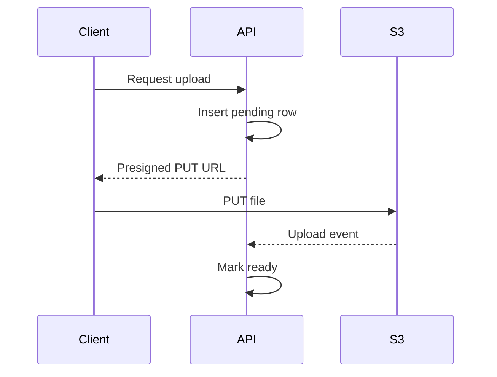
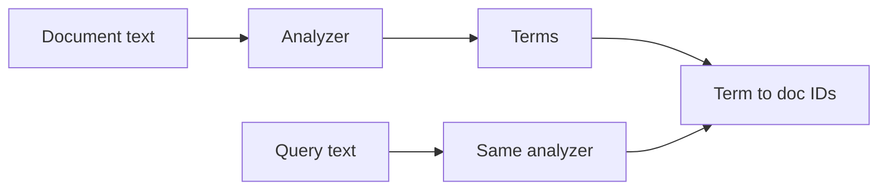
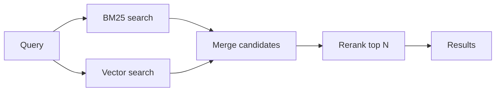
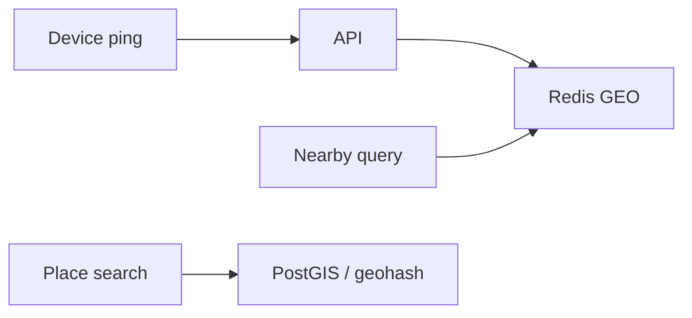

# Storage, Search, and Geo

> [!abstract] What this is
> Files do not go in Postgres. Search is not `LIKE '%foo%'`. Nearby is not `SELECT * WHERE distance < 5` on every row. Each of these needs a specialised store: **object storage**, an **inverted index** (or a **vector index**), and a **geo index**.
>
> In every case, the metadata and the source of truth stay in your OLTP DB. The specialised store is a copy shaped for one kind of query.

---

## Why It Exists

A relational database is great at "find the row with this ID" and "find rows where this column is in this range." It is bad at three things that almost every product needs: storing large binary files, ranking text by relevance, and finding things near a point on a map.

You can force all three into Postgres, and for small scale that's fine. But at real scale, big files bloat the DB and its backups, text search turns into full table scans, and distance queries compute a formula on every row. So each problem gets its own store, fed from the main DB.

---

## Block vs File vs Object Storage

Before object storage specifically, it helps to know the three kinds of storage the cloud offers. They differ in how you address data: by disk block, by file path, or by key over HTTP.

| Type | What it looks like | Example | Pick when |
|---|---|---|---|
| **Block** | A raw disk attached to one machine | AWS EBS | A database's data directory, or any single-server filesystem needing low latency |
| **File** | A shared filesystem with folders, mounted by many machines | AWS EFS, NFS | Several servers need to read and write the same files by path, e.g. legacy apps, shared config |
| **Object** | Flat key → blob, accessed over HTTP | AWS S3 | User uploads, videos, images, backups, data lake files. The default for "files" in an HLD. |

---

## Object / Blob Storage (S3)

Object storage holds videos, images, PDFs, and dumps. It is cheap, durable, and effectively "infinite." Your DB stores the **URL or key**, not the bytes.

The main rule: **never stream a 200 MB file through the app server.** It ties up app threads and bandwidth for something S3 can do directly.

### Upload with a presigned URL

A presigned URL is a time-limited URL, signed by your backend, that lets the client talk to S3 directly for one specific object. Say this sequence:

1. Client asks the API for permission (auth, quota, mime type check).
2. API inserts `files(id, key, status=pending)` and returns a **presigned PUT URL**.
3. Client uploads **directly to S3**.
4. An S3 event (or a client callback) tells the API, which marks `status=ready`. Optionally a virus-scan worker runs first.

**Download** works the same way: a presigned GET, or a public object behind a [[04 - Load Balancing CDN and Gateway|CDN]].

### Large files and dedup

**Multipart / chunking** splits big files into parts, so each part can be retried on its own and parts can upload in parallel. See [[04 - Multipart Upload]] for a full design.

**Dedup** hashes the content, so the same blob is stored once under one key (Dropbox-lite).

Durability is handled by the provider through replication and erasure coding. In an interview, treat S3 as infinitely scalable. Don't shard S3.

---

## Search Basics

`WHERE title LIKE '%pizza%'` scans the whole table and cannot rank results. Search needs a different data structure: the **inverted index**, which maps each word to the list of documents containing it. It's the index at the back of a book, flipped around from "document → words" to "word → documents."

**Elasticsearch / OpenSearch** is the box on the diagram. Postgres `tsvector` with a GIN index is fine for *small* search; say when you'd outgrow it (large corpus, relevance tuning, facets, high query volume).

**Autocomplete** is a different problem: a prefix trie or the ES completion suggester, plus a **top-K per prefix** computed offline. See [[12 - Mini Designs]].

---

## Search Internals

### Building the inverted index

Text goes through an **analyzer** before it is indexed, and the same analyzer runs on the query so both sides match. A typical analyzer does:

1. **Tokenise**: split text into words. "Running shoes, size 10" → `running`, `shoes`, `size`, `10`.
2. **Lowercase and normalise**: `Running` → `running`.
3. **Remove stopwords**: drop words like `the`, `a`, `of`.
4. **Stem**: reduce words to a root, `running` → `run`, `shoes` → `shoe`.

The index then stores, for each term, a **postings list**: the document IDs containing it, often with positions and counts. A query for "running shoe" looks up the postings for `run` and `shoe` and intersects or merges them.

### Relevance: TF-IDF, then BM25

Finding matching documents is half the job; ranking them is the other half. Ranking starts from two ideas:

- **Term frequency (TF):** a document that mentions "pizza" many times is probably more about pizza.
- **Inverse document frequency (IDF):** a rare word matters more than a common one. Matching "margherita" says more than matching "food."

**TF-IDF** multiplies the two. It works, but has two flaws. First, TF grows without limit, so a page that repeats "pizza" 100 times beats a genuinely relevant page. Second, long documents mention everything more often, so they win just by being long.

**BM25** is the modern default (Elasticsearch uses it) and fixes both:

- **Term frequency saturation:** each extra mention adds less than the last. Going from 0 to 1 mention matters a lot; going from 10 to 11 barely matters.
- **Length normalisation:** a match in a short title counts for more than the same match buried in a long article.

In practice, final ranking mixes BM25 with business signals like **popularity and recency**. Don't invent ML unless they ask.

### Sharding, replicas, and refresh

An Elasticsearch index is split into **primary shards**, each a self-contained index holding part of the documents. A query fans out to every shard and the results are merged. Each primary has **replica shards** on other nodes, which give failover and extra read capacity. The primary shard count is fixed when the index is created (changing it means reindexing), so pick it with growth in mind.

Writes are not searchable instantly. ES buffers new documents and makes them visible on each **refresh**, which by default happens about every **1 second**. That's why it's called **near-real-time** search.

### Keeping search in sync

Search is always a **copy**, fed from the source of truth. Write to Postgres first, then index **asynchronously** via Kafka or **CDC** (change data capture, which reads the DB's change log; see [[07 - Async Messaging]] and [[20 - Data Processing and Analytics]]). Search is therefore **eventually consistent**. That's OK.

> [!warning] Don't dual-write in two synchronous calls (DB, then ES). If the second call fails, the two drift apart with nothing to repair them. Let CDC or an outbox drive the index.

---

## Vector Search

Keyword search matches words. It fails when the user and the document use different words for the same thing: "cheap flights" vs "budget airfare." Vector search matches **meaning** instead.

An **embedding model** turns a piece of text (or an image) into a vector of a few hundred to a few thousand numbers, placed so that similar meanings end up close together. Closeness is usually measured with **cosine similarity**, the angle between two vectors: pointing the same way means similar meaning, regardless of length.

### Exact vs approximate nearest neighbours

The exact approach (**exact kNN**) compares the query to every stored vector. With `n` vectors of `d` dimensions, that's `O(n·d)` per query. For millions of vectors with hundreds of dimensions, that's far too slow for an online request.

So real systems use **ANN (approximate nearest neighbours)**: accept that you might miss a few of the true top results in exchange for being much faster.

**HNSW** (hierarchical navigable small world) is the most common ANN index. It builds a **layered graph**: the top layer has few nodes with long-range links, and each lower layer has more nodes with shorter links, down to the bottom layer which has every vector. A search starts at the top, **greedily** hops to whichever neighbour is closest to the query, drops a layer, and repeats. It's like finding a house by going country → city → street.

The main knob is **`ef_search`**, how many candidates the search keeps in play. Higher means better recall and slower queries; lower means faster and more misses.

**IVF** (inverted file) is the main alternative. It clusters vectors into buckets up front, and a query only scans the few buckets whose centres are closest. It uses less memory than HNSW but usually needs tuning to match its recall.

| Method | How it works | Trade-off | Pick when |
|---|---|---|---|
| **Exact kNN** | Compare against every vector, `O(n·d)` | Perfect recall, slow | Small sets (rough guide: up to tens of thousands) or offline jobs |
| **HNSW** | Layered graph, greedy search | Fast, high recall, memory-heavy | Default for online vector search |
| **IVF** | Cluster, then scan nearest buckets | Lower memory, recall depends on tuning | Very large sets where memory is the limit |

### Hybrid search and reranking

Neither method wins alone. BM25 is great at exact terms (product codes, names), and vectors are great at paraphrases. **Hybrid search** runs both, merges the two candidate lists, and then a **reranker** (often a heavier model) reorders the top few dozen results for the final answer.

A real worked example of this, from my own work, is in [[Resume/Delhivery/05 - Ask AI Search]].

---

## Geo / "Nearby"

"Restaurants within 3 km" and "drivers near me" are the classic geo queries. The naive approach computes the haversine distance on every row, which dies immediately at any real scale. The fix is to index location so the query only looks at points in the right area.

### Geohash

A **geohash** encodes latitude and longitude into a string, where each extra character narrows the area. Nearby points share a prefix, so "nearby" becomes a prefix lookup on an ordinary index. Query the user's cell **plus its neighbours**: the gotcha is that two points just across a cell edge can have completely different prefixes. Redis `GEO*` commands are geohash under the hood.

**Quadtree / R-tree / PostGIS:** Postgres can do geo queries with a GiST index via PostGIS. That's fine until write QPS gets huge.

### Beyond geohash: quadtree, S2, H3

Geohash uses a fixed grid, so a cell in central Mumbai may hold thousands of restaurants while a cell in a desert holds none. Other schemes fix this in different ways.

A **quadtree** starts with the whole map as one cell and splits any cell into four once it holds too many points. Dense cities get small cells and empty areas stay as big cells, so it **adapts to density**. It usually lives in memory in a service.

**Google S2** projects the Earth onto a cube and divides each face into a hierarchy of cells along a curve. Because it works on a **sphere**, cell shapes stay reasonable everywhere, including near the poles, and it can cover arbitrary regions with a set of cells.

**Uber H3** divides the Earth into **hexagons** at many resolutions. The key property: every hexagon's six neighbours are all the same distance from its centre, unlike squares where corner neighbours are further away than edge neighbours. That makes "ring of cells around me" and area-based aggregation (like surge pricing zones) clean. Worth name-dropping for mobility and delivery problems; not required elsewhere.

| Index | Cell shape | Strength | Pick when |
|---|---|---|---|
| **Geohash** | Fixed rectangles, string prefix | Simple, works in any DB or Redis | Default for "nearby" in an interview |
| **Quadtree** | Squares that split by density | Adapts to dense vs sparse areas | In-memory index with very uneven density |
| **PostGIS (R-tree / GiST)** | Bounding boxes | Full geometry queries in SQL | Stable places data already in Postgres |
| **S2** | Hierarchical cells on a sphere | Accurate globally, region covering | Global coverage, polygon queries |
| **H3** | Hexagons | Uniform neighbour distances | Mobility, delivery zones, surge/heatmap aggregation |

### Hot path pattern

Moving things and fixed things belong in different stores:

- Partners ping their location every few seconds → **Redis GEO** (ephemeral, high write rate).
- Places such as restaurants → **PostGIS** or a geohash column with an index (stable, rarely written).

---

## Time-Series / Metrics Store

Metrics are a flood of small, timestamped, append-only points that are queried by time range and aggregated. That doesn't fit an OLTP database, so the line to know is "**we don't OLTP our metrics**."

| Data | Store |
|---|---|
| Metrics | Prometheus, a dedicated TSDB, or ClickHouse |
| Logs | ELK or Loki |
| Traces | Jaeger |

The full observability picture is in [[11 - Services and Observability]].

---

## Failure Modes

| Failure | What happens | Mitigation |
|---|---|---|
| **Files through the app server** | Threads and bandwidth tied up by uploads | Presigned URLs straight to S3 |
| **Orphaned uploads** | `pending` rows for files that never arrived | Expire pending rows; S3 lifecycle rules for stray objects |
| **Dual-write drift** | DB and search index disagree after a partial failure | CDC or outbox drives indexing |
| **Expecting instant search** | A just-saved item doesn't show up in results | Accept ~1 s refresh; read-your-writes from the DB if needed |
| **Wrong shard count** | Index can't grow without a full reindex | Plan primary shards for growth; use aliases to reindex safely |
| **Low ANN recall** | Vector search misses relevant results | Raise `ef_search`, use hybrid search plus rerank |
| **Geohash cell edge** | Nearby points in the next cell are missed | Always query the cell plus its neighbours |
| **Hot geo cell** | Dense city cell overloads one shard | Smaller cells there, or a density-adaptive index like a quadtree |

---

## Interview Lines

> [!tip] Say it like this
> - "The DB stores the key and metadata; the bytes go to S3 via a presigned PUT URL, and downloads go through a CDN."
> - "Postgres is the source of truth; Elasticsearch is fed by CDC, so search is eventually consistent, about a second behind."
> - "BM25 is TF-IDF with term frequency saturation and length normalisation."
> - "For semantic search, embeddings in an HNSW index; hybrid with BM25, then rerank the top results."
> - "Nearby drivers go in Redis GEO; I query the geohash cell and its neighbours. For delivery zones I'd use H3."

## Related Notes

- [[04 - Load Balancing CDN and Gateway]]
- [[05 - Databases]]
- [[07 - Async Messaging]]
- [[11 - Services and Observability]]
- [[12 - Mini Designs]]
- [[20 - Data Processing and Analytics]]
- [[Resume/Delhivery/05 - Ask AI Search]]
