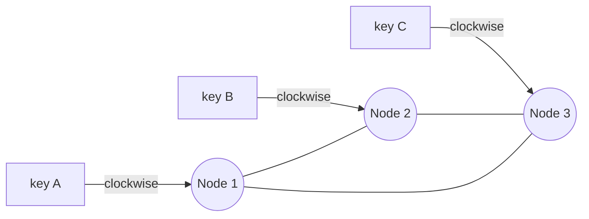
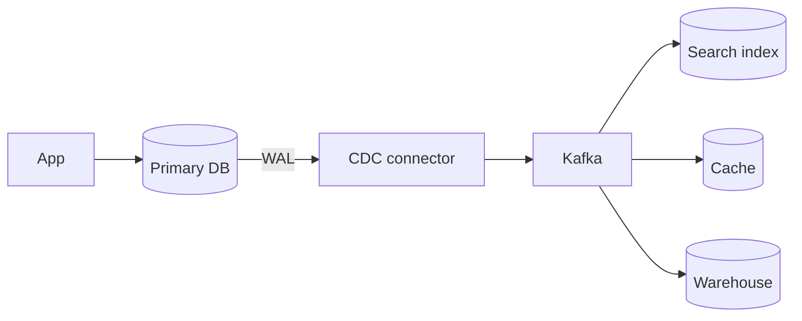

# Distributed Building Blocks

> [!abstract] What this is
> A set of named tools that show up inside bigger designs: consistent hashing, unique IDs, probabilistic structures, quorums, gossip, CRDTs, sagas and CDC. You won't implement Raft. You **will** be asked about unique IDs, consistent hashing, quorum, and "how do two services agree."
>
> The skill is matching the tool to the sentence in the prompt, not listing every tool you know. The theory behind these (consistency models, clocks, consensus internals) lives in [[17 - Consistency Time and Consensus]].

---

## Why It Exists

As soon as data lives on more than one machine, simple things stop being simple. You can't use `hash(key) % N` without moving everything when N changes. You can't use a DB autoincrement across shards. You can't tell whether a silent node is dead or just slow. And you can't wrap two services in one transaction.

Each block in this note is a known answer to one of those problems. Naming the right one, and its cost, is usually a full deep-dive answer on its own.

---

## Placing Keys on Nodes

When data or cache keys are spread over N nodes, you need a rule that says which node owns which key. The naive rule is `hash(key) % N`. It works until N changes: adding or removing one node remaps **almost all keys** to new machines, which for a cache means a near-total miss storm.

### Consistent hashing

Consistent hashing puts both keys **and** nodes on a circle (a hash ring). A key belongs to the next node clockwise. When you add a node, only the keys on the arc just before it move; everything else stays put.

With only a few points on the ring, one node can end up owning a huge arc. **Virtual nodes** fix this: each physical box sits at many points on the ring, so load evens out, and a failed box's load spreads over many neighbours instead of one.

It shows up in Redis Cluster-style sharding, Cassandra, some load balancers and CDNs.

### Rendezvous (highest-random-weight) hashing

Rendezvous hashing solves the same problem with no ring. For each key, compute `hash(key, node)` for every node and pick the node with the **highest score**. When a node leaves, only the keys it owned move, and each goes to its own second-highest node, so load spreads evenly without virtual nodes. It also gives a natural "top k nodes" list for replicas.

The cost is that each lookup scores every node, so it's `O(N)` per key. That's fine for tens or hundreds of nodes, and less fine for thousands.

| Scheme | Lookup cost | Balance | Pick when |
|---|---|---|---|
| `hash % N` | `O(1)` | Even | N never changes |
| **Consistent hashing** + vnodes | `O(log N)` on a sorted ring | Even with enough vnodes | Default for large, changing clusters (Cassandra, cache clusters) |
| **Rendezvous (HRW)** | `O(N)` per key | Even without vnodes | Small-to-medium node sets, you want simple code and a clean "top k replicas" list |

---

## Unique IDs

A DB autoincrement **doesn't work across shards**. Two shards hand out the same number, or you need one shared sequence, which is a single point of failure and a bottleneck. So distributed systems generate IDs another way.

| Scheme | Pros | Cons | Pick when |
|---|---|---|---|
| UUID v4 | No coordination | 128 bits, not sortable, random B-tree inserts | IDs are opaque and index locality doesn't matter |
| UUID v7 / ULID | Roughly time-sortable, no coordination | Still 128 bits | You want sortable IDs without running a service |
| **Snowflake** | 64-bit, time-ordered, generated per machine | Needs a machine ID; clock caution | Tweet IDs, order IDs, anything high-volume and sorted |
| Redis `INCR` | Simple, dense | Redis is now in the write path | Low volume and Redis is already there |
| Range allocator | DB hands you 1,000 IDs at a time | Batch coordination; gaps on crash | Short numeric IDs, e.g. a URL shortener |

The Snowflake layout is worth memorising: **1 sign bit + timestamp + worker ID + sequence**. The timestamp makes IDs sort by time, the worker ID prevents collisions between machines, and the sequence handles many IDs in the same millisecond.

> [!warning] Snowflake trusts the local clock. If the clock jumps backwards, a worker can repeat IDs. Implementations refuse to issue IDs until the clock catches up. Clock behaviour is covered in [[17 - Consistency Time and Consensus]].

This is the classic URL-shortener and tweet-ID deep dive (see [[12 - Mini Designs]]).

---

## Probabilistic Structures

Sometimes an exact answer costs too much memory, and an answer that is "almost always right" is good enough. These structures trade a small, known error for a huge memory saving.

A **Bloom filter** is a probabilistic set. It answers **"definitely not there"** or **"maybe there."** It has false positives but **no false negatives**, and it uses tiny memory. Typical uses: "have we crawled this URL already," or "is this key in the 10B-key store" before paying for a disk read. It is not a database; you can't list or (in the basic form) delete members.

| Structure | Answers | Error | Pick when |
|---|---|---|---|
| **Bloom filter** | "Is X in the set?" | False positives only | Skip expensive lookups for things that surely aren't there |
| **Count-Min Sketch** | "How often has X appeared?" | Over-counts, never under-counts | Heavy hitters, top-k trending items at huge scale |
| **HyperLogLog** | "How many distinct items?" | Small relative error | Unique visitor counts at huge scale |

Count-Min Sketch and HyperLogLog are tail topics. Name them when the prompt says "unique counts" or "frequency at huge scale."

---

## Replication Coordination

Replicated stores need rules for how many copies must agree on a read or write, and who is in charge. The short versions are here; the depth is in [[17 - Consistency Time and Consensus]].

### Quorum

With `N` replicas, a write waits for `W` acks and a read asks `R` replicas. If **R + W > N**, every read set overlaps every write set, so a read sees at least one copy of the latest write (under the usual assumptions).

| Setting | Behaviour | Pick when |
|---|---|---|
| N=3, W=2, R=2 | Classic balanced quorum | Default for Dynamo-style stores |
| N=3, W=1, R=3 (R=N) | Fast writes, slow reads | Write-heavy, reads can wait |
| N=3, W=1, R=1 | Fastest, **stale reads** possible | Freshness doesn't matter |

This is the Dynamo / Cassandra model. Postgres replication is usually **not** discussed as a quorum; don't mix the two models.

### Leader election

Many systems need exactly one primary: a partition leader, a scheduler, a lock holder. **Raft** and **Paxos** get a majority to vote in a leader and keep a replicated log. The one-sentence version is: "consensus, so we never have two primaries." You won't draw Raft.

**ZooKeeper** and **etcd** mean "someone else runs Raft for us." Practical leader-election recipes are in [[14 - Coordination and Concurrency]].

### Vector clocks and conflicts

In multi-writer NoSQL, two replicas can accept writes without seeing each other. **Vector clocks** tell you whether two versions are **causal** (one came after the other) or **concurrent** (a real conflict). The store can detect a conflict, but the application must merge it.

The safe default: avoid multi-leader writes. If you must allow them, use last-write-wins, store both versions and resolve later, or use a CRDT (below).

---

## Gossip and Failure Detection

A large cluster needs every node to know who else is alive, without a central registry that becomes a bottleneck. Gossip spreads that knowledge, and a failure detector decides when a node counts as dead.

### Gossip protocols

In a **gossip** (epidemic) protocol, every node periodically picks a few random peers and swaps what it knows: membership, heartbeats, versions. Each round roughly doubles the number of nodes that have heard a piece of news, so it reaches the whole cluster in about **O(log N) rounds**. No node is special, and losing a few messages doesn't matter because the news arrives by another path.

The cost is that the news is **eventually** consistent. For a moment, different nodes have different views of the cluster.

Cassandra uses gossip for cluster membership and node state. Consul (via Serf) uses gossip for membership and failure detection.

### Failure detection

The basic tool is a **heartbeat with a timeout**: if node B hasn't heard from A in T seconds, B suspects A is down. The catch is that over a network **you can't tell slow from dead**. A long GC pause, a congested link and a crashed process all look identical: silence.

So every timeout is a trade-off. A short timeout detects crashes fast but falsely declares slow nodes dead, which triggers needless failovers. A long timeout avoids false alarms but leaves a dead node in rotation longer.

The **phi accrual failure detector** (used by Cassandra and Akka) softens this. Instead of a yes/no timeout, it tracks how heartbeat arrival times normally vary and outputs a **suspicion level** (phi) that rises the longer a heartbeat is overdue compared to normal. Each caller picks its own threshold: a load balancer might act on low suspicion, while a failover that moves data waits for high suspicion.

| Approach | How it decides | Pick when |
|---|---|---|
| Fixed heartbeat timeout | Silent for T seconds = dead | Simple systems, stable networks |
| **Phi accrual** | Suspicion grows with how unusual the delay is | Networks with variable latency; different actions need different confidence |
| Gossip-based (SWIM-style) | Peers probe indirectly before declaring death | Large clusters where one observer's view isn't enough |

> [!warning] A failure detector can be wrong. A node declared dead may still be alive and still writing. That's why leader handover needs fencing tokens (see [[14 - Coordination and Concurrency]]).

---

## CRDTs

A **CRDT** (conflict-free replicated data type) is a data structure designed so that replicas can accept writes independently and later **merge without coordination**, always arriving at the same result. The merge is built so that order and duplicates don't matter. This removes the "app must resolve the conflict" step for the data types it covers.

The trick is to store a bit more than the plain value. A few standard examples:

| CRDT | How it works | Pick when |
|---|---|---|
| **G-counter** (grow-only) | Each replica keeps its own count; value = sum; merge = max per replica | Likes, views: counts that only go up |
| **PN-counter** | Two G-counters, one for increments, one for decrements; value = P − N | Counters that go up and down, e.g. stock reservations across regions |
| **OR-set** (observed-remove) | Each add gets a unique tag; remove deletes only tags it has seen | Sets where concurrent add and remove must not lose the add, e.g. shopping cart items |
| LWW-register | Keep the value with the latest timestamp | Single values where losing a concurrent write is acceptable |

CRDTs show up in collaborative editing apps, shopping carts (Dynamo's cart is the classic example of "merge, don't lose an add"), and multi-region counters. The cost is extra metadata per replica and a limited menu of operations: you can't express "balance must never go below zero" as a CRDT, because that needs coordination.

---

## Dynamo-Style Repair

Leaderless stores (Dynamo, Cassandra, Riak) keep replicas in sync with several layered mechanisms. Each covers a different gap, and together they are how "eventually consistent" actually becomes consistent.

**Sloppy quorum and hinted handoff.** If one of a key's home replicas is down, the write goes to another healthy node instead, so writes stay available. That node stores a **hint** ("this belongs to node C") and hands the data back when C returns. The cost: a sloppy quorum no longer guarantees R + W > N overlap with the home replicas, so reads can be stale until handoff finishes.

**Read repair.** When a read contacts several replicas and they disagree, the coordinator returns the newest version and writes it back to the stale replicas. Hot keys stay fresh this way, but keys nobody reads are never repaired.

**Anti-entropy with Merkle trees.** A background process compares replicas to catch the keys read repair misses. A **Merkle tree** is a hash tree: leaves hash ranges of keys, and each parent hashes its children. Two replicas compare root hashes; if they match, they're in sync. If not, they walk down only the branches that differ. This lets replicas **diff without sending all the data**.

| Mechanism | Fixes | Pick when |
|---|---|---|
| **Hinted handoff** | Writes during a short node outage | Availability matters more than strict quorum overlap |
| **Read repair** | Stale replicas for keys that are read | Always on in leaderless stores; cheap |
| **Anti-entropy (Merkle)** | Stale replicas for cold keys, long outages | Background safety net; runs periodically |

---

## Cross-Service Transactions: 2PC vs Saga

When one business action touches several services, each with its own database, there's no single transaction to wrap it in. There are two patterns, and in an interview one of them is almost always the answer.

**Two-phase commit (2PC)** has a coordinator ask every participant to *prepare*, then tells all of them to *commit*. It's atomic, but it's blocking: if the coordinator dies after prepare, participants hold locks and wait. It's painful across microservices. Don't propose 2PC as your architecture.

A **saga** has each service commit its own local transaction, and if a later step fails, earlier steps run a **compensating action**. Example: reserve stock → charge card → on failure, release stock. It can be coordinated two ways: an **orchestrator** (one conductor tells each service what to do) or **choreography** (each service reacts to events from the previous one).

| Pattern | Guarantee | Cost | Pick when |
|---|---|---|---|
| **2PC** | Atomic across participants | Blocking, coordinator is a SPOF, poor fit for microservices | Inside one database system or tightly coupled resources |
| **Saga (orchestrated)** | Eventually consistent, with compensation | Must design compensations and intermediate states | Multi-step flows with clear control (checkout, booking) |
| **Saga (choreographed)** | Same | Flow is spread across services, harder to trace | Few steps, loosely coupled services |

> [!warning] Sagas are **not** ACID. Other readers can observe "reserved but not paid." Design for it with timeouts and an explicit status machine.

---

## Change Data Capture (CDC)

Keeping a search index, cache or warehouse in sync with the main database by writing to both from the app (dual writes) goes wrong as soon as one write fails. **CDC** avoids that: a connector reads the database's write-ahead log (WAL) and publishes each change to Kafka, and downstream systems consume it.

The flow is DB WAL → Kafka → search / cache / warehouse. This is how you keep Elasticsearch in sync without dual writes. It pairs with the [[07 - Async Messaging|outbox]] pattern, and feeds the pipelines in [[20 - Data Processing and Analytics]].

---

## Failure Modes

| Failure | What happens | Mitigation |
|---|---|---|
| **Modulo rehash** | Adding a node with `hash % N` remaps almost every key; cache hit rate collapses | Consistent or rendezvous hashing |
| **Uneven ring** | One node owns a large arc and runs hot | Virtual nodes |
| **Clock goes backwards** | Snowflake worker repeats IDs | Refuse to issue until the clock catches up |
| **Bloom false positive** | Filter says "maybe," lookup finds nothing | Size the filter for the acceptable rate; always confirm with the real store |
| **Stale quorum read** | W + R ≤ N, or sloppy quorum in use, returns old data | Choose R + W > N; rely on read repair and anti-entropy |
| **False failure detection** | A slow node is declared dead; needless failover, or two leaders | Phi accrual or longer timeouts; fencing tokens on writes |
| **Concurrent writes (multi-leader)** | Two versions of the same key | Vector clocks to detect; LWW, keep both, or a CRDT to resolve |
| **Saga step fails midway** | Partial state: stock reserved, card not charged | Compensating actions, timeouts, status machine |
| **2PC coordinator dies** | Participants hold locks, blocked | Don't use 2PC across services; use a saga |
| **Dual writes diverge** | DB and search index disagree after a partial failure | CDC or outbox |

---

## Interview Lines

> [!tip] Say it like this
> - "We'll place cache keys with consistent hashing and virtual nodes, so adding a replica doesn't invalidate the whole cache."
> - "IDs are Snowflake: 64 bits, time-ordered, generated per machine, no central sequence."
> - "A Bloom filter in front of the disk lookup; it never gives a false negative, so a 'no' skips the read."
> - "N=3, W=2, R=2, so R + W > N and reads overlap the latest write."
> - "Across services I use a saga with compensations, not 2PC, and I model the in-between states explicitly."
> - "CDC off the WAL into Kafka keeps search in sync without dual writes."

## Related Notes

- [[02 - Fundamentals]]
- [[05 - Databases]]
- [[06 - Caching]]
- [[07 - Async Messaging]]
- [[12 - Mini Designs]] — unique IDs, URL shortener
- [[14 - Coordination and Concurrency]]
- [[17 - Consistency Time and Consensus]]
- [[20 - Data Processing and Analytics]]
