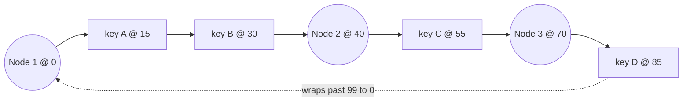
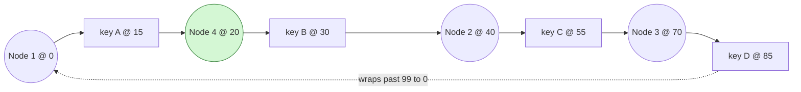
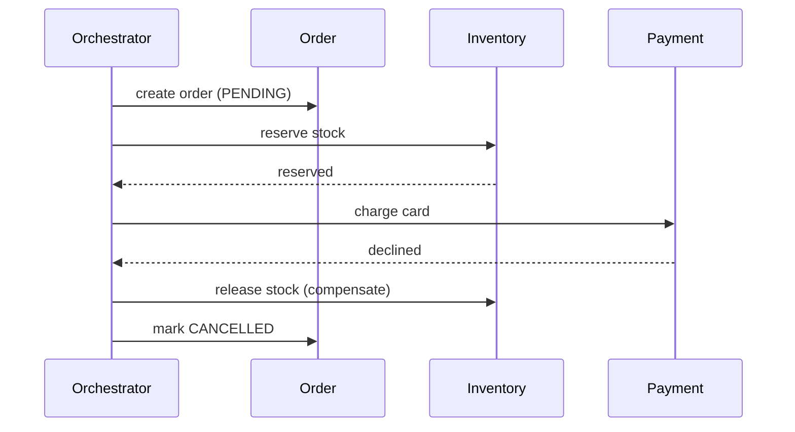
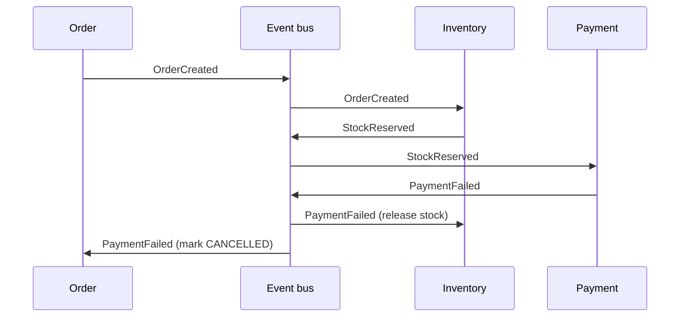
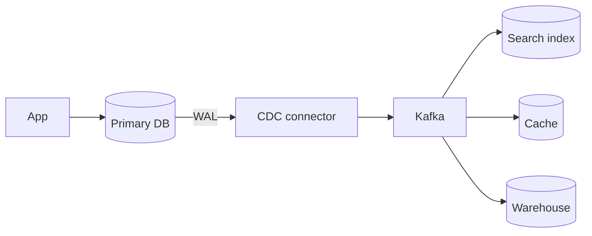

# Distributed Building Blocks

> [!abstract] What this is
> A set of named tools that show up inside bigger designs: consistent hashing, unique IDs, probabilistic structures, quorums, gossip, CRDTs, sagas and CDC. You won't implement Raft. You **will** be asked about unique IDs, consistent hashing, quorum, and "how do two services agree."
>
> The skill is matching the tool to the sentence in the prompt, not listing every tool you know. The theory behind these (consistency models, clocks, consensus internals) lives in [[17 - Consistency Time and Consensus]].

---

## Why It Exists

As soon as data lives on more than one machine, simple things stop being simple. You can't use `hash(key) % N` without moving everything when N changes. You can't use a DB autoincrement across shards. You can't tell whether a silent node is dead or just slow. And you can't wrap two services in one transaction.

Each block in this note is a known answer to one of those problems. Naming the right one, and its cost, is usually a full deep-dive answer on its own.

---

## Placing Keys on Nodes

When data or cache keys are spread over N nodes, you need a rule that says which node owns which key. The naive rule is `hash(key) % N`. It works until N changes: adding or removing one node remaps **almost all keys** to new machines, which for a cache means a near-total miss storm.

### Consistent hashing

Consistent hashing puts both keys **and** nodes on a circle (a hash ring). A key belongs to the next node clockwise. When you add a node, only the keys on the arc just before it move; everything else stays put.

With only a few points on the ring, one node can end up owning a huge arc. **Virtual nodes** fix this: each physical box sits at many points on the ring, so load evens out, and a failed box's load spreads over many neighbours instead of one.

Walk the ring clockwise (positions 0–99, wrapping from 99 back to 0). Each key is owned by the **first node it reaches**:

So A and B belong to Node 2, C to Node 3, and D wraps around to Node 1. Now add **Node 4 at position 20**:

Only **key A** moves (Node 2 → Node 4), because it's the only key on the arc between Node 1 and the new node. B, C and D keep their owners. With `hash(key) % N`, going from 3 to 4 nodes would have remapped about three quarters of all keys.

It shows up in Cassandra, Amazon's Dynamo paper, some load balancers and CDNs, and client-side cache sharding (memcached clients). Redis Cluster is a close cousin rather than a ring: it hashes keys into **16,384 fixed slots** and assigns slot ranges to nodes, so adding a node means moving some slots ([[21 - Redis]]).

**Virtual Nodes** :

In standard consistent hashing, a physical server is assigned to exactly _one_ position on the hash ring. A **virtual node** (or vnode) is an abstraction that assigns a single physical machine to _multiple_ independent positions on the ring.

Instead of placing Server A at one single point on the circle, the system places 100 or more "virtual" versions of Server A scattered randomly around the circle.

**Why do we need virtual nodes? :**

Standard consistent hashing (one node = one point) solves the basic problem of minimizing data movement when servers join or leave, but it introduces three major flaws that virtual nodes are designed to fix:

**1. Uneven Data Distribution (Hotspots)** When physical servers are randomly hashed onto a ring, they rarely space out perfectly. You might get Server A and Server B placed very close together, while Server C is far away. Because a node owns all data between it and its predecessor, Server C ends up owning a massive segment of the ring (handling the majority of the traffic), while Server B handles almost nothing.

- **How vnodes help:** By scattering hundreds of virtual nodes per server across the ring, the "gaps" between nodes average out. The hash space is partitioned into many tiny slices, resulting in a highly uniform distribution of data across all physical machines.

**2. Cascading Failures and Unfair Scaling** In a standard ring, if Server B crashes, all of its data immediately shifts to its next clockwise neighbor (Server C). Server C's load instantly doubles. If Server C cannot handle the sudden traffic spike, it will also crash, triggering a domino effect that takes down the cluster.

- **How vnodes help:** If Server B crashes, all of its virtual nodes disappear from the ring simultaneously. Because those virtual nodes were interleaved randomly among the virtual nodes of _all_ other servers, Server B's orphaned data is instantly divided and absorbed by the entire cluster, rather than overwhelming a single neighbor.

**3. Hardware Heterogeneity** Standard consistent hashing treats all servers equally. But in reality, a cluster might have a mix of older 16-core servers and brand new 64-core servers.

- **How vnodes help:** Virtual nodes act as a weighting mechanism. You can assign 256 virtual nodes to the powerful server, and only 64 virtual nodes to the older server. The powerful server will naturally take ownership of more segments of the ring proportionally.

**How do virtual nodes map to physical reality?**

In reality, virtual nodes are just entries in a **lookup table** (or routing map) kept in memory by the distributed system's routing layer.

Here is exactly how the mapping works under the hood:

1. **Hashing the suffixes:** Instead of hashing the server's IP address once (e.g., `hash("10.0.0.1")`), the system appends an index number to the string and hashes it multiple times to generate distinct coordinates:
    - `hash("10.0.0.1#1")` → Position 4291
    - `hash("10.0.0.1#2")` → Position 88302
    - `hash("10.0.0.1#3")` → Position 12045
2. **The Routing Table:** The cluster maintains a dictionary mapping every virtual node position back to a physical IP address and port:
    - Position 4291 → `10.0.0.1:8080`
    - Position 12045 → `10.0.0.1:8080`
    - Position 88302 → `10.0.0.1:8080`
3. **The Request Flow:** When a user requests a piece of data (e.g., `key="user_123"`), the system hashes the key to find its theoretical position on the ring. It walks clockwise to find the nearest virtual node. Once it hits a virtual node (say, Position 12045), it checks the routing table, sees that this vnode belongs to `10.0.0.1`, and routes the network request to that physical machine.

### Rendezvous (highest-random-weight) hashing

Rendezvous hashing solves the same problem with no ring. For each key, compute `hash(key, node)` for every node and pick the node with the **highest score**. When a node leaves, only the keys it owned move, and each goes to its own second-highest node, so load spreads evenly without virtual nodes. It also gives a natural "top k nodes" list for replicas.

The cost is that each lookup scores every node, so it's `O(N)` per key. That's fine for tens or hundreds of nodes, and less fine for thousands.

| Scheme | Lookup cost | Balance | Pick when |
|---|---|---|---|
| `hash % N` | `O(1)` | Even | N never changes |
| **Consistent hashing** + vnodes | `O(log N)` on a sorted ring | Even with enough vnodes | Default for large, changing clusters (Cassandra, cache clusters) |
| **Rendezvous (HRW)** | `O(N)` per key | Even without vnodes | Small-to-medium node sets, you want simple code and a clean "top k replicas" list |

---

## Unique IDs

A DB autoincrement **doesn't work across shards**. Two shards hand out the same number, or you need one shared sequence, which is a single point of failure and a bottleneck. So distributed systems generate IDs another way.

The primary goal is **uniqueness across a distributed system _without_ using a shared sequence**.

Here is a breakdown of what the text and table emphasize:
- **Why not a shared sequence?** The document explicitly states that relying on one shared sequence creates a "single point of failure and a bottleneck".
- **The problem with basic autoincrement:** A standard database autoincrement "doesn't work across shards". If you just count up from 1, two different databases (shards) will eventually hand out the exact same number, destroying uniqueness.
- **The ultimate goals (The "Pros"):** Because of these limitations, distributed systems aim for ID generation schemes that require "No coordination" between nodes. Furthermore, as seen in the table's comparison, ideal secondary goals include making the IDs "time-sortable" or "time-ordered" (like UUID v7 and Snowflake) and keeping them space-efficient (preferring 64-bit over 128-bit to avoid database performance issues like "random B-tree inserts").

In short, the goal is decentralized uniqueness—allowing multiple independent servers to generate IDs simultaneously without talking to each other, while still guaranteeing no duplicates are ever made.

| Scheme | Pros | Cons | Pick when |
|---|---|---|---|
| UUID v4 | No coordination | 128 bits, not sortable, random B-tree inserts | IDs are opaque and index locality doesn't matter |
| UUID v7 / ULID | Roughly time-sortable, no coordination | Still 128 bits | You want sortable IDs without running a service |
| **Snowflake** | 64-bit, time-ordered, generated per machine | Needs a machine ID; clock caution | Tweet IDs, order IDs, anything high-volume and sorted |
| Redis `INCR` | Simple, dense | Redis is now in the write path | Low volume and Redis is already there |
| Range allocator | DB hands you 1,000 IDs at a time | Batch coordination; gaps on crash | Short numeric IDs, e.g. a URL shortener |

The Snowflake layout is worth memorising: **1 sign bit + timestamp + worker ID + sequence**. The timestamp makes IDs sort by time, the worker ID prevents collisions between machines, and the sequence handles many IDs in the same millisecond.

In the Snowflake ID layout, the **sequence** is a local counter used to differentiate multiple IDs generated by the _exact same machine_ within the _exact same millisecond_.

> [!warning] Snowflake trusts the local clock. If the clock jumps backwards, a worker can repeat IDs. Implementations refuse to issue IDs until the clock catches up. Clock behaviour is covered in [[17 - Consistency Time and Consensus]].

This is the classic URL-shortener and tweet-ID deep dive (see [[12 - Mini Designs]]).

---

## Probabilistic Structures

Sometimes an exact answer costs too much memory, and an answer that is "almost always right" is good enough. These structures trade a small, known error for a huge memory saving.

A **Bloom filter** is a probabilistic set. It answers **"definitely not there"** or **"maybe there."** It has false positives but **no false negatives**, and it uses tiny memory. Typical uses: "have we crawled this URL already," or "is this key in the 10B-key store" before paying for a disk read. It is not a database; you can't list or (in the basic form) delete members.

A Bloom filter is a highly space-efficient, probabilistic data structure designed to tell you, instantly, if an item is part of a set. It trades absolute certainty for a massive reduction in memory usage and lookup time.

Instead of storing actual data (like raw strings or numbers), a Bloom filter uses a fixed-size array of bits (initially all set to 0) and a few independent hash functions.

- **When adding an item:** You pass the item through the hash functions. Each function produces an index position in the bit array, and you change the bits at those specific indices to 1.
- **When checking for an item:** You pass the item through the same hash functions to get the indices.
    - If **any** of the bits at those indices are 0, the item is **definitely not there**.
    - If **all** of the bits at those indices are 1, the item is **maybe there**.

**False Positives ("Maybe There")**

A false positive occurs when the Bloom filter claims an item is in the set, but it actually is not.

This happens because of hash collisions and overlapping bits. As you add more items to the filter, more bits are flipped to 1. Eventually, if you check a completely new, unseen item, its hash functions might happen to point entirely to indices that were _already_ flipped to 1 by a combination of other, previously inserted items. The filter sees all 1s and assumes the item exists. Because of this, a positive result only ever means the item is "probably" or "maybe" in the system.

**False Negatives ("Definitely Not There")**

A false negative would mean the filter claims an item is not in the set, even though it was previously added.

**Standard Bloom filters have exactly zero false negatives.** When you insert an item, its specific bits are flipped to 1, and in a standard Bloom filter, bits are never flipped back to 0. Therefore, if you check an item and find even a single 0 at one of its hashed indices, you have mathematical certainty that the item was never inserted. This structural guarantee is what makes the "definitely not there" feature completely reliable.

| Structure | Answers | Error | Pick when |
|---|---|---|---|
| **Bloom filter** | "Is X in the set?" | False positives only | Skip expensive lookups for things that surely aren't there |
| **Count-Min Sketch** | "How often has X appeared?" | Over-counts, never under-counts | Heavy hitters, top-k trending items at huge scale |
| **HyperLogLog** | "How many distinct items?" | Small relative error | Unique visitor counts at huge scale |

Count-Min Sketch and HyperLogLog are tail topics. Name them when the prompt says "unique counts" or "frequency at huge scale."

---

## Replication Coordination

Replicated stores need rules for how many copies must agree on a read or write, and who is in charge. The short versions are here; the depth is in [[17 - Consistency Time and Consensus]].

### Quorum

With `N` replicas, a write waits for `W` acks and a read asks `R` replicas. If **R + W > N**, every read set overlaps every write set, so a read sees at least one copy of the latest write (under the usual assumptions).

| Setting | Behaviour | Pick when |
|---|---|---|
| N=3, W=2, R=2 | Classic balanced quorum | Default for Dynamo-style stores |
| N=3, W=1, R=3 (R=N) | Fast writes, slow reads | Write-heavy, reads can wait |
| N=3, W=1, R=1 | Fastest, **stale reads** possible | Freshness doesn't matter |

This is the Dynamo / Cassandra model. Postgres replication is usually **not** discussed as a quorum; don't mix the two models.

### Leader election

Many systems need exactly one primary: a partition leader, a scheduler, a lock holder. **Raft** and **Paxos** get a majority to vote in a leader and keep a replicated log. The one-sentence version is: "consensus, so we never have two primaries." You won't draw Raft.

**ZooKeeper** and **etcd** mean "someone else runs Raft for us." Practical leader-election recipes are in [[14 - Coordination and Concurrency]].

### Vector clocks and conflicts

In multi-writer NoSQL, two replicas can accept writes without seeing each other. **Vector clocks** tell you whether two versions are **causal** (one came after the other) or **concurrent** (a real conflict). The store can detect a conflict, but the application must merge it.

The safe default: avoid multi-leader writes. If you must allow them, use last-write-wins, store both versions and resolve later, or use a CRDT (below).

---

## Gossip and Failure Detection

A large cluster needs every node to know who else is alive, without a central registry that becomes a bottleneck. Gossip spreads that knowledge, and a failure detector decides when a node counts as dead.

### Gossip protocols

In a **gossip** (epidemic) protocol, every node periodically picks a few random peers and swaps what it knows: membership, heartbeats, versions. Each round roughly doubles the number of nodes that have heard a piece of news, so it reaches the whole cluster in about **O(log N) rounds**. No node is special, and losing a few messages doesn't matter because the news arrives by another path.

The cost is that the news is **eventually** consistent. For a moment, different nodes have different views of the cluster.

Cassandra uses gossip for cluster membership and node state. Consul (via Serf) uses gossip for membership and failure detection.

### Failure detection

The basic tool is a **heartbeat with a timeout**: if node B hasn't heard from A in T seconds, B suspects A is down. The catch is that over a network **you can't tell slow from dead**. A long GC pause, a congested link and a crashed process all look identical: silence.

So every timeout is a trade-off. A short timeout detects crashes fast but falsely declares slow nodes dead, which triggers needless failovers. A long timeout avoids false alarms but leaves a dead node in rotation longer.

The **phi accrual failure detector** (used by Cassandra and Akka) softens this. Instead of a yes/no timeout, it tracks how heartbeat arrival times normally vary and outputs a **suspicion level** (phi) that rises the longer a heartbeat is overdue compared to normal. Each caller picks its own threshold: a load balancer might act on low suspicion, while a failover that moves data waits for high suspicion.

| Approach | How it decides | Pick when |
|---|---|---|
| Fixed heartbeat timeout | Silent for T seconds = dead | Simple systems, stable networks |
| **Phi accrual** | Suspicion grows with how unusual the delay is | Networks with variable latency; different actions need different confidence |
| Gossip-based (SWIM-style) | Peers probe indirectly before declaring death | Large clusters where one observer's view isn't enough |

> [!warning] A failure detector can be wrong. A node declared dead may still be alive and still writing. That's why leader handover needs fencing tokens (see [[14 - Coordination and Concurrency]]).

---

## CRDTs

A **CRDT** (conflict-free replicated data type) is a data structure designed so that replicas can accept writes independently and later **merge without coordination**, always arriving at the same result. The merge is built so that order and duplicates don't matter. This removes the "app must resolve the conflict" step for the data types it covers.

**Without coordination is the main thing**

The trick is to store a bit more than the plain value. A few standard examples:

| CRDT                         | How it works                                                           | Pick when                                                                            |
| ---------------------------- | ---------------------------------------------------------------------- | ------------------------------------------------------------------------------------ |
| **G-counter** (grow-only)    | Each replica keeps its own count; value = sum; merge = max per replica | Likes, views: counts that only go up                                                 |
| **PN-counter**               | Two G-counters, one for increments, one for decrements; value = P − N  | Counters that go up and down, e.g. stock reservations across regions                 |
| **OR-set** (observed-remove) | Each add gets a unique tag; remove deletes only tags it has seen       | Sets where concurrent add and remove must not lose the add, e.g. shopping cart items |
| LWW-register                 | Keep the value with the latest timestamp                               | Single values where losing a concurrent write is acceptable                          |

The confusion comes from assuming a replica only stores a single total number. In reality, for a G-counter, each replica stores a **vector (an array or dictionary)** that tracks the individual counts of _every_ replica in the entire system.

Here is a step-by-step breakdown of why taking the "max per replica" is necessary to prevent double-counting:

1. **The Internal Record:** Imagine a system with two servers, Server A and Server B. Instead of storing one number, each server stores a list.
2. **Independent Counting:**
    - Server A receives 5 views. Its internal record becomes: `{Server A: 5, Server B: 0}`.
    - Server B receives 3 views. Its internal record becomes: `{Server A: 0, Server B: 3}`.

Imagine sharing a Domino's cart where every single added item is assigned a hidden, unique tag, such as "Vegetable Pizza (Tag A1)". When a user removes an item, the system only deletes the specific, unique tags it has already observed.

For example, if you briefly lose connection and delete the Vegetable Pizza, the system specifically issues a command to delete Tag A1. If your friend simultaneously adds a second Vegetable Pizza while also disconnected, the system assigns that new action a brand new tag, like Tag B2. When the connection returns and the carts merge, your deletion only removes Tag A1, allowing your friend's concurrent addition (Tag B2) to safely survive the merge without being accidentally wiped out.

CRDTs show up in collaborative editing apps, shopping carts (Dynamo's cart is the classic example of "merge, don't lose an add"), and multi-region counters. The cost is extra metadata per replica and a limited menu of operations: you can't express "balance must never go below zero" as a CRDT, because that needs coordination.

---

## Dynamo-Style Repair

Leaderless stores (Dynamo, Cassandra, Riak) keep replicas in sync with several layered mechanisms. Each covers a different gap, and together they are how "eventually consistent" actually becomes consistent.

**Sloppy quorum and hinted handoff.** If one of a key's home replicas is down, the write goes to another healthy node instead, so writes stay available. That node stores a **hint** ("this belongs to node C") and hands the data back when C returns. The cost: a sloppy quorum no longer guarantees R + W > N overlap with the home replicas, so reads can be stale until handoff finishes.

**Read repair.** When a read contacts several replicas and they disagree, the coordinator returns the newest version and writes it back to the stale replicas. Hot keys stay fresh this way, but keys nobody reads are never repaired.

**Anti-entropy with Merkle trees.** A background process compares replicas to catch the keys read repair misses. A **Merkle tree** is a hash tree: leaves hash ranges of keys, and each parent hashes its children. Two replicas compare root hashes; if they match, they're in sync. If not, they walk down only the branches that differ. This lets replicas **diff without sending all the data**.

| Mechanism | Fixes | Pick when |
|---|---|---|
| **Hinted handoff** | Writes during a short node outage | Availability matters more than strict quorum overlap |
| **Read repair** | Stale replicas for keys that are read | Always on in leaderless stores; cheap |
| **Anti-entropy (Merkle)** | Stale replicas for cold keys, long outages | Background safety net; runs periodically |

---

## Cross-Service Transactions: 2PC vs Saga

When one business action touches several services, each with its own database, there's no single transaction to wrap it in. There are two patterns, and in an interview one of them is almost always the answer.

**Two-phase commit (2PC)** has a coordinator ask every participant to *prepare*, then tells all of them to *commit*. It's atomic, but it's blocking: if the coordinator dies after prepare, participants hold locks and wait. It's painful across microservices. Don't propose 2PC as your architecture.

A **saga** has each service commit its own local transaction, and if a later step fails, earlier steps run a **compensating action**. Example: reserve stock → charge card → on failure, release stock. It can be coordinated two ways: an **orchestrator** (one conductor tells each service what to do) or **choreography** (each service reacts to events from the previous one).

The running example for all three: a customer places an order, which must **reserve stock** in the Inventory service, **charge the card** in the Payment service, and **create the order** in the Order service. Each service has its own database.

### 2PC in detail

2PC makes several databases commit **all or nothing**, as if they were one. A **coordinator** (often a transaction manager in the app, or the database itself for distributed transactions) runs two rounds:

1. **Prepare (voting).** The coordinator asks every participant: "can you commit this?" Each one does the work, writes it durably to its log, **takes and keeps its locks**, and votes **yes** or **no**. A "yes" is a promise: "I can commit this no matter what, I'm just waiting for your word."
2. **Commit (decision).** If every vote is yes, the coordinator logs "commit" and tells everyone to commit; each participant makes the change visible and releases its locks. If any vote is no (or times out), it tells everyone to abort and roll back.

**Example.** The coordinator sends *prepare* to Inventory ("decrement stock for item 7"), Payment ("debit ₹500"), and Order ("insert order 123"). All three do the work, lock their rows, and vote yes. The coordinator sends *commit*, and all three changes become visible at once. If Payment had voted no (card declined), all three would roll back, and no one would ever have seen stock reserved without payment.

**Why it's avoided across services.** After voting yes, a participant **can't decide on its own**: it promised to commit if told, so it can't roll back, and it can't commit without the decision. If the coordinator crashes at that moment, every participant sits **holding its locks** until the coordinator comes back. The stock row and the customer's balance stay locked, and every other request touching them queues behind. On top of that, every participant must support the prepare/commit protocol (HTTP APIs and most message brokers don't), and the slowest participant sets the latency for everyone. That's why 2PC lives **inside** database systems (Postgres `PREPARE TRANSACTION`, XA, distributed SQL) and not between microservices.

### Saga in detail

A saga gives up all-or-nothing **atomicity** and replaces it with **compensation**. The business action is split into a sequence of **local transactions**, one per service, and each commits **immediately** in its own database. Nothing is locked across services. If a later step fails, the saga runs **compensating transactions** that semantically undo the steps already committed, in reverse order.

A compensation isn't a rollback: the original change was committed and other people may have seen it. It's a **new forward action** that cancels the effect, like a refund for a charge or a release for a reservation. Some steps can't be compensated (an email already sent), so those go **last**, after the steps that can still fail.

The two flavours differ only in **who decides what happens next**.

### Orchestrated saga

A central **orchestrator** (a dedicated service or workflow engine) holds the saga's state and tells each service what to do, one step at a time, by sending commands and waiting for replies.

**Example.** The Order Saga orchestrator:

1. Creates the order as `PENDING` in the Order service.
2. Sends **Reserve stock** to Inventory → reply: reserved.
3. Sends **Charge card** to Payment → reply: **declined**.
4. Now runs compensations in reverse: sends **Release stock** to Inventory, then marks the order `CANCELLED`.

If payment had succeeded, step 4 would be "mark the order `CONFIRMED`" and the saga ends.

The whole flow lives in **one place**, so it's easy to read, change, monitor ("which orders are stuck at step 3?"), and add timeouts and retries to. The orchestrator persists its state after every step, so if it crashes it resumes where it left off. Workflow engines like **Temporal**, AWS Step Functions, or Camunda are built for exactly this. The cost is a central component that knows about every service in the flow.

### Choreographed saga

There's **no central controller**. Each service listens for **events**, does its own local step, and publishes an event of its own; the next service reacts to that. The flow emerges from the chain of events.

**Example.**

1. Order service creates the order as `PENDING` and publishes **`OrderCreated`**.
2. Inventory hears `OrderCreated`, reserves stock, publishes **`StockReserved`**.
3. Payment hears `StockReserved`, tries the card, it's declined, publishes **`PaymentFailed`**.
4. Inventory hears `PaymentFailed` and releases the stock (its compensation). Order hears `PaymentFailed` and marks the order `CANCELLED`.

On success, Payment publishes `PaymentSucceeded` and Order marks the order `CONFIRMED`.

Services stay **loosely coupled**: Payment doesn't know Order exists, it only knows which event to react to, and adding a new step (say, a Loyalty service that awards points on `PaymentSucceeded`) needs no change elsewhere. The cost is that the flow isn't written down anywhere. To answer "what happens after payment fails?" you have to read every service's event handlers, debugging needs distributed tracing, and with many steps it becomes easy to create cycles or miss a compensation.

### Making sagas safe in practice

- **Every step and every compensation must be idempotent.** Messages are delivered at least once, so "reserve stock" or "refund" may arrive twice ([[07 - Async Messaging]]).
- **Publish events with the outbox pattern.** A service must commit its local change and publish its event together, or the saga silently stalls ([[07 - Async Messaging|transactional outbox]]).
- **Model intermediate states explicitly.** `PENDING`, `CONFIRMED`, `CANCELLED` on the order, with timeouts that cancel sagas stuck in `PENDING`.
- **Compensations must not fail permanently.** Retry them until they succeed; a refund that gives up leaves the system inconsistent.

| Pattern | Guarantee | Cost | Pick when |
|---|---|---|---|
| **2PC** | Atomic across participants | Blocking, coordinator is a SPOF, poor fit for microservices | Inside one database system or tightly coupled resources |
| **Saga (orchestrated)** | Eventually consistent, with compensation | Must design compensations and intermediate states | Multi-step flows with clear control (checkout, booking) |
| **Saga (choreographed)** | Same | Flow is spread across services, harder to trace | Few steps, loosely coupled services |

> [!warning] Sagas are **not** ACID. Other readers can observe "reserved but not paid." Design for it with timeouts and an explicit status machine.

---

## Change Data Capture (CDC)

Keeping a search index, cache or warehouse in sync with the main database by writing to both from the app (dual writes) goes wrong as soon as one write fails. **CDC** avoids that: a connector reads the database's write-ahead log (WAL) and publishes each change to Kafka, and downstream systems consume it.

The flow is DB WAL → Kafka → search / cache / warehouse. This is how you keep Elasticsearch in sync without dual writes. It pairs with the [[07 - Async Messaging|outbox]] pattern, and feeds the pipelines in [[20 - Data Processing and Analytics]].

For the consumer that consumes this and writes to Elastic Search : this can again become a spot for disconnect b/w write to disk but not acked etc. To make this idempotent you must use the idempotency key in the kafka / queue payload as the document id `_id` and never let ES mint it's own Document ID.

---

## Failure Modes

| Failure | What happens | Mitigation |
|---|---|---|
| **Modulo rehash** | Adding a node with `hash % N` remaps almost every key; cache hit rate collapses | Consistent or rendezvous hashing |
| **Uneven ring** | One node owns a large arc and runs hot | Virtual nodes |
| **Clock goes backwards** | Snowflake worker repeats IDs | Refuse to issue until the clock catches up |
| **Bloom false positive** | Filter says "maybe," lookup finds nothing | Size the filter for the acceptable rate; always confirm with the real store |
| **Stale quorum read** | W + R ≤ N, or sloppy quorum in use, returns old data | Choose R + W > N; rely on read repair and anti-entropy |
| **False failure detection** | A slow node is declared dead; needless failover, or two leaders | Phi accrual or longer timeouts; fencing tokens on writes |
| **Concurrent writes (multi-leader)** | Two versions of the same key | Vector clocks to detect; LWW, keep both, or a CRDT to resolve |
| **Saga step fails midway** | Partial state: stock reserved, card not charged | Compensating actions, timeouts, status machine |
| **2PC coordinator dies** | Participants hold locks, blocked | Don't use 2PC across services; use a saga |
| **Dual writes diverge** | DB and search index disagree after a partial failure | CDC or outbox |

---

## Interview Lines

> [!tip] Say it like this
> - "We'll place cache keys with consistent hashing and virtual nodes, so adding a replica doesn't invalidate the whole cache."
> - "IDs are Snowflake: 64 bits, time-ordered, generated per machine, no central sequence."
> - "A Bloom filter in front of the disk lookup; it never gives a false negative, so a 'no' skips the read."
> - "N=3, W=2, R=2, so R + W > N and reads overlap the latest write."
> - "Across services I use a saga with compensations, not 2PC, and I model the in-between states explicitly."
> - "CDC off the WAL into Kafka keeps search in sync without dual writes."

## Related Notes

- [[02 - Fundamentals]]
- [[05 - Databases]]
- [[06 - Caching]]
- [[07 - Async Messaging]]
- [[12 - Mini Designs]] — unique IDs, URL shortener
- [[14 - Coordination and Concurrency]]
- [[17 - Consistency Time and Consensus]]
- [[20 - Data Processing and Analytics]]
