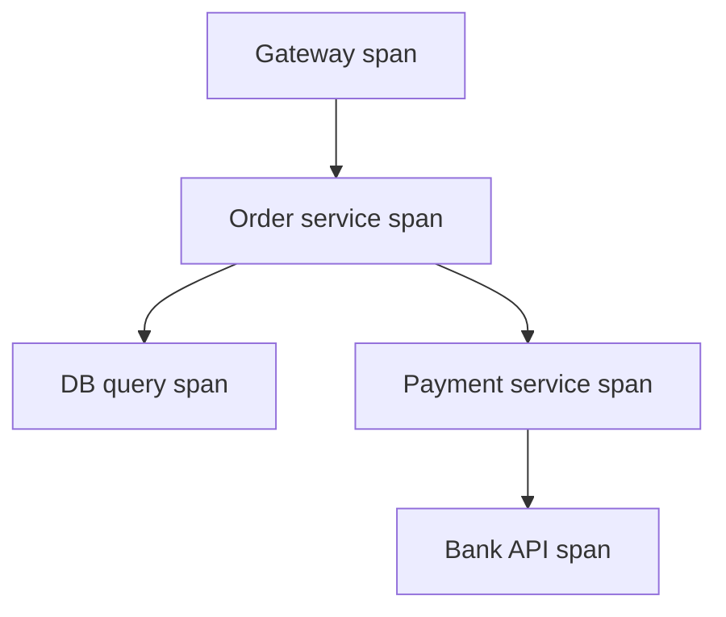

# Services and Observability

> [!abstract] What this is
> How to split a system into services, how those services find and talk to each other, and how you see what's happening across them once they're split.
>
> Default: start with a **modular monolith** unless the prompt forces independent scale or separate teams. If you do split, you owe three answers: how services find each other, how they avoid sharing a database, and how you follow one request across them.

---

## Why It Exists

One process with one database is easy to build, deploy and debug. Transactions just work, and a stack trace shows you everything. Splitting into services buys independent scaling and independent deploys, but every call becomes a network call that can fail, and a single user request now leaves traces in five places.

So this topic is really two halves of one trade. The services half decides *whether and where* to split. The observability half is the price you pay for splitting: without request IDs, traces, metrics and good alerts, a microservice system is unreadable.

---

## Monolith vs Microservices vs Modular Monolith

The question isn't "which is modern," it's "what forces a split." A split is justified by different scaling needs, a different release lifecycle, or hard isolation (payments must not go down because the feed did). Without one of those reasons, a split adds network failures and gives nothing back.

| Style | What it is | Pick when |
|---|---|---|
| **Monolith** | One deploy, one DB; transactions are easy | Simplest default for a small system or team |
| **Modular monolith** | Modules with clear boundaries, still one process | The grown-up default: clean boundaries now, the option to split later |
| **Microservices** | Separately deployed services; each **owns its data** | Different scale, different lifecycle, or hard isolation (payments vs feed) |

> [!warning] "We'll use microservices" for a system with four users is an automatic miss. Split **the one component** that needs it (video transcode, notification fan-out) and keep the rest together.

A shared database across "services" is a monolith in a trench coat. The services are coupled through the schema, so you pay the cost of distribution without getting independence. Don't do it.

---

## How Services Talk

There are two ways for one service to involve another, and the choice depends on whether the caller needs the answer right now.

| Style | Tools | Pick when |
|---|---|---|
| **Sync** | REST, gRPC | The caller needs the result to respond. Always with a timeout and circuit breaker ([[08 - Reliability]]) |
| **Async** | Events on a queue or log ([[07 - Async Messaging]]) | "Someone else should know." Preferred whenever the caller doesn't need to wait |

The **API gateway** is the public front door ([[04 - Load Balancing CDN and Gateway]]). Internal calls don't all bounce through it; services call each other directly.

### Service discovery

Services scale up and down, so their addresses change. Service discovery maps a name like `orders` to the current healthy instances. In Kubernetes this is DNS; outside it, a registry like Consul.

In an interview, this is enough: "The gateway routes `/orders` to the order service; inside the cluster we use DNS."

### Service mesh

Once there are many services, each one needs the same networking features on internal calls: mutual TLS, retries, timeouts, metrics. A **service mesh** moves those into a **sidecar** proxy (usually Envoy) that runs next to every service, configured centrally by a control plane like Istio or Linkerd.

What you get: **mTLS** between services without app code, retries and timeouts configured in one place, **traffic splitting** for canaries, and per-call metrics and traces from the sidecar. The cost is two extra proxy hops per call (latency and CPU) plus a complex system to operate.

| Setup | Mesh? | Pick when |
|---|---|---|
| Dozens of services, many teams, internal security needs | Yes | mTLS, uniform retries and canaries are worth the operational cost |
| A handful of services | No | Libraries and the platform's DNS/LB are enough |

Details and a diagram are in [[04 - Load Balancing CDN and Gateway]]. Don't add a mesh by default.

---

## CQRS and Event Sourcing

These two patterns are worth naming, not designing in full. They come up when reads and writes have very different shapes.

**CQRS** (command query responsibility segregation) means the write model is not the read model. You write to normalised order tables and read from a denormalised feed or cache. You're already doing CQRS whenever you fan out a timeline.

**Event sourcing** means storing the events themselves ("item added," "order paid") as the source of truth and rebuilding current state by replaying them. It fits audit-heavy domains, but it's heavy to run. Don't lead with it.

| Pattern | Pick when |
|---|---|
| **CQRS** | Reads need a different shape or scale than writes (feeds, search, dashboards) |
| **Event sourcing** | A full history is a requirement (ledgers, audit), and the team can handle replay and schema evolution |

---

## The Three Pillars of Observability

Observability is being able to answer "what is the system doing, and why" from the outside. It rests on three kinds of data, each suited to a different question.

| Pillar | What it holds | Pick when |
|---|---|---|
| **Logs** | What happened, with a request ID | Debugging a single request |
| **Metrics** | QPS, p99 latency, error %, queue lag, CPU | Alerts, SLOs, dashboards |
| **Traces** | One request across services, as spans | "Why is checkout taking 2 s?" |

The glue is a **correlation (request) ID**: generated at the gateway, passed along in headers, and written on every log line. Without it, logs from microservices can't be joined up.

You won't install Prometheus in the interview. Draw one box: "metrics + logs + traces, request ID from the gateway."

### Golden signals

When deciding what to measure for a service, start with the four **golden signals**: **latency**, **traffic**, **errors** and **saturation**. They cover most user-visible problems and are the usual base for SLIs.

---

## Distributed Tracing

Logs tell you what one service did. A trace tells you what happened to **one request across all services**, and where the time went.

A **trace** is the whole journey and has a **trace ID**. Each unit of work inside it (an HTTP call, a DB query) is a **span** with its own **span ID**, a start time, a duration, and a **parent span ID** pointing to the span that caused it. The parent links turn the spans into a tree, which tracing UIs draw as a waterfall.

### Context propagation

For spans in different services to join the same trace, the IDs must travel with the request. Each service reads the incoming trace context, creates its child span, and forwards the context on outgoing calls. The standard header is **W3C `traceparent`**, which carries the trace ID, the parent span ID and a sampled flag. For async work, the same context goes into message headers, so a consumer's span joins the producer's trace.

If one service in the chain drops the header, the trace breaks in two. That's why tracing libraries (OpenTelemetry) hook into HTTP clients and queue clients automatically.

### Sampling

Recording every span of every request is expensive at scale, so traces are sampled.

| Strategy | How it decides | Trade-off | Pick when |
|---|---|---|---|
| **Head sampling** | At the first service, keep e.g. 1% of traces; the decision travels in `traceparent` | Cheap and simple, but blind: the rare slow or failed request is probably dropped | High volume, you want cheap overall latency pictures |
| **Tail sampling** | Collect all spans briefly, decide after the trace finishes | Keeps errors and slow traces, but a collector must buffer every span | You care most about the outliers and can afford the collector |
| Always on | Keep everything | Full detail, high cost | Low traffic or debugging a specific issue |

---

## SLIs, SLOs and SLAs

These three terms describe reliability at different levels, and mixing them up is a common slip.

- **SLI** (indicator) is the measurement: the fraction of checkouts that finish under 300 ms.
- **SLO** (objective) is the internal target: "99.9% of checkouts under 300 ms" over 30 days.
- **SLA** (agreement) is the contract with customers, with penalties. It's usually looser than the SLO so there's a buffer.

The gap between 100% and the SLO is the **error budget**. A 99.9% SLO allows 0.1% of requests to be bad over the window. When the budget is spent, the team slows risky releases.

---

## Alerting Design

Alerts wake people up, so each one must mean "a user is being hurt, and a human needs to act." Bad alerting pages on things that don't matter, and people learn to ignore it.

**Alert on symptoms, not causes.** Page on "checkout error rate is high" or "latency SLO is at risk," not on "CPU > 80%." High CPU with happy users isn't an emergency; a cause-based alert either fires with no user impact or misses a failure it didn't anticipate. Causes belong on dashboards for diagnosis.

**Alert on SLO burn rate.** Burn rate is how fast you're spending the error budget. A burn rate of 1 spends exactly the budget over the SLO window; a burn rate of 10 spends it ten times faster. A **multi-window** alert requires both a long window (e.g. 1 hour) and a short window (e.g. 5 minutes) to be burning fast: the long window proves it's significant, and the short window proves it's still happening, so the alert clears soon after recovery. The Google SRE workbook's common example pages at 14.4× burn over 1 hour, which spends 2% of a 30-day budget.

**Page vs ticket.** Fast burn that threatens the SLO within hours pages someone. Slow burn that would exhaust the budget over days opens a ticket for working hours.

| Alert type | Fires on | Pick when |
|---|---|---|
| **Page** | Fast SLO burn on a user-facing symptom | Needs a human now |
| **Ticket** | Slow burn, capacity trends, non-urgent errors | Needs a human this week |
| **Dashboard only** | Causes: CPU, memory, GC, queue depth | Useful for diagnosis, not worth interrupting anyone |

> [!warning] Alert fatigue is a real failure mode. If an alert fires and nobody needs to act, delete it or downgrade it to a ticket. Every page should be actionable and have a runbook.

---

## Security in Brief

The basics that belong in any design: TLS on the internet, authentication and authorisation at the gateway ([[03 - Networking and APIs]]), secrets in a secrets manager rather than Git, least privilege on S3 and databases, and rate limiting as abuse control. Don't store card numbers (PANs); that's why payment gateways exist. Depth is in [[18 - Security]].

---

## Multi-Region in Brief

Going multi-region is either **active-passive** (a primary region plus a standby for disaster recovery) or **active-active** (several regions serving writes). The safe default is a primary region with an async replica region for disaster, where RPO equals the replica lag. Active-active brings data gravity and CAP trade-offs into play; don't design Spanner. See [[08 - Reliability]] for DR and [[17 - Consistency Time and Consensus]] for the consistency side.

---

## Failure Modes

| Failure | What happens | Mitigation |
|---|---|---|
| **Distributed monolith** | Services share a DB or must deploy together; all the cost, none of the independence | Each service owns its data; split only where forced |
| **Sync call chain** | One slow downstream service stalls every caller above it | Timeouts, circuit breakers, prefer async ([[08 - Reliability]]) |
| **Stale discovery** | Traffic goes to instances that no longer exist | Health checks, short DNS TTLs, registry deregistration |
| **Broken trace** | A service drops `traceparent`; the trace splits in two | Instrument HTTP and queue clients with OpenTelemetry |
| **Head sampling hides failures** | The rare failed request was never recorded | Tail sampling, or always keep errors |
| **No request ID** | Logs across services can't be joined | Generate at the gateway, propagate, log on every line |
| **Alert fatigue** | Noisy cause-based alerts get ignored; a real outage is missed | Symptom and burn-rate alerts; page vs ticket; delete unactionable alerts |
| **Mesh overhead** | Added latency and a hard-to-debug control plane | Use a mesh only at many-service scale |

---

## Interview Lines

> [!tip] Say it like this
> - "I'll start with a modular monolith and split out only the transcode service, because it scales differently."
> - "Each service owns its database. A shared DB would make them one system in disguise."
> - "Sync calls get a timeout and a circuit breaker. Anything that's 'someone else should know' goes on a queue."
> - "A request ID is generated at the gateway and propagated with W3C `traceparent`, so logs and traces join up."
> - "I alert on SLO burn rate across two windows, on symptoms like error rate, not on CPU."
> - "Tail sampling keeps the slow and failed traces, which are the ones I actually need."

## Related Notes

- [[01 - How the Round Works]]
- [[03 - Networking and APIs]]
- [[04 - Load Balancing CDN and Gateway]]
- [[07 - Async Messaging]]
- [[08 - Reliability]]
- [[17 - Consistency Time and Consensus]]
- [[18 - Security]]
- [[19 - Deployment and Infrastructure]]
