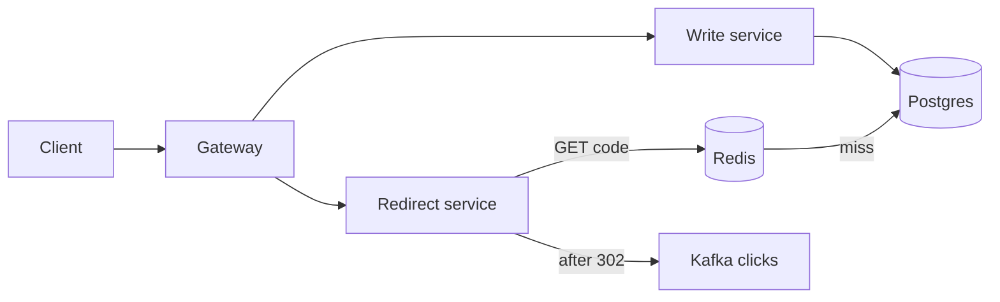
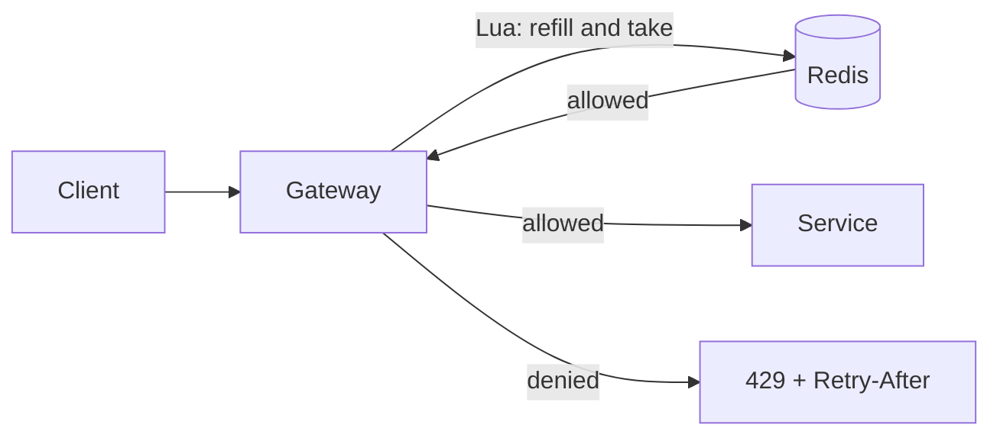
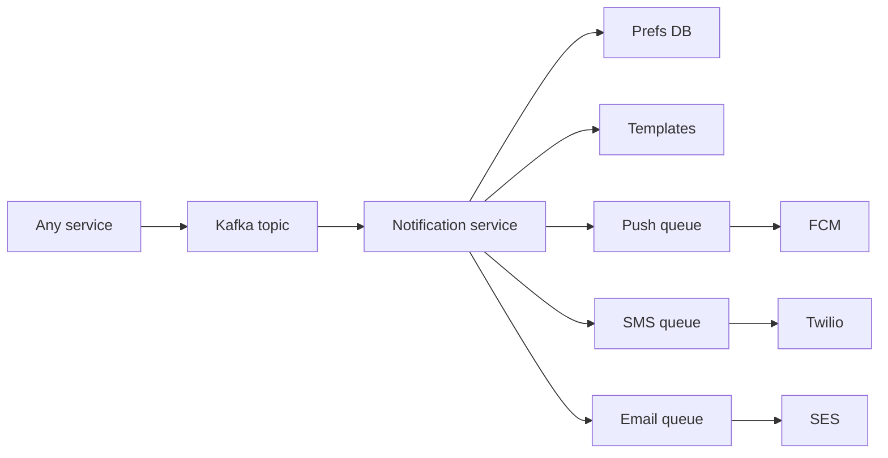
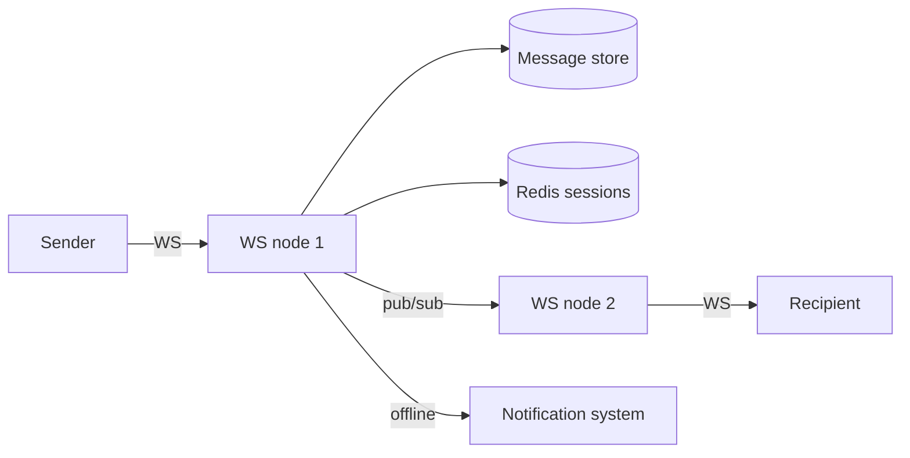
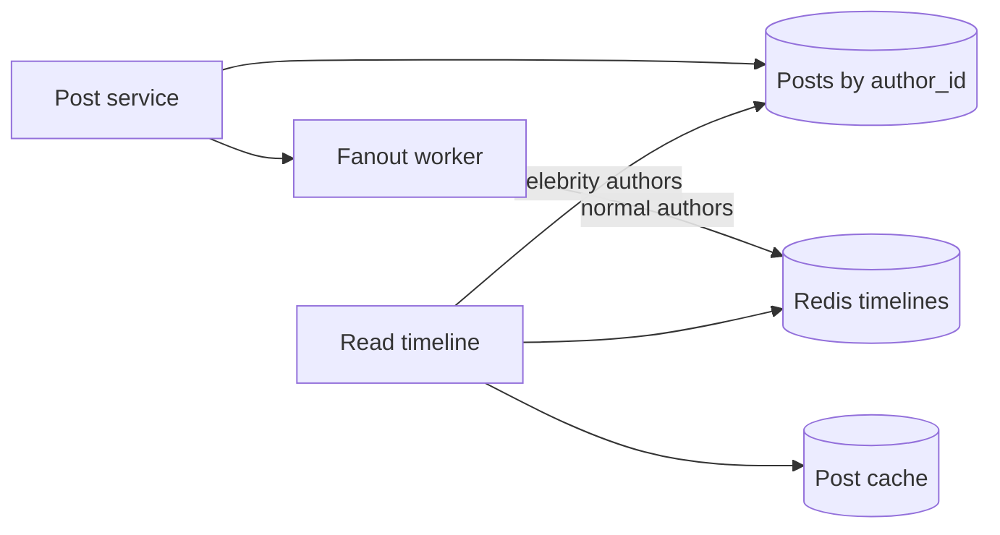
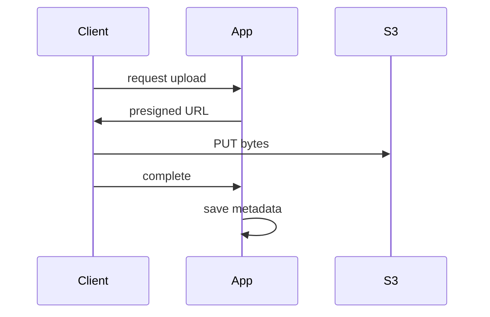
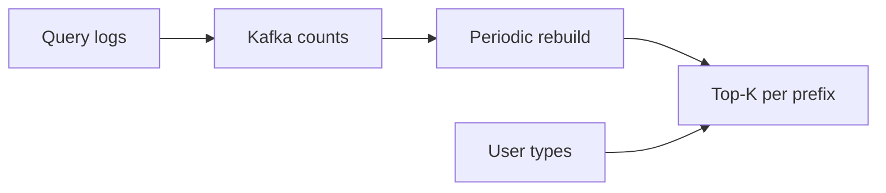
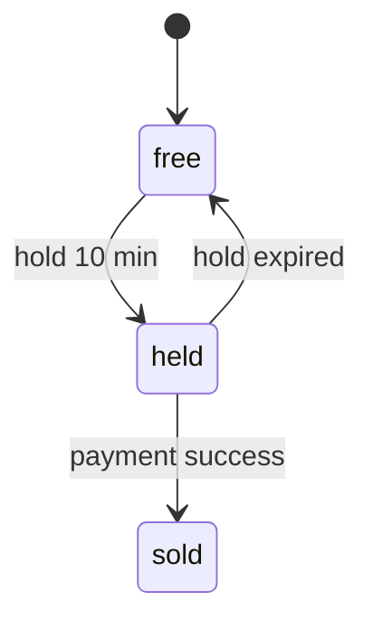
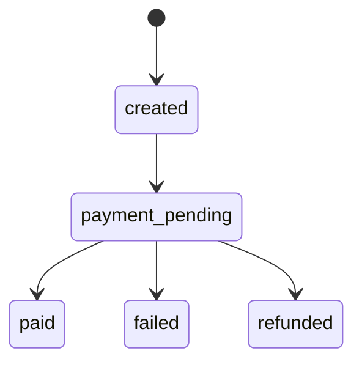

# Mini Designs

> [!abstract] What this is
> The small designs that interview loops actually run, each cut down to the one hard part that decides it. None of them is a product to memorise. Each is a **vehicle for building blocks**: the same cache, queue, lock and ID pieces, arranged around a different noun.
>
> Walk the first six from a blank board until the hard part is the first sentence you say.

---

## How to Use This Note

Set a 20-minute timer. Do requirements, draw about six boxes, then pick one deep dive. Only then check the section here.

Every design below follows the same shape: **what it does**, **core entities and API**, **the key decision** with a short table, **the main diagram**, **what breaks**, and a **full walk** link when one exists in `HLD/Problems/`.

The building blocks these designs lean on:

| Block | Note |
|---|---|
| Round script | [[01 - How the Round Works\|script]] |
| Storage choice | [[05 - Databases]] |
| Read path speed | [[06 - Caching]] |
| Queues and streams | [[07 - Async Messaging]] |
| Timeouts, retries, rate limits | [[08 - Reliability]] |

---

## 1. URL shortener — the one they will ask

### What it does

`POST longUrl → shortCode`, then `GET /{code} → 302` to the long URL. Optional extras are a custom alias, expiry, and a click count.

It gets asked because it tests exactly four things: a unique ID, a read-heavy cache, 301 vs 302, and nothing else. The non-functional requirements are redirects well under 100 ms, uniqueness, and high availability. Analytics stays **off the hot path**.

### Core entities and API

| API | Returns |
|---|---|
| `POST /urls` `{longUrl}` | `{shortUrl}` |
| `GET /{code}` | 302 to the long URL |

The table is `code PK, long_url, created_at, expires_at, user_id`. That's it.

### Key decision: generating codes

Seven base62 characters give 62^7 ≈ 3.5e12 keys, which is enough. The question is how you pick them.

| Approach | Trade-off | Pick when |
|---|---|---|
| **Counter / snowflake → base62** | No collision if the counter is unique | Best default |
| Hash(longUrl), take a prefix | Collisions need a retry; the same URL always maps to the same code | You want the same URL to get the same code |
| Pre-generated key pool in Redis | Extra moving part to keep filled | You want code generation fully off the write path |

The second decision is **301 vs 302**. A 301 is cached forever by browsers, so you lose click counts and can never change the destination. Use **302** (or 307) so every click hits you. Say this; they listen for it.

### Main diagram

The boxes are client → gateway → write service / redirect service → Redis → Postgres, with Kafka for clicks. On a redirect, Redis `GET` → 302. On a miss, read Postgres (indexed on `code`) and fill Redis. The click event goes to Kafka **after** responding.



### What breaks

| Follow-up | Answer |
|---|---|
| Custom alias uniqueness | Insert it and handle the unique-constraint conflict |
| Expiry | TTL in Redis plus an `expires_at` column |
| Abuse | Rate limit `POST` |

The unique ID piece often becomes its own deep dive; see [[#4. Unique ID generator]].

---

## 2. Rate limiter — the other one they will ask

### What it does

Allow N requests per user / IP / key per window. Anything over gets **429 + `Retry-After`**. Rules can differ per endpoint. It is also covered as a component in [[08 - Reliability]]; this section treats it as a whole design.

### Core entities and API

It sits at the **gateway, before the service**. The entity is a rule (dimension, endpoint, limit, window) plus a shared counter per key. It cannot be process-local once you have more than one gateway node, so **Redis is the shared counter**.

### Key decision: algorithm

| Algorithm | Behaviour | Pick when |
|---|---|---|
| **Token bucket in Redis + Lua** | Atomic get-refill-consume; allows bursts up to bucket size | Default |
| Sliding window counter | Smoother limit across window edges | They want smoother windows |

### Main diagram



### What breaks

| Deep dive | Answer |
|---|---|
| Burst vs sustained | Bucket size sets the burst, refill rate sets the sustained limit |
| Many dimensions | Check user AND IP AND route, each its own key |
| Redis down | Fail open vs fail closed. **Auth / payments fail closed, public reads fail open** |
| Clock skew | Use Redis time, not each node's clock |

---

## 3. Notification system — most common "product" design

### What it does

Send push, SMS, and email. Respect user preferences. Never send duplicates. Scale to bursts like a flash sale or "your order shipped."

The hard part is **fanout + idempotency + channel choice**, not "FCM exists."

### Core entities and API

A producer drops an event `{user_id, type, payload, event_id}` onto a topic. It does not call FCM itself. Around that you need a preferences table, templates, and a device tokens table.

### Key decision: queue per channel and priority

The notification service loads preferences (don't SMS at 3am if they said no), renders the template, and enqueues **per channel**. Workers call the providers with retry and a DLQ, and dedupe on `event_id + channel`.

| Choice | Why | Pick when |
|---|---|---|
| One queue per channel | Providers have their own rate limits; **their** 429 is why you have queues | Always |
| Separate priority queues | Marketing cannot starve OTP | Mixed traffic like OTP and campaigns |
| Dedup key `event_id + channel` | At-least-once delivery means repeats will happen | Always |

### Main diagram



### What breaks

| Follow-up | Answer |
|---|---|
| 10M users for one event | Chunk the audience; don't `SELECT` everyone in one query |
| Quiet hours | Preference check before enqueue |
| Device tokens | Their own table, one user to many devices |
| Unread badge | A different counter, not part of sending |

---

## 4. Unique ID generator

### What it does

Hand out unique IDs across many machines without a central bottleneck. This is often a **5-minute deep dive** inside the URL shortener or a tweets design, not a full round.

### Key decision

| Option | Trade-off | Pick when |
|---|---|---|
| **Snowflake** | Time-sortable, 64-bit, no coordination per ID | You need sortable distributed IDs. Walk it from [[10 - Distributed Building Blocks]] |
| UUID | Random, no sort order | They don't need sortability |
| DB sequence per shard with an offset | Boring and works | You want the simple alternative |

### What breaks

Clock skew and running out of sequence bits within one millisecond are the usual Snowflake questions; both are covered in [[10 - Distributed Building Blocks]].

---

## 5. Chat (1-1 first, then groups)

### What it does

Send a message, load history, show who's online, and optionally show receipts. The hard part is **WebSockets + where messages live + fanout to devices.**

### Core entities and API

| Piece | How |
|---|---|
| Connection gateway | Sticky L4 or a WS cluster |
| Session map | `user_id → {connection_id, node}` in Redis |
| Message store | Cassandra / Dynamo keyed by `chat_id + timestamp`, or Postgres until scale |
| History | Paginate by cursor (`before ts`) |
| Presence | Heartbeat to Redis with a TTL. "Online" is eventual |

### Key decision: group fanout

On send, **persist first**, then push to the recipient's node via Redis pub/sub. If the recipient is offline, store it and send a push notification via [[#3. Notification system — most common "product" design|the notification system]].

| Group size | Approach |
|---|---|
| Small group | Write N copies, or one copy plus a member list |
| Large group | Don't write 1M rows per message. Store once; members pull, and fan out to online members only |

### Main diagram



### What breaks

> [!warning] Don't use a single Postgres table scanned by `ORDER BY ts` without a `(chat_id, ts)` index.

Presence is eventual by design, so a user can look online for one TTL after they drop.

---

## 6. News feed / Twitter-lite

### What it does

Post, follow, and read a home timeline. The hard part is **fanout-on-write vs fanout-on-read.**

### Core entities and API

Posts live in the DB, sharded by `author_id`. The timeline cache is a Redis list or sorted set of `post_id` per user, trimmed to 800, with bodies hydrated from a post cache. The follow graph goes in Postgres or a graph store; it is not the first bottleneck.

### Key decision: fanout

| | Write | Read | Who it hurts |
|---|---|---|---|
| Fanout on write | On post, push `post_id` to each follower's Redis list | Cheap `GET` of the list | Celebrities explode writes |
| Fanout on read | Just store the post | Pull from everyone you follow and merge | Slow for 1k follows |
| **Hybrid** | Write-fanout for normal users, read-fanout for celebrities | Merge the two | The actual answer |

### Main diagram



### What breaks

Ranking starts chronological. A ranking worker comes later, as its own step.

---

## 7. File upload / Dropbox-lite

### What it does

Upload, download, and share a link. The hard part is that **bytes never go through the app.**

### Core entities and API

Metadata lives in Postgres; bytes live in S3 behind presigned URLs, with a CDN on download. Large files use multipart. Hashing gives you dedup.

### Key decision

| Choice | Pick when |
|---|---|
| Presigned direct-to-S3 | Always. The app only signs and records metadata |
| Multipart upload | Large files |
| Chunk + delta sync | Say "phase 2" |
| Conflict: last-write-wins or stored versions | Two devices edit. Don't design CRDTs unless they ask |

### Main diagram



### Full walk

[[04 - Multipart Upload]].

---

## 8. Pastebin

### What it does

A URL shortener plus a blob. Create a paste, get a short link, read it back.

### Key decision

| Paste size | Store |
|---|---|
| Small text | Postgres |
| Large paste | S3 |

Expiry is a TTL. The 302 and cache story is the same as [[#1. URL shortener — the one they will ask|the URL shortener]].

---

## 9. Autocomplete / typeahead

### What it does

Take a prefix and return the top 10 queries. The hard part is that it is **not a SQL `LIKE prefix%` at 10k QPS.**

### Key decision: where the top-K lives

Offline, aggregate query logs into top-K per prefix, then serve from one of these:

| Store | Pick when |
|---|---|
| Trie in memory on each app box | Fastest reads, data fits in memory |
| ES completion suggester | You already run Elasticsearch |
| Redis sorted sets per prefix (`za`, `zam`, `zoma`…) | Shared, easy to refresh |

### Main diagram



### What breaks

Freshness comes from the pipeline (Kafka counts → periodic rebuild). Typo tolerance (edit distance) is extra; mention it, don't build it.

---

## 10. Nearby / "places around me"

### What it does

Return places or drivers near a point, ranked by distance plus score. Covered in depth in [[09 - Storage Search and Geo]].

### Key decision

| Thing | Pick |
|---|---|
| Moving things (drivers) | Redis GEO |
| Static places | PostGIS / geohash |

Don't scan the planet.

---

## 11. Ticket booking / inventory

### What it does

Browse, hold a seat, pay, confirm. The hard part is **don't double-sell.** This is the same skeleton as limited-stock checkout.

### Core entities and API

A seat row in Postgres with `status`, `hold_until`, and `version`. The hold is one conditional transaction:

```sql
UPDATE seats
SET status = 'held', hold_until = now() + interval '10 minutes', version = version + 1
WHERE id = ? AND status = 'free';
```

### Key decision

| Option | Pick when |
|---|---|
| **Conditional DB update** (above) | Default. The DB decides |
| Redis lock with TTL + DB write | You want a fast gate in front of the DB |

Payment success moves the seat to `sold`. A timeout worker releases expired holds.

### Main diagram



### What breaks

> [!warning] The cache for **browse** (the event page) must not be the source of truth for remaining seats. Either read the DB for the hold, or accept "you clicked, it's gone."

### Full walk

[[06 - Seat Booking]]. The limited-stock version is [[09 - Inventory and Flash Sale]], and the checkout around it is [[12 - E-commerce Checkout]].

---

## 12. Payments backend (the slice, not Stripe)

### What it does

Charge for an order. The hard part is **idempotency + a state machine + you never store cards.**

### Core entities and API

Call the payment gateway with `Idempotency-Key = order_id`. A webhook confirms the result; don't trust only the client redirect. The webhook must be idempotent too.

### Key decision

| Concern | Answer |
|---|---|
| Duplicate charge | `Idempotency-Key = order_id` |
| Source of truth for success | Webhook, not the redirect |
| Telling other services | Outbox: order paid → Kafka → notifications, fulfilment |
| Refunds | A second state machine, not `DELETE` |
| Consistency | Strong on the money tables. Everything else can lag |

### Main diagram



### Full walk

[[07 - Wallet and Ledger]]. The order side is in [[10 - Order Management]] and [[12 - E-commerce Checkout]].

---

## 13. Know-the-shape (don't memorise full designs)

These come up less often. Know the pipeline in one sentence and the one hard part; that's enough for a 10-minute sketch.

| Design | Shape | Hard part / note |
|---|---|---|
| **Video streaming** | Upload → transcode workers (many bitrates) → S3 → CDN. Metadata in DB. Player uses HLS | Auth on the manifest. [[Netflix HLD]] if extra time |
| **Ride matching** | Rider request → geo query drivers (Redis GEO) → score → offer with a short TTL lock → track over WS | Matching is the hard part, not the map tiles |
| **Web crawler** | URL frontier (queue + bloom "seen"), politeness per domain, workers fetch, store raw, parse links back to the frontier | Less common in entry-level loops, but it's on Grokking lists |
| **Key-value store** | Consistent hashing, replication factor, quorum, hinted handoff | An infra-heavy interview topic. Know the words from [[10 - Distributed Building Blocks]] |
| **Metrics** | Agents → Kafka → TSDB | Don't write metrics to the product Postgres. See [[20 - Data Processing and Analytics]] |

---

## Related Notes

- [[13 - Question Bank]]
- [[01 - How the Round Works]]
- [[16 - Estimation and Decision Cheat Sheet]]
- [[HLD/Problems/00 - Speed Run]]
