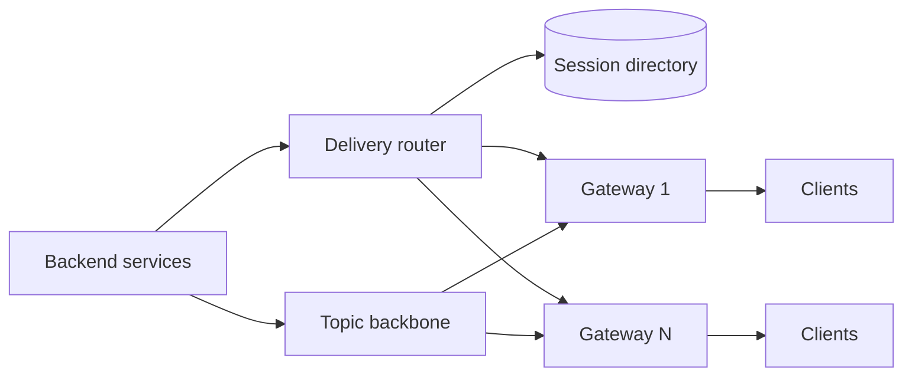

# MD-01 — Stateful Connection and Realtime Push Mesh

> [!abstract] What this is
> How a server pushes data to millions of clients that stay connected: a tier of **gateway** nodes that hold WebSocket / SSE / MQTT connections, a **session directory** that knows which gateway each user is on, a **pub/sub backbone** between backend services and gateways, and the client rules (heartbeats, backoff with jitter, resume from a sequence number) that stop a deploy from turning into a reconnection storm.
>
> The defining decision is **unicast vs broadcast**. Sending to one user means looking up where they are connected. Sending the same thing to millions (a live score, a chat room) means fanning out through topics so each gateway receives the message once and delivers it locally. Most systems need both.

---

## 1. What It Solves and Where It Appears

- HTTP request/response can't push. Polling every few seconds from millions of phones wastes battery and servers. So the server keeps a connection open and pushes when something changes.
- The hard parts are not the protocol. They are: knowing which of hundreds of gateways holds a given user, delivering through gateways that come and go, and surviving a million clients reconnecting at the same second.
- JioHotstar built a pub/sub service for **50 million simultaneously connected clients** for live-match features, and audiences sent over 5 billion emojis during the 2019 World Cup.

| Problem | Pattern | What's pushed |
|---|---|---|
| Chat (#4) | Unicast to each member's devices; group = small fan-out | Messages, receipts, typing, presence |
| Ride Hailing (#7) | Unicast to rider and driver | Driver location every few seconds, trip state |
| Food Delivery tracking (#8) | Unicast | Rider location, order status |
| Live Leaderboard / scores (#20) | Broadcast per match/contest | Score updates |
| Collaborative Editing (#29) | Per-document room | Operations, cursors, presence |
| Streaming LLM tokens (#A3) | Unicast, one long response | Tokens over SSE |
| Seat Booking mega sale | Broadcast per event | Queue position, seats left |

---

## 2. Knobs

| Knob | Options | What it trades |
|---|---|---|
| Protocol | WebSocket, SSE, MQTT, long polling | Two-way vs simplicity vs mobile efficiency vs firewall friendliness |
| Connections per gateway | 50k–1M | Fewer boxes vs bigger blast radius when one dies |
| Heartbeat interval | 15–60 s | Faster dead-connection detection vs battery and bandwidth |
| Session directory | Redis hash, consistent hashing by user, none (broadcast only) | Exact routing vs simplicity |
| Backbone | Redis pub/sub, Kafka, NATS, MQTT broker cluster | Latency vs durability vs fan-out efficiency |
| Delivery guarantee | best effort, at least once with ack + resume | Simplicity vs never missing a message |
| Coalescing | send every update, or latest-only every N ms | Freshness vs bandwidth (locations, scores) |

---

## 3. Evolution of the Block

### Step 0 — Polling

- Clients `GET /updates?since=…` every 5–30 s. Fine for thousands of users and rare updates. Breaks on latency needs and cost.

### Step 1 — One gateway tier, sticky routing

- **Trigger:** need sub-second push to tens of thousands of users.
- **Change:** WebSocket/SSE gateways behind an L4 or L7 load balancer; each gateway holds connections in memory. Backend services publish to a Redis pub/sub channel per user; the gateway holding that user is subscribed.

### Step 2 — Session directory and a real backbone

- **Trigger:** hundreds of thousands to millions of users; per-user channels in Redis pub/sub become expensive, and messages for offline users must not be lost.
- **Change:**
    + A **session directory**: `user_id → {gateway_id, connection_id, connected_at}` in Redis with a TTL refreshed by heartbeats.
    + Backend services send to a **delivery router** that looks up the gateway and forwards over an internal RPC or a per-gateway queue.
    + Messages that must not be lost are stored first (in the chat store, the order store) with a sequence number; the push is only a notification that something new exists.

### Step 3 — Topic fan-out for broadcast

- **Trigger:** one update must reach millions (a match score, a contest leaderboard).
- **Change:** gateways subscribe to **topics** (e.g. `match:123`) on behalf of all their connected clients. The publisher sends once; each gateway receives once and writes to its N local sockets. Fan-out cost becomes `gateways`, not `users`.

### Step 4 — Surviving deploys and failures

- **Trigger:** a gateway restart drops 500k connections, and they all reconnect within a second.
- **Change:** drain gateways slowly (stop accepting, ask clients to reconnect in batches over minutes), clients reconnect with exponential backoff **and jitter**, admission control at the gateway (refuse above a connection-accept rate), and resume from the last sequence number so no state is lost.

### Step 5 — Multi-region edge

- **Trigger:** users far from the gateway region, or one region's failure must not drop everyone.
- **Change:** gateways in several regions; the session directory is per region with a global "home" for routing; broadcast topics replicate across regions.



---

## 4. Core Mechanics

### Connection lifecycle

```
connect:  TLS → auth token (short-lived JWT) → gateway registers
          HSET session:{user} {device} {gateway_id}:{conn_id}  EX 90
heartbeat: client ping every 30 s → gateway refreshes the TTL
          (mobile carriers and NATs drop idle TCP flows; heartbeats keep them open)
message:  gateway → client {seq, type, payload}; client acks seq for reliable types
disconnect: gateway deletes the entry; TTL cleans up if the gateway died
resume:   client reconnects with last_seq → server replays from the durable store
```

- **Delivery is "store, then notify".** The chat message or order status is written to its store with a per-entity sequence number first. The push carries the new item (or just "something changed"). A client that missed pushes asks for everything after its last sequence number on reconnect.
- **Presence** is derived from the session directory plus heartbeats, and it's eventually consistent by nature (a phone in a tunnel is "online" until its TTL lapses).

### Fan-out math

```
Broadcast to 20M viewers on 200 gateways (100k connections each):
  publisher → backbone: 1 message
  backbone → gateways: 200 messages
  gateways → sockets:   20M writes, 100k per gateway, in parallel
Unicast to 1 user:      1 directory lookup + 1 RPC
```

- For high-frequency updates (locations, scores), **coalesce**: keep only the latest value per topic per gateway and flush every 500 ms–1 s. A rider's location every 4 s doesn't need every intermediate point on the customer's screen.

### Protocol choice

| Protocol | Direction | Strength | Pick when |
|---|---|---|---|
| WebSocket | Both | Full duplex, low overhead per message | Chat, collaboration, games |
| SSE | Server → client | Plain HTTP, auto-reconnect with `Last-Event-ID`, proxy friendly | Notifications, LLM token streams, scores |
| MQTT | Both, via broker | Tiny headers, QoS levels, made for flaky mobile networks | Mobile apps on poor networks, IoT |
| Long polling | Server → client | Works everywhere | Fallback only |

---

## 5. Decision Tables

| Backbone | Strength | Weakness | Pick when |
|---|---|---|---|
| Redis pub/sub | Very low latency, simple | Fire-and-forget; lost if the subscriber is down | Small to medium scale, notifications backed by a store |
| Redis Streams / Kafka | Durable, replayable | Higher latency, partition planning | Messages that must be replayed to gateways |
| NATS / MQTT broker cluster | Built for many topics and huge fan-out | Another cluster to run | Broadcast to millions; mobile clients |

| Routing for unicast | Pick when |
|---|---|
| Session directory lookup | Default; any gateway can hold any user |
| Consistent hashing user → gateway | You want no directory; accept rebalancing on scale events |
| Broadcast to all gateways, each filters | Very small scale only |

---

## 6. Numbers to Know

| Thing | Number |
|---|---|
| Idle connections per tuned gateway | 100k–1M (memory per connection is a few KB to tens of KB) |
| Heartbeat | 25–30 s keeps most mobile NAT mappings alive |
| JioHotstar pub/sub | 50M simultaneously connected clients (2020 design) |
| Reconnect storm | 1M clients reconnecting in 1 s = 1M TLS handshakes; spread over 60 s with jitter ≈ 17k/s |
| Location ping | every 3–5 s per moving rider or driver |

---

## 7. Failure Modes

| Failure | What happens | Detect | Fix |
|---|---|---|---|
| Gateway dies | Its users disconnect; directory entries stale | Heartbeat TTL expiry | Clients reconnect elsewhere with jitter; TTL cleans entries |
| Reconnection storm after deploy | TLS and auth overload, cascading failure | Accept-rate spike | Slow drain, jittered backoff, accept-rate limits, server-sent "reconnect after N s" |
| Messages lost during reconnect | Gaps in chat or status | Client sequence gaps | Store-then-notify plus resume from `last_seq` |
| Slow consumer | Gateway buffers grow, memory pressure | Per-connection queue depth | Bounded buffers; drop and resync slow clients; coalesce |
| Stale presence | "Online" users who aren't | — | Accept it; TTL-based, short |
| Hot topic | One match topic overloads backbone partition | Partition skew | Gateway-level subscription (one per gateway, not per user); shard topic |
| Auth expiry on long connections | Connections outlive tokens | Token age | Re-auth message over the socket; close on failure |

---

## 8. Twist Cards

- **"Make sure no chat message is ever lost, even on flaky 4G."**
    + Store first with a per-conversation sequence number, push as notification, client acks, and on reconnect fetches everything after its last acked sequence. The socket is a fast path, not the system of record.
- **"Twenty million people watch one match; push every ball."**
    + Topic fan-out at gateway level, coalesced every ~1 s, plus a CDN-cached JSON for anyone polling. Publisher sends once.
- **"We're deploying the gateway fleet."**
    + Drain one gateway at a time, tell its clients to reconnect over the next few minutes with jitter, and keep connection-accept limits on the remaining gateways.
- **"The app is in the background on Android/iOS."**
    + The OS kills the socket. Fall back to push notifications (FCM/APNs) for important events; the app resyncs on resume.
- **"Stream LLM tokens to the browser."**
    + SSE: one HTTP response, tokens as events, `Last-Event-ID` for resume; the gateway keeps a short buffer so a reconnect doesn't regenerate the answer.

---

## 9. Operations and Cost

- **Watch:** connected clients per gateway, connect/disconnect rate, accept-queue depth, message delivery latency (publish → socket), per-connection buffer depth, resume/replay volume, heartbeat timeouts.
- **Cost:** memory per connection and egress bandwidth. Coalescing and compact payloads (binary or short JSON) cut both.

---

## 10. Say It in One Minute

> "Gateways hold the sockets and nothing else. A session directory in Redis maps user to gateway with a TTL refreshed by 30-second heartbeats. Unicast looks up the gateway; broadcast goes through topics that each gateway subscribes to once, so a match update to 20 million viewers is one publish and a few hundred gateway messages. Anything that matters is stored first with a sequence number, the push is just a notification, and clients resume from their last sequence. Deploys drain slowly and clients reconnect with jittered backoff, so a restart never becomes a reconnection storm."

---

## Sources

- JioHotstar, *Building Pubsub for 50M concurrent socket connections* (2020) and *Pubsub at 50M Scale: Solving for Unicast* (2020). https://blog.hotstar.com/building-pubsub-for-50m-concurrent-socket-connections-5506e3c3dabf · https://blog.hotstar.com/scaling-pubsub-solving-for-unicast-7adfbf894f42
- System Design Newsletter, *Hotstar Architecture* (2024): 55M fans sent over 5 billion emojis in the 2019 World Cup. https://newsletter.systemdesign.one/p/hotstar-architecture
- websocket.org, *WebSocket Reconnection: State Sync and Recovery Guide* (2026): backoff with jitter, sequence numbers, reconciling missed messages. https://websocket.org/guides/reconnection/
- *Avoid WebSocket Reconnect Storms in Multi-Region Systems* (dev.to, 2026): drain, jitter, admission control. https://dev.to/nainikmehta/avoid-websocket-reconnect-storms-in-multi-region-systems-1fpb

## Related Notes

- [[12 - Mini Designs]]
- [[03 - Networking and APIs]]
- [[07 - Async Messaging]]
- [[MD-08 - Hybrid Fan-Out and Celebrity Graph Dispatcher]]
- [[MD-13 - Spatial Cell Indexing and Moving-Entity Trajectory Engine]]
- [[MD-21 - Multi-Region Replication and Disaster Recovery]]
