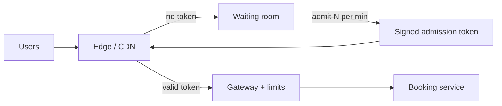

# MD-02 — Distributed Traffic Shaper, Rate Limiter and Waiting Room

> [!abstract] What this is
> Everything that decides **how much traffic is allowed through, and in what order**: per-client rate limits (token bucket, sliding window, GCRA in Redis Lua), concurrency limits, priority load shedding, and an edge **virtual waiting room** that holds a 100x spike outside and admits people at the rate the backend can actually serve.
>
> The defining decision is **what you're protecting and from whom**. A rate limiter protects the system from one client using too much. A load shedder protects it from everyone at once. A waiting room turns an unservable burst into a fair, ordered queue. They're often all needed, at different layers.

---

## 1. What It Solves and Where It Appears

- Every API needs per-client limits against bugs, scrapers and abuse.
- Some products also have **scheduled stampedes**: a sale or booking window opens at a published second, and demand is 10–100x what the inventory path can serve. Rate-limiting each user doesn't help there, because each user is behaving normally; there are just too many of them.
- Indian examples of the second kind are routine: Tatkal opens at 10:00 and 11:00 every day (IRCTC's record is 30,155 tickets booked in one minute, on 12 March 2025), and BookMyShow sold the Coldplay India shows through a virtual queue with randomised positions.

| Problem | What this block does there |
|---|---|
| Rate Limiter (#2) | The whole problem: multi-dimension limits, distributed counters, fail-open policy |
| Seat Booking (#9) | Waiting room in front of the hold path; per-user limits on holds |
| Flash Sale (#10) | Waiting room plus per-user purchase caps |
| URL Shortener (#1) | Per-user/API-key create limits, per-IP limits on redirects against scraping |
| LLM chatbot, AI gateway (#A1, #A7) | Limits in **tokens** and money, not requests; per-tenant budgets |
| Payments, OTP | Per-phone and per-device limits on OTP sends (cost and abuse) |

---

## 2. Knobs

| Knob | Options | What it trades |
|---|---|---|
| Algorithm | fixed window, sliding log, sliding window counter, token bucket, GCRA, leaky bucket | Accuracy and burst behaviour vs memory |
| Dimension | IP, user, API key, tenant, endpoint, device, phone | Fairness vs evasion (IPs are shared behind Indian carrier NAT) |
| Limit and burst | e.g. 100/min, burst 20 | Smoothness vs user experience |
| Where enforced | edge/CDN, gateway, service, per-pod | Earlier is cheaper but has less context |
| Consistency of counters | central Redis, local with batching, approximate | Exactness vs latency and Redis load |
| Failure policy | fail open, fail closed | Availability vs protection |
| Waiting-room admission rate | users/min | Backend safety vs time spent queueing |
| Queue order | FIFO by arrival, random at open | Fairness to early arrivers vs bot advantage at the opening second |

---

## 3. Evolution of the Block

### Step 0 — In-process limiter per pod

- A token bucket in each pod's memory. Free and fast, but a client spread across 50 pods gets 50x the limit.

### Step 1 — Central counters in Redis

- **Trigger:** more than one pod, and the limit must be global.
- **Change:** one Redis key per `(dimension, window)`; check-and-increment atomically with a Lua script so two pods can't both pass the last token.

### Step 2 — Multiple limits and concurrency limits

- **Trigger:** one number doesn't express the policy (per-second burst and per-day quota; writes stricter than reads), or slow endpoints pile up.
- **Change:** evaluate several limits per request (Stripe runs a request-rate limiter, a concurrent-requests limiter, and two load shedders); a concurrency limiter counts in-flight requests instead of requests per second.

### Step 3 — Local batching (L1 tokens)

- **Trigger:** Redis becomes a bottleneck or adds too much latency (every request = one Redis round trip).
- **Change:** each pod takes tokens from Redis in batches (for example 10% of the client's limit) and spends them locally. Accuracy drops slightly at the edges; Redis load drops by the batch size.

### Step 4 — Priority load shedding

- **Trigger:** total load exceeds capacity even though every client is under its limit.
- **Change:** classify traffic (critical: payments, login; normal; best-effort: analytics, recommendations) and drop from the bottom up based on fleet utilisation. JioHotstar's degradation during peak matches is this idea applied to features: non-critical features are switched off so the stream survives.

### Step 5 — Virtual waiting room

- **Trigger:** a known opening moment brings far more users than the protected flow can serve (seats, Tatkal, a sale).
- **Change:** users arriving at the protected path are held at the edge with a signed queue ticket; the room admits users at a fixed rate equal to what the booking path can handle; admitted users get a short-lived signed **admission token** that the booking service verifies on every request.



---

## 4. Core Mechanics

### Algorithms

| Algorithm | State per key | Behaviour |
|---|---|---|
| Fixed window | 1 counter | 2x burst possible across a window boundary |
| Sliding log | every timestamp | Exact, but memory grows with traffic |
| Sliding window counter | 2 counters | Weighted estimate of the last window; good default for per-minute limits |
| Token bucket | tokens + last refill time | Allows bursts up to bucket size, then a steady rate |
| GCRA | 1 timestamp (theoretical arrival time) | Same as a token bucket with a single value; cheap in Redis |
| Leaky bucket (queue) | queue | Smooths output; adds latency |

### Token bucket in Redis Lua (atomic)

```lua
-- KEYS[1] = bucket key; ARGV = rate_per_sec, capacity, now_ms, cost
local b = redis.call('HMGET', KEYS[1], 'tokens', 'ts')
local tokens = tonumber(b[1]) or tonumber(ARGV[2])
local ts     = tonumber(b[2]) or tonumber(ARGV[3])
local now    = tonumber(ARGV[3])
tokens = math.min(tonumber(ARGV[2]), tokens + (now - ts) / 1000 * tonumber(ARGV[1]))
local allowed = tokens >= tonumber(ARGV[4])
if allowed then tokens = tokens - tonumber(ARGV[4]) end
redis.call('HSET', KEYS[1], 'tokens', tokens, 'ts', now)
redis.call('PEXPIRE', KEYS[1], math.ceil(tonumber(ARGV[2]) / tonumber(ARGV[1]) * 1000) * 2)
return allowed and 1 or 0
```

- Pass `now` from the caller or use Redis `TIME` inside the script; clocks on different pods differ, so one source of time per key is safer.
- `cost` lets one request spend more than one token (LLM tokens, bulk APIs).

### Sliding window counter

```
estimate = count(current_window) + count(previous_window) × (1 − elapsed_fraction_of_current)
allow if estimate < limit
```

### Response contract

- Reject with **429**, `Retry-After`, and remaining-quota headers so well-behaved clients back off.
- Clients retry with exponential backoff and jitter; otherwise a 429 wave becomes a retry storm.

### Waiting room mechanics

- **Entry:** first request to the protected path gets a signed queue cookie/token: `{user_or_device, room_id, arrival_bucket, nonce, sig}`. Cloudflare's version stores the **minute you arrived** as a group ID and counts how many people are in front of your group.
- **Order:** FIFO by arrival bucket, or **random** for people present at the opening second (BookMyShow's Coldplay sale randomised queue positions, which removes the advantage of refreshing faster).
- **Admission:** a controller admits `rate × interval` users per tick, where `rate` is measured capacity of the booking path, not a guess. Admitted users receive an admission token (JWT, 5–15 min expiry, bound to user and device, single-use per session).
- **Enforcement:** the booking service rejects any request without a valid admission token. This is the part that makes the room real; a room that only exists in the UI is bypassed by calling the API directly.
- **Position display:** "N ahead of you" from counters per arrival bucket; refresh by polling with jitter (every 15–30 s) or SSE.
- **Anti-bot:** verified identity at entry (IRCTC requires Aadhaar-authenticated accounts and Aadhaar OTP for online Tatkal since July 2025, and bars agents for the first 30 minutes), CAPTCHA, device fingerprinting, per-account and per-payment-instrument caps.

---

## 5. Decision Tables

### Which algorithm

| Need | Algorithm | Pick when |
|---|---|---|
| Simple per-minute API limit | Sliding window counter | Default for public APIs |
| Allow short bursts | Token bucket / GCRA | Interactive APIs, mobile clients |
| Exact count, low volume | Sliding log | Low-rate, high-value actions (OTP sends, password resets) |
| Smooth output to a fragile downstream | Leaky bucket (queue) | Calling a partner/bank API with a hard TPS cap |
| Slow, expensive endpoints | Concurrency limiter | Reports, exports, LLM calls |

### Which layer

| Layer | Good at | Pick when |
|---|---|---|
| CDN / edge | Volumetric abuse, waiting room | Before traffic costs you anything |
| API gateway | Per-key, per-tenant limits | Central policy for many services |
| Service | Business limits (5 holds per user per show) | Needs domain context |
| Client SDK | Backoff, honouring `Retry-After` | Always |

### Fail open vs fail closed when Redis is down

| Policy | Risk | Pick when |
|---|---|---|
| Fail open (allow) | Abuse gets through for a while | Normal APIs, where an outage hurts more than abuse |
| Fail closed (deny) | You cause your own outage | Costly or dangerous actions (OTP SMS cost, payouts) |
| Fall back to local per-pod limits | Limits loosen by the pod count | Best default: keeps some protection without a hard dependency |

---

## 6. Numbers to Know

| Thing | Number |
|---|---|
| Redis Lua limiter call | ~0.5–1 ms in-region; one shard handles tens of thousands of limiter calls/s |
| Memory per token-bucket key | ~100 bytes; 10M active clients ≈ 1 GB |
| IRCTC peak | 30,155 tickets booked in one minute (12 Mar 2025); upgraded system targets more than 1.5 lakh booking requests/min |
| Waiting-room poll | every 15–30 s with jitter; 1M waiting users at 20 s ≈ 50k req/s, mostly served at the edge |
| Admission token expiry | 5–15 min, aligned with the hold TTL |

---

## 7. Failure Modes

| Failure | What happens | Detect | Fix |
|---|---|---|---|
| Limiter Redis down | Every request blocked (fail closed) or unprotected (fail open) | Limiter error rate | Local fallback limits; Redis replicas; short timeouts on limiter calls |
| Hot limiter key | One big tenant's key overloads a Redis shard | Per-shard CPU | Local token batching; split the tenant's key |
| Shared IP | Thousands of real users behind one carrier NAT get blocked together | 429s on one IP from many accounts | Limit by user/API key; IP limits only as a loose outer layer |
| Retry storm after 429s | Load goes up, not down | Request rate rising while 429s rise | `Retry-After`, client backoff with jitter, retry budgets |
| Waiting room bypassed | Bots call the booking API directly | Booking requests without admission tokens | Enforce the token in the service, not the UI |
| Admission rate too high | Booking path overloads anyway | Error rate and latency on booking | Admission rate driven by measured capacity; automatic back-off |
| Token sharing | One admission token used by many bots | Same token from many devices | Bind token to user and device; single active session |

---

## 8. Twist Cards

- **"Limit LLM usage by tokens and by money, per tenant."**
    + Use token-bucket cost = estimated tokens. Reserve the estimate before the call, then reconcile with actual usage after it returns; keep a daily spend budget per tenant as a second limit.
- **"Different limits for free and paid plans, changed without deploys."**
    + Limits are config keyed by plan, cached in each pod, refreshed every few seconds.
- **"A partner bank allows only 200 TPS."**
    + That's shaping, not limiting: queue requests and drain at 200/s (leaky bucket), and reject early if the queue would exceed your latency budget.
- **"Make the queue fair; bots refresh faster."**
    + Randomise positions for everyone present at the opening moment, verify identity at entry, cap tickets per account and per payment instrument.
- **"What happens to users when the room is admitting but seats are gone?"**
    + Stop admitting and tell the people still queueing as soon as inventory reaches zero. Holds that later expire release seats, so the room can reopen briefly.

---

## 9. Operations and Cost

- **Watch:** allowed vs rejected per dimension, top limited keys, limiter latency, Redis CPU, waiting-room depth, admission rate vs booking error rate, time-in-queue percentiles.
- **Cost:** limiter calls are cheap; the waiting room's cost is edge requests from polling (served from the CDN, so cheap). Rejecting early is the cheapest request you'll ever serve.

---

## 10. Say It in One Minute

> "Per-client limits live in Redis as a token bucket in a Lua script so the check and decrement are atomic, keyed by user or API key rather than IP because Indian carrier NAT puts thousands of users behind one IP. Pods batch tokens locally to keep Redis off the hot path, and if Redis dies we fall back to local limits instead of failing everything. Separate from that, a priority load shedder drops best-effort traffic first. For a scheduled stampede like a Tatkal window or a concert sale, a waiting room at the edge hands out signed queue tickets, randomises positions for everyone present at opening, admits users at the booking path's measured capacity, and the booking service rejects any request without a valid admission token."

---

## Sources

- Stripe, *Scaling your API with rate limiters* (2017): request-rate limiter, concurrent-requests limiter, fleet-usage and worker-utilisation load shedders. https://stripe.com/blog/rate-limiters
- Redis, *Build 5 Rate Limiters with Redis* (2026): sliding window counter as the default, token bucket for bursts. https://redis.io/learn/howtos/ratelimiting
- Cloudflare Waiting Room docs and blog (cookie with arrival-minute group ID, FIFO and random queueing). https://developers.cloudflare.com/waiting-room/reference/waiting-room-cookie/ · https://blog.cloudflare.com/waiting-room-random-queueing-and-custom-web-mobile-apps/
- Coldplay, *2025 Ahmedabad show announced* (Nov 2024): BookMyShow virtual queue with randomised positions. https://www.coldplay.com/2025-ahmedabad-show-announced/
- IRCTC, *Internet ticketing* page: 30,155 tickets in one minute on 12 March 2025. https://www.irctc.com/internet-ticketing.php
- Indian Express (2026), on the NGeT upgrade for peak hours; MSN/agency reports of >1.5 lakh requests per minute. https://indianexpress.com/article/india/irctc-upgrade-nget-ticket-booking-system-reduce-website-disruptions-peak-hours-tatkal-timings-10846197/
- Economic Times and The Hindu (June–July 2025): Aadhaar authentication for Tatkal from 1 July 2025, Aadhaar OTP from 15 July, agents barred for the first 30 minutes. https://www.thehindu.com/news/national/railways-tightens-tatkal-ticket-norms-aadhaar-based-authentication-made-mandatory/article69683148.ece

## Related Notes

- [[12 - Mini Designs]]
- [[08 - Reliability]]
- [[21 - Redis]]
- [[04 - Load Balancing CDN and Gateway]]
- [[MD-04 - High-Contention Reservation and TTL Lease Sweeper]]
- [[MD-11 - Multi-Tier Hot-Key Shield]]
