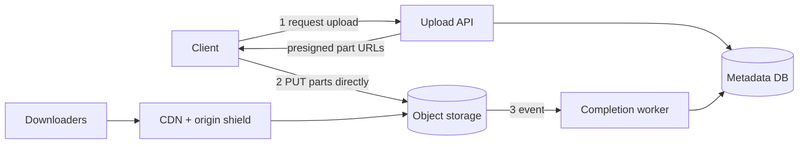

# MD-03 — Presigned Direct-to-Blob Multipart and Chunk Sync Engine

> [!abstract] What this is
> How large files get into and out of object storage without passing through your app servers: the client asks the API for **presigned URLs**, uploads straight to S3-compatible storage (in parts, in parallel, resumable), and the API only records **metadata**. For sync products, files are split into **content-addressed chunks** (named by their SHA-256), so unchanged chunks are never re-uploaded and identical chunks are stored once. Downloads go through a CDN with an **origin shield** in front of the bucket.
>
> The defining decisions are **who owns the bytes vs the metadata** (blob store vs database, committed in the right order), **chunk size and boundaries** (fixed blocks vs content-defined), and **how an upload becomes visible** (only after the metadata commit that references fully uploaded parts).

---

## 1. What It Solves and Where It Appears

- Streaming a 2 GB video through an app server ties up a thread and bandwidth for minutes, and a dropped connection starts over.
- Presigned URLs let the client talk to object storage directly with a time-limited, scoped permission; multipart uploads let it send parts in parallel and retry only the failed part.
- Dropbox's sync unit is a 4 MB block; only changed blocks are uploaded, and blocks are deduplicated by hash.

| Problem | Use |
|---|---|
| Chat media (#4) | Presigned single PUT for images/voice notes; thumbnails async |
| Video Streaming (#13) | Multipart upload of raw video → triggers transcoding ([[MD-18 - Media Transcoding DAG and Adaptive Bitrate Edge Pipeline]]) |
| Dropbox / Drive sync (#15) | Chunked, content-addressed, delta sync, conflict handling |
| Instagram (#18) | Presigned upload, async processing, CDN delivery |
| Object Storage (#32) | The storage side of the same contract |
| Vault problem [[04 - Multipart Upload]] | Presign, ETag ack, CompleteMultipartUpload |

---

## 2. Knobs

| Knob | Options | What it trades |
|---|---|---|
| Upload style | single presigned PUT, multipart | Simplicity vs resumability for large files |
| Part / chunk size | 5–100 MiB parts; 4 MB sync blocks | Fewer requests vs finer retry and dedup |
| Chunking | fixed size, content-defined (rolling hash) | Simplicity vs dedup that survives inserts in the middle of a file |
| URL expiry | minutes → hours | Security vs slow uploads on poor networks |
| Dedup scope | per user, global | Privacy (cross-user dedup leaks existence) vs storage savings |
| Integrity | per-part checksum, whole-file hash | Detects corruption vs CPU |
| Delivery | direct S3, CDN, signed CDN URLs | Cost and latency vs access control |

---

## 3. Evolution of the Block

### Step 0 — Upload through the API

- `POST /files` with the body, the server writes to S3. Fine for small files and low volume. Breaks on large files, mobile networks and server bandwidth.

### Step 1 — Presigned single PUT

- **Trigger:** files above a few MB, or many uploads.
- **Change:** `POST /uploads` → API checks quota and type, creates a `pending` metadata row, returns a presigned PUT URL (scoped to one key, expiring in ~15 min). Client uploads directly. Completion comes from the client's confirm call **or** the storage's event notification; the API verifies size/checksum and marks the file `ready`.

### Step 2 — Multipart, parallel, resumable

- **Trigger:** large files (hundreds of MB to GB) on flaky networks.
- **Change:** the API starts a multipart upload and presigns each part URL; the client uploads parts in parallel, records each part's ETag, retries failed parts only, and calls complete with the ordered ETag list. A lifecycle rule aborts incomplete uploads after a few days (incomplete multipart uploads otherwise never expire and keep costing storage).

### Step 3 — Content-addressed chunks and delta sync

- **Trigger:** a sync product where users edit large files and have many devices.
- **Change:** the client splits files into chunks, hashes each, and asks the server which hashes it already has. Only missing chunks are uploaded. A file version is a list of chunk hashes in the metadata DB. Other devices fetch the new list and download only chunks they lack.

### Step 4 — CDN and origin shielding

- **Trigger:** popular downloads (a viral video, a shared file).
- **Change:** serve through a CDN; an **origin shield** (one mid-tier cache layer) means a cache miss in 200 edge locations becomes one request to the bucket, not 200. Private content uses short-lived signed CDN URLs or cookies.



---

## 4. Core Mechanics

### Commit order (bytes first, then metadata)

1. Metadata row `pending` with the intended key, size, checksum, owner.
2. Bytes uploaded to a key nobody can see yet (e.g. `uploads/{upload_id}/…`).
3. Completion verifies (size, checksum, malware scan if needed), then a DB transaction marks the file `ready` and points it at the final key.
4. Readers only ever see `ready` files. Orphaned bytes from abandoned uploads are cleaned up by lifecycle rules and a sweeper comparing keys to metadata.

### Sync metadata

```
files(id, owner_id, path, current_version, deleted, updated_at)
file_versions(file_id, version, chunk_hashes[], size, created_by_device, base_version)
chunks(hash PK, size, storage_key, refcount)
```

- A new version is accepted only if `base_version == current_version` (optimistic check). If another device already moved the file forward, it's a **conflict**: keep both ("file (conflicted copy from Asha's laptop)") rather than silently overwriting.
- Devices learn about changes through a per-user change cursor (long poll or push, [[MD-01 - Stateful Connection and Realtime Push Mesh]]) and pull new versions after their cursor.

### Fixed vs content-defined chunking

- Fixed 4 MB blocks: inserting one byte at the start shifts every block, so every block's hash changes.
- Content-defined chunking (rolling hash picks boundaries where the content matches a pattern) keeps most boundaries stable after inserts, so most chunks are reused. Costs CPU on the client.

### Limits to remember (AWS S3)

- Multipart parts: 1–10,000 parts; each part 5 MiB–5 GiB except the last, which can be smaller.
- Maximum object size: AWS's current docs give 50 TB (10,000 × 5 GiB); much older material says 5 TB.
- A single PUT is limited to 5 GB.

---

## 5. Decision Tables

| Upload | Pick when |
|---|---|
| Through API | Tiny files, need inline processing |
| Presigned single PUT | Files up to ~100 MB on decent networks |
| Presigned multipart | Large files, mobile networks, need resume |
| Chunked content-addressed sync | Sync products with edits and many devices |

| Dedup scope | Pick when |
|---|---|
| Per user | Default for consumer products (no cross-user leak) |
| Global | Internal or enterprise storage where existence leaks don't matter |

---

## 6. Numbers to Know

| Thing | Number |
|---|---|
| Dropbox block | 4 MB |
| S3 parts | up to 10,000; min 5 MiB except last; max 5 GiB |
| Presigned URL expiry | 15 min–1 h typical (max 7 days with SigV4) |
| Parallel parts | 4–8 on mobile, more on desktop |
| SHA-256 hashing | hundreds of MB/s per core on modern CPUs |

---

## 7. Failure Modes

| Failure | What happens | Detect | Fix |
|---|---|---|---|
| Client dies mid-upload | Orphan parts cost money | Incomplete MPU count | Resume with saved upload ID; lifecycle abort after N days |
| Metadata marked ready before bytes | Broken downloads | 404s on ready files | Bytes first, verify, then metadata |
| Presigned URL leaked | Someone uploads or reads | Unexpected access | Scope to one key, short expiry, content-type and size conditions |
| Conflicting edits | Lost work | Version check fails | Conflicted copy, never last-write-wins for user files |
| Hot file download | Bucket request costs, throttling | Origin request rate | CDN + origin shield |
| Malware uploads | Distribution of malware | Scanner results | Quarantine until scanned for shared/public files |

---

## 8. Twist Cards

- **"Users upload 2 GB videos on 4G and the connection drops."**
    + Multipart with saved upload ID and ETags; the app resumes the missing parts after reconnecting.
- **"A user edits one paragraph in a 1 GB file."**
    + Content-defined chunking means only the chunks around the edit change; upload just those, then commit a new chunk list.
- **"Two devices edit the same file offline."**
    + The second commit fails the base-version check; keep both versions as a conflicted copy and let the user resolve.
- **"Share a private file with a link that expires."**
    + Signed CDN URL with expiry, generated after a permission check ([[MD-17 - ReBAC Authorisation Graph and Consistent Cache]]).

---

## 9. Operations and Cost

- **Watch:** upload success rate by network type, part retries, incomplete multipart uploads, pending-but-never-completed metadata rows, CDN hit rate, origin requests, storage growth, dedup ratio.
- **Cost:** storage (tiered by access: infrequent-access classes for old versions), egress (the CDN reduces it), and request counts (bigger parts mean fewer requests).

---

## 10. Say It in One Minute

> "The API never touches the bytes. It checks quota, writes a pending metadata row and returns presigned part URLs; the client uploads parts in parallel straight to object storage, retries only failed parts, and completes with the ETag list. A completion worker verifies size and checksum and only then marks the file ready. For sync, files are chunked and content-addressed, so the client uploads only chunks the server doesn't have, versions are lists of chunk hashes with an optimistic base-version check, and conflicts become conflicted copies. Downloads go through a CDN with an origin shield."

---

## Sources

- AWS docs, *Amazon S3 multipart upload limits* and *Uploading objects* (accessed 2026-10-24): 10,000 parts, 5 MiB minimum except the last, multipart from 5 MB to 50 TB, incomplete uploads don't expire. https://docs.aws.amazon.com/AmazonS3/latest/userguide/qfacts.html · https://docs.aws.amazon.com/AmazonS3/latest/userguide/upload-objects.html
- Dropbox architecture write-ups (block servers, 4 MB blocks, only changed blocks synchronised). https://expertbeacon.com/under-the-hood-how-dropbox-works-at-scale/
- Abstract Algorithms, *File Storage and Sync* (2026): blob store vs metadata DB, chunk dedup, delta sync. https://abstractalgorithms.hashnode.dev/system-design-hld-file-storage-sync-example

## Related Notes

- [[12 - Mini Designs]]
- [[04 - Multipart Upload]]
- [[09 - Storage Search and Geo]]
- [[04 - Load Balancing CDN and Gateway]]
- [[MD-18 - Media Transcoding DAG and Adaptive Bitrate Edge Pipeline]]
- [[MD-17 - ReBAC Authorisation Graph and Consistent Cache]]
