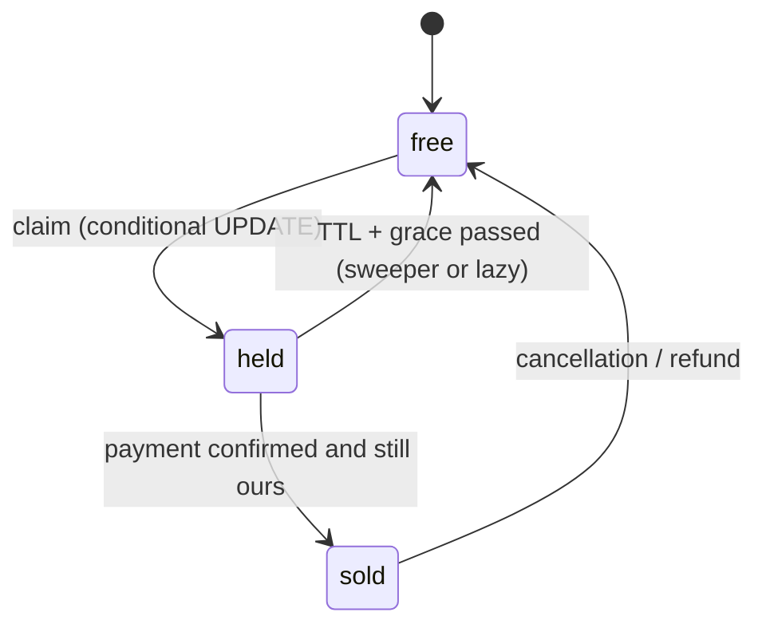

# MD-04 — High-Contention Reservation and TTL Lease Sweeper

> [!abstract] What this is
> How to hold scarce inventory for a buyer without overselling and without deadlocks: a specific item (seat A12 for a show, room type on a date, one driver) or a count (SKU stock). A hold is an **atomic state change plus a clock**: `free → held(until T)`, then either `held → sold` when payment confirms or `held → free` when the clock runs out.
>
> The defining decision is **where the atomic check-and-claim happens** (a conditional `UPDATE` on the source-of-truth row, or a Redis counter in front of it) and **how expired holds are released** (a sweeper, lazy expiry on read, or both). Locks held across a payment are never the answer.

---

## 1. What It Solves and Where It Appears

- Two buyers want the last seat. Both read "free", both pay, one gets a refund and an angry tweet. The block exists to make one of them lose **before** paying.
- The pattern repeats across domains with two flavours:
    + **Non-fungible:** each unit has an identity (seat A12, room 304, driver D). Claim the specific row.
    + **Fungible:** units are interchangeable (500 units of SKU X; 40 rooms of type Deluxe on 12 Dec). Decrement a counter.

| Problem | Unit | Flavour | Typical hold TTL |
|---|---|---|---|
| Seat Booking (#9) | `(show_id, seat_id)` | Non-fungible | 5–10 min |
| Flash Sale (#10) | `sku_id` stock | Fungible | 5–15 min until payment |
| Hotel Booking (#21) | `(hotel, room_type, date)` count | Fungible per night | 10–15 min |
| Ride Hailing (#7) | driver | Non-fungible | 10–20 s offer window |
| Food Delivery | rider assignment | Non-fungible | seconds |
| E-commerce checkout | stock reservation | Fungible | until payment or cart expiry |

---

## 2. Knobs

| Knob | Range | What it trades |
|---|---|---|
| Hold TTL | seconds (driver offer) → 15 min (payment) | Short: users lose seats mid-payment. Long: inventory locked by people who walked away |
| Grace after TTL | 0 → minutes | Covers late payment confirmations vs delays re-selling |
| Claim location | DB row, Redis counter + DB, sharded counters | Correctness simplicity vs throughput on one hot item |
| Expiry mechanism | sweeper job, lazy on read, both | Freshness of "free" vs background load |
| Max units per hold | 1 → N | Bulk buying and scalping vs convenience |
| All-or-nothing | yes / partial | Multi-seat atomicity vs higher success rate |

---

## 3. Evolution of the Block

### Step 0 — Status column with a conditional update

- One row per unit with `status` and `hold_until`. The claim is a single `UPDATE … WHERE status = 'free'`. The row-level lock lasts only as long as that statement's transaction (milliseconds).
- Correct on its own; handles thousands of claims per second across different rows.

### Step 1 — Expiry: sweeper plus lazy expiry

- **Trigger:** holds expire and must become claimable again.
- **Change:** treat `held AND hold_until < now()` as free in the claim query itself (lazy), and run a sweeper that flips expired holds back to `free` so reads and counts are accurate.

### Step 2 — Payment confirmation races

- **Trigger:** the payment provider confirms late, or the user pays after the hold expired.
- **Change:** confirm only `WHERE held_by = :booking AND status = 'held'`. Zero rows means the hold is gone: don't sell, refund automatically. Add a short grace period between the visible TTL and the sweeper's TTL ("dual TTL").

### Step 3 — Hot item

- **Trigger:** one row (one SKU, one general-admission bucket) receives thousands of claims per second, and the row lock serialises them.
- **Change:** move the counter in front: Redis `DECRBY` in a Lua script as the gate, with the DB reservation written asynchronously or right after; or split the stock into N bucket rows and claim from a random bucket.

### Step 4 — Admission control

- **Trigger:** even a fast claim path is overwhelmed by the opening-second crowd.
- **Change:** a waiting room in front ([[MD-02 - Traffic Shaper Rate Limiter and Waiting Room]]), so the reservation path sees only its capacity.

### Step 5 — Partitioned inventory

- **Trigger:** total inventory writes exceed one primary.
- **Change:** shard by the unit's parent (`show_id`, `sku_id`, `hotel_id`) so each hold is a single-shard transaction ([[MD-20 - Partitioning Shard Keys and Resharding]]).



---

## 4. Core Mechanics

### Non-fungible claim (multi-seat, all-or-nothing)

```sql
BEGIN;
UPDATE seats
SET status = 'held',
    hold_until = now() + interval '10 minutes',
    held_by = :booking_id
WHERE show_id = :show_id
  AND id = ANY(:seat_ids)              -- application sorts ids
  AND (status = 'free' OR (status = 'held' AND hold_until < now() - interval '2 minutes'));
-- if rowcount <> cardinality(:seat_ids): ROLLBACK (someone else got one)
INSERT INTO bookings(id, user_id, show_id, status, hold_until, idempotency_key)
VALUES (:booking_id, :user, :show_id, 'held', now() + interval '10 minutes', :idem);
COMMIT;
```

- **One statement claims all seats or the transaction rolls back.** No read-then-write race, because the condition is evaluated under the row lock.
- **Sorted IDs** make every transaction lock rows in the same order, which prevents deadlocks between two multi-seat holds.
- The `2 minutes` in the lazy-expiry clause is the grace period from Step 2.

### Fungible claim (counter)

```sql
UPDATE inventory
SET available = available - :qty, reserved = reserved + :qty
WHERE sku_id = :sku AND available >= :qty;
-- rowcount 0 → sold out
INSERT INTO reservations(id, sku_id, qty, expires_at, order_id) VALUES (...);
```

- Release on expiry: `available = available + qty, reserved = reserved - qty` and delete the reservation in one transaction, guarded by `reservations.status = 'active'` so a release happens once.

### Hot counter gate in Redis

```lua
-- KEYS[1] = stock:{sku}, KEYS[2] = holds:{sku} (sorted set by expiry)
local left = tonumber(redis.call('GET', KEYS[1]) or '0')
if left < tonumber(ARGV[1]) then return -1 end
redis.call('DECRBY', KEYS[1], ARGV[1])
redis.call('ZADD', KEYS[2], ARGV[2], ARGV[3])   -- expiry_ms, reservation_id
return left - tonumber(ARGV[1])
```

- Redis is the **gate**, the DB stays the **record**. Write the reservation to the DB right after (or via a queue), and run a reconciler that compares Redis stock with DB reservations, because Redis can lose recent writes on failover.
- If Redis says yes and the DB write fails, give the unit back to Redis.

### Sweeper

```sql
-- runs every few seconds, many workers in parallel without stepping on each other
WITH expired AS (
  SELECT id FROM seats
  WHERE status = 'held' AND hold_until < now() - interval '2 minutes'
  ORDER BY hold_until
  LIMIT 500
  FOR UPDATE SKIP LOCKED
)
UPDATE seats s SET status = 'free', held_by = NULL, hold_until = NULL
FROM expired e WHERE s.id = e.id;
```

- A partial index on `(hold_until) WHERE status = 'held'` keeps this cheap.
- `SKIP LOCKED` lets several sweeper workers run without blocking each other or the claim path. Background: [[14 - Coordination and Concurrency]].
- **Don't rely on Redis keyspace expiry notifications** to release holds. Redis fires `expired` events only when it actually deletes the key (on access or during background sampling), not exactly at TTL, and pub/sub messages are lost if no subscriber is connected. Use a sorted set by expiry plus a poller, or the DB sweeper.

### Dual TTL

- **Visible TTL** (shown to the user, e.g. 10 min): the countdown; payment must start before it.
- **Hard TTL** (sweeper and lazy-expiry clause, e.g. visible + 2 min): absorbs payment confirmations that arrive slightly late.
- **Late success after hard TTL:** if the seat is still free, re-claim it for the same booking; if someone else has it, refund. Payment gateways do confirm late: Razorpay describes payments that time out at about 10 minutes and are later authorised after the gateway keeps polling the bank (for up to 72 hours).

---

## 5. Decision Tables

### Claim strategy

| Strategy | Throughput on one item | Correctness | Pick when |
|---|---|---|---|
| Conditional `UPDATE` on the row | ~1 / (txn time) on one row, unlimited across rows | Strong, one source of truth | Default; seats, rooms, normal SKUs |
| `SELECT … FOR UPDATE` then branch | Same, longer locks | Strong | Logic between read and write that can't be one statement; keep it milliseconds |
| Optimistic version column | High when conflicts are rare | Strong with retry | Low contention edits |
| Redis counter gate + DB record | Very high on one item | Needs reconciliation | Flash-sale SKU, general admission |
| Bucketed counter rows | N× one row | Strong | Hot SKU without Redis; buckets can run dry unevenly |
| Lock held across payment | Terrible | Breaks on any delay | Never |

### Expiry mechanism

| Mechanism | Pros | Cons | Pick when |
|---|---|---|---|
| Lazy (expired = free in the claim query) | No lag; no extra job | Counts and maps show stale "held" | Always, as the correctness layer |
| DB sweeper with SKIP LOCKED | Accurate views; simple | Background load; runs every few seconds | Always, as the cleanup layer |
| Delayed message per hold | Precise timing | Queue per hold; must be idempotent | Very large hold volumes |
| Redis key TTL + keyspace events | Easy | Late or lost events | Not for releasing inventory |

---

## 6. Numbers to Know

| Thing | Number |
|---|---|
| Hot single row in Postgres | throughput ≈ 1 ÷ lock hold time; at ~1–2 ms per transaction, roughly 500–1,000 updates/s on that row |
| Different rows | thousands to tens of thousands of claims/s per primary |
| Redis Lua gate | tens of thousands of claims/s on one key, then MD-11 techniques |
| Seat rows | 1k shows/day × 200 seats × 90 days ≈ 18M rows; one Postgres is fine |
| Payment timeout window | about 10 min at Indian gateways, with late authorisation possible afterwards |

---

## 7. Failure Modes

| Failure | What happens | Detect | Fix |
|---|---|---|---|
| Two buyers, last seat | One `UPDATE` matches, the other gets 0 rows | 409s | Expected; show "just taken" |
| Deadlock on multi-seat holds | Transactions abort | Deadlock count | Sort IDs; one statement |
| Payment after expiry | Money taken, seat maybe gone | Confirm returns 0 rows | Re-claim if still free, else auto-refund |
| Sweeper and payment confirm race | Seat freed while the confirm is in flight | Confirm returns 0 rows | Confirm guarded by `held_by` and status; grace period |
| Redis gate and DB disagree | Oversell or phantom sold-out | Reconciler diff | DB is the record; reconcile every few seconds; fail closed on mismatch for that SKU |
| Process dies after claim, before response | User retries and double-holds | Duplicate holds per user | Idempotency key on the booking |
| Scalper bots | Inventory held by bots that never pay | Holds per account, hold-to-pay ratio | Per-user hold caps, waiting room, identity checks |

---

## 8. Twist Cards

- **"Hold time is 10 minutes but UPI collect requests can take longer."**
    + Dual TTL with a grace period, and the late-success path (re-claim if free, else refund). Show the countdown clearly and stop new payment attempts near the end.
- **"Let people pick 'best available' instead of specific seats."**
    + `SELECT … ORDER BY score LIMIT n FOR UPDATE SKIP LOCKED`, then claim. Concurrent buyers skip each other's locked rows instead of waiting.
- **"General admission: 50,000 identical tickets, everyone clicks at once."**
    + It's fungible now: Redis counter gate (or bucketed counters) plus waiting room. Seat-level rows aren't needed.
- **"Hotel booking for 3 nights."**
    + Three counter rows `(room_type, date)`; decrement all three in one transaction in date order; any zero row rolls back the whole thing.
- **"A driver must not get two ride offers at once."**
    + Non-fungible claim with a seconds-long TTL: `SET driver_lock:{id} {ride} NX PX 15000`, released on accept/decline/expiry. Redis is fine here because the cost of a rare double offer is low; for money, the DB stays the record.

---

## 9. Operations and Cost

- **Watch:** claim success vs conflict rate, active holds, hold-to-sale conversion, expired holds per minute, sweeper lag (oldest expired-but-held), late payment confirmations, refunds caused by expiry, Redis-vs-DB reconciliation diffs.
- **Cost:** cheap in compute; the expensive part is failed experiences (refunds, support). Grace periods and clear countdowns are cheaper than refunds.

---

## 10. Say It in One Minute

> "A hold is an atomic state change plus a clock. The claim is one conditional `UPDATE … WHERE status = 'free'` over sorted IDs, so it's all-or-nothing and can't deadlock, and the row lock lasts milliseconds. I never hold a lock across payment. The payment webhook confirms only if the hold still belongs to this booking; if not, the seat is re-claimed if free or the money is refunded, because Indian gateways do confirm late. Expiry is lazy in the claim query and a `SKIP LOCKED` sweeper cleans up, never Redis expiry events. For one hot item, a Redis Lua counter becomes the gate with the database as the record and a reconciler between them, and a waiting room keeps the crowd outside."

---

## Sources

- Razorpay, *Payment Timeout vs Late Authorisation* (2026): ~10 min timeout, polling up to 72 hours, late authorisation. https://razorpay.com/learn/payment-timeout/
- Redis keyspace notification timing (expired events fire on actual deletion, not at TTL), as discussed in the Redis docs and Stack Overflow answers quoting them. https://stackoverflow.com/questions/23964548/notification-of-key-expiration-in-redis-python
- *How do Indian platforms handle high-volume last-minute ticket sales?* (Quora, 2026), used only for the general hold-window practice (5–10 min).
- Vault: [[14 - Coordination and Concurrency]] for locks, leases, fencing and `SKIP LOCKED`.

## Related Notes

- [[12 - Mini Designs]]
- [[14 - Coordination and Concurrency]]
- [[04 - Isolation and Anomalies]]
- [[MD-02 - Traffic Shaper Rate Limiter and Waiting Room]]
- [[MD-06 - Distributed Saga and Compensating State Machine]]
- [[MD-11 - Multi-Tier Hot-Key Shield]]
- [[MD-20 - Partitioning Shard Keys and Resharding]]
