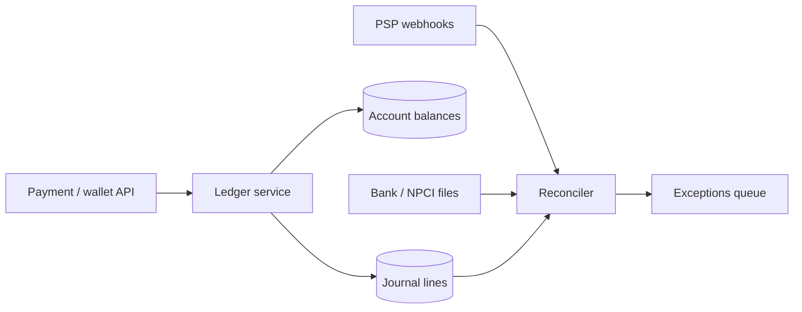

# MD-05 — Immutable Double-Entry Ledger and Reconciliation Loop

> [!abstract] What this is
> How money (or any quantity that must never appear or vanish) is recorded: every movement is a **journal entry** of debit and credit lines that sum to zero, written once and never edited; balances are derived from those lines; and a **reconciliation loop** compares your ledger with banks, payment gateways and NPCI settlement files to catch drift.
>
> The defining decisions are **how balances are materialised** (computed on read, cached on the account row, or both), **how concurrent movements on the same account are serialised** without making that account a bottleneck, and **what counts as the truth when you disagree with the outside world**.

---

## 1. What It Solves and Where It Appears

- A `balance` column updated in place has no history. When it's wrong, nobody can say why, and a retried request can apply twice.
- Double-entry fixes both: every rupee that leaves one account enters another in the same entry, so the sum of all lines is always zero, and every balance is explainable line by line.
- Stripe built its internal *Ledger* as an immutable log of all money movement and runs automated data-quality checks on top of it. Payment interviews at Razorpay, PhonePe, CRED and Paytm expect this shape.

| Problem | Accounts | Hard part |
|---|---|---|
| Payment Gateway (#6) | customer, merchant, gateway fees, PSP receivable, refunds | Webhook-driven state, settlement reconciliation |
| Wallet (#22) | user wallets, top-up clearing, merchant | Hot merchant accounts, no negative balances |
| Food Delivery refunds (#8) | customer, restaurant payable, platform | Partial refunds, adjustments |
| Ad billing (#27) | advertiser prepaid, revenue | High-rate small debits |
| Stock Exchange (#30) | cash and securities per client | Two assets per trade |
| Splitwise (#33) | pair balances in a group | Not real money, same invariant |

---

## 2. Knobs

| Knob | Options | What it trades |
|---|---|---|
| Balance materialisation | sum on read, cached balance with version, periodic snapshots | Read cost vs write contention |
| Concurrency on one account | row lock, optimistic version, single writer per account, batching | Simplicity vs throughput on hot accounts |
| Holds | none, two-phase (pending → posted/voided) | Simplicity vs authorisation flows |
| Negative balance rule | forbid, allow up to credit limit | Safety vs product flexibility |
| Currency | single, multi with separate accounts per currency | Simplicity vs FX entries |
| Amount type | integer minor units (paise) | Always integers; never floats |
| Reconciliation cadence | per event, intraday, T+1 | Detection speed vs cost |

---

## 3. Evolution of the Block

### Step 0 — Entries and lines in one Postgres

- `journal_entries` and `journal_lines` tables, written in one transaction with a check that lines sum to zero. Balance = sum of lines for the account.
- Correct and simple. Breaks when summing millions of lines per read gets slow.

### Step 1 — Cached balances with optimistic versioning

- **Trigger:** balance reads on every payment; summing lines is too slow.
- **Change:** an `accounts` row holds `balance` and `version`. Each entry updates the affected accounts in the same transaction as the lines, with `WHERE version = :v` (or a row lock held for milliseconds). The cached balance can always be rebuilt from lines.

### Step 2 — Idempotency and two-phase transfers

- **Trigger:** retries from clients, webhooks delivered twice, authorisations that may later be voided.
- **Change:** every entry carries an **idempotency key** with a unique constraint (a retry returns the first result). Authorisations are **pending** entries that reserve funds (`available` drops, `posted` doesn't); capture **posts** them, expiry or failure **voids** them. TigerBeetle builds exactly this into its transfer model.

### Step 3 — Hot accounts

- **Trigger:** one account (a large merchant, the platform's fee account) receives hundreds of entries per second, and its row lock serialises them.
- **Change:** split the hot account into N sub-accounts (credit a random one, sum for the balance), or batch: collect entries for that account for ~50–100 ms and apply them in one transaction. Uber described batching to handle sustained contention on single accounts.
    + Accounts that receive money (merchant payables) are easy to split. Accounts that must not go negative (a user wallet) keep one writer, which is fine because a single user rarely makes hundreds of payments per second.

### Step 4 — Reconciliation loop

- **Trigger:** your records and the outside world disagree (a payment captured at the bank but stuck as pending here; a refund you sent that the bank didn't apply).
- **Change:** continuous reconciliation: match every internal entry against PSP webhooks, bank statements and NPCI settlement reports by reference ID; unmatched or mismatched items become **exceptions** handled by automated rules (late success → post; missing at bank → reverse) or an ops queue.

### Step 5 — Partitioned ledger

- **Trigger:** total write volume beyond one primary.
- **Change:** shard by `account_id` ([[MD-20 - Partitioning Shard Keys and Resharding]]). An entry that touches accounts on two shards becomes two legs through a **clearing account** on each side, coordinated as a saga ([[MD-06 - Distributed Saga and Compensating State Machine]]) so each shard's books still sum to zero.



---

## 4. Core Mechanics

### Schema

```
accounts(id, owner_type, owner_id, currency, kind,       -- asset | liability | revenue | expense
         posted_balance bigint, pending_debits bigint, pending_credits bigint,
         allow_negative bool, version bigint)
journal_entries(id, idempotency_key UNIQUE, type, status, -- pending | posted | voided
                external_ref, created_at)
journal_lines(entry_id, account_id, amount bigint,       -- +credit / -debit in paise
              PRIMARY KEY(entry_id, account_id))
```

- **Invariant:** `SUM(amount) = 0` per entry, checked in the transaction (or by a deferred constraint trigger).
- **Immutable:** lines are never updated or deleted. Mistakes are fixed by a **reversing entry** that points to the original.

### Posting a payment (customer pays merchant ₹500, gateway fee ₹10)

```
entry E1 (idempotency_key = psp_payment_id):
  PSP receivable        +50000   (we're owed by the PSP)
  merchant payable      -49000   (we owe the merchant)
  fee revenue           -1000
  sum = 0
```

```sql
BEGIN;
INSERT INTO journal_entries(id, idempotency_key, type, status) VALUES (:e, :key, 'payment', 'posted');
INSERT INTO journal_lines VALUES (:e, :psp_recv, 50000), (:e, :merchant, -49000), (:e, :fees, -1000);
UPDATE accounts SET posted_balance = posted_balance + delta, version = version + 1
  WHERE id = ... ;              -- one statement per account, in sorted account-id order
COMMIT;
```

- Sorted account order prevents deadlocks between two entries touching the same pair.
- A duplicate webhook hits the unique `idempotency_key` and returns the existing entry.

### Two-phase (authorisation then capture)

```
authorise: pending entry; available = posted - pending_debits drops; posted unchanged
capture:   post the pending entry (amount ≤ authorised); pending moves to posted
void:      release the pending amounts; entry status = voided
expiry:    a sweeper voids pendings past their deadline
```

### Reconciliation

| Source | Matched on | Typical exception |
|---|---|---|
| PSP webhooks / status API | `psp_payment_id` | Captured at PSP, pending here (late authorisation) |
| PSP settlement report (T+1/T+2) | settlement batch, payment IDs, fees | Fee or amount mismatch |
| Bank statement | UTR / RRN | Money received with no matching entry |
| NPCI UPI settlement | RRN per settlement cycle | Disputed or reversed transactions |

- UPI settles between banks in multiple cycles per day (ten per day as of 2025, with NPCI separating authorised and dispute settlements from November 2025), so bank-side reconciliation runs intraday, not only at end of day.

---

## 5. Decision Tables

| Balance strategy | Read | Write | Pick when |
|---|---|---|---|
| Sum lines on read | Slow for busy accounts | Fast, append only | Low volume, audit-first |
| Cached balance on account row | Fast | Contention per account | Default |
| Cached + periodic snapshot | Fast; rebuild from snapshot + recent lines | Same | Very long histories |
| Sub-accounts for hot receivers | Sum N rows | Spread | Large merchants, platform fee accounts |
| Batched application | Fast | Adds ~50–100 ms latency | Sustained hot accounts |

| Store | Pick when |
|---|---|
| Postgres with the schema above | Default; strong transactions and familiar operations |
| TigerBeetle | Very high transfer rates with built-in double-entry and two-phase transfers |
| Event-sourced log + projections | You already run event sourcing; need replays |

---

## 6. Numbers to Know

| Thing | Number |
|---|---|
| Hot single account on one row lock | ~1 ÷ transaction time; low hundreds to ~1k entries/s |
| Lines per entry | 2–5 typically |
| Storage | ~100–200 bytes per line; 100M entries/day × 3 lines × 150 B ≈ 45 GB/day |
| UPI scale | ~24,000 crore transactions in FY 2025–26 |
| UPI settlement cycles | 10 per day (2025) |

---

## 7. Failure Modes

| Failure | What happens | Detect | Fix |
|---|---|---|---|
| Duplicate webhook | Double credit | Unique key violation | Idempotency key per entry |
| Lines don't sum to zero | Money created or lost | Constraint failure; daily trial balance | Enforce in the transaction; reject |
| Cached balance drifts from lines | Wrong balance shown or spent | Nightly recompute and compare | Rebuild from lines; find the bug |
| Hot account lock contention | Timeouts at peak | Lock wait on one row | Sub-accounts or batching |
| PSP says captured, ledger says pending | Customer charged, order not confirmed | Reconciler match | Auto-post late success; trigger the saga forward |
| Bank says received, no entry | Unidentified money | Statement match | Suspense account, ops investigation |
| Manual edit of a line | Audit trail broken | DB audit log | No UPDATE/DELETE grants; reversals only |

---

## 8. Twist Cards

- **"A wallet must never go negative, even with two payments at the same instant."**
    + Single writer per wallet: the debit is `UPDATE accounts SET posted_balance = posted_balance - :amt WHERE id = :w AND posted_balance - pending_debits >= :amt`, inside the entry's transaction. Zero rows → insufficient funds.
- **"A big merchant receives 2,000 payments per second at sale time."**
    + Credit one of 32 merchant sub-accounts at random; the merchant's balance is the sum. Payouts debit from sub-accounts in turn.
- **"Refund half of an order."**
    + A new entry that reverses part of the original lines, linked by `original_entry_id`. The original is untouched.
- **"Finance needs the balance as of last March 31."**
    + Sum lines with `created_at ≤` that date (or start from the nearest snapshot). Immutability makes point-in-time answers possible.
- **"Our numbers don't match the PSP's settlement file."**
    + The reconciler matches per payment ID, classifies each difference (timing, fee, missing), auto-resolves known patterns and queues the rest. Never "adjust the balance" without an entry.

---

## 9. Operations and Cost

- **Watch:** entries per second, idempotency hits, hot-account lock waits, daily trial balance (sum of all accounts = 0), cached-vs-recomputed balance diffs, reconciliation match rate, exception queue age.
- **Cost:** storage grows forever (lines are never deleted), so partition lines by month and move old partitions to cheaper storage while keeping them queryable for audits.

---

## 10. Say It in One Minute

> "Every money movement is a journal entry of lines in paise that sum to zero, written once with an idempotency key, and fixed only by reversing entries. Balances are cached on the account row and updated in the same transaction, in sorted account order, with a guard so a wallet can't go negative; the cache can always be rebuilt from lines. Authorisations are pending entries that are posted or voided. Hot receiving accounts are split into sub-accounts or batched. A reconciler matches every entry against PSP webhooks, settlement files, bank statements and NPCI cycles by reference ID and turns differences into exceptions, never silent edits."

---

## Sources

- Stripe Engineering, *Ledger: Stripe's system for tracking and validating money movement* (2024): immutable log, double-entry, data-quality platform. https://stripe.dev/authors/ilya-ganelin
- TigerBeetle docs, *Two-Phase Transfers* and *Data Modeling*. https://docs.tigerbeetle.com/coding/two-phase-transfers/
- Uber Engineering, *Building High Throughput Payment Account Processing* (2026), and InfoQ coverage: batching for hot accounts. https://www.infoq.com/news/2026/06/uber-payment-batching-system/
- Modern Treasury, *Design a Ledger for Concurrency*. https://docs.moderntreasury.com/ledgers/docs/handle-concurrency
- Mint / Business Today (Sept 2025): UPI's ten settlement cycles per day and the change from 3 November 2025. http://www.livemint.com/money/personal-finance/these-new-upi-rules-to-come-into-force-from-3-november-11758531210822.html
- Razorpay, *Payment Timeout vs Late Authorisation* (2026). https://razorpay.com/learn/payment-timeout/

## Related Notes

- [[12 - Mini Designs]]
- [[07 - Wallet and Ledger]]
- [[01 - Splitwise]]
- [[MD-06 - Distributed Saga and Compensating State Machine]]
- [[MD-20 - Partitioning Shard Keys and Resharding]]
- [[14 - Coordination and Concurrency]]
