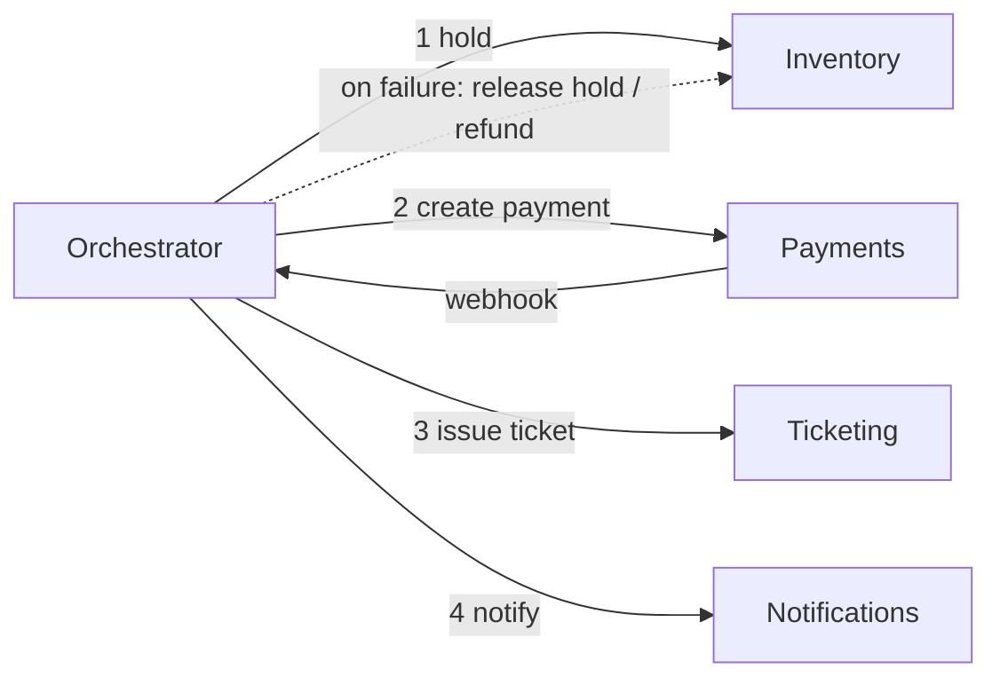

# MD-06 — Distributed Saga and Compensating State Machine

> [!abstract] What this is
> How to run one business operation that spans several services or databases (hold seat → charge → issue ticket → notify) without a distributed transaction. Each step is a local transaction; if a later step fails, earlier steps are undone by **compensating** actions, or the saga keeps retrying forward until it finishes.
>
> The defining decisions are **who drives the steps** (one orchestrator, or services reacting to each other's events), **which step is the point of no return** (after it, you only go forward), and **how each step's state change and its outgoing message are made atomic** (transactional outbox or CDC). Every step must be idempotent, because every step will be retried.

---

## 1. What It Solves and Where It Appears

- Two-phase commit across services is slow, blocks on a dead coordinator, and isn't available across a payment gateway, a bank, or a restaurant's tablet. So multi-step operations are modelled as a **state machine** whose transitions are local transactions plus messages.
- The interviewer's real questions: what happens if step 3 fails, if the same message arrives twice, if the orchestrator crashes halfway, and what the user sees in between.

| Problem | Steps | Point of no return |
|---|---|---|
| Seat Booking (#9) | hold seats → create payment → confirm on webhook → issue ticket → notify | Payment captured (then only forward: issue ticket, or refund as a forward action) |
| Payments (#6) | create intent → authorise → capture → settle → ledger | Capture |
| Food Delivery (#8) | place order → restaurant accepts → rider assigned → picked up → delivered | Restaurant starts cooking |
| Checkout (#10) | reserve stock → charge → create order → release cart | Charge succeeded |
| Flight + hotel bundle (#21) | hold flight → hold hotel → pay → ticket both | Ticketing |
| Agent that takes actions (#A5) | plan → approve → call tools → record | First irreversible tool call |

---

## 2. Knobs

| Knob | Options | What it trades |
|---|---|---|
| Coordination | orchestration, choreography | One place to see and change the flow vs no central component |
| Engine | state table + workers, Temporal/Cadence, Step Functions | Control and familiarity vs built-in timers, retries and history |
| Message emission | transactional outbox, CDC (Debezium), listen-to-yourself | Simplicity vs latency vs extra infrastructure |
| Retry policy per step | attempts, backoff, deadline | Recovery vs time the user waits |
| Step timeout | seconds → hours | Fast failure vs tolerating slow partners (bank callbacks) |
| Compensation style | undo, or forward-only correction (refund, credit note) | Clean rollback vs reality: money already moved can only be moved back |
| Isolation countermeasures | semantic lock (pending states), commutative updates, re-read | Users never see half-done states vs complexity |

---

## 3. Evolution of the Block

### Step 0 — Everything in one database transaction

- One service, one Postgres: hold, order and payment records commit together. The external payment call is outside the transaction by necessity.
- **Breaks when:** a step lives in another service or database, or calls a third party.

### Step 1 — Status column + webhook

- **Trigger:** the external step (payment) completes later, via webhook.
- **Change:** the booking row has a status (`held → payment_pending → confirmed / failed`). The webhook handler moves it forward with a guarded `UPDATE … WHERE status = 'payment_pending'`.

### Step 2 — Transactional outbox

- **Trigger:** a state change must also emit an event (to notify, to issue the ticket, to update search), and "write DB then publish" can lose the publish if the process dies in between.
- **Change:** in the **same** transaction as the state change, insert a row into an `outbox` table. A relay reads the outbox (polling or CDC) and publishes to Kafka, marking rows sent. Consumers deduplicate by event ID. Razorpay built a library for exactly this ("Outboxer").

### Step 3 — Orchestrator

- **Trigger:** more than two or three steps, compensations, timeouts and retries are spread across services and nobody can say what state an order is in.
- **Change:** one orchestrator owns the saga's state machine: it sends commands, waits for replies or timeouts, retries, and runs compensations in reverse order. Its state is durable (a `saga` table, or a workflow engine like Temporal that persists every step's history).

### Step 4 — Reconciliation

- **Trigger:** some outcomes are only known later (the bank confirms after the timeout; a webhook never arrives).
- **Change:** a reconciler polls the partner's status API for sagas stuck in pending states and drives them to a final state; a daily job compares your records with the partner's settlement file.



---

## 4. Core Mechanics

### Saga state table

```
sagas(
  id, type, business_key UNIQUE,         -- e.g. booking_id
  state,                                  -- HOLDING, AWAITING_PAYMENT, ISSUING, DONE, COMPENSATING, FAILED
  step, attempts, next_attempt_at,
  deadline_at, payload jsonb, version     -- version for optimistic updates
)
saga_steps(saga_id, step, status, request_id UNIQUE, result jsonb, updated_at)
outbox(id, aggregate_id, type, payload, created_at, sent_at NULL)
```

- Workers pick due sagas with `WHERE next_attempt_at <= now() … FOR UPDATE SKIP LOCKED`, execute the next step, and write the new state plus any outbox rows in one transaction.
- `request_id` per step is the idempotency key sent to the downstream service, so a retry never charges twice.

### Pivot step and compensations

- Steps before the **pivot** are compensatable (release hold, cancel payment intent).
- The pivot is the step after which undoing is impossible or wrong (money captured, food being cooked).
- Steps after the pivot are **retriable**: retry forward until they succeed, and if they truly can't, the "compensation" is a new forward business action (refund, voucher, manual queue), not an undo.

| Step | Compensation | Type |
|---|---|---|
| Hold seats | Release hold | Compensatable |
| Create payment intent | Cancel intent | Compensatable |
| **Capture payment** | — | **Pivot** |
| Issue ticket | Retry; if impossible → refund + apology | Retriable |
| Send notification | Retry; drop after N | Retriable, best-effort |

### Outbox relay

```
loop:
    rows = SELECT * FROM outbox WHERE sent_at IS NULL ORDER BY id LIMIT 500 FOR UPDATE SKIP LOCKED
    for r in rows: kafka.produce(topic(r.type), key=r.aggregate_id, value=r.payload, headers={event_id: r.id})
    UPDATE outbox SET sent_at = now() WHERE id IN rows
```

- Delivery is **at least once**: a crash after produce and before the update republishes. Consumers keep a `processed_events(event_id)` table (or a unique constraint on the effect) and skip duplicates.
- Key by `aggregate_id` so events for one booking stay in order within a Kafka partition.
- CDC alternative: Debezium tails the WAL and publishes outbox inserts, removing the polling relay.

### Isolation between concurrent sagas

- Sagas have no isolation: another request can see a booking that is half done.
- **Semantic lock:** visible pending states (`PAYMENT_PENDING`) that other operations respect ("you can't cancel while payment is pending; try again in a minute").
- **Commutative updates:** ledger entries instead of balance overwrites, so order doesn't matter.
- **Re-read before write:** check the current version before applying a step's result.

---

## 5. Decision Tables

### Orchestration vs choreography

| | Orchestration | Choreography |
|---|---|---|
| Flow visible in one place | Yes | No; spread across services |
| Adding a step | Change the orchestrator | Change several subscribers |
| Coupling | Orchestrator knows every participant | Services know event types only |
| Failure handling | Central timeouts and compensations | Each service must handle its part |
| Pick when | More than ~3 steps, compensations, deadlines, money | 2–3 steps, simple fan-out reactions (send email on order placed) |

### Engine

| Engine | Strength | Cost | Pick when |
|---|---|---|---|
| State table + workers + outbox | Familiar, inspectable with SQL | You build timers, retries, history | Few saga types, team owns Postgres well |
| Temporal / Cadence | Durable timers, retries, full history, code-as-workflow | Another cluster; workflow code must be deterministic | Many long-running flows, human waits, agent workflows |
| AWS Step Functions | Managed | Vendor lock-in, per-transition cost | AWS-native, moderate volume |

### Emitting events

| Option | Risk | Pick when |
|---|---|---|
| Write DB, then publish | Lost event on crash | Never for important events |
| Transactional outbox + relay | Seconds of delay | Default |
| CDC (Debezium) on outbox | More infrastructure | High volume; already running Kafka Connect |
| Publish, then consume your own event to write DB | DB lags the event | Event-sourced designs |

---

## 6. Numbers to Know

| Thing | Number |
|---|---|
| Outbox relay latency | tens of ms (CDC) to ~1 s (polling every 500 ms) |
| Payment confirmation | seconds normally; late authorisation can arrive after ~10 min timeouts, up to days of gateway polling |
| Step retry backoff | e.g. 1 s, 2 s, 4 s … capped at minutes, with jitter |
| Saga deadline for a booking | hold TTL + grace (~12 min) |
| Reconciliation | partner status polling every few minutes for pending sagas; settlement file T+1 |

---

## 7. Failure Modes

| Failure | What happens | Detect | Fix |
|---|---|---|---|
| Orchestrator crashes mid-saga | Saga stuck | Sagas past `next_attempt_at` or `deadline_at` | Durable state; another worker resumes; steps are idempotent |
| Duplicate message | Step runs twice (double charge, double ticket) | Duplicate effects | Idempotency key per step; dedup table on consumers |
| Compensation fails | Inventory stays held, money stays authorised | Sagas in COMPENSATING too long | Retry compensations forever with backoff; alert; manual queue |
| Webhook never arrives | Booking stuck in payment pending | Age of pending sagas | Poll the provider's status API; reconcile |
| Status polling floods the partner | Your reconciler becomes the outage. NPCI's root cause for the April 2025 UPI outage was banks flooding the "Check Transaction" API, some repeatedly for old transactions | Status-call rate per saga | Rate-limit status checks, first check only after a delay (NPCI now requires banks to wait 90 s), exponential backoff, a hard cap per transaction |
| Event published but DB rolled back | Downstream acts on something that didn't happen | Consumers can't find the record | Outbox in the same transaction (never publish before commit) |
| Out-of-order events | "Delivered" processed before "picked up" | State machine rejects transition | Key by aggregate for ordering; state machine ignores or parks invalid transitions |
| Users see half-done state | Confusing UI, double actions | Support tickets | Semantic locks and explicit pending states in the UI |

---

## 8. Twist Cards

- **"Payment succeeded but ticket issuing is down for an hour."**
    + Payment is the pivot, so go forward: the saga keeps retrying issuance with backoff while the user sees "confirmed, ticket on its way". If issuance can't succeed by a deadline, the forward compensation is a refund.
- **"Why not 2PC?"**
    + The payment gateway, bank and partner systems don't take part in your transaction, a dead coordinator blocks everyone holding locks, and locks would span seconds or minutes. Sagas trade isolation for availability, and you handle the visible pending states explicitly.
- **"Show the user exactly where their order is."**
    + The saga state machine *is* the status; expose it (with friendly names) and push changes over the realtime channel.
- **"Make it work across two regions."**
    + A saga instance has one home region (by business key); its state table lives there. Other regions forward commands to the owner instead of running a second copy.
- **"An AI agent performs a sequence of actions for the user."**
    + Same block: each tool call is a step with an idempotency key, risky steps need an approval step before the pivot, and the workflow engine persists progress so a crash doesn't repeat a payment.

---

## 9. Operations and Cost

- **Watch:** sagas by state and age, stuck-saga count (past deadline), compensation rate, retries per step, outbox backlog and relay lag, duplicate-event drops, reconciliation mismatches.
- **Operate:** a dashboard and admin actions for stuck sagas (retry, force-compensate, mark resolved) with an audit log; every manual action is itself idempotent.
- **Cost:** one or two extra writes per step (state and outbox), plus Kafka. Cheap compared with the cost of a lost confirmation or a double charge.

---

## 10. Say It in One Minute

> "I model the booking as a saga with an orchestrator and a durable state table. Each step is a local transaction that writes its new state and an outbox row together, so a crash can't lose the event, and the relay publishes at least once to Kafka keyed by booking ID. Every step carries an idempotency key, so retries are safe. Before payment capture, failures compensate in reverse: cancel the intent, release the hold. Capture is the pivot; after it I only go forward, retrying ticket issuance, and if that's impossible the compensation is a refund. Stuck sagas are found by deadline and pushed along by polling the payment provider's status API, with a daily reconciliation against the settlement file."

---

## Sources

- Razorpay Engineering, *Atomic Dual Writes Via Outboxer* (2021): transactional outbox with a task processor. https://engineering.razorpay.com/achieving-reliable-dual-writes-in-distributed-systems-cb9ff3b9bfc1
- Razorpay, *Payment Timeout vs Late Authorisation* (2026): late confirmations and webhooks with idempotency keys. https://razorpay.com/learn/payment-timeout/
- Times of India and Moneycontrol (April 2025), NPCI root cause of the UPI outage: flooding of the "Check Transaction" API with no limiter; Economic Times (April 2025): NPCI directs banks to delay check-transaction calls by 90 s. https://www.moneycontrol.com/technology/why-was-upi-down-for-a-few-hours-over-the-weekend-article-12995316.html · https://m.economictimes.indiatimes.com/tech/technology/limit-usage-of-non-financial-requests-to-upi-npci-to-banks/articleshow/120734859.cms
- Garcia-Molina and Salem, *Sagas* (SIGMOD 1987): the original definition with compensating transactions.
- DZone, *A Practical Guide to Temporal Workflow Design Patterns* (2026): saga compensation in reverse order with a workflow engine. https://dzone.com/articles/temporal-workflow-design-patterns
- Freysoft, *4 Reliability Patterns for Payment Corridors* (2026): idempotency, saga orchestration, observability, reconciliation. https://freysoft.com/blog/the-four-reliability-patterns-every-payment-corridor-needs-in-production/

## Related Notes

- [[12 - Mini Designs]]
- [[07 - Async Messaging]]
- [[14 - Coordination and Concurrency]]
- [[08 - Reliability]]
- [[07 - Wallet and Ledger]]
- [[MD-04 - High-Contention Reservation and TTL Lease Sweeper]]
- [[MD-20 - Partitioning Shard Keys and Resharding]]
