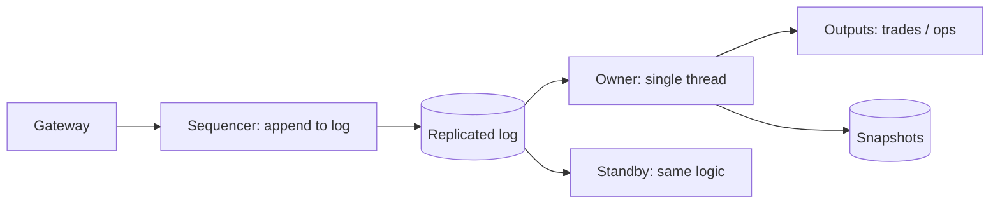

# MD-07 — Deterministic Single-Threaded Sequencer (LMAX / Actor Pattern)

> [!abstract] What this is
> Instead of letting many threads or servers fight over the same state with locks, give each partition of state (one stock symbol, one document, one leaderboard) **exactly one owner** that processes its commands **one at a time, in memory**. Commands are written to a replicated log first; because processing is deterministic, any replica that replays the same log reaches the same state.
>
> The defining decisions are **the partition key** (what must be strictly ordered together), **how the log is made durable and replicated** before acknowledging, and **how the owner fails over** without two owners existing at once.

---

## 1. What It Solves and Where It Appears

- Some state has a hot centre that everyone writes to and that must be strictly ordered: the order book for one stock, the text of one document, the score of one contest. Locks around it serialise everyone anyway, with extra overhead and deadlock risk.
- A single thread that owns the state in memory does the same serialisation without locks, and is extremely fast because it never waits. LMAX's business logic processor handled about 6 million orders per second on one thread. NSE reports order responses as low as 660 nanoseconds while handling roughly 2,200 crore orders in a six-hour trading day (about a million orders per second on average).

| Problem | Partition | Commands | Output |
|---|---|---|---|
| Stock Exchange (#30) | `symbol` | new order, cancel, modify | trades, book updates |
| Collaborative Editing (#29) | `doc_id` | operations (insert/delete at position) | transformed ops, new revision |
| Leaderboard / score updates (#20) | `contest_id` or `match_id` | score events | ranks |
| Auctions | `auction_id` | bids | winner, price updates |
| Per-user wallet at extreme rates | `account_id` | debits, credits | balances |
| Game servers | `room_id` | player inputs | state ticks |

---

## 2. Knobs

| Knob | Options | What it trades |
|---|---|---|
| Partition granularity | per entity, per group of entities | Parallelism vs cross-entity atomicity |
| Durability before ack | log replicated to quorum, local fsync, async | Latency vs data loss on crash |
| Batching | per command, micro-batches | Latency vs throughput |
| Snapshot interval | seconds → hours | Recovery time vs snapshot cost |
| Placement | static map, consistent hashing, coordinator-assigned with leases | Simplicity vs rebalancing |
| Failover | hot standby replaying the log, cold restart from snapshot | Recovery time vs cost |

---

## 3. Evolution of the Block

### Step 0 — Row locks in a database

- Each order updates book rows under `SELECT … FOR UPDATE`. Correct, but throughput on one symbol is limited by lock time, and latency is milliseconds.

### Step 1 — In-memory owner per partition

- **Trigger:** one partition's command rate exceeds what row locks allow, or latency must be microseconds to low milliseconds.
- **Change:** route all commands for a partition to one process that keeps the state in memory and processes commands sequentially from an inbound queue.

### Step 2 — Write-ahead log before processing

- **Trigger:** the process can crash; in-memory state must be recoverable.
- **Change:** each command is appended to a durable log (local journal plus replication, or a Kafka partition / Raft log) **before** it's processed. On restart, load the latest snapshot and replay the log after it.

### Step 3 — Hot standby replicas

- **Trigger:** recovery from snapshot + replay takes too long.
- **Change:** standbys consume the same log and apply the same deterministic logic, staying seconds or less behind. Failover promotes a standby with an epoch/fencing token so the old leader's outputs are rejected.

### Step 4 — Many partitions across many machines

- **Trigger:** thousands of symbols/documents/contests.
- **Change:** a placement service assigns partitions to processes with leases; a router (or the client library) sends each command to its owner. Hot partitions get dedicated cores.



---

## 4. Core Mechanics

### The loop

```
loop:
    cmd = inbound.next()                 # already durably logged, has sequence number
    assert cmd.seq == last_seq + 1
    events = apply(state, cmd)           # pure, deterministic: no clock reads, no randomness, no I/O
    last_seq = cmd.seq
    outbound.publish(events, seq=cmd.seq)
    if last_seq % SNAPSHOT_EVERY == 0: snapshot_async(state, last_seq)
```

- **Determinism rules:** the timestamp comes from the command (set by the sequencer when logged), never `now()` inside `apply`; no random numbers; no external calls. Anything external (risk checks, balance lookups) happens **before** the command is logged, or results come back as new commands.
- **Ring buffer:** the LMAX Disruptor is a pre-allocated ring buffer that lets the journaller, replicator and business logic read the same entries without locks or queue allocations, which is where most of the speed comes from.

### Exchange example: price-time priority

- Per symbol, two books (bids descending, asks ascending), each price level a FIFO queue of orders.
- A new buy at price P matches against the best asks ≤ P in time order, producing trades, and the remainder rests on the bid book.
- Every output event carries the input sequence number, so downstream (market data, clearing, ledger) can detect gaps and replay.

### Collaborative editing example: central OT sequencer

- Clients send operations tagged with the revision they were based on.
- The document's single owner transforms each incoming op against all ops accepted since that revision, assigns the next revision number, appends to the log, and broadcasts.
- Because one owner orders all ops for that document, every client converges. (CRDTs remove the central owner at the cost of larger metadata; see the Collaborative Editing problem.)

### Fencing the owner

- The owner holds a lease with an **epoch** number from the placement service (etcd/ZooKeeper).
- Every log append and every output carries the epoch; the log and downstream consumers reject lower epochs. A paused old owner that wakes up can't write.

---

## 5. Decision Tables

| Approach | Throughput on one hot partition | Latency | Pick when |
|---|---|---|---|
| DB row locks | Low (≈ 1 ÷ lock time) | ms | Low rates, simple domains |
| Optimistic concurrency + retry | Collapses under contention | ms | Rare conflicts |
| Single-threaded owner in memory | Millions/s | µs–ms | Hot, strictly ordered state |
| Actor framework (Akka, Orleans) | High | ms | Many small entities, framework handles placement |

| Log | Pick when |
|---|---|
| Custom journal + replication (LMAX style) | Ultra-low latency trading |
| Raft log (embedded, e.g. via etcd/raft) | Strong durability with automatic leader election |
| Kafka partition per group of entities | Millisecond latency is fine; reuse existing infra |

---

## 6. Numbers to Know

| Thing | Number |
|---|---|
| LMAX single-thread business logic | ~6M orders/s (2011) |
| NSE | order response as low as 660 ns; ~2,200 crore orders in a six-hour day (2026) |
| Single-thread budget at 1M commands/s | 1 µs per command: no allocation, no I/O, no locks |
| Replication to a quorum in one data centre | tens to hundreds of µs on fast networks; ~1 ms on cloud |
| Recovery | snapshot load + replay; keep replay to seconds with frequent snapshots |

---

## 7. Failure Modes

| Failure | What happens | Detect | Fix |
|---|---|---|---|
| Non-determinism (clock, random, map iteration order) | Replicas diverge | State hash comparison between primary and standby | Timestamps from the log; deterministic data structures; periodic state hash checks |
| Owner pauses (GC), standby takes over, old owner resumes | Two owners | Epoch mismatch | Fencing by epoch on log and outputs |
| One hot partition | One core saturated | Per-partition queue depth | Dedicated core; split the partition if semantics allow (rarely for an order book) |
| Slow downstream consumer | Back-pressure into the owner | Outbound buffer depth | Decouple outputs through the log; consumers replay at their own pace |
| Log replication slow | Latency spikes | Append latency | Batch appends; keep replicas close |
| Bug in `apply` | Corrupt state replicated everywhere | Invariant checks | Validate invariants after each command; replay from log into fixed code |

---

## 8. Twist Cards

- **"Why not just use a database with row locks for the order book?"**
    + Every order on a liquid symbol touches the same few price levels; locks serialise them anyway, with network round trips and lock overhead per order. One in-memory owner does the same ordering at microsecond cost and replays from its log after a crash.
- **"The matching engine crashes mid-day."**
    + The standby, already replaying the log, is promoted with a higher epoch; clients reconnect; output consumers dedupe by sequence number.
- **"Cross-symbol orders (a pair trade) must be atomic."**
    + Either put both symbols in one partition (losing parallelism) or treat it as a two-step saga with risk of partial fill, and say which the business accepts.
- **"Thousands of documents are being edited at once."**
    + Thousands of owners spread across processes by a placement service; each document has one. Idle documents are unloaded and reloaded from snapshot + log.

---

## 9. Operations and Cost

- **Watch:** per-partition command rate, queue depth, apply latency percentiles, log append latency, standby lag (sequence number difference), snapshot duration, state hash mismatches.
- **Cost:** few machines for enormous throughput; the cost is engineering discipline (determinism, no allocation on the hot path) and memory for state.

---

## 10. Say It in One Minute

> "For state that must be strictly ordered and is hot, like one symbol's order book or one document, I give each partition a single owner thread with the state in memory. Every command is appended to a replicated log first and gets a sequence number, then applied deterministically, using only the log's timestamp, no I/O. A standby replays the same log, so failover is promoting it with a higher epoch that fences the old owner. That's how LMAX did 6 million orders per second on one thread, and it's why exchanges like NSE answer in nanoseconds instead of locking rows."

---

## Sources

- Martin Fowler, *The LMAX Architecture* (2011): business logic processor at 6M orders/s on one thread, in-memory with event sourcing. https://www.martinfowler.com/articles/lmax.html
- LMAX Disruptor technical paper and user guide: ring buffer, ~3 orders of magnitude lower latency than queues in a three-stage pipeline. https://lmax-exchange.github.io/disruptor/disruptor.html
- ET BFSI (2026): NSE order processing as low as 660 ns, nearly 2,200 crore orders in six trading hours. https://bfsi.economictimes.indiatimes.com/news/articles/nse-achieves-660-nanoseconds-order-processing-time-amid-rising-cyber-threats/131372632
- Economic Times (2026): NSE nanosecond-level acknowledgements from April 2026, down from ~100 µs. https://m.economictimes.indiatimes.com/markets/stocks/news/nse-rolls-out-nanosecond-level-acknowledgement-for-market-orders-from-april-11/articleshow/130170308.cms

## Related Notes

- [[12 - Mini Designs]]
- [[17 - Consistency Time and Consensus]]
- [[14 - Coordination and Concurrency]]
- [[MD-05 - Immutable Double-Entry Ledger and Reconciliation Loop]]
- [[MD-15 - Partitioned Append-Only Log and LSM Storage Engine]]
- [[11 - Collaborative Workspace]]
