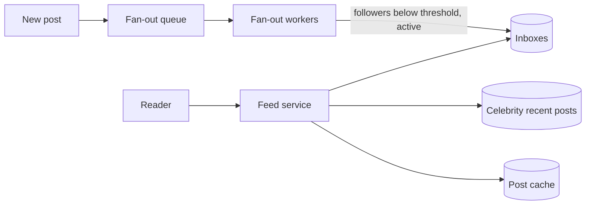

# MD-08 — Hybrid Fan-Out and Celebrity Graph Dispatcher

> [!abstract] What this is
> How one event (a post, a message to a group, an activity on an issue) reaches everyone who should see it. **Fan-out on write (push):** copy a lightweight pointer into each recipient's inbox when the event happens, so reads are one lookup. **Fan-out on read (pull):** store the event once and merge it into each reader's view when they read. Real systems mix them: push for normal senders, pull for **celebrities** whose follower count would make a push explode.
>
> The defining decisions are the **celebrity threshold**, **what goes into an inbox** (IDs only, never full content), and **how inboxes are bounded and rebuilt**.

---

## 1. What It Solves and Where It Appears

- A user with 200 followers posts: push 200 IDs, done. A cricketer with 200 million followers posts: pushing 200M inbox writes takes minutes and costs a fortune, and most of those followers won't open the app today.
- Reading by pulling from everyone you follow is cheap to write but slow to read: a user following 1,000 accounts would merge 1,000 lists on every refresh.
- The hybrid takes the cheap side of each.

| Problem | Sender | Recipients | Mix |
|---|---|---|---|
| News Feed (#5) | Any user | Followers | Push below threshold, pull for celebrities, merge at read |
| Instagram (#18) | Creators | Followers | Same, plus ranking |
| Group Chat (#4) | Member | Group members (≤ few thousand) | Push to each member's inbox; huge channels become pull |
| Notifications (#3) | Event source | Users who subscribed | Push into a notification inbox |
| Activity streams (#35 Jira) | Issue change | Watchers, project followers | Push for watchers; pull for project-level feed |

---

## 2. Knobs

| Knob | Range | What it trades |
|---|---|---|
| Celebrity threshold | 10k–1M followers | Write amplification vs read-time merge cost |
| Inbox length | 200–1,000 IDs | Memory vs how far back a user scrolls before falling back to pull |
| Inbox entry | `(post_id, author_id, ts)` | Small entries keep inboxes in RAM |
| Active-user filter | push only to users active in last N days | Large savings vs slower first load for returning users |
| Fan-out workers | count, batch size | Delivery delay vs cost |
| Ranking | chronological, ranked at read | Simplicity vs engagement |

---

## 3. Evolution of the Block

### Step 0 — Pull with a query

- `SELECT … FROM posts WHERE author_id IN (followees) ORDER BY created_at DESC LIMIT 50`. Correct and fine for small graphs. Slow at hundreds of followees and millions of reads.

### Step 1 — Push into per-user inboxes

- **Trigger:** feed reads in the thousands per second; the query is too slow.
- **Change:** on post, a fan-out worker reads the author's followers and appends the post ID into each follower's inbox (a Redis list or sorted set, trimmed to N). Reading the feed = read the inbox + batch-fetch post bodies from cache.

### Step 2 — Celebrity cut-over

- **Trigger:** a post from an account with millions of followers takes minutes to fan out and swamps the workers.
- **Change:** accounts above the threshold are **not pushed**. At read time, the feed service fetches the reader's inbox **and** the recent posts of the celebrities they follow (a small list per celebrity, heavily cached), merges by time or score, and returns.

### Step 3 — Active-only push and rebuild

- **Trigger:** most followers are inactive; pushing to them wastes work and memory.
- **Change:** push only to followers active in the last ~30 days. When an inactive user returns, rebuild their inbox by pull, then keep it warm.

### Step 4 — Ranking and mixing

- **Trigger:** product wants a ranked feed and injected content (ads, suggestions).
- **Change:** candidate generation (inbox + celebrity pulls + recommendations) → feature fetch → ranking model → mix. The fan-out machinery becomes candidate generation.



---

## 4. Core Mechanics

### Write path

```
on_post(author, post_id, ts):
    store post (source of truth)
    if follower_count(author) >= THRESHOLD:
        ZADD celeb_posts:{author} ts post_id ; trim to 200
        return
    enqueue fanout(author, post_id, ts)

fanout worker:
    for batch in followers(author, active_only=True, batch=1000):
        pipeline: for f in batch: ZADD inbox:{f} ts post_id ; ZREMRANGEBYRANK inbox:{f} 0 -(N+1)
```

### Read path

```
feed(user, cursor):
    ids  = ZREVRANGEBYSCORE inbox:{user} cursor -inf LIMIT 50
    for c in celebrities_followed(user):               # usually few dozen
        ids += ZREVRANGEBYSCORE celeb_posts:{c} cursor -inf LIMIT 20
    ids = top 50 by ts (or rank)
    posts = MGET post:{id} for ids (cache, then DB)
    filter deleted / blocked / private
```

- Inboxes hold **IDs only**. Edits and deletes then only touch the post itself; readers filter deleted IDs at read.
- **Unfollow** removes future pushes immediately; existing inbox entries are filtered at read time (cheaper than deleting from every inbox).

### Sizing

```
Inbox memory = active users × N entries × ~20 bytes
             = 100M × 500 × 20 B ≈ 1 TB of Redis   → trim N, active-only, or compact encoding
Fan-out work = posts/s × avg followers (below threshold)
             = 5k/s × 300 = 1.5M inbox writes/s    → pipelined Redis writes, many workers
```

---

## 5. Decision Tables

| Strategy | Write cost | Read cost | Pick when |
|---|---|---|---|
| Pull only | 1 write | Merge many lists per read | Few followees, low read rate |
| Push only | followers writes | 1 inbox read | No accounts with huge followings |
| Hybrid (push + celebrity pull) | Bounded | Inbox + a few celebrity lists | Social feeds at scale (default) |
| Push to active users only | Much lower | Rebuild on return | Most followers inactive |

| Inbox store | Pick when |
|---|---|
| Redis sorted set / list | Hot inboxes, fast reads |
| Cassandra wide row per user | Larger history, cheaper per GB |
| No inbox, ranking service pulls candidates | Fully ranked, recommendation-driven feeds |

---

## 6. Numbers to Know

| Thing | Number |
|---|---|
| Typical celebrity threshold | ~10k–100k followers (systems pick by write budget) |
| Inbox length | a few hundred to ~1,000 IDs |
| Inbox entry | ~16–24 bytes (ID + score) |
| Fan-out delay target | seconds for normal users |
| Feed read target | p99 ~100–200 ms including post hydration |

---

## 7. Failure Modes

| Failure | What happens | Detect | Fix |
|---|---|---|---|
| Celebrity misclassified as normal | Fan-out queue floods | Queue lag after one post | Threshold check before enqueue; cap fan-out per post |
| Fan-out backlog | Posts appear minutes late | Queue lag | More workers, batch writes, push to active only |
| Inbox memory blow-up | Redis evictions, empty feeds | Memory and eviction metrics | Trim N, active-only push, move cold inboxes to Cassandra |
| Deleted or blocked content shown | Policy breach | Reports | Filter at read time against post status and block lists |
| Celebrity list hot key | One Redis shard overloaded | Per-key QPS | L1 cache and replication ([[MD-11 - Multi-Tier Hot-Key Shield]]) |
| Returning user sees empty feed | Bad first impression | Feed length on open | Rebuild by pull on first open |

---

## 8. Twist Cards

- **"A cricketer with 250M followers posts during the final."**
    + Not pushed. Their recent posts sit in one small list, cached in every feed pod; every follower's read merges it in.
- **"Group chat with 100,000 members."**
    + That's a channel, not a group: store messages once per channel and let members pull (with a realtime topic for online members, [[MD-01 - Stateful Connection and Realtime Push Mesh]]).
- **"Users want an exact chronological feed."**
    + Merge by timestamp; the hybrid still works because the celebrity lists are time-ordered too.
- **"Someone unfollows; the posts must disappear now."**
    + Filter by the current follow graph at read time; don't scrub inboxes.
- **"Cut infra cost."**
    + Push only to recently active users, shorten inboxes, and move cold inboxes to cheaper storage.

---

## 9. Operations and Cost

- **Watch:** fan-out queue lag, inbox writes per second, posts above threshold, feed read latency, hydration cache hit rate, inbox memory.
- **Cost:** inbox memory and fan-out compute grow with followers × posts. The threshold and the active-user filter are the main cost dials.

---

## 10. Say It in One Minute

> "Posts are stored once; inboxes hold only IDs. Normal authors are pushed: a fan-out worker appends the post ID to each active follower's Redis inbox, trimmed to a few hundred. Authors above a follower threshold are never pushed; their recent posts sit in one cached list that each reader merges in at read time. Unfollows and deletes are filtered on read, inactive users get their inbox rebuilt by pull when they return, and the threshold and active-only filter are the knobs that cap write amplification."

---

## Sources

- *Twitter's Fanout Strategy at Scale: The Trade-Off Most Designs Miss* (dev.to, 2026): hybrid push for normal users, pull for celebrities, merge at the edge. https://dev.to/gabrielanhaia/twitters-fanout-strategy-at-scale-the-trade-off-most-designs-miss-55oa
- *Write-Time vs Read-Time Fan-Out* (Abstract Algorithms, 2026): threshold-based hybrid. https://abstractalgorithms.hashnode.dev/write-time-vs-read-time-fan-out
- KodeKloud, *Design a Home Feed for Instagram* (2026): progressive versions from pull to hybrid. https://notes.kodekloud.com/docs/DevOps-Interview-Questions-and-Answers-Scenario-Based-Prep/System-Design/Design-a-Home-Feed-For-Instagram/page

## Related Notes

- [[12 - Mini Designs]]
- [[06 - Caching]]
- [[MD-01 - Stateful Connection and Realtime Push Mesh]]
- [[MD-09 - Multi-Lane Priority Queue Retry and Vendor Failover Hub]]
- [[MD-11 - Multi-Tier Hot-Key Shield]]
- [[MD-20 - Partitioning Shard Keys and Resharding]]
