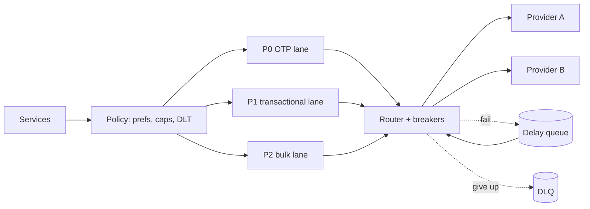

# MD-09 — Multi-Lane Priority Queue, Retry and Vendor Failover Hub

> [!abstract] What this is
> How to send work to external providers you don't control (SMS gateways, push services, email, webhooks to merchants, LLM APIs) so that urgent work is never stuck behind bulk work, failures are retried without hammering anyone, and a dying provider is replaced automatically.
>
> The defining decisions are **lane isolation** (OTPs never share a queue or worker pool with marketing), **retry semantics** (delay queues with backoff, a dead-letter queue, idempotent sends), and **provider routing** (health-based failover per message, with a deadline after which a second channel takes over).

---

## 1. What It Solves and Where It Appears

- An OTP that arrives after 2 minutes is useless; a marketing SMS that arrives after 2 hours is fine. If both sit in one queue, a 10M-message campaign delays every OTP behind it.
- External providers fail partially and silently: an SMS gateway accepts the message and the operator drops it; a merchant's webhook endpoint is down for an hour. Retrying blindly makes things worse.
- Indian scale is large: Meesho's internal communication platform sends over **10 billion messages a day** for 100+ campaign creators and 20+ services. Every commercial SMS in India must also follow TRAI's DLT rules (registered sender headers and templates).

| Problem | Lanes | Providers |
|---|---|---|
| Notification System (#3) | P0 OTP / security, P1 transactional (order, payment), P2 bulk marketing | SMS gateways, FCM/APNs, email, WhatsApp |
| Webhook delivery (#6 Payments) | Per-merchant queues | Merchant HTTP endpoints |
| LLM chatbot (#A1), AI gateway (#A7) | Interactive vs batch | Multiple LLM providers / models |
| Food delivery (#8) | Rider assignment pings vs promo | Push, SMS fallback |

---

## 2. Knobs

| Knob | Options | What it trades |
|---|---|---|
| Lanes | 2–4 priority classes | Isolation vs operational overhead |
| Worker pools | per lane, per provider | Bulkheads vs utilisation |
| Retry schedule | fixed, exponential with jitter, capped | Recovery speed vs load on a struggling provider |
| Retry window | seconds (OTP) → 24 h (webhooks) | Delivery chance vs staleness |
| Deadline per message | per type | When to stop or switch channel |
| Provider routing | static weights, health-based, cost-based | Reliability vs cost |
| Dedup | message idempotency key | Prevents double OTPs on failover |
| Rate limits per provider | TPS caps | Avoids provider throttling and bans |

---

## 3. Evolution of the Block

### Step 0 — Send inline

- The API calls the SMS provider synchronously. Simple; any provider slowness becomes your latency, and a failure is lost.

### Step 1 — Queue + workers

- **Trigger:** provider latency in the request path; need to retry.
- **Change:** write a `message` row and enqueue; workers send; failures retry a few times.

### Step 2 — Lanes and bulkheads

- **Trigger:** a campaign delays OTPs.
- **Change:** separate queues (or Kafka topics) and **separate worker pools** per lane. P0 has reserved capacity and the lowest latency; P2 is rate-limited and paused under load.

### Step 3 — Delay queues and DLQ

- **Trigger:** retries in a tight loop hammer failing providers or merchant endpoints.
- **Change:** a failed send is scheduled for later (a delay queue: Redis sorted set by `next_attempt_at`, SQS delay, or a Kafka retry topic per delay tier), with exponential backoff and jitter. After the last attempt, it goes to a **dead-letter queue** with the error, for replay after a fix.

### Step 4 — Provider failover and circuit breakers

- **Trigger:** one SMS gateway degrades (high latency, low delivery reports).
- **Change:** track per-provider success rate and latency (including **delivery reports**, not just "accepted"); a circuit breaker removes a sick provider; routing sends to the next healthy one. **Per-message deadlines** decide when to try another provider or channel (OTP: a few seconds without a delivery report → resend via a second route or WhatsApp/voice), with dedup so the user doesn't get two different OTPs.

### Step 5 — Preferences, quiet hours and caps

- **Trigger:** users get spammed; regulations and app-store policies.
- **Change:** a policy layer before the lanes: user channel preferences, DND and quiet hours for marketing, frequency caps per user per day, template and DLT checks.



---

## 4. Core Mechanics

### Message record

```
messages(id, idempotency_key UNIQUE, user_id, lane, channel, template_id, params,
         status,            -- queued | sent | delivered | failed | expired
         attempts, next_attempt_at, deadline_at, provider, provider_msg_id, created_at)
```

- The idempotency key comes from the producer (e.g. `otp:{login_attempt_id}`), so a retried API call doesn't send twice.
- Status is updated by provider callbacks (delivery reports) and by the router.

### Retry with backoff and jitter

```
delay = min(cap, base * 2^attempt) * random(0.5, 1.5)
OTP lane:       base 1 s, cap 5 s,  deadline ~30 s, then switch channel
Transactional:  base 10 s, cap 10 min, deadline hours
Webhooks:       base 30 s, cap 1 h,  window 24 h (Razorpay retries for 24 h, then disables the endpoint)
```

- Retry only what can succeed later: timeouts, 5xx, 429 (honour `Retry-After`). Never retry 4xx validation errors.

### Circuit breaker per provider

```
closed    → errors or missing delivery reports above threshold in a window → open
open      → send nothing for cool-down (e.g. 30 s) → half-open
half-open → let a few through; success → closed; failure → open
```

### Webhooks to many merchants

- One slow merchant must not block others: per-merchant queues (or per-merchant concurrency limits on a shared pool), each with its own backoff.
- Sign every payload (HMAC with the merchant's secret) and include an event ID so merchants dedupe.
- After the retry window, disable the endpoint and let merchants **replay** missed events from a dashboard or API.

---

## 5. Decision Tables

| Queue | Strength | Pick when |
|---|---|---|
| Kafka topics per lane + retry topics per delay tier | Very high throughput, replay | Billions of messages a day |
| SQS / RabbitMQ with delay | Per-message delays and DLQ built in | Moderate volume, simpler ops |
| Redis sorted set by `next_attempt_at` | Precise delays, simple | Retry scheduling layer on top of any queue |

| Failover trigger | Pick when |
|---|---|
| Synchronous error or timeout | Always |
| No delivery report within the message's window | OTPs and critical alerts (accepted ≠ delivered) |
| Provider success-rate drop over a window | Route-level health |

---

## 6. Numbers to Know

| Thing | Number |
|---|---|
| Meesho's messaging platform | 10B+ messages/day |
| Indian SMS OTP cost | roughly ₹0.10–0.45 per delivered OTP (2026, DLT routes) |
| OTP useful life | ~30–120 s; failover window seconds |
| Webhook retry window | 24 h with exponential backoff at Razorpay |
| Push (FCM/APNs) | cheapest channel; no guarantee when the app is killed |

---

## 7. Failure Modes

| Failure | What happens | Detect | Fix |
|---|---|---|---|
| Bulk floods shared queue | OTP delays, failed logins | P0 latency | Separate lanes and worker pools; reserved capacity |
| Provider accepts but doesn't deliver | Silent OTP loss | Delivery-report rate per provider | Deadline-based resend via another route; breaker on DR rate |
| Retry storm on a down provider | Provider bans you, recovery slower | Retry rate | Backoff with jitter, breakers, per-provider TPS caps |
| Duplicate sends on failover | Two OTPs, confusion | Duplicate idempotency keys | Same OTP value on resend; dedup by key |
| Poison message | Worker crashes repeatedly | Same message failing | Max attempts → DLQ |
| One merchant endpoint slow | Webhooks to everyone delayed | Per-merchant latency | Per-merchant queues and concurrency limits |
| DLT template mismatch | SMS blocked by operator | Operator rejection codes | Validate template and header before enqueue |

---

## 8. Twist Cards

- **"OTPs must arrive within 10 seconds, always."**
    + Dedicated lane and workers, two SMS providers on different operator routes, resend via the other route if no delivery report in ~5–10 s, then WhatsApp or voice; same OTP value throughout.
- **"Send a festival campaign to 50 million users without hurting anything else."**
    + P2 lane with its own rate limit, spread over hours, respecting quiet hours, frequency caps and DND; pauses automatically if P0/P1 latency rises.
- **"Our LLM provider is rate-limiting us."**
    + Same block: per-provider token budgets, a second provider or smaller model as fallback for interactive traffic, batch work deferred to off-peak.
- **"A merchant was down for two days and missed webhooks."**
    + Retries stopped after 24 h and the endpoint was disabled; the merchant replays from the event log using event IDs to dedupe.

---

## 9. Operations and Cost

- **Watch:** queue depth and age per lane, send latency per lane, delivery rate per provider and channel, breaker state, retry and DLQ volume, cost per delivered message.
- **Cost:** SMS dominates; push and email are near free. Route by cost for non-urgent lanes, by reliability for OTPs, and prefer push or WhatsApp where users allow it.

---

## 10. Say It in One Minute

> "Every message gets an idempotency key and a lane. OTPs, transactional and bulk each have their own queue and worker pool, so a campaign can never delay an OTP. Failures go to a delay queue with exponential backoff and jitter, then to a DLQ after the window. A router tracks each provider's delivery reports, not just accepts, with a circuit breaker, and for OTPs a missing delivery report within a few seconds triggers a resend on another route with the same code. A policy layer in front applies preferences, caps, quiet hours and DLT template checks."

---

## Sources

- Meesho Engineering, *How Meesho Powers 10B+ Messages Daily with Multi-Tenancy*. https://www.meesho.io/blog/scaling-seamless-communication-how-meesho-powers-10b-messages-daily-with-multi-tenancy
- Razorpay docs, *Webhooks best practices* and *Replay webhook events*: exponential backoff for 24 h, then disabled; replay of missed events. https://razorpay.com/docs/webhooks/best-practices · https://razorpay.com/docs/webhooks/replay-events
- Fyno, *Delivery Failure Detection and Automatic Rerouting for Banks* (2026): per-message wait windows, reroute with duplicate checks. https://www.fyno.io/blog/delivery-failure-detection-automatic-rerouting/
- Message Central, *SMS OTP Pricing in India 2026* and *India SMS Regulations, DLT* (2026). https://messagecentral.com/blog/sms-otp-pricing-india
- Stripe, *Scaling your API with rate limiters* (2017), for load shedding by priority. https://stripe.com/blog/rate-limiters

## Related Notes

- [[12 - Mini Designs]]
- [[07 - Async Messaging]]
- [[08 - Reliability]]
- [[MD-02 - Traffic Shaper Rate Limiter and Waiting Room]]
- [[MD-06 - Distributed Saga and Compensating State Machine]]
- [[MD-10 - Partitioned Time-Bucket Job Scheduler and Leased Worker Pool]]
