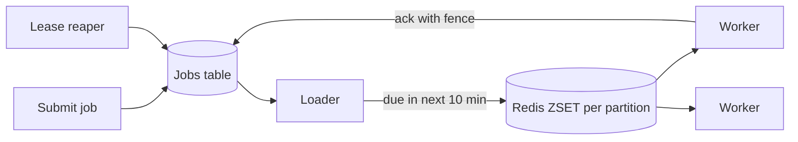
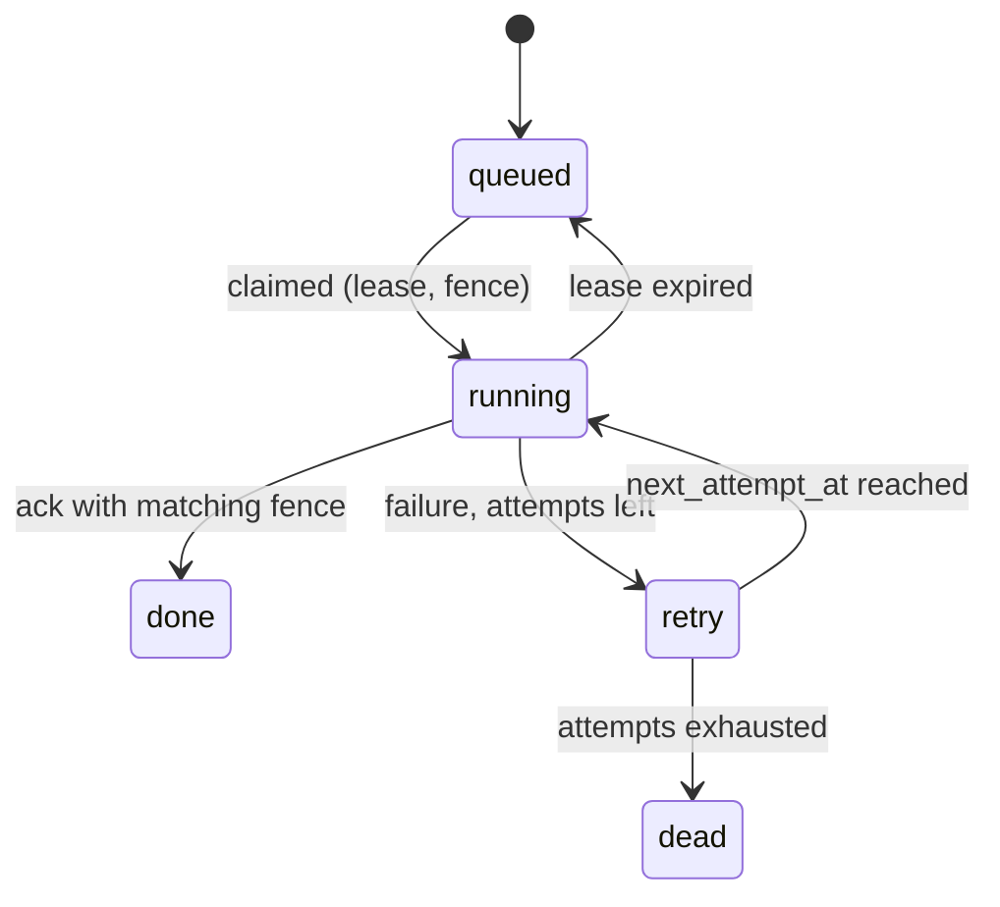

# MD-10 — Partitioned Time-Bucket Job Scheduler and Leased Worker Pool

> [!abstract] What this is
> How to run work at a future time (or on a schedule) across many machines so that every job runs, runs roughly on time, and doesn't run twice in a harmful way: jobs stored durably with a `run_at`, a **hot window** of near-due jobs kept in a fast structure (Redis sorted set or a time wheel), workers that **claim** jobs with a lease (`SKIP LOCKED`, visibility timeouts), and **fencing tokens** so a worker that lost its lease can't still commit results.
>
> The defining decisions are **how jobs are claimed** (so two workers never both think they own one), **what happens when a worker dies mid-job** (lease expiry and re-run, so jobs must be idempotent), and **how far ahead jobs are loaded into the hot tier**.

---

## 1. What It Solves and Where It Appears

- `cron` on one box runs everything twice when you add a second box, and nothing when that box dies.
- Distributed scheduling is at-least-once by nature: a worker can die after doing the work and before recording it. Exactly-once *effects* come from idempotent jobs, not from the scheduler.
- Razorpay asked SDE-2 candidates in 2026 for a job queue where producers submit and workers pull; Amazon's LLD/HLD loop has a delayed job scheduler with a status state machine.

| Problem | Jobs | Special need |
|---|---|---|
| Distributed Job Scheduler (#19) | Arbitrary delayed and recurring jobs | The whole problem |
| Scheduled rides (#7) | Dispatch at pickup time − N minutes | Precise timing |
| Web Crawler frontier (#17) | Fetch URL when its host is allowed again | Per-domain politeness |
| Workflow automation (#35 Jira) | Rules that fire at times ("remind in 2 days") | Many tenants |
| Payments | Retry failed payouts, expire holds, reconciliation runs | Idempotency |
| Notifications | Send at 9 am local time | Time zones, quiet hours |

---

## 2. Knobs

| Knob | Options | What it trades |
|---|---|---|
| Claim mechanism | `FOR UPDATE SKIP LOCKED`, Redis `ZPOPMIN`/Lua, SQS visibility timeout | Simplicity vs throughput |
| Lease duration | seconds → minutes | Fast recovery vs false expiry on slow jobs (heartbeat to extend) |
| Hot window | next 1–60 min loaded into Redis | Memory vs DB polling |
| Bucket size | 1 s → 1 min | Timing precision vs number of buckets |
| Partitions | by job ID hash, by tenant | Parallelism vs fairness |
| Retry policy | per job type | Recovery vs load |
| Concurrency limits | per tenant, per job type, per external domain | Fairness and politeness vs throughput |
| Missed-run policy | run once, run all missed, skip | Correctness for recurring jobs after downtime |

---

## 3. Evolution of the Block

### Step 0 — Jobs table + `SKIP LOCKED`

- `jobs(id, run_at, status, …)` with an index on `(status, run_at)`. Workers poll for due jobs with `FOR UPDATE SKIP LOCKED`, mark them running, and commit. Handles thousands of jobs per second on one Postgres. This is the right V0.

### Step 1 — Leases and heartbeats

- **Trigger:** workers die mid-job; jobs stay "running" forever.
- **Change:** claiming sets `lease_until = now() + 60 s` and `lease_owner`; long jobs heartbeat to extend. A job whose lease expired is claimable again.

### Step 2 — Fencing

- **Trigger:** a paused worker (GC, network) resumes after its lease expired and another worker took the job; both write results.
- **Change:** each claim increments `fence` on the job; the worker passes the fence to every side effect (DB writes check `WHERE fence = :mine`; downstream services reject lower fences).

### Step 3 — Hot tier for precise timing

- **Trigger:** millions of future jobs; polling the DB every second for "due now" is wasteful, and precision must be ~1 s.
- **Change:** a loader moves jobs due in the next N minutes from the DB into a Redis sorted set (score = `run_at`) or an in-memory **time wheel** per partition; workers pop due jobs atomically. The DB remains the source of truth; the hot tier is rebuilt from it after a crash.

### Step 4 — Partitioning and fairness

- **Trigger:** one tenant schedules 10M jobs and starves everyone; one Redis set becomes a hot key.
- **Change:** partition jobs (hash of job ID into K partitions, each with its own sorted set and loader); per-tenant concurrency limits; per-domain rate queues for crawlers.

### Step 5 — Recurring jobs and workflows

- **Trigger:** cron-style schedules, multi-step jobs.
- **Change:** a schedule table generates the next occurrence when the current one is claimed (never pre-generate years of rows); multi-step jobs become workflows ([[MD-06 - Distributed Saga and Compensating State Machine]]).



---

## 4. Core Mechanics

### Claim with `SKIP LOCKED`

```sql
WITH due AS (
  SELECT id FROM jobs
  WHERE status IN ('queued','retry') AND run_at <= now()
  ORDER BY run_at
  LIMIT 100
  FOR UPDATE SKIP LOCKED
)
UPDATE jobs j
SET status = 'running', lease_owner = :worker, lease_until = now() + interval '60 seconds',
    fence = fence + 1, attempts = attempts + 1
FROM due WHERE j.id = due.id
RETURNING j.id, j.fence, j.payload;
```

- Workers never wait on each other: rows locked by one worker are skipped by others.
- A reaper (or the same query with `OR (status='running' AND lease_until < now())`) reclaims expired leases.

### Hot tier pop (Redis Lua, atomic)

```lua
-- KEYS[1] = due:{partition}; ARGV[1] = now_ms; ARGV[2] = batch
local ids = redis.call('ZRANGEBYSCORE', KEYS[1], '-inf', ARGV[1], 'LIMIT', 0, ARGV[2])
for _, id in ipairs(ids) do redis.call('ZREM', KEYS[1], id) end
return ids
```

- The worker then claims each ID in the DB (status + lease + fence). If Redis loses the set, the loader rebuilds it from the DB.

### Time wheel

- An array of slots (e.g. 3,600 one-second slots); each slot holds the jobs due in that second; a pointer advances every second. Jobs further out than one rotation sit in the DB (or a coarser wheel). Kafka uses hierarchical timing wheels internally for delayed operations.

### Politeness queues (crawler)

- One queue per host; each host has `next_allowed_at`. The scheduler only pops from hosts whose `next_allowed_at ≤ now` and sets it forward by the crawl delay.

### Job states



---

## 5. Decision Tables

| Approach | Throughput | Precision | Pick when |
|---|---|---|---|
| Postgres + `SKIP LOCKED` | Thousands/s | ~1 s polling | Default; jobs and business data in one DB |
| DB + Redis hot tier | Tens of thousands/s | ~100 ms | Millions of future jobs, precise timing |
| SQS with delay + visibility timeout | High | Delay up to 15 min | AWS, short delays |
| Kafka + retry topics per delay tier | Very high | Coarse (tier size) | Huge volume retries, not precise timers |
| Temporal / workflow engine | High | ~1 s | Durable timers inside multi-step workflows |

---

## 6. Numbers to Know

| Thing | Number |
|---|---|
| `SKIP LOCKED` claim throughput | thousands of jobs/s on one Postgres with batching |
| Lease | 30–120 s with heartbeats every lease/3 |
| Hot window | 5–60 min of upcoming jobs |
| Redis sorted set | millions of members per set fine; partition to avoid one hot key |
| 10M jobs/day | ~115/s average; peaks at round times (9:00, midnight) can be 50–100× |

---

## 7. Failure Modes

| Failure | What happens | Detect | Fix |
|---|---|---|---|
| Worker dies mid-job | Job stuck in running | Expired leases | Reaper re-queues; job must be idempotent |
| Zombie worker | Two results committed | Fence mismatch | Fencing token on every side effect |
| Thundering herd at :00 | Everyone schedules "midnight" | Spikes at round times | Jitter schedule times; spread with priority |
| Hot tier lost | Due jobs not popped | Due-but-not-claimed count | Rebuild from DB; DB polling as backstop |
| One tenant floods | Others delayed | Per-tenant queue share | Per-tenant concurrency caps and fair scheduling |
| Recurring job missed during downtime | Reports not generated | Last-run vs schedule | Explicit missed-run policy per schedule |
| Poison job | Infinite retries | Attempts count | Max attempts → dead state, alert |

---

## 8. Twist Cards

- **"Guarantee each job runs exactly once."**
    + The scheduler gives at-least-once with leases. Exactly-once effects come from the job: idempotency keys on side effects and fence checks on writes.
- **"Run 100M reminders at 9 am IST tomorrow."**
    + Spread them over a window with jitter, partition by user, and rate-limit downstream channels ([[MD-09 - Multi-Lane Priority Queue Retry and Vendor Failover Hub]]).
- **"Cancel a scheduled job."**
    + Mark cancelled in the DB and remove from the hot tier; workers re-check status when claiming.
- **"Jobs must survive the scheduler service being down for an hour."**
    + They're in the DB; on recovery the loader catches up and due jobs run late. Missed-run policy decides about recurring ones.

---

## 9. Operations and Cost

- **Watch:** due-but-unclaimed jobs, scheduling lag (start time − `run_at`), lease expiries, retries and dead jobs per type, per-tenant backlog, hot-tier size.
- **Cost:** small; the expensive part is workers sitting idle for peaks. Spread peaks with jitter instead of provisioning for them.

---

## 10. Say It in One Minute

> "Jobs live in Postgres with `run_at` and a status. Workers claim batches with `FOR UPDATE SKIP LOCKED`, which sets a lease and bumps a fencing token; long jobs heartbeat. Expired leases are reclaimed, so it's at-least-once, and every job is idempotent and passes its fence to side effects so a zombie worker can't commit. For millions of future jobs, a loader moves the next few minutes into partitioned Redis sorted sets for precise pops, rebuilt from the DB if lost. Per-tenant caps keep it fair, and round-time spikes get jitter."

---

## Sources

- Redis docs, *Redis job queue* (2026), and antirez, *Delayed Queue Pattern*: sorted sets by execution time. https://redis.io/docs/latest/develop/use-cases/job-queue/ · https://redis.antirez.com/fundamental/delayed-queue.html
- OneUptime, *How to Build a Distributed Task Scheduler with Redis* (2026). https://oneuptime.com/blog/post/2026-03-31-redis-distributed-task-scheduler/view
- *Designing an SQS-like Queue with Redis Sorted Sets* (2025): visibility timeouts and DLQs. https://apoorvashettigar.substack.com/i/165169955/recreating-sqs-features-visibility-timeout-and-dead-letter-queues
- Interview reports summarised in [[Interview Question Priority]] and the LLD catalog (Razorpay SDE-2 job queue, Amazon delayed job scheduler).

## Related Notes

- [[12 - Mini Designs]]
- [[02 - Task Scheduler]]
- [[14 - Coordination and Concurrency]]
- [[MD-06 - Distributed Saga and Compensating State Machine]]
- [[MD-09 - Multi-Lane Priority Queue Retry and Vendor Failover Hub]]
