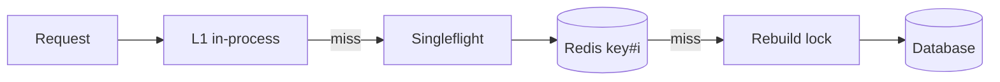

# MD-11 — Multi-Tier Hot-Key Shield (L1 + Singleflight + Key Salting)

> [!abstract] What this is
> What protects a cache shard and the database behind it when a huge share of traffic hits **one key**: a viral short link, the live score of an IPL final, the product page in a Big Billion Day deal, a celebrity profile.
>
> Normal scaling doesn't help, because one key lives on one shard no matter how many shards you add. The shield is four layers: a tiny **in-process L1 cache** with a 1–2 s TTL, **request coalescing** so a miss triggers one rebuild instead of thousands, **early or logical expiry** so a hot key never expires under load, and **key splitting** so one hot key becomes N keys on N shards.

---

## 1. What It Solves and Where It Appears

- Redis Cluster and every sharded store place a key on exactly one shard. If that key gets 300k reads/s and one shard handles ~100k simple ops/s, adding shards changes nothing.
- Two separate hot-key failures:
    + **Hot read:** too many reads on one key (shard CPU, network on one node).
    + **Stampede:** the hot key expires or is invalidated, and every concurrent request misses at once and hits the database together.
- A third, **hot write** (a counter everyone increments), needs write splitting rather than caching.

| Problem | Hot key | Layers used |
|---|---|---|
| URL Shortener | A viral code shared on WhatsApp | L1 cache, coalescing, replicated hot key; edge caching of the redirect |
| Seat Booking / Flash sale | The show or SKU everyone is viewing | L1 for the seat-map read model, coalescing; write path stays on the DB |
| News Feed / Instagram | Celebrity profile and posts | L1 + replicas of the key |
| Live scores, leaderboard | One match's score | L1 with 1 s TTL, push instead of pull |
| Distributed Cache (#14) | Any skewed workload | All layers plus hot-key detection |
| Like / view counters | One post's counter | Write splitting (`counter:{id}:{0..N}`) |

---

## 2. Knobs

| Knob | Range | What it trades |
|---|---|---|
| L1 TTL | 100 ms – 5 s | Staleness vs offload. 1 s on a key read 100k times/s across 100 pods turns 100k Redis reads/s into ~100. |
| L1 size | hundreds to thousands of entries | Memory per pod vs coverage of the hot set |
| Coalescing scope | per process, per cluster (Redis lock) | Simplicity vs one rebuild globally |
| Lock TTL for rebuild | 1–5 s | Too short: two rebuilders; too long: stall if the rebuilder dies |
| Early-expiry β (XFetch) | ~1 | Higher refreshes earlier and more often |
| Replica count for a hot key | 2–32 | Read spread vs invalidation fan-out |
| Counter split factor | 8–256 | Write spread vs read cost (sum N keys) |

---

## 3. Evolution of the Block

### Step 0 — Plain cache-aside

- Redis in front of the DB, TTL on every key ([[MD-19 - Baseline Scaling Path]]). Works until one key dominates.

### Step 1 — TTL jitter and request coalescing

- **Trigger:** periodic DB spikes when popular keys expire.
- **Change:** add random jitter to TTLs; coalesce misses so only one request per key rebuilds (per process with singleflight, across the cluster with a short Redis lock).

### Step 2 — Never let a hot key expire under load

- **Trigger:** even one rebuild is slow (an expensive query), or the lock holder sometimes dies.
- **Change:** probabilistic early refresh (XFetch) or logical expiry: store `value + soft_expiry`, serve the stale value while one background request refreshes.

### Step 3 — In-process L1 cache

- **Trigger:** one key's read rate approaches a shard's limit, or network to that one shard saturates.
- **Change:** each app pod keeps a tiny LRU of the hottest keys with a 1–2 s TTL. Redis sees roughly one read per pod per second for that key.

### Step 4 — Replicate the hot key, split hot counters

- **Trigger:** L1 isn't enough (too many pods, or the key must be fresher than the L1 TTL allows), or the hot key is a write.
- **Change:**
    + Reads: store copies as `key#0 … key#N-1` (they land on different shards); readers pick one at random; writers update or delete all N.
    + Writes: split counters into N sub-counters, increment a random one, and sum on read (or roll them up periodically).

### Step 5 — Detect hot keys automatically

- **Trigger:** you can't predict which key will go viral.
- **Change:** sample key accesses in the client or proxy, keep a Count-Min Sketch or top-K, and automatically promote keys above a threshold into L1 and key replication. The top-K technique itself is in [[MD-14 - Streaming Window Watermark and Top-K Pipeline]].



---

## 4. Core Mechanics

### Singleflight (per process)

```
inflight = {}                          # key -> future

get(key):
    if v := l1.get(key): return v
    if key in inflight: return inflight[key].wait()
    f = inflight[key] = Future()
    try:
        v = redis_or_db(key)
        l1.set(key, v, ttl=1s)
        f.resolve(v); return v
    finally:
        del inflight[key]
```

- With 200 pods, a miss storm becomes at most 200 rebuilds instead of 200,000.

### Cluster-wide coalescing with a Redis lock

```
v, soft_exp = redis.GET(key)
if v and now < soft_exp: return v
if redis.SET("lock:"+key, token, NX, PX=3000):        # one winner
    v = db.load(key)
    redis.SET(key, (v, now + ttl), EX=ttl*3)            # hard TTL well past soft
    redis.DEL_IF_TOKEN("lock:"+key, token)
    return v
return v if v else wait_and_retry()                     # losers serve stale
```

- This is the same idea as Facebook's memcache **leases**: the cache hands one client a token to refill a key and makes the others wait briefly or take the stale value.

### XFetch (probabilistic early expiration)

```
# delta = how long the last rebuild took; beta ≈ 1
if now - delta * beta * ln(random()) >= expiry:
    rebuild()
```

- `ln(random())` is negative, so the left side is "now plus a random head start". Requests close to expiry are more likely to rebuild, and the most likely outcome is that exactly one rebuild happens shortly before expiry.

### Key replication for reads

```
write(key, v):  for i in 0..N-1: redis.SET(f"{key}#{i}", v, EX=ttl)
read(key):      redis.GET(f"{key}#{rand(0, N-1)}")
```

- Only do this for keys detected as hot. Invalidation now costs N deletes.

### Counter splitting

```
incr(post):  redis.INCR(f"likes:{post}:{rand(0, 63)}")
read(post):  sum(redis.MGET(f"likes:{post}:{i}" for i in 0..63))   # cache the sum for 1 s
```

---

## 5. Decision Tables

| Problem | Technique | Cost | Pick when |
|---|---|---|---|
| Synchronized expiry of many keys | TTL jitter | None | Always |
| Stampede on one key | Singleflight + Redis lock | Waiters add latency | Rebuild is expensive |
| Rebuild too slow to wait for | Logical expiry / stale-while-revalidate | Serves stale briefly | Staleness of seconds is fine |
| Avoid any miss on hot keys | XFetch / refresh-ahead | Extra rebuilds | A few known hot keys |
| One key too hot for its shard | L1 in-process cache | Staleness up to L1 TTL, memory | Reads tolerate ~1 s staleness |
| Hot key that must be fresh | Replicate key N ways | N× write/invalidate | Freshness matters and L1 is too stale |
| Hot counter | Split into N sub-counters | Sum on read | Likes, views, stock reservations counted approximately |
| Public, identical response | CDN / edge cache | Purge delay | Response is the same for everyone |

---

## 6. Numbers to Know

| Thing | Number |
|---|---|
| One Redis shard | ~100k+ simple ops/s; network on one node can saturate first with large values |
| L1 offload math | reads to Redis ≈ pods ÷ L1 TTL. 300 pods, 1 s TTL → 300 reads/s for that key |
| Rebuild lock TTL | a few × the normal rebuild time (e.g. 3 s for a 500 ms query) |
| Hot-key threshold to promote | e.g. > 1–5% of a shard's capacity on one key |

---

## 7. Failure Modes

| Failure | What happens | Detect | Fix |
|---|---|---|---|
| Stampede on expiry | DB spike, timeouts, cascading failure | DB QPS spikes aligned with TTLs | Coalescing, logical expiry, jitter |
| Rebuild-lock holder dies | Everyone waits until the lock TTL | Lock wait time | Short lock TTL, serve stale while waiting |
| L1 serves stale after a write | User sees old data for up to L1 TTL | — | Keep L1 TTL small; only L1-cache data that tolerates it; pub/sub invalidation for critical keys |
| Hot shard network saturation | Latency for every key on that shard | Per-shard network and CPU skew | L1 + key replication; smaller values |
| Missed hot key | A new viral key melts a shard before anyone notices | Per-key sampling | Automatic detection and promotion |
| Write splitting read cost | Summing 64 keys per read | Read latency on counters | Cache the sum for 1 s or roll up asynchronously |

---

## 8. Twist Cards

- **"One short link was just shared by a celebrity; it's 50% of traffic."**
    + Edge-cache the 302 for a few seconds if analytics can come from logs, L1 in every redirect pod, and replicate the key across shards. The DB never sees it.
- **"Score updates every ball; 20 million people are watching."**
    + Don't let 20M clients pull. Push via a realtime fan-out, and for anyone who pulls, an L1 TTL of 1 s plus a CDN with 1 s TTL means the origin sees almost nothing.
- **"The key expired and the database fell over."**
    + That's a stampede. Coalesce rebuilds, keep a soft expiry so stale is served while one refresh runs, and add jitter.
- **"Your L1 means users see stale data."**
    + Bounded by the L1 TTL (1 s). For data that can't be stale (balances, seat holds) the L1 is not used; those reads go to the source of truth.
- **"How do you know which key is hot?"**
    + Sample accesses in the client library, keep a heavy-hitters sketch per pod, aggregate, and promote keys over a threshold.

---

## 9. Operations and Cost

- **Watch:** per-shard ops and network (skew), per-key top-K, cache hit rate per tier (L1, Redis), rebuild-lock wait time, DB QPS caused by misses.
- **Cost:** L1 is free in memory terms; key replication multiplies memory only for the few hot keys; edge caching is the cheapest offload of all when responses are public.

---

## 10. Say It in One Minute

> "A hot key lives on one shard, so more shards don't help. I layer it: a 1-second in-process cache in every pod, so Redis sees one read per pod per second; singleflight plus a short Redis lock, so a miss causes one rebuild instead of thousands; a soft expiry, so the hot key is refreshed early and stale is served during the refresh; and if it's still too hot or must be fresh, N copies on N shards. Hot counters get split into sub-counters and summed. Hot keys are detected by sampling, not guessed."

---

## Sources

- Nishtala et al., *Scaling Memcache at Facebook* (NSDI 2013): leases to stop stampedes and stale sets.
- Vattani, Chierichetti, Lowenstein, *Optimal Probabilistic Cache Stampede Prevention* (VLDB 2015): the XFetch rule.
- Codemia, *Cache Stampede: When TTL Expiry Becomes a Self-Inflicted DDoS* (2026): `SET NX PX` lock-and-populate. https://codemia.io/archive/cache-stampede-protection
- Cache Stampede Lab: plain TTL vs single-flight vs lease vs XFetch vs stale-while-revalidate, run side by side. https://cache-stampede-lab.johanthegoat.xyz/
- JioHotstar peak-concurrency coverage (59M during the 2023 World Cup final; 65.2M later) for the live-score style hot key. https://mojoauth.com/blog/ott-session-management-millions-concurrent-viewers

## Related Notes

- [[12 - Mini Designs]]
- [[06 - Caching]]
- [[21 - Redis]]
- [[MD-19 - Baseline Scaling Path]]
- [[MD-14 - Streaming Window Watermark and Top-K Pipeline]]
- [[MD-20 - Partitioning Shard Keys and Resharding]]
