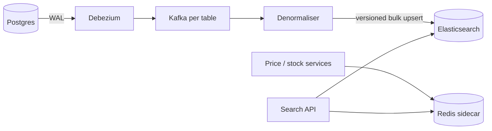

# MD-12 — CDC-to-Inverted-Index and Real-Time Sidecar Merger

> [!abstract] What this is
> How to keep a search index (Elasticsearch/OpenSearch) in step with the database that owns the data, without dual writes: changes are captured from the database log (**CDC**, e.g. Debezium → Kafka), a **denormaliser** builds search documents, and the index is updated with versioned upserts. Fields that change every few seconds (price, stock, ETA, availability) are **not** re-indexed on every change; they live in a fast **sidecar** store (Redis) and are joined in at query time.
>
> The defining decisions are **what goes into the index vs the sidecar** (slow-changing, searchable text and facets vs fast-changing numbers), **how ordering is guaranteed** (versions from the source), and **how to rebuild the index from scratch** without downtime (aliases).

---

## 1. What It Solves and Where It Appears

- Writing to Postgres and then to Elasticsearch from the app (dual write) loses or reorders updates whenever one write fails or two requests race.
- Re-indexing a big product document every time its price or stock changes overloads the cluster during a sale; each update is a full delete-and-reinsert inside Lucene, even with the partial-update API.
- Elasticsearch is **near real time**: by default it refreshes about once a second, so a change becomes searchable within roughly a second after indexing.

| Problem | Indexed (slow) | Sidecar (fast) |
|---|---|---|
| Product Search and Catalog (#12) | title, brand, category, attributes, ratings | price, stock per warehouse/pincode, offers |
| Typeahead (#11) | suggestion strings, popularity buckets | trending boost |
| Proximity / restaurant search (#16) | name, cuisine, geo point | open/closed, ETA, rush status |
| Jira issue search (#35) | text, labels, fields | status, assignee (often indexed, but permission filtering at query) |
| Hybrid RAG search (#A2) | chunks, embeddings, metadata | document ACLs (filter), freshness |

---

## 2. Knobs

| Knob | Options | What it trades |
|---|---|---|
| Capture | CDC from WAL, outbox + CDC, app events | Completeness and ordering vs schema coupling |
| Denormalisation | in a stream job, in a service that reads the DB | Speed vs simplicity |
| Refresh interval | 1 s → 30 s | Freshness vs indexing throughput |
| Field placement | index vs sidecar | Filter/sort capability vs update cost |
| Versioning | external version from source LSN / `updated_at` | Correct ordering vs complexity |
| Shards and replicas | per index | Write throughput vs query fan-out and cost |
| Reindex strategy | alias swap, in-place | Zero downtime vs simplicity |

---

## 3. Evolution of the Block

### Step 0 — Postgres full-text search

- `tsvector` + GIN index. Fine for small catalogs and simple ranking. Outgrown by facets, typo tolerance, relevance tuning and query volume.

### Step 1 — Elasticsearch fed by app dual-write

- Works in demos; drops or reorders updates in production. Mention only to reject it.

### Step 2 — CDC pipeline

- **Trigger:** search must reflect DB changes within seconds, reliably.
- **Change:** Debezium tails the Postgres WAL → Kafka topics per table (keyed by entity ID, so per-entity order holds) → a denormaliser joins related rows into one document → bulk upserts into Elasticsearch with an **external version** so an older change can never overwrite a newer one.

### Step 3 — Sidecar for fast-changing fields

- **Trigger:** price/stock changes thousands of times per second during a sale; re-indexing documents for each change saturates the cluster.
- **Change:** keep fast fields in Redis (`price:{sku}`, `stock:{sku}:{pincode}`). Query flow: Elasticsearch returns top N candidates by relevance with coarse filters → the service fetches live price/stock for those N from Redis → filters out-of-stock, re-sorts if needed, returns the page.
- Index only a **coarse** version of the fast field if filtering on it is needed (e.g. `in_stock_somewhere: true`, price bucket), updated rarely.

### Step 4 — Zero-downtime rebuilds

- **Trigger:** a mapping change or analyser change needs a full reindex.
- **Change:** build `products_v2` from a snapshot plus the CDC stream from the snapshot's position, catch up, then atomically switch the alias `products` → `products_v2`.



---

## 4. Core Mechanics

### Versioned upsert

```
PUT products/_doc/{sku}?version={source_version}&version_type=external
```

- `source_version` = the row's `updated_at` in microseconds, or the WAL LSN of the change. Elasticsearch rejects writes with a version ≤ the stored one, so replays and out-of-order deliveries are harmless.

### Denormalisation

- A product document needs rows from `products`, `brands`, `categories`, `attributes`, `ratings`. When a brand name changes, every product of that brand must be re-indexed: the denormaliser looks up affected product IDs and enqueues them. Prefer **fan-out bounded by design** (don't put data in the document that changes for millions of products at once unless you can afford the reindex).

### Query with sidecar merge

```
candidates = ES.search(query, filters=coarse, size=200)        # relevance + facets
live = REDIS.MGET(price:{sku}, stock:{sku}:{pincode} for sku in candidates)
results = [c for c in candidates if live.stock > 0]
results.sort(by=sort_key(live))                                # if user sorted by price
return results[:page_size]
```

- Ask Elasticsearch for more candidates than the page (e.g. 200 for a page of 20) so filtering by live stock still fills the page.
- Facet counts from Elasticsearch are approximate with respect to live stock; say so.

### Index sizing

- Shard size around tens of GB is a common target; too many small shards waste memory, too few large ones slow recovery.
- Replicas add query capacity and availability; writes go to every replica.

---

## 5. Decision Tables

| Field | Index | Sidecar | Pick when |
|---|---|---|---|
| Title, description, brand, category | Yes | — | Searched and faceted, changes rarely |
| Rating, popularity score | Yes (updated hourly/daily) | — | Used for ranking, slow changing |
| Price | Coarse bucket only | Exact | Changes often; exact value shown and sorted |
| Stock | `in_stock` flag only | Exact per location | Changes constantly |
| Permissions (ACL) | Group IDs on doc for filtering | Check on result | Security trimming |

| Capture method | Pick when |
|---|---|
| Debezium CDC on tables | Existing schema, need everything |
| Outbox table + CDC | You want explicit, versioned domain events |
| App publishes events | No CDC available; accept outbox discipline |

---

## 6. Numbers to Know

| Thing | Number |
|---|---|
| Elasticsearch default refresh | ~1 s (near real time) |
| CDC end-to-end lag | typically sub-second to a few seconds |
| Bulk indexing | thousands to tens of thousands of docs/s per node, depending on doc size and mappings |
| Target shard size | ~10–50 GB |
| Candidate over-fetch | 5–10× page size when filtering by live data |

---

## 7. Failure Modes

| Failure | What happens | Detect | Fix |
|---|---|---|---|
| Out-of-order updates | Old data overwrites new | Version conflicts (rejections) are the fix working | External versioning |
| CDC connector stalls | Search goes stale | Consumer lag, replication slot growth | Alert on lag; restart; Postgres slot size limits |
| Replication slot grows unbounded | Primary disk fills | Slot lag bytes | Monitor; drop and resnapshot if a consumer is gone |
| Denormalisation fan-out storm | A brand rename reindexes millions | Reindex queue size | Throttle; keep such fields out of documents |
| Sidecar down | No live price/stock | Redis errors | Fall back to indexed coarse values with "price may vary"; fail closed on checkout |
| Mapping change needs reindex | Downtime if in place | — | Alias swap with dual consumption during catch-up |
| Search shows items the user can't access | Data leak | Audit | Filter by ACL at query and re-check on results |

---

## 8. Twist Cards

- **"Prices change every few seconds during Big Billion Days."**
    + Price lives in the sidecar; the index holds only a price bucket. Search returns candidates, the service joins live price and stock, and checkout always re-reads the source of truth.
- **"Show only items deliverable to my pincode."**
    + Serviceability is a fast field per pincode/warehouse; filter candidates through the sidecar, or index a coarse `serviceable_zones` list if it changes slowly.
- **"Search must reflect a new listing within 2 seconds."**
    + CDC lag plus the 1 s refresh fits; for the seller's own view, read from the DB right after their write (read-your-writes).
- **"Rebuild the index with a new analyser without downtime."**
    + New index from a snapshot, replay CDC from the snapshot position, then swap the alias.

---

## 9. Operations and Cost

- **Watch:** CDC lag, replication slot size, indexing rate and rejections, search p99, refresh time, cluster heap and disk, sidecar hit rate.
- **Cost:** Elasticsearch clusters are memory and disk heavy; keep fast-changing data out of them, size shards sensibly, and use hot/warm tiers for older data.

---

## 10. Say It in One Minute

> "The database is the source of truth. Debezium streams its WAL into Kafka keyed by entity, a denormaliser builds documents, and they're bulk-upserted into Elasticsearch with the source version as an external version, so replays and reordering can't overwrite newer data. Fields that change every few seconds, price and stock per pincode, stay in Redis; search fetches candidates from Elasticsearch, joins live values, filters and re-sorts. Mapping changes are rebuilt into a new index and switched with an alias."

---

## Sources

- Elastic docs, *Near real-time search*: refresh roughly every second. https://www.elastic.co/docs/manage-data/data-store/near-real-time-search
- Elastic docs, *Update API*: partial documents are merged, the document is still reindexed. https://www.elastic.co/docs/api/doc/elasticsearch/operation/operation-update
- Debezium blog, *Materializing Aggregate Views With Hibernate and Debezium*: CDC into search indexes. https://debezium.io/blog/2018/09/20/materializing-aggregate-views-with-hibernate-and-debezium/
- Streamkap, *PostgreSQL to Elasticsearch: Real-Time Search Index Sync* (2026). https://streamkap.com/resources-and-guides/postgresql-to-elasticsearch-cdc
- Flipkart's near-real-time data store for price and inventory changes, as summarised in *Node Coordination System by Flipkart* (2024). https://vivekbansal.substack.com/p/system-design-study-node-coordination

## Related Notes

- [[12 - Mini Designs]]
- [[22 - Elasticsearch]]
- [[09 - Storage Search and Geo]]
- [[07 - Async Messaging]]
- [[MD-11 - Multi-Tier Hot-Key Shield]]
- [[MD-17 - ReBAC Authorisation Graph and Consistent Cache]]
