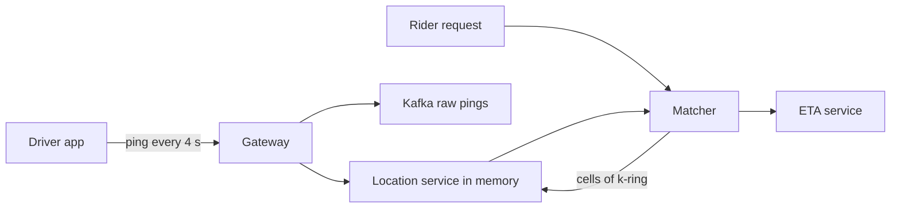

# MD-13 — Spatial Cell Indexing and Moving-Entity Trajectory Engine

> [!abstract] What this is
> How to answer "what is near this point?" and "which zone is this point in?" fast, for things that don't move (restaurants, stores) and things that move every few seconds (drivers, riders). The world is cut into **cells** (geohash rectangles, Uber's H3 hexagons, S2 cells, or an adaptive quadtree); each entity is indexed by its cell; a search looks at the cell of the query point and its neighbours (a **k-ring**), then filters by exact distance or by polygon.
>
> The defining decisions are **static vs moving entities** (a slow-changing index vs an in-memory index rewritten every few seconds), **cell size** (small enough to keep candidate lists short, big enough that a search touches few cells), and **what to do with hot cells** (a stadium after a match, a mall at 9 pm).

---

## 1. What It Solves and Where It Appears

- A database scan computing distance to every driver is impossible at scale. A B-tree on latitude and longitude separately can't answer a 2D radius query well.
- Cells turn a 2D problem into key lookups: "drivers in these 7 cell IDs".
- Uber built H3, a hexagonal hierarchical grid, for pricing and dispatch. H3 has 16 resolutions, from continent-sized cells down to under a square metre.

| Problem | Entities | Query |
|---|---|---|
| Ride Hailing (#7) | Drivers (moving, pings every ~4 s) | Nearest available drivers to a pickup |
| Food Delivery (#8) | Riders (moving), restaurants (static) | Riders near a restaurant; restaurants that deliver to me |
| Proximity Search (#16) | Restaurants, stores | Within radius, ranked |
| Surge Pricing (#28) | Demand and supply per cell | Ratio per cell per minute |
| Maps / ETA (#31) | Road graph, traffic per segment | Routes and ETAs |
| Quick commerce | Dark stores, service polygons | Which store serves this address |

---

## 2. Knobs

| Knob | Options | What it trades |
|---|---|---|
| Grid | geohash, H3, S2, quadtree | Simplicity vs uniform neighbours vs adaptive density |
| Resolution | H3 res 7–9 for city dispatch | Candidate count per cell vs cells per query |
| Search radius | k-ring of 1, 2, 3 | Recall vs work |
| Ping interval | 2–10 s | Freshness vs write load and battery |
| Index store | Redis (GEO or sets per cell), in-memory service, PostGIS | Write rate vs query richness |
| Staleness cutoff | drop entities not seen for 30–60 s | Ghost drivers vs flapping |
| Zone model | polygons, cell sets | Exact boundaries vs fast lookup |

---

## 3. Evolution of the Block

### Step 0 — PostGIS for static entities

- Restaurants in Postgres with PostGIS and a GiST index; `ST_DWithin(location, point, radius)`. Fine for static data and moderate QPS.

### Step 1 — Cell IDs as keys

- **Trigger:** high query rate or moving entities.
- **Change:** compute the cell ID of each entity (geohash prefix or H3 index at a chosen resolution); store `cell → set of entity IDs`. A query computes the query cell and its neighbours and unions their sets, then filters by exact distance.

### Step 2 — In-memory index for moving entities

- **Trigger:** 1M drivers pinging every 4 s = 250k location writes/s; a database can't take it and doesn't need to.
- **Change:** an in-memory location service (sharded by city/region) holds `driver → (lat, lng, cell, status, ts)` and `cell → drivers`. Each ping moves the driver between cell sets if the cell changed. Raw pings go to Kafka for history/ETA training; only the latest position is kept hot.

### Step 3 — Zones and polygons

- **Trigger:** serviceability ("does this store deliver here?"), surge zones, airport queues.
- **Change:** precompute each polygon as a set of covering cells (H3 `polyfill`); lookup is "cell of the address ∈ zone cells", with an exact point-in-polygon check only for boundary cells.

### Step 4 — Hot cells

- **Trigger:** one cell has thousands of entities (a stadium exit) or receives a flood of searches.
- **Change:** use a finer resolution there (hierarchical grids make this natural: H3 children, quadtree split when a node exceeds N entities), cap candidates returned per cell, and cache search results for a second.



---

## 4. Core Mechanics

### Grid comparison

| Grid | Shape | Neighbours | Notes |
|---|---|---|---|
| Geohash | Rectangles, base32 prefix | 8, unequal distances; boundary problems across prefixes | Easy; works in any KV store with prefix scans |
| H3 | Hexagons (+12 pentagons per resolution) | 6, all equidistant | Uniform k-rings; good for aggregation like surge |
| S2 | Quadrilaterals on a cube | Variable | Used by Google; good for region coverings |
| Quadtree | Adaptive squares | Variable | Splits dense areas; in-memory |

- H3 approximate sizes: resolution 7 ≈ 5 km² per cell (edge ~1.2 km), resolution 8 ≈ 0.7 km² (edge ~0.46 km), resolution 9 ≈ 0.1 km² (edge ~0.17 km). City dispatch typically searches resolution 8–9 cells with a k-ring of 1–2.

### Nearest available drivers

```
cells = k_ring(h3(pickup, res=9), k=1)          # 7 cells
cands = union(drivers_in(c) for c in cells if status == available and age < 30 s)
if len(cands) < 5: cells = k_ring(..., k=2)     # widen: 19 cells
rank by ETA (road distance via routing), not straight-line distance
offer to best with a lease (MD-04 driver lock)
```

### Location update

```
on_ping(driver, lat, lng, ts):
    if ts <= last_ts[driver]: drop                 # out-of-order ping
    new_cell = h3(lat, lng, 9)
    if new_cell != cell[driver]: move driver between cell sets
    position[driver] = (lat, lng, ts)
```

- Redis GEO (`GEOADD`, `GEOSEARCH`) is a geohash-on-sorted-set implementation that works well up to large scale per city shard.

### Trajectory and ETA

- Pings stream to Kafka → map-matching (snap to roads) → per-road-segment speeds per time window ([[MD-14 - Streaming Window Watermark and Top-K Pipeline]]) → routing engine with live edge weights → ETAs.

---

## 5. Decision Tables

| Store | Pick when |
|---|---|
| PostGIS | Static entities, rich polygon queries, moderate QPS |
| Redis GEO / sets per cell | Moving entities per city, high write rate |
| Custom in-memory service | Very high rate, custom matching logic, sharded by city |
| Elasticsearch `geo_point` | Static entities combined with text search and filters |

| Need | Grid | Pick when |
|---|---|---|
| Simple nearby search | Geohash | Fast to build, KV-friendly |
| Aggregation per area (surge, heatmaps) | H3 | Equal-area-ish cells and uniform neighbours |
| Dense, uneven areas | Quadtree / multi-resolution H3 | Stadiums, CBDs |

---

## 6. Numbers to Know

| Thing | Number |
|---|---|
| H3 resolutions | 16 (0–15), from ~4.3M km² down to under 1 m² |
| H3 res 8 / 9 | edge ~0.46 km / ~0.17 km |
| Pings | 1M active drivers × 1 per 4 s = 250k writes/s |
| Ping payload | ~50–100 bytes → 250k/s ≈ 25 MB/s |
| Stale cutoff | 30–60 s without a ping → treat as offline |

---

## 7. Failure Modes

| Failure | What happens | Detect | Fix |
|---|---|---|---|
| Boundary miss | Nearby entity in a neighbour cell not found | Recall tests | Always search the k-ring, not just the centre cell |
| Ghost drivers | Offered rides never accepted | Offer timeouts | Stale cutoff by last ping; heartbeat status |
| Hot cell | Huge candidate lists, slow matching | Per-cell counts | Finer resolution there; cap per cell |
| Location service node down | A city can't match | Health per shard | Replica per city shard; drivers re-ping and rebuild state in seconds |
| GPS jitter | Driver flips between cells; jumpy map | Cell changes per minute | Smooth positions; hysteresis on cell moves |
| Polygon edge cases | Address wrongly unserviceable | Support tickets | Exact point-in-polygon on boundary cells |

---

## 8. Twist Cards

- **"10,000 people leave a stadium and request cabs at once."**
    + Finer cells around the venue, batch matching every few seconds instead of greedy per request, a pickup-zone queue, and surge computed per cell.
- **"Which dark store serves this address in 10 minutes?"**
    + Store polygons precomputed into H3 cell sets; address → cell → store (with load-based fallback to a neighbour store).
- **"Show the rider moving smoothly on the customer's map."**
    + Coalesce and push the latest position every few seconds ([[MD-01 - Stateful Connection and Realtime Push Mesh]]); the client interpolates between points.
- **"Nearest by road, not by air."**
    + Cells only produce candidates; rank them by ETA from the routing service.

---

## 9. Operations and Cost

- **Watch:** ping ingest rate and lag per city, stale-entity count, matching latency, candidates per search, hot-cell counts, ETA error vs actual.
- **Cost:** memory for the live index (small: one position per entity), Kafka for raw pings, and the routing/ETA compute, which dominates.

---

## 10. Say It in One Minute

> "I cut the city into H3 cells at around resolution 9. Static places live in PostGIS or Elasticsearch with geo points. Drivers ping every four seconds into an in-memory location service sharded by city, which keeps only the latest position and moves each driver between cell sets; raw pings go to Kafka for ETA training. A search takes the pickup cell's k-ring, unions available drivers seen in the last 30 seconds, widens the ring if there are too few, and ranks by road ETA. Zones are precomputed cell sets, and hot areas get finer cells."

---

## Sources

- Uber Engineering, *H3: Uber's Hexagonal Hierarchical Spatial Index*: pricing and dispatch on a hexagonal grid. https://www.uber.com/en-MA/blog/h3/
- Esri, *Use H3 hexagons in ArcGIS Pro 3.1* (2024): 16 resolutions, 12 pentagons per resolution, area range. https://www.esri.com/arcgis-blog/products/arcgis-pro/analytics/use-h3-to-create-multiresolution-hexagon-grids-in-arcgis-pro-3-1
- H3 documentation, cell area and edge length tables (h3geo.org).
- Redis docs, geospatial commands (`GEOADD`, `GEOSEARCH`).

## Related Notes

- [[12 - Mini Designs]]
- [[09 - Storage Search and Geo]]
- [[MD-01 - Stateful Connection and Realtime Push Mesh]]
- [[MD-04 - High-Contention Reservation and TTL Lease Sweeper]]
- [[MD-14 - Streaming Window Watermark and Top-K Pipeline]]
