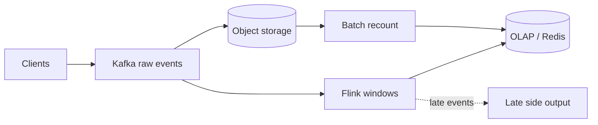

# MD-14 — Streaming Window, Watermark and Probabilistic Top-K Pipeline

> [!abstract] What this is
> How to turn an endless stream of events (clicks, views, location pings, metrics) into counts, rates and "top N" lists that are fresh within seconds: Kafka in, a stream processor (Flink, Kafka Streams) grouping events into **time windows** by event time, **watermarks** to decide when a window is complete despite late events, and **sketches** (HyperLogLog, Count-Min, heavy hitters) when exact counting would need too much memory.
>
> The defining decisions are **event time vs processing time**, **how late is too late**, and **whether the number must be exact** (billing) or only close (trending). Exact numbers usually come from a batch recount that corrects the fast stream.

---

## 1. What It Solves and Where It Appears

- Writing every event into a database and running `COUNT(*) GROUP BY` doesn't survive 100k+ events per second, and the query gets slower every minute.
- A streaming pipeline keeps running aggregates in memory, partitioned by key, and writes out only the results.

| Problem | Events | Output | Exact? |
|---|---|---|---|
| URL Shortener (#1) | redirect clicks | clicks per link per minute/day, unique visitors, top referrers | Approximate is fine for dashboards |
| Ad Click Aggregation (#27) | ad clicks and impressions | clicks per ad per minute | Exact for billing |
| Trending / Leaderboard (#20) | plays, votes, score events | top-K per window | Approximate |
| Typeahead (#11) | search queries | top prefixes per hour | Approximate |
| Surge Pricing (#28) | ride requests, driver pings per zone | demand/supply ratio per zone per minute | Approximate, but fresh |
| Metrics / Logs (#26), IoT (#36) | metric points | rollups (1 min, 1 h) | Close enough with known error |

---

## 2. Knobs

| Knob | Options | What it trades |
|---|---|---|
| Window type | tumbling, sliding (hopping), session | Simplicity vs smooth trends vs per-user activity bursts |
| Window size and slide | 10 s → 1 day | Freshness vs noise and state size |
| Time semantics | event time, processing time | Correct bucketing vs simplicity |
| Watermark delay | seconds → minutes | Completeness vs output latency |
| Allowed lateness | 0 → hours | Accepting late updates vs state kept open |
| Exactness | exact, sketch | Memory and cost vs accuracy |
| Delivery guarantee | at least once + idempotent sink, exactly once (transactions) | Simplicity vs end-to-end correctness |
| Correction path | none, batch recount | Cost vs billing-grade numbers |

---

## 3. Evolution of the Block

### Step 0 — Counter in the database

- Increment a counter row per event. Works at hundreds per second; becomes a hot row for viral keys (see counter splitting in [[MD-11 - Multi-Tier Hot-Key Shield]]).

### Step 1 — Log events, aggregate in batch

- **Trigger:** need for history and breakdowns (per referrer, per city).
- **Change:** append raw events to Kafka → object storage; an hourly or daily batch job computes aggregates. Exact, cheap, but hours stale.

### Step 2 — Stream processing with windows

- **Trigger:** freshness requirement in seconds to minutes (live dashboards, surge, trending).
- **Change:** a Flink/Kafka Streams job reads Kafka partitioned by key, keeps per-key window state, emits results to an OLAP store (ClickHouse, Druid, Pinot) or Redis.

### Step 3 — Event time and watermarks

- **Trigger:** mobile clients send events late (offline, flaky networks), so counting by arrival time puts events in the wrong minute.
- **Change:** bucket by the event's own timestamp, advance a watermark ("I believe all events up to time T have arrived"), close windows when the watermark passes, and route events that arrive after allowed lateness to a side output.

### Step 4 — Sketches for memory-bounded answers

- **Trigger:** unique counts or top-K over millions of distinct keys per window.
- **Change:** HyperLogLog for distinct counts, Count-Min Sketch for per-key frequency, a heavy-hitters structure (Space-Saving, or Count-Min plus a min-heap) for top-K.

### Step 5 — Lambda-style correction

- **Trigger:** the number is money (ad billing) or a contract, and streaming results can be slightly off (late events, duplicates, replays).
- **Change:** the stream gives fast provisional numbers; a batch job over the raw log recomputes the exact numbers for each closed day and replaces the provisional ones. The raw log in object storage is the source of truth.

---

## 4. Core Mechanics

### Window types

| Window | Definition | Example |
|---|---|---|
| Tumbling | Fixed, non-overlapping | Clicks per link per minute |
| Sliding / hopping | Fixed size, overlapping by a slide | Last 60 min, updated every 1 min (each event lands in 60 windows) |
| Session | Gap-based, per key | A user's browsing session ends after 30 min idle |

### Watermarks and lateness

- Watermark at time `W` = "events with event time < W are assumed complete".
    + A common strategy: `W = max_event_time_seen − bounded_delay` (e.g. 10 s).
- A window `[t, t+1min)` fires when `W ≥ t+1min`.
- **Allowed lateness:** keep window state for an extra period; a late event inside it updates the result and re-emits (the sink must accept updates, i.e. upserts).
- Events later than that go to a **side output** (a separate topic or table) and are folded in by the batch recount.

### Exactly-once in practice

- Flink checkpoints its state and Kafka offsets together; with Kafka transactions (or a two-phase-commit sink) results are written once per checkpoint.
- Still needed:
    + **Deduplication of client retries** by an event ID (the same click sent twice is two Kafka records). Keep a short-lived dedup state per key or use an idempotent upsert on `(event_id)`.
    + **Idempotent sinks:** write `(key, window_start) → count` as an upsert, so a replay overwrites instead of adding.

### Sketches

| Sketch | Answers | Memory | Error |
|---|---|---|---|
| HyperLogLog | How many distinct items? | ~12 KB per counter in Redis (`PFADD`/`PFCOUNT`) | ~0.81% standard error |
| Count-Min Sketch | How many times did item X occur? | width × depth counters (e.g. 2,000 × 5) | Over-counts only, bounded by ε × total |
| Space-Saving / heavy hitters | Which items are in the top K? | O(K) counters | Exact for items far above the threshold |
| Bloom filter | Have I seen this event ID? | ~10 bits per item for ~1% false positives | False positives only |

- Sketches **merge**: per-partition sketches can be combined into a global one. That's why they fit a partitioned stream.
- For top-K, compute per-partition top-K, then merge into a global top-K in a small second stage.

### Time-series storage

- Store rollups (per minute, per hour), not every raw point, for dashboards; keep raw data in object storage for recounts.
- Time-series databases use **Gorilla-style compression** (delta-of-delta timestamps, XOR of float values); Facebook's Gorilla paper reported about 1.37 bytes per data point.

---

## 5. Decision Tables

| Need | Choice | Pick when |
|---|---|---|
| Fresh counts per key | Tumbling window in Flink/Kafka Streams → OLAP upsert | Dashboards within seconds |
| Rolling "last hour" | Sliding window, or tumbling minutes summed on read | Trending, surge |
| Distinct users | HyperLogLog | Exact distinct count is too expensive |
| Top items over millions of keys | Per-partition heavy hitters + merge | Trending, top links |
| Money | Stream for preview + batch recount from raw log | Ad billing, creator payouts |
| Small scale | Kafka consumer + Redis `INCR`/`HINCRBY` per minute bucket | Under a few thousand events/s |

| Store for results | Strength | Pick when |
|---|---|---|
| Redis | Millisecond reads of small aggregates | Live counters, top-K lists |
| ClickHouse / Druid / Pinot | Fast group-by over billions of rows | Dashboards with breakdowns |
| Postgres | Simple | Low volume aggregates |
| Object storage (Parquet) | Cheap, replayable | Source of truth for recounts |

---

## 6. Numbers to Know

| Thing | Number |
|---|---|
| Kafka partition throughput | roughly tens of MB/s per partition; plan partitions for peak with headroom |
| Event size | clicks ~200–500 bytes; 100k/s × 300 B = 30 MB/s |
| HLL | ~12 KB, ~0.81% error |
| Watermark delay | 5–30 s for mobile clickstreams; allowed lateness minutes to hours |
| Raw click log | 1B clicks/day × 300 B ≈ 300 GB/day before compression |
| Dream11 | 15M+ peak concurrency in IPL 2024, edge RPM above 300M, with Kafka consumers re-engineered for that load |

---

## 7. Failure Modes

| Failure | What happens | Detect | Fix |
|---|---|---|---|
| Watermark stuck (an idle partition) | Windows never fire | Output lag; watermark not advancing | Idle-source detection; per-partition watermark timeouts |
| Late events dropped silently | Counts too low | Side-output volume | Allowed lateness; side output folded into batch recount |
| Duplicates from client retries | Counts too high | Duplicate event IDs | Dedup by event ID; idempotent upserts |
| Hot key in the stream | One task overloaded, backpressure | Per-subtask lag | Pre-aggregate locally (two-phase aggregation: salt key, aggregate, then combine) |
| State too large | Checkpoints slow, restarts slow | Checkpoint duration | Shorter windows, TTL on state, sketches |
| Consumer lag after a spike | Dashboards minutes behind | Kafka consumer lag | Scale task slots/partitions; prioritise critical streams |
| Replay double counts | Re-processing adds instead of replacing | Totals jump after a restart | Upsert by `(key, window)`; exactly-once sinks |

---

## 8. Twist Cards

- **"These counts are used to bill advertisers."**
    + Provisional numbers from the stream, final numbers from a batch recount over the raw log after the day closes, with deduplication by impression/click ID and fraud filtering in between. Invoices use only the final numbers.
- **"Users are on flaky 4G and send events minutes late."**
    + Event time with a watermark and allowed lateness; anything later goes to a side output that the recount absorbs.
- **"Show unique visitors per link."**
    + HyperLogLog per link per day (12 KB each, ~1% error), merged for longer ranges.
- **"Trending must update every 10 seconds across 50M items."**
    + Per-partition heavy hitters in 1-minute tumbling windows, summed into a sliding hour, with a small global merge stage writing the top-K to Redis.
- **"The stream processor crashed."**
    + It restarts from the last checkpoint (state plus Kafka offsets), reprocesses since then, and idempotent sinks make the replay harmless.

---

## 9. Operations and Cost

- **Watch:** consumer lag per partition, watermark delay, late-event rate, checkpoint duration and size, backpressure, output freshness (now − last window emitted), recount vs stream difference.
- **Cost:** the main drivers are raw event retention (object storage is cheap; Kafka retention is not), the stream cluster's memory for state, and OLAP storage. Sample or sketch where exactness isn't required.

---

## 10. Say It in One Minute

> "Events go to Kafka keyed by the thing being counted, and also land raw in object storage. A Flink job buckets them by event time into one-minute tumbling windows, closes a window when the watermark passes, keeps it open a little longer for late mobile events, and upserts `(key, minute) → count` so replays don't double count. Distinct users are HyperLogLog, top-K is per-partition heavy hitters merged in a second stage. If the numbers are money, the stream is only a preview: a batch recount over the raw log, with dedup by event ID, produces the final figures."

---

## Sources

- PracHub, *Ad Click Aggregator System Design: Streams, Late Events, and the Billing-Grade Recount* (2026): exactly-once as a pipeline property, impression-scoped idempotency key, reconciliation. https://prachub.com/resources/ad-click-aggregator-system-design
- Factor House, *Flink windows not firing or dropping late events* (2026): watermark mechanics and late data. https://factorhouse.io/resources/flink/troubleshooting/flink-watermarks-late-data/
- Pelkonen et al., *Gorilla: A Fast, Scalable, In-Memory Time Series Database* (VLDB 2015): ~1.37 bytes per point.
- Redis docs on HyperLogLog (`PFADD`, `PFCOUNT`): 12 KB, 0.81% standard error.
- Confluent Current Bengaluru 2025, Dream11's Kafka consumer re-engineering for IPL scale. https://current.confluent.io/post-conference-videos-2025/re-engineering-kafka-consumers-for-india-scale-dream11s-journey-to-processing-millions-of-message-bng25
- JioHotstar, *High Slope Traffic Scaling Lessons On Kubernetes* (2020): ~1 Gbps of metrics ingested at peak. https://blog.hotstar.com/ipl-2020-infrastructure-in-perspective-fe00a21963ea

## Related Notes

- [[12 - Mini Designs]]
- [[20 - Data Processing and Analytics]]
- [[07 - Async Messaging]]
- [[MD-11 - Multi-Tier Hot-Key Shield]]
