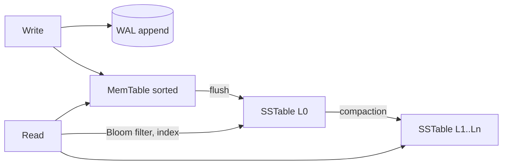

# MD-15 — Partitioned Append-Only Log and LSM Storage Engine

> [!abstract] What this is
> The storage internals behind Kafka, Cassandra, DynamoDB-style stores, RocksDB and most time-series and log systems: writes are **appended sequentially** (never updated in place), data is **partitioned** across nodes and **replicated** to a quorum, and reads are made fast with in-memory tables, sorted immutable files and indexes. Two shapes share the idea: a **partitioned log** (Kafka: consumers read by offset) and an **LSM tree** (MemTable → WAL → SSTables with compaction: point and range reads by key).
>
> The defining decisions are **partitioning and replication** (how many copies, how many must acknowledge), **how reads find data** (offsets vs key lookups through SSTables and Bloom filters), and **compaction** (reclaiming space and keeping reads fast, at the cost of background I/O).

---

## 1. What It Solves and Where It Appears

- Random in-place updates are slow on disks and wear SSDs; sequential appends are fast. Systems that take huge write rates are built around appends.
- These are the "design X itself" questions: interviewers want the internals, not "use Kafka".

| Problem | Shape | Key internals |
|---|---|---|
| Distributed Message Queue (#23) | Partitioned log | Segments, offsets, ISR, consumer groups, retention, zero-copy |
| Distributed KV Store (#24) | LSM + consistent hashing | MemTable, WAL, SSTables, Bloom filters, quorum, hinted handoff, anti-entropy |
| Metrics / Logs (#26) | Log + time-partitioned LSM | Compression, retention by time |
| Object Storage (#32) | Volumes packing many small objects | Append-only volumes, index of offsets, compaction of deleted objects |

---

## 2. Knobs

| Knob | Options | What it trades |
|---|---|---|
| Replication factor N | 3 typical | Durability vs cost |
| Write acks W / read R | `W + R > N` for overlap | Consistency vs latency and availability |
| Kafka `acks` + `min.insync.replicas` | `acks=all`, min ISR 2 | Durability vs availability when replicas lag |
| Segment / SSTable size | MBs to GBs | Fewer files vs finer retention and compaction |
| Compaction strategy | size-tiered, leveled, time-window | Write amplification vs read amplification vs space |
| Retention | time, size, compaction by key | Storage vs replay window |
| Fsync policy | per write, batched, rely on replication | Latency vs durability on power loss |

---

## 3. Evolution of the Block

### Step 0 — One append-only file

- Every write appends `(key, value)`; an in-memory hash map points each key to its latest offset (Bitcask-style). Fast writes, fast reads, but all keys must fit in memory and the file grows forever.

### Step 1 — Segments and compaction

- Roll the file into segments; background compaction rewrites old segments keeping only the latest value per key (or dropping expired data). Kafka does time/size retention per segment, or **log compaction** that keeps the latest record per key.

### Step 2 — LSM tree for large key spaces

- **Trigger:** keys don't fit in memory; range scans needed.
- **Change:** writes go to a WAL (for durability) and a sorted in-memory MemTable; when it's full, it's flushed as an immutable sorted **SSTable**. Reads check MemTable, then SSTables newest to oldest, using per-SSTable **Bloom filters** to skip files that can't contain the key and sparse indexes to find the block. Compaction merges SSTables.

### Step 3 — Partitioning and replication

- **Trigger:** one machine's disk or throughput isn't enough; must survive node loss.
- **Change:**
    + Kafka: topics split into partitions; each partition has a leader and followers; the **in-sync replica set (ISR)** is followers caught up with the leader. With `acks=all` and `min.insync.replicas=2`, a write is acknowledged only when at least two replicas have it.
    + Dynamo-style KV: consistent hashing with virtual nodes assigns key ranges to N replicas; writes need W acks, reads R responses; `W + R > N` means a read overlaps the latest write.

### Step 4 — Repair and membership

- **Trigger:** replicas drift after failures.
- **Change:** hinted handoff (a neighbour holds writes for a down node and replays later), read repair (fix stale replicas seen during reads), and anti-entropy with Merkle trees (compare range hashes to find and sync differences cheaply). Membership via gossip or a controller (Kafka now uses KRaft instead of ZooKeeper).

---

## 4. Core Mechanics

### Why Kafka is fast

- Sequential appends to segment files; reads are sequential too.
- The OS page cache serves recent data from memory.
- **Zero-copy** (`sendfile`) sends bytes from the page cache to the socket without copying through user space.
- Batching and compression per batch on the producer.

### Kafka durability, precisely

- `acks=all` waits for the **current ISR**, which can shrink to just the leader if followers lag. That's why `min.insync.replicas=2` (with replication factor 3) matters: if ISR drops below 2, writes are rejected instead of silently having one copy.
- Consumers track **offsets** per partition per consumer group; ordering is guaranteed only within a partition, so key messages by the entity that needs ordering.

### LSM amplification

| Amplification | Meaning | Who suffers |
|---|---|---|
| Write | Bytes written to disk per byte of user data (compaction rewrites) | Leveled compaction |
| Read | SSTables checked per read | Size-tiered compaction |
| Space | Disk used vs live data | Size-tiered, before compaction |

- Leveled: low read and space amplification, high write amplification (read-heavy workloads).
- Size-tiered: low write amplification, more read and space overhead (write-heavy).
- Time-window: for time-series with TTL; whole old windows are dropped.

### Quorum examples (N = 3)

| W | R | Behaviour |
|---|---|---|
| 2 | 2 | Overlap guaranteed; tolerates one node down for both reads and writes |
| 3 | 1 | Fast reads, writes fail if any replica is down |
| 1 | 1 | Fastest, may read stale |

- Even with `W + R > N`, sloppy quorums (writing to substitute nodes during failures) and concurrent writes mean you still need conflict handling: last-write-wins by timestamp, or vector clocks / version vectors with application merge.

---

## 5. Decision Tables

| Need | Pick |
|---|---|
| Ordered stream, replay by offset, many consumers | Partitioned log (Kafka) |
| Huge write rate, key lookups, tunable consistency | LSM KV (Cassandra, DynamoDB-style) |
| Strong consistency per key with leader election | Raft-replicated KV (etcd for small data, TiKV/CockroachDB for large) |
| Many small blobs | Append-only volumes + offset index (Haystack-style) |

---

## 6. Numbers to Know

| Thing | Number |
|---|---|
| Sequential disk writes | hundreds of MB/s per disk; SSD random writes far slower in comparison |
| Kafka partition | tens of MB/s writes per partition in practice; thousands of partitions per cluster |
| Replication factor | 3 with min ISR 2 is the standard durable setting |
| Bloom filter | ~10 bits per key for ~1% false positives |
| Merkle tree repair | compares range hashes, transfers only differing ranges |

---

## 7. Failure Modes

| Failure | What happens | Detect | Fix |
|---|---|---|---|
| ISR shrinks to leader | `acks=all` means one copy | Under-replicated partitions | `min.insync.replicas=2` so writes fail instead |
| Unclean leader election | Lost acknowledged messages | Config audit | Disable unclean election for important topics |
| Compaction falls behind | Reads slow, disk fills | Pending compaction bytes | More I/O, tune strategy, throttle writes |
| Hot partition | One broker overloaded | Per-partition bytes in | Better key, more partitions (plan for ordering impact) |
| Tombstones pile up | Slow range reads | Tombstone scans | Proper TTL strategy, timely compaction |
| Replica divergence | Stale reads | Read repair counts | Anti-entropy with Merkle trees |
| Consumer lag | Delayed processing, retention deletes unread data | Lag vs retention | Scale consumers; alert well before retention |

---

## 8. Twist Cards

- **"Guarantee no acknowledged message is ever lost."**
    + Replication factor 3, `acks=all`, `min.insync.replicas=2`, unclean leader election off, idempotent producer.
- **"Strict order for all of a user's events."**
    + Key by user ID so they land in one partition; accept that one partition caps that user's throughput.
- **"Make the KV store strongly consistent."**
    + `W + R > N` gives overlap but not linearisability under concurrent writes; for real strong consistency use a leader per range with Raft.
- **"Store logs for a year cheaply."**
    + Tiered storage: recent segments on local disk, older segments offloaded to object storage, read back on demand.

---

## 9. Operations and Cost

- **Watch:** under-replicated partitions, ISR shrink/expand rate, consumer lag, disk usage per broker/node, compaction backlog, p99 produce/fetch latency, read/write amplification.
- **Cost:** disks and replication (N copies), plus cross-AZ traffic for replication. Retention and tiered storage are the main levers.

---

## 10. Say It in One Minute

> "Both Kafka and LSM stores win by appending sequentially. Kafka splits a topic into partitions of segment files, serves recent data from page cache with zero-copy, and with replication factor 3, `acks=all` and min ISR 2, an acknowledged write exists on at least two brokers. An LSM KV writes to a WAL and a sorted MemTable, flushes immutable SSTables, uses Bloom filters to skip files on reads and compaction to merge them; data is spread with consistent hashing to N replicas, and `W + R > N` makes reads overlap writes, with hinted handoff, read repair and Merkle-tree anti-entropy healing drift."

---

## Sources

- Confluent docs, *Kafka Replication and Committed Messages*. https://docs.confluent.io/kafka/design/replication.html
- Netdata, *Kafka min.insync.replicas misconfigured* (2026): ISR can shrink to the leader under `acks=all`. https://www.netdata.cloud/guides/kafka/kafka-min-insync-replicas-misconfigured/
- Conduktor, *Kafka min.insync.replicas Explained* (2026). https://www.conduktor.io/kafka/kafka-topic-configuration-min-insync-replicas
- DeCandia et al., *Dynamo: Amazon's Highly Available Key-value Store* (SOSP 2007): consistent hashing, quorums, hinted handoff, Merkle trees.
- O'Neil et al., *The Log-Structured Merge-Tree* (1996); Kleppmann, *Designing Data-Intensive Applications*, ch. 3 and 5.

## Related Notes

- [[12 - Mini Designs]]
- [[07 - Async Messaging]]
- [[24 - Cassandra and DynamoDB]]
- [[01 - Storage Engine and Disk IO]]
- [[10 - Distributed Building Blocks]]
- [[MD-20 - Partitioning Shard Keys and Resharding]]
