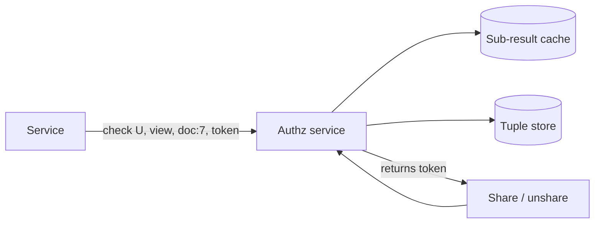

# MD-17 — ReBAC Authorisation Graph and Consistent Cache (Zanzibar)

> [!abstract] What this is
> How to answer "can user U do action A on object O?" when permissions come from relationships: U is an editor of a folder, the folder contains the document, U is in a group that owns the project, the project belongs to an org. Permissions are stored as **relation tuples** (`object#relation@subject`), a small schema says how relations imply each other, and a **check** walks the graph. Caches make it fast; **consistency tokens** make sure a cache never answers with permissions older than the change the user just made.
>
> The defining decisions are **the schema of relations** (what implies what), **how deep inheritance can go** (folders inside folders), and **how fresh a check must be** (the "new enemy" problem: removing someone's access must take effect before they see new content).

---

## 1. What It Solves and Where It Appears

- Role-based access (RBAC: user → role → permissions) breaks down when permissions depend on the object: sharing one document, inheriting from a folder, a team owning a project.
- ACL lists copied onto every object explode when a folder with a million files is shared.
- Google's Zanzibar handles Drive, YouTube, Calendar and Cloud with relation tuples; the paper reports trillions of ACLs, millions of checks per second, p95 under 10 ms and over 99.999% availability. SpiceDB and OpenFGA are open-source implementations of the model.

| Problem | Relations |
|---|---|
| Drive / file sharing (#15) | `doc#viewer@user`, `doc#parent@folder`, viewer of folder ⇒ viewer of doc |
| Access Control system (#34) | The whole problem |
| Jira / multi-tenant SaaS (#35) | `project#member@group`, `issue#project@project`, org admins |
| Document-ACL filtered RAG (#A2) | Only retrieve chunks the asking user can view |
| Resource Sharing ACL (vault problem 08) | Grants, inheritance vs materialisation |

---

## 2. Knobs

| Knob | Options | What it trades |
|---|---|---|
| Model | RBAC, ABAC (attributes/policies), ReBAC (tuples) | Simplicity vs expressiveness |
| Inheritance | none, bounded depth, unbounded | Power vs check cost |
| Evaluation | walk at check time, precomputed (materialised) | Write cost vs read cost |
| Consistency | eventual, at-least-as-fresh-as token, fully consistent | Latency vs "new enemy" safety |
| Cache | per-check results, subproblem results, group memberships | Hit rate vs invalidation complexity |
| List filtering | check each result, "lookup resources" query, prefilter in search | Correctness vs performance for list views |

---

## 3. Evolution of the Block

### Step 0 — Role column / RBAC

- `users.role` or `user_roles(user, role, scope)`; checks are table lookups. Fine for admin/member/viewer per tenant.

### Step 1 — Per-object grants

- **Trigger:** users share individual objects.
- **Change:** `grants(object, subject, relation)`; check = "is there a grant for U or one of U's groups on O".

### Step 2 — Inheritance via parent relations

- **Trigger:** folders, projects, orgs.
- **Change:** tuples for `doc#parent@folder:X`; schema rule "viewer of parent ⇒ viewer". Check walks up parents (bounded depth), unions group memberships.

### Step 3 — Dedicated authorisation service with cache and consistency tokens

- **Trigger:** many services need the same checks; checks dominate request latency.
- **Change:** a central authz service (Zanzibar-style, SpiceDB/OpenFGA) storing tuples, with caching of sub-results. Every permission write returns a **consistency token** (Zanzibar calls it a zookie, a snapshot timestamp). Content writes store the token next to the content; checks on that content are evaluated at a snapshot **at least as fresh** as the token, so a cache can serve anything newer but never older.

### Step 4 — Listing and search

- **Trigger:** "show all documents I can see" or search results filtered by permission.
- **Change:** a "lookup resources" query for small sets; for search, index the groups/principals allowed on each document as a filter field, then re-check the final page.



---

## 4. Core Mechanics

### Tuples and schema

```
doc:7#parent@folder:3
folder:3#editor@user:asha
folder:3#viewer@group:finance#member
group:finance#member@user:ravi

definition doc {
  relation parent: folder
  relation viewer: user | group#member
  relation editor: user | group#member
  permission view = viewer + editor + parent->view
  permission edit = editor + parent->edit
}
```

- `check(user:ravi, view, doc:7)` → doc viewers? no → editors? no → parent folder:3 → view = viewer + editor → viewer includes `group:finance#member` → ravi is a member → **allowed**.

### Consistency and the "new enemy" problem

- Asha removes Ravi from a folder, then adds a confidential document. If a stale cache still says Ravi can view the folder, he sees the new document.
- Fix: the content write carries the token from **after** the ACL change, and checks on that content use a snapshot ≥ token. Caches keyed by snapshot can still serve most checks; only checks needing a newer snapshot go deeper.

### Making checks fast

- Cache group membership expansions and sub-checks (`folder:3#view@user:ravi` at snapshot T).
- Bound inheritance depth and fan-out (e.g. max 10 levels, max groups per user).
- Precompute ("materialise") hot, wide relations (a company-wide group with 100k members) into a flat index updated asynchronously, used only when the token allows.

### Tuple storage

```
tuples(namespace, object_id, relation, subject_type, subject_id, subject_relation,
       created_txn, deleted_txn)          -- versioned for snapshot reads
PRIMARY KEY (namespace, object_id, relation, subject_type, subject_id, subject_relation, created_txn)
index on (subject_type, subject_id) for reverse lookups
```

---

## 5. Decision Tables

| Model | Strength | Pick when |
|---|---|---|
| RBAC | Simple, auditable | Few roles per tenant; permissions not per object |
| ABAC (policy engine, e.g. OPA) | Rules on attributes (time, region, department) | Policies over attributes, not relationships |
| ReBAC (Zanzibar-style) | Sharing, inheritance, groups | Docs/files/projects with sharing and nesting |
| Hybrid | ReBAC for objects + ABAC conditions | Enterprise products |

| Evaluation | Pick when |
|---|---|
| Walk at check time with caches | Default |
| Materialised permissions | Very read-heavy, relations change rarely, can accept async lag |

---

## 6. Numbers to Know

| Thing | Number |
|---|---|
| Zanzibar | trillions of ACLs, millions of checks/s, p95 < 10 ms, > 99.999% availability |
| Check budget in a request | a few ms; many requests need several checks |
| Typical inheritance depth | 3–10 levels |
| Cache hit rate target | > 90% for sub-checks |

---

## 7. Failure Modes

| Failure | What happens | Detect | Fix |
|---|---|---|---|
| Stale cache after revoke | Removed user sees new content | Security review, tests | Consistency tokens on content; snapshot-aware cache |
| Deep or cyclic inheritance | Slow or infinite checks | Check latency, depth metrics | Depth limits, cycle detection on writes |
| Huge groups | Expansion slow | Group size | Materialise big groups; nested groups with limits |
| Authz service down | Every request fails | Error rate | Replicas; cached decisions with short TTL for reads; fail closed for writes |
| List views leak or are slow | Wrong items shown, or N checks per page | Latency, audits | Prefilter in index + recheck final page |
| Tenant isolation bug | Cross-tenant access | Audits | Tenant ID in every object ID and every check |

---

## 8. Twist Cards

- **"Share a folder with a million files with a team."**
    + One tuple: `folder#viewer@group:team#member`. No per-file writes; inheritance does the rest.
- **"Revoke must take effect immediately."**
    + Consistency tokens: content created after the revoke is checked at a snapshot that includes the revoke. For existing content, invalidate cached sub-results for that folder.
- **"Search results must only show what I can see."**
    + Index allowed principals on each document as a filter, then re-check the final page with the authz service.
- **"RAG over company docs must not leak."**
    + Same: filter retrieval by the user's principals, and re-check every chunk's document before it goes into the prompt.

---

## 9. Operations and Cost

- **Watch:** check latency and rate, cache hit rate, tuple write rate, depth and fan-out distributions, denied vs allowed ratios, audit log completeness.
- **Cost:** checks are on the hot path of nearly every request, so the authz service needs the same availability as the product; caching is the main cost lever.

---

## 10. Say It in One Minute

> "Permissions are relation tuples like `doc#parent@folder` and `folder#viewer@group#member`, with a schema saying view = viewer + editor + parent's view. A check walks that graph with depth limits and cached sub-results. Every permission change returns a consistency token, content written afterwards stores it, and checks on that content must use a snapshot at least that fresh, so a revoked user can't see anything created after the revoke. Lists and search prefilter by indexed principals and re-check the final page."

---

## Sources

- Pang et al., *Zanzibar: Google's Consistent, Global Authorization System* (USENIX ATC 2019): trillions of ACLs, millions of checks/s, p95 < 10 ms, > 99.999% availability, zookies. https://research.google/pubs/zanzibar-googles-consistent-global-authorization-system/
- AuthZed, *The Google Zanzibar Paper, annotated* and SpiceDB docs. https://zanzibar.tech/ · https://authzed.com/docs/spicedb/concepts/zanzibar
- OpenFGA, *What is Google Zanzibar?* (2026). https://openfga.dev/docs/learn/zanzibar
- *Beware of the New Enemy Problem* (dev.to, 2025). https://dev.to/sohan26/beware-of-the-new-enemy-problem-180m

## Related Notes

- [[12 - Mini Designs]]
- [[18 - Security]]
- [[08 - Resource Sharing ACL]]
- [[MD-12 - CDC-to-Inverted-Index and Real-Time Sidecar Merger]]
