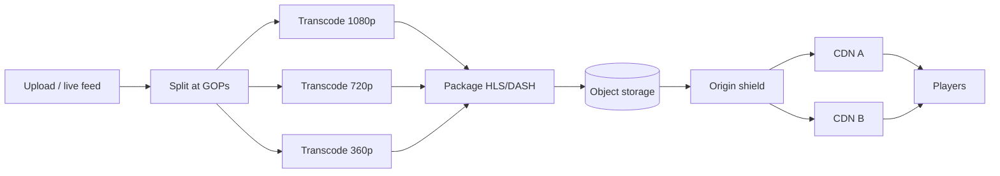

# MD-18 — Media Transcoding DAG and Adaptive Bitrate Edge Pipeline

> [!abstract] What this is
> How uploaded or live video becomes something every phone can play smoothly: the source is split into segments at keyframe (GOP) boundaries, a **DAG of jobs** transcodes each segment in parallel into a **bitrate ladder** (several resolutions and bitrates), packages them as **HLS/DASH** with manifests, and a CDN serves the small segment files. The player picks a rung every few seconds based on measured bandwidth (**adaptive bitrate**).
>
> The defining decisions are **the ladder** (which renditions, how far apart), **segment length** (latency vs efficiency), and for live, **how to fan out to tens of millions** without the origin seeing them (multi-CDN, origin shield, cacheable manifests).

---

## 1. What It Solves and Where It Appears

- A single 4K file can't play on a 2 Mbps phone, and a phone switching from Wi-Fi to 4G needs to drop quality without stopping.
- Transcoding one long movie serially takes hours; splitting into segments and transcoding in parallel takes minutes. JioHotstar wrote about scaling its transcoding pipeline roughly 10x with parallel, recoverable processing.
- For live sports, the video path must be separate from the API path: viewers download segments from CDN edges and almost never touch origin servers. JioHotstar serves live matches across multiple CDNs with failover between them.

| Problem | Use |
|---|---|
| YouTube / VOD (#13) | Upload → transcode DAG → ladder → CDN |
| JioHotstar live sports (#13 live) | Live ingest → real-time encode → short segments → multi-CDN |
| Reels / Stories (#18) | Short videos, fast publish, few renditions first, more later |
| Netflix-style catalog | Per-title encoding to save bandwidth |

---

## 2. Knobs

| Knob | Options | What it trades |
|---|---|---|
| Ladder | 4–8 rungs, 144p → 4K, rungs ~1.5–2× apart | Quality and smooth switching vs encode cost and storage |
| Codec | H.264, HEVC, AV1 | Compatibility vs bandwidth savings vs encode cost |
| Segment length | 2–6 s (LL-HLS parts ~0.5 s) | Latency vs request count and encode efficiency |
| Keyframe interval | ~2 s, aligned across renditions | Switching smoothness vs compression |
| Encoding mode | fixed ladder, per-title, per-shot | Simplicity vs bandwidth savings |
| Publish strategy | all renditions before publish, or low rungs first | Time to publish vs initial quality |
| CDN | one, multi-CDN with steering | Cost vs resilience at peak |
| DRM | none, Widevine/FairPlay/PlayReady | Rights compliance vs complexity |

---

## 3. Evolution of the Block

### Step 0 — One worker, one file

- Upload completes → one FFmpeg job produces renditions serially. Fine for short clips. Slow for long content and fragile (a crash restarts everything).

### Step 1 — Split, parallel transcode, stitch

- **Trigger:** long videos, publish-time targets.
- **Change:** split the source at GOP boundaries into chunks (e.g. 10–60 s), fan out one job per (chunk × rendition), then package. A failed chunk retries alone.

### Step 2 — DAG orchestration

- **Trigger:** more steps: inspection, thumbnails, subtitles, audio tracks, DRM, quality checks, content moderation.
- **Change:** a workflow/DAG engine runs dependent steps: `inspect → split → [transcode × ladder] → package → DRM → QC → publish`, with retries per node and checkpointing ([[MD-10 - Partitioned Time-Bucket Job Scheduler and Leased Worker Pool]] for workers).

### Step 3 — ABR packaging and CDN

- **Trigger:** playback on varied networks.
- **Change:** HLS (and DASH) manifests listing renditions; segments in object storage; CDN in front with long TTLs for segments (immutable) and short TTLs for live playlists.

### Step 4 — Live pipeline

- **Trigger:** live events.
- **Change:** contribution feed (SRT/RTMP) → live encoder producing the ladder in real time → packager writes segments and updates playlists every segment → origin with shield → multiple CDNs; redundant encoders in two regions so one failing doesn't stop the stream.

### Step 5 — Peak survival and cost

- **Trigger:** tens of millions concurrent.
- **Change:** multi-CDN steering by real-time quality, lower default rung under pressure (a slightly lower-resolution match beats a buffering one), pre-warmed capacity, per-title encoding for VOD.



---

## 4. Core Mechanics

### Bitrate ladder (illustrative H.264)

| Rung | Resolution | Bitrate |
|---|---|---|
| 1 | 256×144 | ~0.15 Mbps |
| 2 | 426×240 | ~0.3 Mbps |
| 3 | 640×360 | ~0.7 Mbps |
| 4 | 854×480 | ~1.2 Mbps |
| 5 | 1280×720 | ~2.5 Mbps |
| 6 | 1920×1080 | ~5 Mbps |

- Keep rungs 1.5–2× apart so switches are visible but not jarring, and align keyframes across rungs so the player can switch at any segment boundary.

### Latency budget (live)

```
encode + package ~1–2 s
segment duration ~2–6 s (player usually buffers ~3 segments)
CDN + network    ~0.5–1 s
standard HLS: ~10–30 s behind live; LL-HLS with ~0.5 s parts: ~2–5 s
```

- Sports apps often choose a few seconds more latency in exchange for fewer stalls at peak; spoilers via push notifications are the reason to keep it low.

### Storage math (VOD)

```
1 hour at ~10 Mbps total across the ladder ≈ 10 × 3600 / 8 ≈ 4.5 GB per hour of content
100k hours of catalog ≈ 450 TB, before multiple codecs
```

### Manifests and caching

- Segments are immutable: cache for days.
- Live playlists change every segment: cache for about one segment duration (or less), and use an origin shield so millions of playlist requests become a handful per second at origin.

---

## 5. Decision Tables

| Codec | Pick when |
|---|---|
| H.264 | Default for compatibility |
| HEVC | Better compression on supported devices (TVs, iOS) |
| AV1 | Big bandwidth savings at high encode cost; for popular content |

| Encoding | Pick when |
|---|---|
| Fixed ladder | Simple, fast publish |
| Per-title | Large catalogs where bandwidth dominates cost |
| Low rungs first, rest later | User-generated video that must be playable quickly |

---

## 6. Numbers to Know

| Thing | Number |
|---|---|
| HLS segment | 2–6 s typical; LL-HLS parts ~0.5 s |
| Keyframe interval | ~2 s |
| Ladder spacing | ~1.5–2× bitrate between rungs |
| JioHotstar live peaks | tens of millions concurrent (59M in Nov 2023; 65.2M reported later) |
| Mobile 720p | ~2–3 Mbps |

---

## 7. Failure Modes

| Failure | What happens | Detect | Fix |
|---|---|---|---|
| One chunk fails to transcode | Video stuck in processing | DAG node failures | Retry the chunk only; checkpoint |
| Misaligned keyframes | Glitches on rendition switch | QC step | Force aligned GOPs |
| Live encoder dies | Stream stops | Ingest health | Redundant encoders in two regions, automatic switch |
| CDN degradation at peak | Buffering for a region | Player QoE beacons (rebuffer ratio) | Multi-CDN steering, lower default rung |
| Playlist stampede at origin | Origin overload | Origin RPS | Origin shield, short but non-zero playlist TTL |
| DRM licence service down | Nobody can start playback | Licence errors | Replicated licence servers; cache licences per session |

---

## 8. Twist Cards

- **"The IPL final: 60 million viewers, and everyone joins when a star walks out to bat."**
    + Video never hits the API path: segments from multiple CDNs, origin shield, pre-warmed capacity, and an automatic lower default bitrate if CDN capacity tightens. Non-video features degrade first.
- **"Uploads must be watchable within a minute."**
    + Transcode 360p and 720p first and publish, then fill in other rungs in the background.
- **"Cut bandwidth cost by 30%."**
    + Per-title encoding and HEVC/AV1 for the most-watched titles, where the encode cost pays back quickly.
- **"Reduce live latency so push notifications don't spoil the match."**
    + LL-HLS with partial segments, shorter player buffer, and accept a slightly higher stall risk.

---

## 9. Operations and Cost

- **Watch:** transcode queue time and failures, time to publish, encode cost per hour of content, CDN hit ratio, origin RPS, player QoE (startup time, rebuffer ratio, average bitrate, playback failures).
- **Cost:** CDN egress dominates for popular content; encode compute dominates for long-tail content. Per-title encoding and codec choice trade one against the other.

---

## 10. Say It in One Minute

> "Uploads go straight to object storage, then a DAG splits the source at keyframes and transcodes each chunk into a ladder of about six renditions in parallel, retrying failed chunks alone, packages HLS/DASH with aligned keyframes, applies DRM and publishes. Segments are immutable and cached at the CDN for days; live playlists are cached for about a segment behind an origin shield. Live adds redundant encoders and multiple CDNs with steering, and under peak pressure the default bitrate drops before anything buffers."

---

## Sources

- JioHotstar engineering, *Innovations in high-quality transcoding: Hotstar's tale of 10x scale up* (2023). https://blog.hotstar.com/innovations-in-high-quality-transcoding-hotstars-tale-of-10x-scale-up-b531f5170d5c
- *How JioHotstar Served 65.2 Million Live Viewers at Once* (2026): video path separate from API path, ABR ladder, HLS segments, multi-CDN failover. https://oolooroo.substack.com/p/how-jiohotstar-served-652-million
- BlazingCDN, *Adaptive Bitrate Streaming Best Practices* (2026): rungs 1.5–2× apart, LL-HLS parts ~0.5 s, 2–3 s behind live. https://blog.blazingcdn.com/en-us/cdn-stream-optimization-adaptive-bitrate-low-latency-hls
- Dacast, *HLS Encoder Settings & Bitrate Ladder* (2026): ~6 s segments, ~2 s keyframes. https://dacast.com/blog/encoder-settings-hls-live-streaming/

## Related Notes

- [[12 - Mini Designs]]
- [[Netflix HLD]]
- [[04 - Load Balancing CDN and Gateway]]
- [[MD-03 - Presigned Direct-to-Blob Multipart and Chunk Sync Engine]]
- [[MD-10 - Partitioned Time-Bucket Job Scheduler and Leased Worker Pool]]
