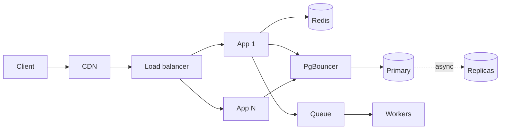

# MD-19 — Baseline Scaling Path

> [!abstract] What this is
> The generic moves almost every system makes between V0 (one app box, one database) and the point where it needs sharding: a stateless app tier behind a load balancer, connection pooling, cache-aside, read replicas, a CDN, and pushing slow work onto a queue.
>
> The defining decision is **which resource is actually saturating**: app CPU, DB connections, DB read IOPS, DB write throughput, or egress bandwidth. Each move fixes exactly one of these. Applying them in the wrong order adds boxes without removing the bottleneck.

---

## 1. What It Solves and Where It Appears

- Every V0 in this vault is the same shape: client → one app server → one Postgres. It works until one resource hits its ceiling.
- This MD is the ordered list of the cheap fixes, before anything that changes the data model (sharding is [[MD-20 - Partitioning Shard Keys and Resharding]]; regions are [[MD-21 - Multi-Region Replication and Disaster Recovery]]).
- Problem notes cite it as "V1: apply MD-19 step X" and then give their own numbers.

| Problem | How it uses this block |
|---|---|
| URL Shortener | Read path dominates (redirects 100:1 over creates). Cache-aside on `code`, replicas rarely needed because the cache absorbs reads. CDN/edge caching of 302s is a twist. |
| Seat Booking | Browse path (seat map) gets cache + CDN; the hold path must stay on the primary. Replicas only serve "my bookings". |
| News Feed, Product Catalog | Replicas + cache on read models; CDN for media. |
| Payments, Wallet | Pooling and async offload matter; caching balances is mostly forbidden. |
| Any CRUD on your resume | The "scale this" follow-up is exactly this ladder. |

---

## 2. Knobs

Each knob trades freshness, cost, or complexity for headroom on one resource.

| Knob | Range | What it trades |
|---|---|---|
| App replicas | 2 → hundreds | Cost vs CPU headroom. Needs statelessness first. |
| Pool size per app pod | 5–50 DB connections | Too high multiplies into thousands of PG backends; too low queues requests in the app. |
| Cache TTL | seconds → days | Freshness vs hit rate. Immutable data can have long TTL plus delete-on-write. |
| Cache hit-rate target | 80–99% | Each 1% at high QPS is a lot of DB load: at 50k QPS, 95% → 2.5k DB reads/s, 99% → 500/s. |
| Replica count | 1–5 per primary | Read headroom vs replication lag and cost. |
| Read routing | primary / replica / "read-your-writes" | Correctness vs offload. |
| CDN TTL and cache key | none → hours | Origin offload vs staleness and purge cost. |
| Queue offload | sync → async | Latency the user sees vs eventual completion and a new failure mode. |

---

## 3. Evolution of the Block

The order matters. Each step names the resource it relieves and the signal that says you need it.

### Step 0 — One box, one database

- One app process, one Postgres primary, backups.
- Fine below roughly 1k requests/s of simple indexed queries, which covers most products' first year.

### Step 1 — Stateless app tier behind a load balancer

- **Trigger:** app CPU above ~60–70% at peak, or any requirement for zero-downtime deploys (you need at least two instances to deploy one at a time).
- **Change:** move sessions out of process memory (JWT or a Redis session store), put an L7 load balancer in front, run N identical instances, autoscale on CPU or request rate.
- **Trade-off:** you now need health checks, graceful shutdown (drain in-flight requests), and anything stored on local disk has to move to S3.
- Details of LB algorithms and health checks: [[04 - Load Balancing CDN and Gateway]].

### Step 2 — Connection pooling

- **Trigger:** `app_pods × pool_size` approaches Postgres `max_connections`, or PG CPU is high with many idle backends. Each Postgres backend is a process using several MB, so a few thousand connections is already a problem.
- **Change:** a transaction-mode pooler (PgBouncer, or RDS Proxy) between app and DB; small per-pod pools.
- **Trade-off:** transaction-mode pooling breaks session features (session-level prepared statements, advisory locks held across transactions, `SET` without `LOCAL`).
- Size the pool with Little's law: connections needed ≈ DB QPS × average query time. 2,000 QPS × 5 ms = 10 busy connections. Pools are usually far bigger than needed.

### Step 3 — Cache-aside on the hot read path

- **Trigger:** read QPS in the thousands on a small set of rows, or DB read latency rising with CPU.
- **Change:** Redis in front of the read path: read cache → on miss read DB → set with TTL. On write, update DB then **delete** the key.
- **Trade-off:** a second copy that can be stale; a new dependency that must fail open (fall back to DB, with a limiter so the DB isn't trampled).
- Full mechanics, invalidation races and the delete-not-update rule: [[06 - Caching]]. Hot single keys are a separate problem: [[MD-11 - Multi-Tier Hot-Key Shield]].

### Step 4 — Read replicas

- **Trigger:** reads that can't be cached (varied queries, per-user lists, reports) push the primary's CPU or IOPS, typically past a few thousand QPS.
- **Change:** 1–3 async replicas; route read-only queries to them; keep anything that must see its own write on the primary.
- **Trade-off:** **replication lag**. Normally milliseconds, seconds under load, minutes during a long query or vacuum. Name it out loud and say which reads tolerate it.
- Read-your-writes options: route the user to the primary for N seconds after they write, or pass the commit LSN and only read from a replica that has replayed past it. Replication internals: [[08 - Replication]].

### Step 5 — CDN and edge caching

- **Trigger:** egress bandwidth or static/media traffic. Example: 3k QPS × 1 MB images = 3 GB/s, which no app tier should serve.
- **Change:** static assets and media served from object storage behind a CDN; public, identical-for-everyone `GET` responses cached at the edge with short TTLs.
- **Trade-off:** purges are slow and best-effort; never put private data at the edge.

### Step 6 — Async offload

- **Trigger:** a request does slow work the user doesn't need to wait for (emails, thumbnails, analytics events, webhooks to third parties), or a dependency is slower than your latency target.
- **Change:** write the intent, return, and let workers process it from a queue (Kafka, SQS, RabbitMQ). Use the outbox pattern if the DB write and the publish must both happen.
- **Trade-off:** eventual completion, retries, duplicates (consumers must be idempotent), and a queue to monitor. See [[07 - Async Messaging]].

### Step 7 — Vertical headroom before sharding

- **Trigger:** writes approach a single primary's ceiling.
- **Change:** bigger instance, faster disks, fewer indexes, batching, partitioning large tables by time, archiving cold data.
- **Exit:** when the write rate or data size still outgrows one primary, move to [[MD-20 - Partitioning Shard Keys and Resharding]].



---

## 4. Core Mechanics

### What "stateless" really means

- Nothing a later request needs lives only in one pod's memory or disk.
    + Sessions: JWT (verify locally, revoke via short expiry plus a deny list) or a Redis session store.
    + Uploads: straight to S3 via presigned URLs, not via local disk.
    + In-process caches are allowed only for data that is safe to lose and safe to be slightly different across pods (config, feature flags, tiny hot lookups).
- WebSocket and other long-lived connections are the exception: they are stateful by nature and need their own routing layer.

### Cache-aside read and write

```
read(key):
    v = redis.GET(key)
    if v: return v
    v = db.query(key)
    redis.SET(key, v, EX=ttl + random_jitter)   # jitter avoids synchronized expiry
    return v

write(key, new):
    db.update(key, new)        # source of truth first
    redis.DEL(key)             # delete, never write the new value
```

- Negative caching: cache "not found" for a short TTL so missing keys don't hit the DB on every request (and to stop enumeration from punching through).
- The race that still exists: reader misses, reads old value, writer updates DB and deletes key, reader sets the old value. TTL bounds it; delete-twice (delete again after a short delay) or versioned values close it.

### Read routing

| Read | Where | Why |
|---|---|---|
| Right after the user's own write | Primary (or LSN-aware replica) | Read-your-writes |
| Money, inventory, holds | Primary | Correctness |
| Lists, history, search filters | Replica | Tolerates seconds of lag |
| Reports, exports | Dedicated replica or warehouse | Long queries must not stall the primary |

---

## 5. Decision Tables

### Which step first

| Symptom | Step | Pick when |
|---|---|---|
| App CPU high, DB fine | 1 (more app pods) | The app is the bottleneck |
| DB "too many connections" | 2 (pooler) | Many pods, small queries |
| Same rows read repeatedly | 3 (cache) | Read-heavy and repeat reads |
| Varied reads, primary CPU high | 4 (replicas) | Reads can't be cached and tolerate lag |
| Bandwidth bill, media | 5 (CDN) | Payloads are large and public |
| Slow third-party calls in request path | 6 (queue) | The user doesn't need the result now |
| Writes saturate the primary | 7 then MD-20 | Write-heavy growth |

### Session state

| Option | Cost | Pick when |
|---|---|---|
| JWT | Hard to revoke instantly | Default for APIs; short expiry plus refresh token |
| Redis session store | One Redis read per request | You need instant logout or server-side session data |
| Sticky sessions | Uneven load, lost sessions on pod death | Only for legacy apps or WebSockets |

---

## 6. Numbers to Know

These are ballparks for in-region traffic on commodity cloud instances. Say "roughly".

| Thing | Number |
|---|---|
| Redis GET in the same region | ~0.2–1 ms; one instance does ~100k+ simple ops/s |
| Postgres indexed point read | ~1–5 ms in-region; a well-sized primary does several thousand to tens of thousands of simple reads/s |
| Postgres sustained simple writes on one primary | low thousands/s comfortably; tens of thousands with batching and few indexes |
| Postgres connection | each backend is a process, several MB of memory; keep active connections in the low hundreds |
| Async replica lag | ms normally; seconds under load; can spike much higher during long transactions |
| CDN hit | single-digit to tens of ms from an Indian metro edge |
| Cross-region RTT inside India (Mumbai ↔ Hyderabad/Chennai) | ~20–30 ms |

The vault's thresholds for when each step kicks in are in [[16 - Estimation and Decision Cheat Sheet]].

---

## 7. Failure Modes

| Failure | What happens | Detect | Fix |
|---|---|---|---|
| Redis down | Every read goes to the DB at once | Cache error rate, DB QPS spike | Fail open with a concurrency limit on DB fallbacks; serve stale from in-process cache for the hottest keys |
| Mass expiry (same TTL on many keys) | Synchronized misses, DB spike every TTL | Periodic DB spikes | TTL jitter; refresh-ahead for hot keys |
| Replica lag spike | Users don't see their own changes; double submits | `replay_lag` metric | Read-your-writes routing; stop routing to lagging replicas |
| Pool exhaustion | Requests queue in the app, latency climbs, timeouts | Pool wait time | Find the slow query; timeouts on acquire; don't just raise the pool size |
| Retry storm after a blip | Clients and pods retry together, turning a blip into an outage | Request rate > organic rate | Exponential backoff with jitter, retry budgets, circuit breakers ([[08 - Reliability]]) |
| Autoscaling too slow for a step spike | Pods arrive after the spike has already broken things | Spike shape vs scale-up time | Pre-scale on known events (match start, sale start); keep headroom |
| Queue backlog | Async work delayed by hours | Consumer lag | Scale consumers, shed low-priority work, alert on age of oldest message |

---

## 8. Twist Cards

- **"Traffic is 10x for the IPL final / sale hour, starting in one minute."**
    + Reactive autoscaling won't make it. Pre-scale before the known event (JioHotstar and Dream11 both scale ahead of matches rather than reacting), pre-warm caches, and switch off non-critical features with flags so the core path keeps its capacity.
- **"The cache cluster just died."**
    + Fail open, but cap concurrent DB fallbacks per pod; serve stale from an in-process copy for the top keys; shed non-critical reads.
- **"A user updated their profile and still sees the old one."**
    + That's replica lag or a stale cache. Read-your-writes routing for that user for a few seconds after a write, and delete-on-write for their cache keys.
- **"Can we just add more replicas?"**
    + Only if the bottleneck is reads that tolerate lag. Replicas don't help writes, and each one adds replication load on the primary.
- **"Cut infra cost by 40%."**
    + Raise cache hit rate (cheapest DB offload), right-size pools and pods, move cold data to object storage, use spot/preemptible capacity for async workers, and CDN-cache anything public.

---

## 9. Operations and Cost

- **Golden signals per tier:** request rate, error rate, p50/p99 latency, saturation (CPU, pool wait, connections, replica lag, queue age).
- **Alerts that matter:** cache hit rate drop, replica lag above the threshold your reads tolerate, pool wait time, oldest message age in each queue.
- **Main cost drivers:** database instance size (the most expensive box to scale), egress bandwidth (solved by the CDN), and idle headroom kept for spikes.

---

## 10. Say It in One Minute

> "V0 is one app and one Postgres. Before touching the data model I scale by whichever resource saturates. App CPU: make the tier stateless and add pods behind a load balancer. Connections: PgBouncer in transaction mode. Repeated reads: Redis cache-aside, delete on write, TTL with jitter, and fail open with a limit. Varied reads: async replicas, with read-your-writes on the primary because of lag. Big public payloads: CDN. Slow side effects: outbox to a queue. Only when writes outgrow one primary do I shard, and for known spikes like a match start I pre-scale instead of trusting autoscaling."

---

## Sources

- Hello Interview, *Delivery Framework* (accessed 2026-10-24): latency ballparks for cache, DB and web server hops. https://www.hellointerview.com/learn/system-design/in-a-hurry/delivery
- JioHotstar engineering, *Scaling Infrastructure for Millions* parts 1 and 2 (2024–2025): ~25M concurrency on two self-managed Kubernetes clusters, pre-planned scaling. https://blog.hotstar.com/scaling-infrastructure-for-millions-from-challenges-to-triumphs-part-1-6099141a99ef
- Write-ups on Hotstar's degradation under peak load (turning off recommendations, personalisation and other non-critical features via flags). https://iq.opengenus.org/deal-with-traffic-spike/
- Dream11 engineering, *Observability at scale* (2021): prediction-based scaling, scaling out before matches. https://d11engg.medium.com/observability-at-scale-how-we-built-a-cutting-edge-dream11-monitoring-ecosystem-c3ac8cfeca1
- Confluent Current Bengaluru 2025, Dream11 talk: 15M+ peak concurrency in IPL 2024, edge RPM above 300M. https://current.confluent.io/post-conference-videos-2025/re-engineering-kafka-consumers-for-india-scale-dream11s-journey-to-processing-millions-of-message-bng25

## Related Notes

- [[12 - Mini Designs]]
- [[04 - Load Balancing CDN and Gateway]]
- [[06 - Caching]]
- [[08 - Replication]]
- [[07 - Async Messaging]]
- [[08 - Reliability]]
- [[16 - Estimation and Decision Cheat Sheet]]
- [[MD-11 - Multi-Tier Hot-Key Shield]]
- [[MD-20 - Partitioning Shard Keys and Resharding]]
- [[MD-21 - Multi-Region Replication and Disaster Recovery]]
