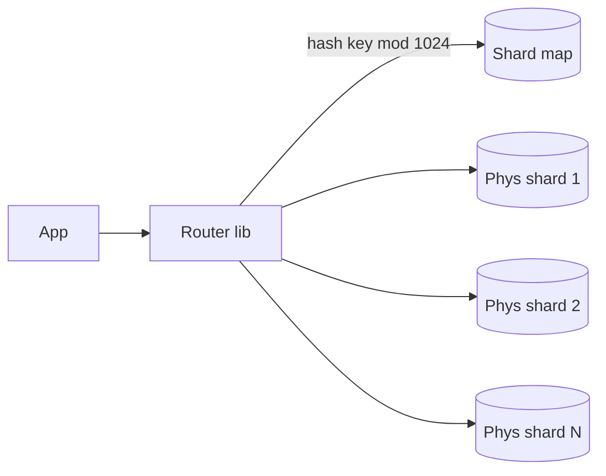

# MD-20 — Partitioning, Shard Keys and Online Resharding

> [!abstract] What this is
> What you do when one primary can no longer hold the writes or the data: split the data across many databases by a **shard key**, route every query to the right shard, and later move data between shards without downtime.
>
> The defining decision is the **shard key**. It must match the dominant access pattern (so most queries hit one shard), spread load evenly (no hot shard), and keep the rows that must change together in one transaction on the same shard. Everything else in this note is consequences of that choice.

---

## 1. What It Solves and Where It Appears

- After [[MD-19 - Baseline Scaling Path]] runs out (caches and replicas don't help writes; a bigger box has a ceiling), you partition.
- Partitioning shows up in almost every V2 or V3 of a large problem. The interviewer's real question is always "what's your shard key, and what breaks with it?"

| Problem | Shard key | Why |
|---|---|---|
| URL Shortener | `code` (hash) | Redirect is a point lookup by code; codes are random so load is even |
| Seat Booking | `show_id` (or `event_id`) | One booking touches seats of one show; the transaction stays on one shard |
| Chat | `conversation_id` | Messages of a conversation are read and ordered together |
| Wallet / Ledger | `account_id` | A balance and its entries change together |
| Multi-tenant SaaS (Jira) | `tenant_id` | Tenant isolation and queries scoped to a tenant |
| Time-series, logs | `(source_id, time bucket)` | Writes spread across sources, reads by range |

---

## 2. Knobs

| Knob | Options | What it trades |
|---|---|---|
| Key | entity ID, tenant ID, composite | Locality of the main query vs evenness of load |
| Strategy | hash, range, directory (lookup table), geo | Even spread vs range scans vs flexible placement |
| Logical shard count | fixed, e.g. 256–4,096 | Fine-grained moves later vs routing table size |
| Physical shard count | starts small, grows | Cost vs headroom |
| Replication per shard | 1 primary + N replicas | Durability and read capacity vs cost |
| Cross-shard policy | forbid, scatter-gather, async read model | Simplicity vs query flexibility |

---

## 3. Evolution of the Block

### Step 0 — Partition inside one database first

- **Trigger:** one table is huge (hundreds of millions of rows), but write QPS fits one primary.
- **Change:** native table partitioning (Postgres declarative partitioning by time or hash). Old partitions are detached and archived; indexes stay small.
- **Why first:** no routing layer, no distributed transactions, and it fixes vacuum and index bloat on giant tables.

### Step 1 — Vertical split by domain

- **Trigger:** different domains (users, orders, analytics) compete for the same primary.
- **Change:** separate databases per domain or service. No resharding logic yet; just fewer tables per box.
- **Cost:** joins across domains become API calls or async read models.

### Step 2 — Horizontal sharding with logical shards

- **Trigger:** sustained writes above what one primary handles (low tens of thousands/s even with batching), or data in the multi-TB range per table with growth.
- **Change:** pick a shard key, hash it into a **fixed number of logical shards** (for example 1,024), and map logical shards to a smaller number of physical databases through a routing table.
    + Notion did exactly this: 480 logical shards on 32 Postgres instances in 2021, then moved to 96 instances in 2023 by moving logical shards, without changing the hash.
- **Why logical shards:** adding capacity becomes "move some logical shards to new machines", not "rehash everything".

### Step 3 — Online resharding

- **Trigger:** physical shards hit their limit, or one is hot.
- **Change:** move logical shards to new hosts with a copy → catch-up → cutover procedure (Section 4).

### Step 4 — Hot-shard handling

- **Trigger:** one key (a celebrity, a mega tenant, a viral event) dominates one shard.
- **Change:** split that key's data (key salting for counters, a dedicated shard for a mega tenant, or a different data structure for that entity). Hot reads go to [[MD-11 - Multi-Tier Hot-Key Shield]].



---

## 4. Core Mechanics

### Routing

```
logical = hash(shard_key) mod L          # L fixed forever, e.g. 1024
physical = shard_map[logical]            # small table, cached in every app pod
conn = pool[physical]
```

- The router lives either in the app (a library, like Notion) or in a proxy (Vitess `vtgate`, Citus coordinator).
- The shard map is tiny (L rows), cached in memory, and versioned so a move can flip it atomically.
- Use a stable hash (murmur, xxhash), never a language's built-in hash, which can differ between runtimes.

### Hash vs consistent hashing

- With **fixed logical shards plus a map**, you never need consistent hashing at the DB layer: the logical count never changes, only the map.
- **Consistent hashing** (a ring with virtual nodes) is the right tool when nodes join and leave often and there is no central map, as in caches (Redis Cluster uses 16,384 hash slots, which is the same idea as logical shards) and Dynamo-style stores. See [[10 - Distributed Building Blocks]].

### Online resharding (move a logical shard)

1. **Copy:** snapshot the logical shard's rows to the target.
2. **Catch up:** stream changes from the source (CDC from the WAL/binlog) to the target until lag is near zero. Vitess does this with VReplication.
3. **Verify:** row counts and checksums per range; optionally shadow-read from the target and compare.
4. **Cutover:** briefly block writes for that logical shard (seconds), apply the last changes, flip the shard-map entry, unblock.
5. **Keep a way back:** reverse replication for a while so you can flip back.
6. **Clean up:** delete the moved rows from the source after a safety period.

The alternative is **application dual-write** (write to old and new, backfill, compare, then switch reads). It's simpler to explain but it has a gap: a write that succeeds on one side and fails on the other. CDC-based moves avoid that because there is one write path.

### Cross-shard operations

| Need | Approach |
|---|---|
| Query not by shard key (e.g. "bookings by user" when sharded by show) | A secondary index table sharded by the other key, kept up to date asynchronously (CDC), or a search/read store |
| Aggregate across shards | Scatter-gather with limits, or precompute in a stream/warehouse |
| Transaction across shards | Avoid by key choice; otherwise a saga ([[MD-06 - Distributed Saga and Compensating State Machine]]); 2PC only inside one database product that supports it |
| Global uniqueness (e.g. custom alias) | Make the unique field the shard key, or a dedicated uniqueness table sharded by that field |
| Unique IDs | Not DB sequences: [[MD-16 - Time-Sortable ID and Token Generator]] |

---

## 5. Decision Tables

### Strategy

| Strategy | Strength | Weakness | Pick when |
|---|---|---|---|
| Hash | Even spread | No range scans across shards | Point lookups by ID (default) |
| Range | Range scans, easy splits | Hot ranges (latest time, sequential IDs) | Time-ordered data with time-bounded queries, and the newest range isn't overloaded |
| Directory (lookup) | Place any key anywhere | Lookup on every request (cache it) | Mega tenants, geo pinning, uneven tenants |
| Geo | Data residency, locality | Users who move; cross-region queries | Residency rules or region-local products |

### Key choice

| Candidate | Good | Bad | Pick when |
|---|---|---|---|
| User ID | Per-user queries on one shard | Cross-user features scatter | Social, wallet, profiles |
| Tenant ID | Isolation, simple queries | One giant tenant becomes a hot shard | B2B SaaS, with a directory override for big tenants |
| Entity ID (show, order, conversation) | The transaction stays local | Queries by user need a secondary index | Booking, chat, orders |
| Time | Easy retention | All writes hit the latest shard | Only combined with a second dimension |

---

## 6. Numbers to Know

| Thing | Number |
|---|---|
| Logical shards | a few hundred to a few thousand; Notion used 480 |
| Redis Cluster hash slots | 16,384 |
| Comfortable data per Postgres primary | a few TB with good indexes; past that, vacuum and backups slow down |
| Cutover write pause per logical shard | seconds when done with CDC catch-up |
| Scatter-gather cost | latency = slowest shard; with 100 shards, the p99 of the fan-out is roughly the p99.99 of one shard |

---

## 7. Failure Modes

| Failure | What happens | Detect | Fix |
|---|---|---|---|
| Hot shard | One shard's CPU pinned while others idle | Per-shard QPS/CPU skew | Split or move that logical shard; salt hot counters; directory override for the hot tenant |
| Bad key | Most queries scatter to all shards | Fan-out ratio per query | Add a secondary index table, or re-key (expensive, plan it as a migration) |
| Shard map stale in a pod | Writes go to the old shard after a move | Writes rejected by the old shard (fencing by map version) | Version the map; old shard rejects writes for moved ranges |
| Partial failure in scatter-gather | Request fails because one of 100 shards is slow | Tail latency | Timeouts, partial results where acceptable, hedged requests |
| Cross-shard invariant broken | Two shards disagree after a failed multi-step write | Reconciliation job | Saga with compensations; re-key so the invariant is single-shard |
| Resharding bug | Lost or duplicated rows | Checksums, row-count comparison | Verify before cutover, keep reverse replication for rollback |

---

## 8. Twist Cards

- **"One tenant is 40% of all traffic."**
    + Directory-based placement: give it its own physical shard (or several, sharded by a second key inside the tenant). Everyone else stays hashed.
- **"Now we need to query by a field that isn't the shard key."**
    + Build a second table sharded by that field, populated by CDC, accepting seconds of lag; or send the query to a search store. Never scatter on a hot path.
- **"Add 3x capacity during peak season without downtime."**
    + Move logical shards to new physical hosts ahead of the season (copy, catch up, cutover per shard). Because the logical count is fixed, nothing is rehashed.
- **"Why not consistent hashing for the database?"**
    + Fixed logical shards plus a map give the same "move a small piece" property with an explicit, auditable placement. Consistent hashing shines where membership churns without a coordinator, like caches.
- **"A transaction must update two shards."**
    + First try to change the key so it doesn't. If it truly can't, make it a saga with idempotent steps and compensations, and say what users might see in between.

---

## 9. Operations and Cost

- **Watch:** per-shard QPS, CPU, storage and replication lag (skew is the signal, not the average); fan-out ratio per endpoint; size of the largest tenants.
- **Run:** schema changes become fleet-wide rollouts (online DDL per shard, one at a time); backups and restores are per shard; resharding is a routine, rehearsed operation.
- **Cost:** sharding multiplies fixed costs (N primaries, N × replicas). Delay it with MD-19 until the numbers force it, and say so in the round.

---

## 10. Say It in One Minute

> "I shard only when writes or data outgrow one primary. The shard key follows the main transaction, here `show_id`, so a booking is one shard and one local transaction. I hash into a fixed 1,024 logical shards mapped to a few physical databases, so growing means moving logical shards with copy, CDC catch-up and a seconds-long cutover, never rehashing. Queries by other fields go to a secondary index table fed by CDC. A hot key gets salted or its own shard, and anything that crosses shards becomes a saga rather than a distributed transaction."

---

## Sources

- Notion, *Herding elephants: lessons learned from sharding Postgres at Notion* (2021) and *The Great Re-shard* (2023): 480 logical shards on 32 instances, later 96, application-level routing. https://www.notion.com/blog/sharding-postgres-at-notion · https://www.notion.com/blog/the-great-re-shard
- Notion, *Building and scaling Notion's data lake* (2024): 32 instances × 15 logical shards, then 96 × 5. https://www.notion.so/blog/building-and-scaling-notions-data-lake
- Vitess docs, *Reshard*, *MoveTables* and *How traffic is switched* (VReplication cutover). https://vitess.io/docs/23.0/reference/vreplication/internal/cutover/
- Discord hot-partition write-up (Engineering at Scale, 2023). https://engineeringatscale.substack.com/p/how-discord-solved-hot-partition-problem

## Related Notes

- [[12 - Mini Designs]]
- [[09 - Sharding]]
- [[08 - Replication]]
- [[10 - Distributed Building Blocks]]
- [[MD-19 - Baseline Scaling Path]]
- [[MD-11 - Multi-Tier Hot-Key Shield]]
- [[MD-06 - Distributed Saga and Compensating State Machine]]
- [[MD-16 - Time-Sortable ID and Token Generator]]
