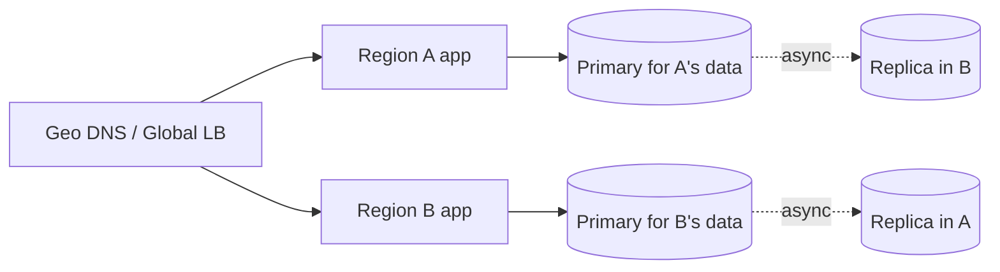

# MD-21 — Multi-Region, Replication Topology and Disaster Recovery

> [!abstract] What this is
> How a system survives losing a whole region and serves users from more than one: active-passive vs active-active, how data is replicated between regions, how traffic is routed and failed over, and how much data you're allowed to lose (**RPO**) and for how long you may be down (**RTO**).
>
> The defining decision is **which data needs one writer and which can accept writes anywhere**. Money, inventory and uniqueness need a single home per record; counters, likes, sessions and caches can be written in every region. Everything else follows from that split, plus the speed of light between regions.

---

## 1. What It Solves and Where It Appears

- "What if `ap-south-1` goes down?" is a standard senior follow-up. So is "serve users in another country with low latency".
- For Indian companies there's a regulatory twist: RBI's 2018 circular requires the **entire payment system data to be stored only in India**, so payment systems put both primary and DR inside India (for example Mumbai and Hyderabad on AWS, Mumbai and Delhi on GCP, Pune and Chennai on Azure).

| Problem | Data that needs one writer | Data that can be multi-writer | Typical shape |
|---|---|---|---|
| URL Shortener | Code creation (uniqueness), custom aliases | Click counts | Redirects served active-active everywhere; creates go to the home region or use region-partitioned ID ranges |
| Seat Booking | Seat holds, bookings, payments | Browse caches, seat-map snapshots | Active-passive for the booking DB, per-event home region; browse active-active |
| Payments / Wallet | Ledger, balances | Analytics | Active-passive inside India, RPO≈0 via synchronous replica in-region plus async cross-region |
| Chat | Per-conversation order | Presence, typing | Conversation pinned to a home region |
| Global consumer apps | User profile (one home) | Feeds, caches | Geo-partitioned by user home region |

---

## 2. Knobs

| Knob | Options | What it trades |
|---|---|---|
| Topology | single region multi-AZ, active-passive, active-active read, active-active write | Cost and complexity vs RTO and latency |
| Replication | synchronous, semi-synchronous, async | RPO 0 vs write latency (adds a cross-region round trip) |
| RPO target | 0, seconds, minutes | Data loss on failover vs write latency |
| RTO target | seconds, minutes, hours | Automation and warm capacity vs cost |
| Write placement | one global primary, per-record home region, anywhere | Simplicity vs latency vs conflicts |
| Conflict resolution | none (single writer), last-write-wins, CRDTs, app merge | Correctness vs availability |
| Routing | DNS (latency/geo, health checks), anycast, global LB | Failover speed vs control |
| Standby warmth | backup-and-restore, pilot light, warm standby, hot | Cost vs RTO |

---

## 3. Evolution of the Block

### Step 0 — One region, multiple availability zones

- App across 2–3 AZs, database primary in one AZ with a **synchronous standby** in another (RDS Multi-AZ, Patroni). Survives a data-centre failure with RPO≈0 and a failover of tens of seconds to a couple of minutes.
- This is the right default for most products. Say so before adding regions.

### Step 1 — Backups and a cold DR region

- **Trigger:** must survive a full region loss, but hours of RTO are acceptable.
- **Change:** continuous backups (WAL archiving / snapshots) copied to a second region; infrastructure as code to rebuild there. RPO minutes, RTO hours.

### Step 2 — Warm standby (active-passive)

- **Trigger:** RTO must be minutes.
- **Change:** an async cross-region replica of every database, a scaled-down app tier in the DR region, DNS or global LB failover with health checks. Promote the replica on failover. RPO = replication lag at the moment of failure (seconds).

### Step 3 — Active-active for reads

- **Trigger:** users far from the primary region need low-latency reads.
- **Change:** read replicas and caches in each region serve reads locally; writes go to the primary region. Read-your-writes needs routing the writer back to the primary for a short time.

### Step 4 — Geo-partitioned writes (home region per record)

- **Trigger:** write latency to a far primary is unacceptable, or residency rules require data to stay in a country.
- **Change:** each user/tenant/event has a **home region** where its records are written; requests are routed there. Each region is primary for its partition and a replica for others'. No conflicts, because every record has one writer.

### Step 5 — Multi-writer for conflict-tolerant data

- **Trigger:** some data must be writable everywhere even during a partition (counters, likes, presence, carts).
- **Change:** multi-region-writable stores (DynamoDB global tables, Cassandra multi-DC, CRDT-based stores) with explicit conflict rules: counters as CRDT increments, sets as add/remove CRDTs, last-write-wins only where losing a concurrent update is acceptable.

---

## 4. Core Mechanics

### RPO and RTO

- **RPO (recovery point objective):** how much recently committed data you can lose. Async replication → RPO = lag at failure. Synchronous → 0, at the cost of a round trip on every commit.
- **RTO (recovery time objective):** how long until service is back. Driven by detection time + decision + promotion + DNS/LB convergence + cache warm-up.

### Failover runbook (active-passive)

1. **Detect:** health checks from several vantage points; avoid failing over on a blip (require several minutes of confirmed failure, or a human decision for the database).
2. **Fence the old primary:** make sure it can't accept writes if it comes back (revoke its credentials, stop its instances, or rely on a lease/epoch the clients check). Without fencing you get **split brain**: two primaries accepting writes.
3. **Promote** the replica in the DR region.
4. **Redirect traffic:** DNS (keep TTL low, 30–60 s, and remember some clients ignore TTLs) or a global load balancer.
5. **Reconcile:** writes that reached the old primary but not the replica (the RPO gap) are found from the old primary's WAL when it's recoverable, and replayed or handled manually.
6. **Fail back** later, deliberately, as its own planned operation.

### Routing users to their home region

- Store `home_region` in the user/tenant record and in the auth token.
- The edge reads it and routes; a request landing in the wrong region is proxied or redirected to the right one.
- Global uniqueness (usernames, custom aliases) needs a single owner for that namespace, or a region prefix in the key.

### Conflict handling for multi-writer data

| Data | Conflict rule |
|---|---|
| Counters (likes, views) | CRDT G-counter / PN-counter: each region keeps its own count, total = sum |
| Sets (cart items, tags) | OR-set: add wins over concurrent remove, or the reverse, as a product decision |
| Profile fields | Last-write-wins by hybrid logical clock; acceptable for display names, not for balances |
| Money, inventory | Not multi-writer. One home per record. |

---

## 5. Decision Tables

| Topology | RPO | RTO | Cost | Pick when |
|---|---|---|---|---|
| Multi-AZ, one region | ~0 | 1–2 min | 1× | Default |
| Backup and restore to another region | minutes–hours | hours | ~1.1× | Region loss is unlikely and tolerable |
| Pilot light (data replicated, little compute) | seconds | tens of minutes | ~1.3× | Regulated but cost-sensitive |
| Warm standby | seconds | minutes | ~1.5× | Payments, bookings with an RTO in minutes |
| Active-active reads, single write region | seconds | minutes (writes) | ~2× | Global reads, writes tolerate one region |
| Geo-partitioned active-active | seconds per partition | seconds (other partitions unaffected) | ~2×+ | Global writes, residency, very low RTO |

| Replication | Write latency | Pick when |
|---|---|---|
| Synchronous within region (across AZs) | +~1 ms | Always for important data |
| Synchronous across regions | + cross-region RTT (~20–30 ms Mumbai ↔ Hyderabad) | RPO must be 0 across regions and write volume is moderate |
| Async across regions | none | Default; RPO = seconds |

---

## 6. Numbers to Know

| Thing | Number |
|---|---|
| Intra-region cross-AZ RTT | ~1 ms |
| Mumbai ↔ Hyderabad / Chennai / Delhi | ~20–35 ms |
| Mumbai ↔ Singapore | ~50–60 ms |
| Mumbai ↔ US East | ~180–200 ms |
| Async replication lag | sub-second normally, seconds under load |
| DNS failover | TTL (30–60 s) + health-check interval + clients that cache longer |
| Multi-AZ DB failover | ~1–2 minutes on managed Postgres |

---

## 7. Failure Modes

| Failure | What happens | Detect | Fix |
|---|---|---|---|
| Split brain | Two primaries accept writes; divergent data | Writes on both sides | Fencing (leases, epochs, revoke the old primary); never automatic DB failover without fencing |
| Data loss on async failover | Last seconds of writes missing | Compare old primary WAL when it returns | Accept as RPO; reconcile; sync replication for the data that can't lose anything |
| Failover on a blip | Unnecessary failover, then a messy failback | Flapping health checks | Require sustained failure; human-in-the-loop for databases |
| DR region can't take the load | Failover succeeds, then everything falls over | DR drills | Keep warm capacity or pre-approved scale-up; drill quarterly |
| DNS clients ignore TTL | Some users stuck on the dead region | Traffic still arriving at the old region | Global anycast LB; clients with multiple endpoints |
| Shared dependency in one region | "Multi-region" system fails because auth or a config store is single-region | Dependency map | Every critical dependency must be multi-region too |
| Residency violation | Personal or payment data copied abroad | Data inventory audit | Region-pinned storage, encryption, logs scrubbed before export |

---

## 8. Twist Cards

- **"Mumbai region is down. Walk me through the next ten minutes."**
    + Health checks confirm the outage, the on-call (or automation) fences the old primary, promotes the Hyderabad replica, flips the global LB, and scales the warm app tier. Say the RPO you just accepted and how the gap is reconciled.
- **"We need RPO 0 for payments."**
    + Synchronous replication to a standby: inside the region across AZs always; across regions only if write latency can absorb ~25 ms per commit. Many fintechs do sync in-region plus async to the DR region and reconcile the tiny gap from bank and NPCI records.
- **"Expand to the Middle East and Southeast Asia."**
    + Geo-partition by user home region. Data residency rules decide which records may leave India; payment data stays in India under RBI rules, so cross-border flows read through APIs, not replicated tables.
- **"Make it active-active."**
    + First split the data: money, inventory and unique names keep one writer per record (home region); counters, carts and presence can be multi-writer with CRDT rules. "Active-active everything" is not a design.
- **"How do you know DR works?"**
    + Regular game days: fail over a real region on a schedule, measure actual RTO and RPO, and fix what broke.

---

## 9. Operations and Cost

- **Watch:** cross-region replication lag, health of every region from external probes, DR capacity headroom, DNS/LB failover time in drills, residency audit results.
- **Cost:** a warm standby roughly doubles database spend and adds cross-region data transfer charges; active-active doubles most of the stack. The cheapest real resilience is multi-AZ plus tested backups, and the round should hear that you'd start there.

---

## 10. Say It in One Minute

> "My default is one region across three AZs with a synchronous standby, which survives a data-centre loss with no data loss. For a region outage I keep a warm standby in a second Indian region, because RBI requires payment data to stay in India: async replicas, a scaled-down app tier, global LB failover, and fencing of the old primary before promotion so we never get two primaries. RPO is the replication lag, a few seconds, reconciled from partner records. If we need writes in several regions, I give every record a home region so there's one writer, and only conflict-tolerant data like counters or presence is multi-writer with CRDTs."

---

## Sources

- RBI circular DPSS.CO.OD No.2785/06.08.005/2017-18, *Storage of Payment System Data* (6 April 2018), and the RBI FAQ clarification (June 2019) as summarised by The Hindu and Treelife (2026). https://www.thehindu.com/business/payments-data-must-be-saved-locally-rbi/article28159408.ece · https://treelife.in/compliance/data-localisation-in-india/
- Google Cloud, *Data localisation and RBI guidelines* (whitepaper). https://services.google.com/fh/files/misc/gcp_data_localization_rbi_guidelines.pdf
- AWS Architecture Blog, *Disaster Recovery Architecture on AWS, Part IV: Multi-site Active/Active* (2021). https://aws.amazon.com/blogs/architecture/disaster-recovery-dr-architecture-on-aws-part-iv-multi-site-active-active/
- AWS Route 53 docs, *Active-active and active-passive failover*. https://docs.aws.amazon.com/Route53/latest/DeveloperGuide/dns-failover-types.html
- Latency figures are typical published inter-region round-trip times for Indian cloud regions; treat them as ballparks.

## Related Notes

- [[12 - Mini Designs]]
- [[08 - Replication]]
- [[17 - Consistency Time and Consensus]]
- [[08 - Reliability]]
- [[19 - Deployment and Infrastructure]]
- [[MD-19 - Baseline Scaling Path]]
- [[MD-20 - Partitioning Shard Keys and Resharding]]
